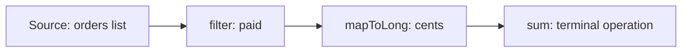

# Java Stream API: The Big Picture

**Java · Streams · Step 13.2.1 · Series overview** · Last updated 2026-10-21
**Prerequisites:** [Java language and platform: the big picture](../01-java-overview.md) (13.1)

Read this first. It is the map of the Streams series: what a stream is, why it exists, when to prefer a plain loop, and the order to learn the topics in.

## 1. The concept in simple English

**What is it?** A **stream** is a way to describe a computation over a sequence of elements as a **pipeline** of steps, such as "keep the paid orders, take their amounts, add them up". The steps run only when you ask for a final result.

**Why do we need it?** A loop mixes *what* you want with *how* to get it (index, accumulator variable, `if`). A pipeline states the *what* step by step, so it is easier to read, to change and, when it is safe, to run in parallel.

**When would I meet it?** Processing collections, reading lines of a file, turning entities into DTOs, grouping and summarising data, and any code review that says "why not a stream?".

> [!TIP]
> **Memory hook:** a conveyor belt with a start button. Items pass through stations one at a time, nothing moves until you press start, and the belt can run only once.

## 2. Mental model: a conveyor belt

| In the analogy | In the Stream API |
|---|---|
| The crate of items | The **source** (a list, an array, a file) |
| A station that sorts or relabels items | An **intermediate operation** (`filter`, `map`) |
| The packing station at the end | The **terminal operation** (`toList`, `sum`) |
| Pressing the start button | Calling the terminal operation |

**Where the analogy breaks:** a real belt carries physical items you could put back. A stream stores nothing and can't be rewound: the documentation says a stream "is not a data structure that stores elements" and that elements are visited only once.

## 3. Industry terms

| Term | Simple meaning | Why it matters | Example | Related terms |
|---|---|---|---|---|
| **Stream** | A one-time flow of elements through a pipeline | The object you build the pipeline on | `orders.stream()` | Collection |
| **Pipeline** | Source, zero or more intermediate operations, one terminal operation | The unit of reasoning | `filter → map → sum` | Lazy |
| **Intermediate operation** | A step that returns another stream | Describes work, doesn't do it | `filter`, `map` | Terminal operation |
| **Terminal operation** | The step that produces a result or effect and starts the run | Without it, nothing runs | `toList`, `sum`, `forEach` | Short-circuiting |
| **Lazy** | Work happens only when the terminal operation runs | Explains surprising behaviour | `peek` prints nothing alone | Eager |
| **Lambda / method reference** | A function passed to a step | What each station does | `o -> o.cents()` | Functional interface |
| **Collector** | A recipe for gathering results | Used with `collect` | `groupingBy` | Reduction |
| **Parallel stream** | A stream that may split work across threads | Powerful and easy to misuse | `parallelStream()` | Fork/join |

## 4. In a real system (ShopFlow)

**The business problem.** Finance asks the Order Service for the total of all paid orders and the list of customers who paid.

The loop version needs an accumulator, an `if`, and a separate loop for the customers. The stream version states each step in order and reads like the request. Both give the same totals (run on Java 21.0.8, 22,500 cents and customers `[ana, cy]` for four sample orders).

```java
long total = orders.stream()
    .filter(o -> o.status().equals("PAID"))
    .mapToLong(Order::cents)
    .sum();                       // terminal operation: starts the run
```

**What it costs.** Pipelines are harder to step through in a debugger, wrong use of side effects or parallelism creates subtle bugs, and for simple work a loop can be shorter and clearer.

## 5. How it works



1. You create a stream from a source.
2. You chain intermediate operations; each returns a new stream and does no work yet.
3. You call a terminal operation; only now does the source start producing elements.
4. Elements flow through the stations one at a time, and the result comes out of the terminal operation.
5. The stream is now used up; start again from the source for another run.

The next notes take this apart ([13.2.2](02-pipeline-laziness.md) first).

## 6. Architectural decisions

| Use a stream when | Prefer a loop when |
|---|---|
| The work is "filter, transform, gather" over a sequence | You need several outputs from one pass with shared mutable state |
| Each step is a small, pure function | The logic has complex early exits or checked exceptions in every step |
| You may later gather results with a collector | A plain loop is shorter and equally clear |

**Versions.** These notes use Java 21. `Stream.toList()` needs Java 16, `takeWhile` and `dropWhile` need Java 9, and custom intermediate operations (Stream Gatherers) became final in Java 24. **Common mistakes:** forgetting the terminal operation; reusing a stream; putting side effects in `map`; using parallel streams by reflex.

## 7. Notes in this series, in learning order

### Fundamentals

| Step | Topic | Prerequisites | Status |
|---|---|---|---|
| 13.2.1 | This overview | 13.1 | Done |
| 13.2.2 | [The pipeline: source, operations and laziness](02-pipeline-laziness.md) | 13.2.1 | Done |
| 13.2.3 | Transforming and filtering: `map`, `filter`, `flatMap`, `sorted`, `limit` | 13.2.2 | Planned |
| 13.2.4 | Terminal operations and `Optional` | 13.2.2 | Planned |

### Intermediate

| Step | Topic | Prerequisites | Status |
|---|---|---|---|
| 13.2.5 | Collectors: `groupingBy`, `toMap`, `partitioningBy`, `teeing` | 13.2.4 | Planned |
| 13.2.6 | Primitive streams and boxing | 13.2.3 | Planned |
| 13.2.7 | Lambdas in pipelines: statelessness, side effects, exceptions | 13.2.2 | Planned |

### Advanced

| Step | Topic | Prerequisites | Status |
|---|---|---|---|
| 13.2.8 | Parallel streams: when they help and when they hurt | 13.2.7 | Planned |
| 13.2.9 | Streams versus loops in production code | 13.2.7 | Planned |
| 13.2.10 | Custom stages: Stream Gatherers | 13.2.7 | Planned |

## 8. Check your understanding

1. You build `orders.stream().filter(...).map(...)` and never call a terminal operation. What happens?
2. Why can't you call two terminal operations on the same stream?
3. When would you keep a loop instead of rewriting it as a stream?

Answers are at the end of this note.

## 9. Revision

**Remember**
- **Source → intermediate operations → one terminal operation.**
- **Nothing runs until the terminal operation.**
- **A stream stores nothing and is used once.**
- **A stream is not automatically better than a loop.**

**Explain in 15 seconds:** "A stream describes a computation over a sequence as a lazy pipeline that runs when you call a terminal operation."

**Explain in 60 seconds:**
> "A stream is a pipeline over a source: intermediate operations like filter and map describe the work, and nothing happens until a terminal operation such as toList or sum starts it. Elements flow through the steps one at a time, the stream stores nothing and can be used once. That makes pipelines readable for filter-transform-gather work, but they need stateless lambdas, side effects and parallelism need care, and a simple loop is sometimes clearer."

**Architect's takeaway:** use streams to state intent when the steps are small and pure, and judge each use by its guarantees, not by how modern it looks.

**Next topic:** [The pipeline: source, operations and laziness](02-pipeline-laziness.md) (13.2.2)

## 10. Verification and sources

> [!NOTE]
> Checked 2026-10-21 against the Java SE 21 documentation and by running the ShopFlow example on OpenJDK 21.0.8. Re-verify for other versions.

- **Confirmed (Java SE 21, `java.util.stream` package summary):** a pipeline consists of a source, zero or more intermediate operations and a terminal operation; intermediate operations are lazy and traversal begins when the terminal operation runs; a stream "is not a data structure that stores elements"; the elements of a stream are visited only once. JEP 485 finalises Stream Gatherers in Java 24 (previewed in JDK 22 and 23). `Stream.toList()` is since Java 16; `takeWhile` and `dropWhile` since Java 9.
- **Observed (OpenJDK 21.0.8):** the loop and stream versions of the ShopFlow example both returned 22,500, and the customers were `[ana, cy]`.
- **Assumptions and illustrations:** the ShopFlow scenario; the planned topic list is a proposal.
- **To verify:** behaviour on Java versions other than 21.
- **Decision rule:** a stream for filter-transform-gather over a sequence with small pure steps; a loop otherwise.

**Sources:** Java SE 21 API documentation, `java.util.stream` and `Stream`; OpenJDK JEP 485.

## Answers

1. Nothing runs: intermediate operations only describe the work, so no element is read from the source and no lambda is called.
2. The first terminal operation uses the stream up; a second one throws `IllegalStateException` (shown in the next note). Get a new stream from the source instead.
3. When the logic needs shared mutable state across several outputs, complex early exits, or checked exceptions in each step, or when the loop is simply shorter and clearer.

Back to [the Java overview](../01-java-overview.md) · [Index](../../README.md) · [Roadmap](../../roadmap.md).
