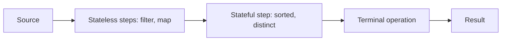

# The Stream Pipeline: Source, Operations and Laziness

**Java · Streams · Step 13.2.2 · Fundamentals** · Last updated 2026-10-21
**Prerequisites:** [Java Stream API: the big picture](01-streams-overview.md) (13.2.1)

## 1. The concept in simple English

**What is it?** A stream pipeline has three parts: a **source** that holds the data, **intermediate operations** that describe what to do, and one **terminal operation** that starts the run and produces the result. Nothing happens until the terminal operation is called, and then elements flow through the steps one at a time.

**Why do we need it?** Most surprises with streams come from one of three facts: nothing runs without a terminal operation, elements are processed one by one rather than step by step, and a stream can be used only once. Knowing them lets you predict what a pipeline does.

**When would I meet it?** The first time a `peek` prints nothing, a stream throws `IllegalStateException`, or a debugging print shows elements in an unexpected order.

> [!TIP]
> **Memory hook:** describe the belt, press start once, and the items pass through the stations one at a time.

## 2. Industry terms

| Term | Simple meaning | Why it matters | Example | Related terms |
|---|---|---|---|---|
| **Source** | Where elements come from | Decides ordering and whether the size is known | `List.stream()`, `Stream.of(...)` | Encounter order |
| **Intermediate operation** | Returns a new stream; describes work | Lazy: does nothing alone | `filter`, `map`, `sorted` | Stateless, stateful |
| **Terminal operation** | Produces a result and runs the pipeline | Starts everything; consumes the stream | `toList`, `findFirst`, `count` | Short-circuiting |
| **Lazy evaluation** | Work is deferred until a result is needed | Explains "nothing printed" | `peek` without a terminal operation | Eager |
| **Stateless / stateful operation** | Whether a step needs earlier elements | Stateful steps can hold up the flow | `filter` vs `sorted` | Barrier |
| **Short-circuiting** | A step that can finish without reading everything | Makes infinite streams usable | `limit`, `findFirst` | Infinite stream |
| **Encounter order** | The order elements are met in the source | Some operations must respect it | List order | Parallel streams |

## 3. In a real system (ShopFlow)

**The business problem.** Finance wants the total of paid orders and the paying customers, and the team wants to know that the pipeline does no wasted work.

```java
long total = orders.stream()
    .filter(o -> o.status().equals("PAID"))   // intermediate: describes
    .mapToLong(Order::cents)                  // intermediate: describes
    .sum();                                   // terminal: starts the run
```

Four sample orders (three paid, one cancelled) gave 22,500 on Java 21.0.8, the same as the equivalent loop, with the paying customers `[ana, cy]` from `filter → map → distinct → sorted → toList`. The questions this note answers: when does each lambda run, in what order, and what can go wrong?

## 4. How it works



1. **Building** the pipeline only creates objects that describe it; no lambda has run.
2. The **terminal operation** asks the source for elements.
3. Each element passes through the stateless steps **one at a time**, all the way to the end, before the next element starts.
4. A **stateful** step such as `sorted` must see all elements before it can pass any on, so everything before it runs first.
5. A **short-circuiting** operation (`findFirst`, `limit`) stops pulling as soon as the answer is known.
6. After the terminal operation the stream is **used up**.

> [!NOTE]
> Run on OpenJDK 21.0.8 (2026-10-21). The `peek` and `println` calls are only for showing the order; the documentation says `peek` exists mainly to support debugging.

| Experiment | What was printed or returned |
|---|---|
| `Stream.of(1,2,3).peek(print).map(x -> x*2)` with no terminal operation | Nothing |
| `Stream.of(1,2,3,4)` with `filter(even)` then `map(x*10)` printing each call, then `toList()` | `filter 1`, `filter 2`, `map 2`, `filter 3`, `filter 4`, `map 4`; result `[20, 40]` |
| `Stream.of(1..5).peek(pulled).filter(x > 1).findFirst()` | `pulled 1`, `pulled 2`; result `Optional[2]` |
| `Stream.of(3,1,2).peek(before).sorted().forEach(after)` | `before 3`, `before 1`, `before 2`, then `after 1`, `after 2`, `after 3` |
| Calling `count()` twice on one stream | `IllegalStateException: stream has already been operated upon or closed` |

Read the second row carefully: it is **not** "filter everything, then map everything". Each element goes through the whole pipeline before the next begins. The fourth row shows the exception: `sorted` holds everything back.

**Who guarantees what**

| Layer | Responsible for |
|---|---|
| Stream library | Deferring work, running stages per element, short-circuiting, rejecting reuse |
| Your lambdas | Being stateless and not changing the source (see below) |
| The source | Its own ordering and whether its size is known |
| You | Calling exactly one terminal operation per stream |

## 5. Failure scenarios

### Nothing happens

- **What happened?** A pipeline was built and never ended with a terminal operation.
- **Why?** Intermediate operations are lazy; the documentation says traversal of the source doesn't begin until the terminal operation runs.
- **What you see:** no output, no side effect, no error.
- **Solutions:** end every pipeline with a terminal operation; be suspicious of a "stream" statement that ends in `map` or `peek`.

### Reusing a stream

- **What happened?** A stream variable was used for two results.
- **Why?** The stream is consumed by its first terminal operation.
- **What you see:** `IllegalStateException: stream has already been operated upon or closed` (observed on Java 21.0.8).
- **Solutions:** keep the source, not the stream, and create a new stream for each result.

### Relying on `peek` or on side effects

- **What happened?** `peek` printed for some elements and not others, or didn't run at all.
- **Why?** Short-circuiting operations stop early. For `count()` on a list whose size is known, the pipeline may not run at all: `List.of(1,2,3).stream().peek(print).count()` returned 3 and printed nothing on 21.0.8, and the API note for `count()` says an implementation may skip the pipeline in that case.
- **Solutions:** don't put required work in `peek`; use it only for debugging.

### Changing the source while the pipeline runs

- **What happened?** A lambda added to the list the stream was reading.
- **What you see:** `ConcurrentModificationException` (observed with an `ArrayList`). The documentation calls a parameter that modifies the source *interfering* and requires non-interference.
- **Solutions:** don't modify the source inside the pipeline; build the new data in the result.
- **Note:** an element added to an `ArrayList` after `stream()` but before the terminal operation was included in the sum (observed). Don't rely on that.

### A shared list filled from a parallel stream

- **What happened?** `IntStream.range(0, 10_000).parallel().forEach(list::add)` on a plain `ArrayList`.
- **What you see:** in five runs the list held 6,788, 4,625, 3,104, 5,868 and 6,706 elements instead of 10,000 (observed), with no error.
- **Why?** The lambda has a side effect on shared mutable state, which the documentation warns about.
- **Solutions:** let the stream produce the result (`toList()` or a collector) instead of adding to a shared list.

## 6. Architectural decisions

- **`peek` and `forEach`** work only through side effects; use `peek` for debugging and keep `forEach` for the end, for effects such as logging, not for building results.
- **`toList()` or `Collectors.toList()`?** `toList()` (Java 16+) returns an unmodifiable list: `add` threw `UnsupportedOperationException`. `Collectors.toList()` returned a modifiable list on 21.0.8, but the API gives no guarantee about its type or mutability; use `Collectors.toCollection(...)` when you need a specific kind.
- **Keep lambdas small and pure** so the order and number of calls don't matter. **Common mistakes:** thinking steps run one after another over the whole data; counting on `peek` output; sharing a stream between methods.

## 7. Check your understanding

1. Predict the output order: `Stream.of(1,2,3).filter(x -> x > 1).peek(x -> print("p" + x)).map(x -> x * 10).forEach(x -> print("f" + x))`.
2. A method returns a `Stream<Order>` that the caller uses twice. What goes wrong, and what should the method return instead?
3. Why does `sorted()` change the order in which `peek` calls appear?
4. A teammate adds results to a shared `ArrayList` inside `parallelStream().forEach(...)`. What do you tell them?

Answers are at the end of this note.

## 8. Revision

**Remember**
- **Nothing runs without a terminal operation.**
- **Elements go through the whole pipeline one at a time**, except past a stateful step such as `sorted`.
- **Short-circuiting operations stop early**, so side effects may not run.
- **A stream is used once.**
- **Don't change the source or share mutable state inside lambdas.**

**Explain in 15 seconds:** "A stream pipeline is lazy: intermediate operations describe the work and the terminal operation runs it, one element at a time, once."

**Explain in 60 seconds:**
> "A pipeline has a source, intermediate operations and one terminal operation. Building it does no work. The terminal operation pulls elements, and each one goes through all the stateless steps before the next starts, except that a stateful step like sorted must see everything first. Short-circuiting operations such as findFirst stop early, so side effects in peek may not run, and count may skip the pipeline for a sized source. A stream is consumed once, and lambdas must not change the source or share mutable state, because that breaks sequential code with exceptions and parallel code silently."

**Likely follow-up questions:**
- **Is a stream a collection?** No, it stores nothing; it conveys elements from a source through the pipeline.
- **Why is the stream lazy?** So it can short-circuit and avoid reading or processing elements it doesn't need.

**Architect's takeaway:** treat a pipeline as a description that runs once, and keep every lambda free of shared state so the result doesn't depend on how the library runs it.

**Next topic:** transforming and filtering with `map`, `filter` and `flatMap` (13.2.3, planned).

## 9. Verification and sources

> [!NOTE]
> Checked 2026-10-21 against the Java SE 21 documentation, and by running the experiments above on OpenJDK 21.0.8 (macOS). Re-verify for other versions.

- **Confirmed (Java SE 21 `java.util.stream` package summary):** a pipeline is a source, zero or more intermediate operations and a terminal operation; intermediate operations are lazy and traversal doesn't begin until the terminal operation runs; the elements of a stream are visited only once and a consumed stream can't be used again; behavioural parameters must be non-interfering and in most cases stateless; side effects are discouraged, and `forEach` and `peek` work only through side effects; stateful operations such as `distinct` and `sorted` may need to process the entire input before producing a result; short-circuiting operations such as `limit` and `findFirst` can finish on infinite input.
- **Confirmed (`Stream` Javadoc):** `peek` exists mainly for debugging and isn't invoked for elements optimised away; an implementation of `count()` may not execute the pipeline when it can compute the count from the source; `toList()` (since Java 16) returns an unmodifiable list with no guarantee about its implementation type.
- **Observed (OpenJDK 21.0.8):** every output in section 4 and section 5, including the lost elements from the parallel `ArrayList` example (single sets of runs; the exact counts vary).
- **Assumptions and illustrations:** the ShopFlow story.
- **To verify:** the late-binding behaviour of an `ArrayList` source in other versions (observed only); whether `IllegalStateException` text is the same in other releases.
- **Decision rule:** one terminal operation per stream; no shared mutable state or source changes in lambdas; use `peek` only to debug.

**Sources:** Java SE 21 API documentation, package `java.util.stream` and interface `Stream`.

## Answers

1. `p2`, `f20`, `p3`, `f30`. Element 1 is filtered out; element 2 goes all the way through (peek, map, forEach) before element 3 starts.
2. The second use throws `IllegalStateException` because the first terminal operation consumed the stream. Return the source (for example a `List<Order>`) or a `Supplier<Stream<Order>>`, and let each caller create its own stream.
3. `sorted` is a stateful step that must see all elements before passing any on, so all the upstream `peek` calls run first and the downstream ones after.
4. It is a side effect on shared mutable state: the parallel run can silently lose elements (in the run above the list ended with 3,104 to 6,788 of 10,000). Let the stream build the result with `toList()` or a collector.

Back to [the streams overview](01-streams-overview.md) · [Index](../../README.md) · [Roadmap](../../roadmap.md).
