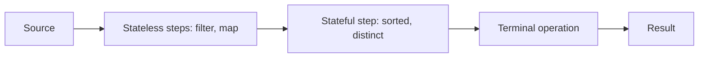

# The Stream Pipeline: Source, Operations and Laziness

**Java · Streams · Step 13.2.2 · Fundamentals** · Last updated 2026-10-21
**Prerequisites:** [Java Stream API: the big picture](01-streams-overview.md) (13.2.1)

**Version note**

| Item | Version |
|---|---|
| Baseline | **Java 8**: pipelines, laziness, short-circuiting (`findFirst`, `anyMatch`, `limit`), `peek`, `forEachOrdered`, parallel streams |
| Newer features used | **Java 16**: `Stream.toList()`; the examples also use records (Java 16) and `List.of` (Java 9) |
| Examples need | **Java 16 or later** |
| Hands-on tested with | OpenJDK 21.0.8 (Temurin) |
| Compatibility note | Before Java 16 there is no `Stream.toList()`: use `collect(Collectors.toList())` (type and mutability unspecified) or, from Java 10, `collect(Collectors.toUnmodifiableList())`, which also rejects `null` elements |

Every example below is a complete program using the shared ShopFlow orders. Run it, compare with the **Expected output**, then try the experiment. How to run them on your Mac (terminal or VS Code) is in [the Java overview](../01-java-overview.md), section 5.

## 1. What it is and why it matters

**What is it?** A stream pipeline has three parts: a **source** that holds the data, **intermediate operations** that describe what to do, and one **terminal operation** that starts the run and produces the result. Nothing happens until the terminal operation is called; then, in a sequential stream, elements flow through the steps one at a time.

**Why do we need it?** Most surprises with streams come from four facts: nothing runs without a terminal operation, a sequential stream processes elements one by one rather than step by step, some operations stop early, and a stream can be used only once. A parallel stream changes the second fact, and this note shows exactly how. Knowing them lets you predict what a pipeline does, and spot the bug when it doesn't.

**When would I meet it?** The first time a `peek` prints nothing, a stream throws `IllegalStateException`, or a debugging print shows elements in an unexpected order.

> [!TIP]
> **Memory hook:** describe the belt, press start once, and (on a sequential stream) the items pass through the stations one at a time.

## 2. Industry terms

| Term | Simple meaning | Why it matters | Example | Related terms |
|---|---|---|---|---|
| **Source** | Where elements come from | Decides ordering and whether the size is known | `orders.stream()`, `Stream.of(...)` | Encounter order |
| **Intermediate operation** | Returns a new stream; describes work | Lazy: does nothing alone | `filter`, `map`, `sorted` | Stateless, stateful |
| **Terminal operation** | Produces a result and runs the pipeline | Starts everything; consumes the stream | `toList`, `findFirst`, `count` | Short-circuiting |
| **Lazy evaluation** | Work is deferred until a result is needed | Explains "nothing printed" | A pipeline with no terminal operation | Eager |
| **Stateless / stateful operation** | Whether a step needs earlier elements | Stateful steps hold up the flow | `filter` versus `sorted` | Barrier |
| **Short-circuiting** | A step that can finish without reading everything | Saves work; makes infinite streams usable | `findFirst`, `anyMatch`, `limit` | Infinite stream |
| **Sequential / parallel stream** | One thread processing elements in turn / the library allowed to split the work across threads | Changes which order things happen in | `stream()` / `parallelStream()` | Fork/join pool |
| **Encounter, processing and result order** | The source's order / the order elements are actually handled / the order of the output | In parallel they can differ | List order; thread timing; `toList()` output | `forEachOrdered` |
| **Side effect** | Changing something outside the lambda (printing, adding to a list) | Can run fewer times than you think, or race in parallel | `peek(list::add)` | Stateless lambda |

## 3. In a real system (ShopFlow)

**The business problem.** The Order Service builds reports and checks from order streams: "the paid order ids", "the first big paid order", "is any order cancelled?". The team needs to know when each lambda runs, how many orders are actually read, and what can make a pipeline silently wrong.

The revenue pipeline from [13.2.1](01-streams-overview.md) (`filter → mapToLong → sum`, 22,500 cents) works. This note shows *why*, and what changes when you add printing, early exits, sorting or a second use.

## 4. How it works



1. **Building** the pipeline only creates objects that describe it; no lambda has run.
2. The **terminal operation** asks the source for elements.
3. In a **sequential** stream, each element passes through the stateless steps **one at a time**, all the way to the end, before the next element starts. A **parallel** stream may handle several elements at once on different threads (see "Sequential versus parallel execution" below).
4. A **stateful** step such as `sorted` must see all elements before it can pass any on, so everything before it runs first.
5. A **short-circuiting** operation (`findFirst`, `anyMatch`, `limit`) stops pulling as soon as the answer is known.
6. After the terminal operation the stream is **used up**.

The printing inside the lambdas below is there only to make the order visible; section 5 explains why you shouldn't rely on it in real code.

### Laziness and execution order

**Concept.** Intermediate operations are recipes. The run starts at the terminal operation, and then, in this sequential stream, each order goes through `filter` and, if it passes, `map`, before the next order starts.

```java
// File: LazinessDemo.java (runnable, Java 16)
import java.util.List;
import java.util.stream.Stream;

public class LazinessDemo {

    enum Status { PAID, PENDING, CANCELLED }

    record Order(String id, String customer, Status status, long totalCents) {}

    static List<Order> sampleOrders() {               // the same five ShopFlow orders in every example
        return List.of(
            new Order("o-1001", "ana", Status.PAID,      8_000),
            new Order("o-1002", "ben", Status.CANCELLED, 3_000),
            new Order("o-1003", "ana", Status.PAID,      2_500),
            new Order("o-1004", "cy",  Status.PENDING,   4_500),
            new Order("o-1005", "cy",  Status.PAID,     12_000));
    }

    public static void main(String[] args) {
        List<Order> orders = sampleOrders();

        System.out.println("1. building the pipeline");
        Stream<String> paidIds = orders.stream()
                .filter(o -> {
                    System.out.println("   filter " + o.id() + " (" + o.status() + ")");
                    return o.status() == Status.PAID;
                })
                .map(o -> {
                    System.out.println("   map    " + o.id());
                    return o.id();
                });
        System.out.println("2. pipeline built, nothing has run yet");

        List<String> result = paidIds.toList();       // terminal operation: the run starts here
        System.out.println("3. result " + result);
    }
}
```

**Expected output** (run on OpenJDK 21.0.8, 2026-10-21):

```text
1. building the pipeline
2. pipeline built, nothing has run yet
   filter o-1001 (PAID)
   map    o-1001
   filter o-1002 (CANCELLED)
   filter o-1003 (PAID)
   map    o-1003
   filter o-1004 (PENDING)
   filter o-1005 (PAID)
   map    o-1005
3. result [o-1001, o-1003, o-1005]
```

**Walkthrough.** Line 2 appears **before** any `filter` line: building the pipeline did nothing. Then, from `toList()`:

| Order | `filter` runs? | Passes? | `map` runs? | Added to the result |
|---|---|---|---|---|
| o-1001 (PAID) | yes | yes | yes | o-1001 |
| o-1002 (CANCELLED) | yes | no | no | (none) |
| o-1003 (PAID) | yes | yes | yes | o-1003 |
| o-1004 (PENDING) | yes | no | no | (none) |
| o-1005 (PAID) | yes | yes | yes | o-1005 |

It is *not* "filter all five, then map the three survivors": `map o-1001` comes before `filter o-1002`.

**Experiment.** Change `paidIds.toList()` to `paidIds.limit(1).toList()`. Predict how many `filter` lines you'll see, then run it. (Answer at the end.)

### Short-circuiting

**Concept.** Some terminal operations can answer before reading everything. `findFirst` stops at the first match, `anyMatch` stops at the first `true`, and `limit` stops an otherwise endless source.

```java
// File: ShortCircuitDemo.java (runnable, Java 16)
import java.util.List;
import java.util.Optional;
import java.util.stream.Stream;

public class ShortCircuitDemo {

    enum Status { PAID, PENDING, CANCELLED }

    record Order(String id, String customer, Status status, long totalCents) {}

    static List<Order> sampleOrders() {               // the same five ShopFlow orders in every example
        return List.of(
            new Order("o-1001", "ana", Status.PAID,      8_000),
            new Order("o-1002", "ben", Status.CANCELLED, 3_000),
            new Order("o-1003", "ana", Status.PAID,      2_500),
            new Order("o-1004", "cy",  Status.PENDING,   4_500),
            new Order("o-1005", "cy",  Status.PAID,     12_000));
    }

    public static void main(String[] args) {
        List<Order> orders = sampleOrders();

        // First paid order over EUR 50 (5,000 cents): stops as soon as it is found
        Optional<Order> firstBig = orders.stream()
                .filter(o -> {
                    System.out.println("   checking " + o.id());
                    return o.status() == Status.PAID && o.totalCents() > 5_000;
                })
                .findFirst();
        System.out.println("first big paid order: " + firstBig.map(Order::id).orElse("none"));

        // anyMatch also stops early: is there any cancelled order?
        boolean anyCancelled = orders.stream()
                .peek(o -> System.out.println("   looking at " + o.id()))
                .anyMatch(o -> o.status() == Status.CANCELLED);
        System.out.println("any cancelled: " + anyCancelled);

        // An infinite source becomes finite with limit()
        List<Integer> firstThreeMultiplesOf7 = Stream.iterate(1, n -> n + 1)
                .filter(n -> n % 7 == 0)
                .limit(3)
                .toList();
        System.out.println("first three multiples of 7: " + firstThreeMultiplesOf7);
    }
}
```

**Expected output** (run on OpenJDK 21.0.8, 2026-10-21):

```text
   checking o-1001
first big paid order: o-1001
   looking at o-1001
   looking at o-1002
any cancelled: true
first three multiples of 7: [7, 14, 21]
```

**Walkthrough.**

| Pipeline | Orders read | Why it stopped |
|---|---|---|
| `findFirst` paid order over EUR 50 | 1 (o-1001) | o-1001 is paid and 8,000 > 5,000: the answer is known |
| `anyMatch` cancelled | 2 (o-1001, o-1002) | o-1002 is cancelled: the answer is `true` |
| `iterate` + `filter` + `limit(3)` | 21 numbers | `limit` closed the endless source after the third match (7, 14, 21) |

Without `limit`, the last pipeline would never finish.

**Experiment.** Raise the threshold in the `findFirst` pipeline from `5_000` to `10_000`. Predict which orders are checked and which one is found. (Answer at the end.)

### Stateful steps hold the flow

**Concept.** `sorted` can't release the smallest order until it has seen them all. So everything before it runs first, and everything after it runs afterwards.

```java
// File: SortedBarrierDemo.java (runnable, Java 16)
import java.util.Comparator;
import java.util.List;

public class SortedBarrierDemo {

    enum Status { PAID, PENDING, CANCELLED }

    record Order(String id, String customer, Status status, long totalCents) {}

    static List<Order> sampleOrders() {               // the same five ShopFlow orders in every example
        return List.of(
            new Order("o-1001", "ana", Status.PAID,      8_000),
            new Order("o-1002", "ben", Status.CANCELLED, 3_000),
            new Order("o-1003", "ana", Status.PAID,      2_500),
            new Order("o-1004", "cy",  Status.PENDING,   4_500),
            new Order("o-1005", "cy",  Status.PAID,     12_000));
    }

    public static void main(String[] args) {
        List<String> byAmount = sampleOrders().stream()
                .filter(o -> o.status() == Status.PAID)
                .peek(o -> System.out.println("   before sorted: " + o.id()))
                .sorted(Comparator.comparingLong(Order::totalCents))
                .peek(o -> System.out.println("   after sorted:  " + o.id()))
                .map(Order::id)
                .toList();
        System.out.println("paid orders, smallest first: " + byAmount);
    }
}
```

**Expected output** (run on OpenJDK 21.0.8, 2026-10-21):

```text
   before sorted: o-1001
   before sorted: o-1003
   before sorted: o-1005
   after sorted:  o-1003
   after sorted:  o-1001
   after sorted:  o-1005
paid orders, smallest first: [o-1003, o-1001, o-1005]
```

**Walkthrough.** All three "before sorted" lines come first, in source order (o-1001, o-1003, o-1005). Then `sorted` releases them by amount: o-1003 (2,500), o-1001 (8,000), o-1005 (12,000). `distinct` behaves the same way in spirit: it has to remember what it has already seen.

**Experiment.** Delete the `.sorted(...)` line. Predict the order of the "before" and "after" lines. (Answer at the end.)

### A stream is used once

**Concept.** The first terminal operation consumes the stream. To compute two results, keep the *source* (or a recipe that builds a new stream), not the stream.

```java
// File: SingleUseDemo.java (runnable, Java 16)
import java.util.List;
import java.util.function.Supplier;
import java.util.stream.Stream;

public class SingleUseDemo {

    enum Status { PAID, PENDING, CANCELLED }

    record Order(String id, String customer, Status status, long totalCents) {}

    static List<Order> sampleOrders() {               // the same five ShopFlow orders in every example
        return List.of(
            new Order("o-1001", "ana", Status.PAID,      8_000),
            new Order("o-1002", "ben", Status.CANCELLED, 3_000),
            new Order("o-1003", "ana", Status.PAID,      2_500),
            new Order("o-1004", "cy",  Status.PENDING,   4_500),
            new Order("o-1005", "cy",  Status.PAID,     12_000));
    }

    public static void main(String[] args) {
        Stream<Order> paid = sampleOrders().stream().filter(o -> o.status() == Status.PAID);

        System.out.println("paid orders: " + paid.count());
        try {
            System.out.println("paid revenue: " + paid.mapToLong(Order::totalCents).sum());   // second use
        } catch (IllegalStateException e) {
            System.out.println("second use failed: " + e.getMessage());
        }

        // Fix: keep the recipe, not the stream. Each get() builds a new stream.
        Supplier<Stream<Order>> paidOrders = () -> sampleOrders().stream().filter(o -> o.status() == Status.PAID);
        System.out.println("paid orders: " + paidOrders.get().count());
        System.out.println("paid revenue: " + paidOrders.get().mapToLong(Order::totalCents).sum());
    }
}
```

**Expected output** (run on OpenJDK 21.0.8, 2026-10-21):

```text
paid orders: 3
second use failed: stream has already been operated upon or closed
paid orders: 3
paid revenue: 22500
```

**Walkthrough.** `count()` consumed `paid`; the second terminal operation on the same object throws. The `Supplier<Stream<Order>>` holds the recipe, and each `get()` builds a fresh stream from the list.

**Real-world use.** A repository or service method that returns a `Stream<Order>` hands the caller a one-shot object. Unless the stream must be lazy (for example a very large or database-backed result, which the caller must also close), returning a `List<Order>` is simpler and safer for callers that need it twice.

### Sequential versus parallel execution

**Concept.** Everything above used a **sequential** stream: one thread, one element at a time, in encounter order. `parallelStream()` (or `.parallel()`) allows the library to split the source into parts and process them on several threads (the common fork/join pool). It is permission, not a promise: on a given run the library may still do most or all of the work on one thread. Three kinds of order then need to be kept apart:

| Order | Meaning | Sequential | Parallel |
|---|---|---|---|
| **Encounter order** | The order the source defines (a `List`'s order) | Followed | Still defined by the source |
| **Processing order** | The order in which lambdas actually run | Encounter order | **Not guaranteed**: any element, any thread, any time |
| **Result order** | The order of the output | Encounter order | Kept by `toList()`, `findFirst()`, `forEachOrdered()` on an ordered source; **not** kept by `forEach()`; `findAny()` may return any match |

The program below prints only what the Java documentation guarantees, so its output is the same on every run:

```java
// File: ParallelGuarantees.java (runnable, Java 16)
import java.util.ArrayList;
import java.util.List;
import java.util.Optional;
import java.util.Queue;
import java.util.concurrent.ConcurrentLinkedQueue;

public class ParallelGuarantees {

    enum Status { PAID, PENDING, CANCELLED }

    record Order(String id, String customer, Status status, long totalCents) {}

    static List<Order> sampleOrders() {               // the same five ShopFlow orders in every example
        return List.of(
            new Order("o-1001", "ana", Status.PAID,      8_000),
            new Order("o-1002", "ben", Status.CANCELLED, 3_000),
            new Order("o-1003", "ana", Status.PAID,      2_500),
            new Order("o-1004", "cy",  Status.PENDING,   4_500),
            new Order("o-1005", "cy",  Status.PAID,     12_000));
    }

    public static void main(String[] args) {
        List<Order> orders = sampleOrders();          // a List: an ordered source

        // 1. Result order: toList() keeps encounter order, sequential or parallel
        List<String> sequential = orders.stream()
                .filter(o -> o.status() == Status.PAID).map(Order::id).toList();
        List<String> parallel = orders.parallelStream()
                .filter(o -> o.status() == Status.PAID).map(Order::id).toList();
        System.out.println("sequential toList: " + sequential);
        System.out.println("parallel   toList: " + parallel);

        // 2. The same result for a reduction, sequential or parallel
        long parallelSum = orders.parallelStream()
                .filter(o -> o.status() == Status.PAID).mapToLong(Order::totalCents).sum();
        System.out.println("parallel sum: " + parallelSum);

        // 3. findFirst respects encounter order; findAny may return any match
        Optional<Order> first = orders.parallelStream().filter(o -> o.status() == Status.PAID).findFirst();
        Optional<Order> any = orders.parallelStream().filter(o -> o.status() == Status.PAID).findAny();
        System.out.println("parallel findFirst: " + first.map(Order::id).orElse("none"));
        System.out.println("parallel findAny returned a paid order: " + any.map(o -> o.status() == Status.PAID).orElse(false));

        // 4. forEachOrdered visits in encounter order; forEach makes no order promise
        List<String> ordered = new ArrayList<>();
        orders.parallelStream().map(Order::id).forEachOrdered(ordered::add);   // one at a time, in order
        System.out.println("parallel forEachOrdered: " + ordered);

        Queue<String> unordered = new ConcurrentLinkedQueue<>();              // thread-safe: forEach may run on several threads
        orders.parallelStream().map(Order::id).forEach(unordered::add);
        System.out.println("parallel forEach visited all five: " + (unordered.size() == 5 && unordered.containsAll(sequentialIds(orders))));
    }

    static List<String> sequentialIds(List<Order> orders) {
        return orders.stream().map(Order::id).toList();
    }
}
```

**Expected output** (run on OpenJDK 21.0.8, 2026-10-21; the same on every run, because each line is guaranteed):

```text
sequential toList: [o-1001, o-1003, o-1005]
parallel   toList: [o-1001, o-1003, o-1005]
parallel sum: 22500
parallel findFirst: o-1001
parallel findAny returned a paid order: true
parallel forEachOrdered: [o-1001, o-1002, o-1003, o-1004, o-1005]
parallel forEach visited all five: true
```

**Walkthrough.**

| Line | Why it is guaranteed |
|---|---|
| Both `toList` lines are equal | The source is an ordered `List`, and `toList()` returns elements in encounter order, sequential or parallel |
| `parallel sum: 22500` | A correct pipeline gives the same result sequentially or in parallel |
| `findFirst: o-1001` | `findFirst` respects encounter order even in parallel |
| `findAny ... true` | `findAny` may return *any* paid order (o-1001, o-1003 or o-1005); the program only checks that it is one of them |
| `forEachOrdered` in source order | `forEachOrdered` processes elements one at a time, in encounter order |
| `forEach visited all five: true` | `forEach` reaches every element, but in parallel in no promised order and possibly on several threads, so the program collects into a thread-safe queue and checks only *which* elements arrived |

Now the part that is **not** guaranteed. This trace prints which thread runs `map` for each order:

```java
// File: ParallelTrace.java (runnable, Java 16)
import java.util.List;

public class ParallelTrace {

    enum Status { PAID, PENDING, CANCELLED }

    record Order(String id, String customer, Status status, long totalCents) {}

    static List<Order> sampleOrders() {               // the same five ShopFlow orders in every example
        return List.of(
            new Order("o-1001", "ana", Status.PAID,      8_000),
            new Order("o-1002", "ben", Status.CANCELLED, 3_000),
            new Order("o-1003", "ana", Status.PAID,      2_500),
            new Order("o-1004", "cy",  Status.PENDING,   4_500),
            new Order("o-1005", "cy",  Status.PAID,     12_000));
    }

    public static void main(String[] args) {
        System.out.println("-- sequential");
        sampleOrders().stream()
                .map(o -> trace("map", o))
                .forEach(id -> System.out.println("   forEach " + id));

        System.out.println("-- parallel");
        List<String> result = sampleOrders().parallelStream()
                .map(o -> trace("map", o))
                .toList();
        System.out.println("parallel result: " + result);
    }

    static String trace(String step, Order o) {
        System.out.println("   " + step + " " + o.id() + " on " + Thread.currentThread().getName());
        return o.id();
    }
}
```

**Example output** (run on OpenJDK 21.0.8, 2026-10-21, on a Mac). The order and thread names of the parallel `map` lines **change between runs and machines**, and all of them may run on `main`; only the sequential part and the final result line are fixed:

```text
-- sequential
   map o-1001 on main
   forEach o-1001
   map o-1002 on main
   forEach o-1002
   map o-1003 on main
   forEach o-1003
   map o-1004 on main
   forEach o-1004
   map o-1005 on main
   forEach o-1005
-- parallel
   map o-1005 on main
   map o-1004 on main
   map o-1003 on main
   map o-1001 on main
   map o-1002 on ForkJoinPool.commonPool-worker-1
parallel result: [o-1001, o-1002, o-1003, o-1004, o-1005]
```

**Walkthrough.** In this run, `map` handled o-1005 first and ran o-1002 on a worker thread, yet `toList()` still returned the ids in encounter order. Processing order and result order are different things: never infer one from the other, and never let a correct result depend on processing order.

**When to use it.** Parallel streams can help for large, CPU-heavy, side-effect-free work on sources that split well (arrays, `ArrayList`, ranges); they rarely help for five orders, and they hurt with blocking I/O or shared state. That trade-off is the subject of 13.2.8 (planned). For everything in this series, assume sequential streams unless a note says otherwise.

**Who guarantees what**

| Layer | Responsible for |
|---|---|
| Stream library | Deferring work, running steps per element, short-circuiting, rejecting reuse |
| Your lambdas | Being stateless, not changing the source, not relying on side effects |
| The source | Its own ordering and whether its size is known |
| You | Calling exactly one terminal operation per stream |

## 5. Failure scenarios

These are realistic mistakes, each as a program you can run. Two simpler ones are already shown above: a pipeline without a terminal operation does nothing (the laziness example), and a reused stream throws (the single-use example).

### Trusting `peek` to run

- **What happened?** A developer used `peek` to write an audit line for each order, and later to collect an audit trail.
- **Why?** `peek` runs only for the elements the pipeline actually processes. With `count()` on a list whose size is known, the pipeline may not run at all; with `findFirst`, it stops after the first match.

```java
// File: PeekPitfallDemo.java (runnable, Java 16)
import java.util.ArrayList;
import java.util.List;
import java.util.Optional;

public class PeekPitfallDemo {

    enum Status { PAID, PENDING, CANCELLED }

    record Order(String id, String customer, Status status, long totalCents) {}

    static List<Order> sampleOrders() {               // the same five ShopFlow orders in every example
        return List.of(
            new Order("o-1001", "ana", Status.PAID,      8_000),
            new Order("o-1002", "ben", Status.CANCELLED, 3_000),
            new Order("o-1003", "ana", Status.PAID,      2_500),
            new Order("o-1004", "cy",  Status.PENDING,   4_500),
            new Order("o-1005", "cy",  Status.PAID,     12_000));
    }

    public static void main(String[] args) {
        List<Order> orders = sampleOrders();

        // Mistake 1: expecting peek to run for every element of count()
        long counted = orders.stream()
                .peek(o -> System.out.println("   audit " + o.id()))
                .count();
        System.out.println("counted " + counted + " orders, audit lines printed above: none");

        // Mistake 2: using peek to record an audit trail, then short-circuiting
        List<String> audited = new ArrayList<>();
        Optional<Order> firstPaid = orders.stream()
                .peek(o -> audited.add(o.id()))
                .filter(o -> o.status() == Status.PAID)
                .findFirst();
        System.out.println("first paid: " + firstPaid.map(Order::id).orElse("none") + ", audited: " + audited);

        // Correct: make the audit a deliberate step of its own, not a side effect of a query
        List<String> auditTrail = orders.stream().map(Order::id).toList();
        System.out.println("audit trail: " + auditTrail);
    }
}
```

**Expected output** (run on OpenJDK 21.0.8, 2026-10-21):

```text
counted 5 orders, audit lines printed above: none
first paid: o-1001, audited: [o-1001]
audit trail: [o-1001, o-1002, o-1003, o-1004, o-1005]
```

- **What you see:** no audit lines at all for `count()`, and only one audited order for `findFirst`, with no error.
- **Solution:** make required work a deliberate step of its own (as in the last pipeline, or a plain loop); keep `peek` for temporary debugging.

### Filling a shared list from a parallel stream

- **What happened?** Results were added to an `ArrayList` from `parallel().forEach(...)`.
- **Why?** Several threads call `add` on the same non-thread-safe list at once, and some additions are lost (or the list's internal array is corrupted).

```java
// File: SharedListMistakeDemo.java (runnable, Java 16)
import java.util.ArrayList;
import java.util.List;
import java.util.stream.IntStream;

public class SharedListMistakeDemo {

    public static void main(String[] args) {
        for (int run = 1; run <= 3; run++) {
            List<Integer> shared = new ArrayList<>();            // not thread-safe
            try {
                IntStream.range(0, 10_000).parallel().forEach(shared::add);   // MISTAKE: side effect on shared state
                System.out.println("run " + run + ": shared list has " + shared.size() + " of 10000");
            } catch (RuntimeException e) {
                System.out.println("run " + run + ": failed with " + e.getClass().getSimpleName());
            }
        }

        // Correct: let the stream build the result
        List<Integer> result = IntStream.range(0, 10_000).parallel().boxed().toList();
        System.out.println("toList() result has " + result.size() + " of 10000");
    }
}
```

**Example output** (run on OpenJDK 21.0.8, 2026-10-21). The three "shared list" sizes **change on every run**, and a run may instead fail with an exception; the last line is always the same:

```text
run 1: shared list has 4586 of 10000
run 2: shared list has 1738 of 10000
run 3: shared list has 1232 of 10000
toList() result has 10000 of 10000
```

- **What you see:** silently missing data, which is worse than an exception.
- **Solution:** let the stream build the result (`toList()` or a collector); never mutate shared state from a lambda.

### Changing the source while the stream reads it

- **What happened?** A lambda added elements to the very list the stream was reading.
- **Why?** The documentation calls this *interference* and requires lambdas not to modify the source.

```java
// File: InterferenceDemo.java (runnable, Java 16)
import java.util.ArrayList;
import java.util.ConcurrentModificationException;
import java.util.List;

public class InterferenceDemo {

    public static void main(String[] args) {
        List<String> orderIds = new ArrayList<>(List.of("o-1001", "o-1002"));

        try {
            orderIds.stream().forEach(id -> orderIds.add(id + "-copy"));   // MISTAKE: changes the source
        } catch (ConcurrentModificationException e) {
            System.out.println("changing the source failed: ConcurrentModificationException");
        }

        // Correct: build the new data as the result, from an unchanged source
        List<String> source = List.of("o-1001", "o-1002");
        List<String> copies = source.stream().map(id -> id + "-copy").toList();
        System.out.println("copies: " + copies);
    }
}
```

**Expected output** (run on OpenJDK 21.0.8, 2026-10-21):

```text
changing the source failed: ConcurrentModificationException
copies: [o-1001-copy, o-1002-copy]
```

- **Solution:** build new data as the stream's result from an unchanged source.

## 6. Architectural decisions

### `Stream.toList()` or `Collectors.toList()`?

**Concept.** All three below gather elements into a `List` in encounter order, but they promise different things. `toList()` (Java 16+) returns an **unmodifiable** list. `Collectors.toList()` makes **no promise** about the list's type, mutability, serializability or thread safety. When you need a list you will change, ask for one explicitly with `Collectors.toCollection(ArrayList::new)`. The program checks only the guaranteed behaviour, so it never calls `add` on the `Collectors.toList()` result.

```java
// File: ToListDemo.java (runnable, Java 16)
import java.util.ArrayList;
import java.util.List;
import java.util.stream.Collectors;

public class ToListDemo {

    enum Status { PAID, PENDING, CANCELLED }

    record Order(String id, String customer, Status status, long totalCents) {}

    static List<Order> sampleOrders() {               // the same five ShopFlow orders in every example
        return List.of(
            new Order("o-1001", "ana", Status.PAID,      8_000),
            new Order("o-1002", "ben", Status.CANCELLED, 3_000),
            new Order("o-1003", "ana", Status.PAID,      2_500),
            new Order("o-1004", "cy",  Status.PENDING,   4_500),
            new Order("o-1005", "cy",  Status.PAID,     12_000));
    }

    public static void main(String[] args) {
        List<Order> orders = sampleOrders();

        List<String> fixed    = orders.stream().map(Order::id).toList();                                   // Java 16+: unmodifiable
        List<String> anyList  = orders.stream().map(Order::id).collect(Collectors.toList());               // type and mutability unspecified
        List<String> editable = orders.stream().map(Order::id).collect(Collectors.toCollection(ArrayList::new)); // always an ArrayList

        // Guaranteed for all three: the same elements, in encounter order
        System.out.println("same elements, same order: " + (fixed.equals(anyList) && anyList.equals(editable)));

        // Guaranteed: Stream.toList() rejects changes
        try {
            fixed.add("o-9999");
        } catch (UnsupportedOperationException e) {
            System.out.println("Stream.toList(): add rejected with UnsupportedOperationException");
        }

        // Guaranteed: toCollection(ArrayList::new) gives a list you may change
        editable.add("o-9999");
        System.out.println("toCollection(ArrayList::new): add accepted, size " + editable.size());

        // Collectors.toList(): neither outcome is promised, so don't depend on add() working or failing
        System.out.println("Collectors.toList(): " + anyList.size() + " ids; mutability not specified, so not modified here");
    }
}
```

**Expected output** (run on OpenJDK 21.0.8, 2026-10-21):

```text
same elements, same order: true
Stream.toList(): add rejected with UnsupportedOperationException
toCollection(ArrayList::new): add accepted, size 6
Collectors.toList(): 5 ids; mutability not specified, so not modified here
```

| You need | Use | Why |
|---|---|---|
| A result nobody should change (most service and DTO results) | `stream.toList()` | Unmodifiable, short, Java 16+ |
| A list you will add to or sort in place | `Collectors.toCollection(ArrayList::new)` | Guaranteed `ArrayList` |
| Older code, or a collector inside another collector | `Collectors.toList()` | Fine for reading; treat it as "some list": its type and mutability are not part of the contract |

**Observation, not a guarantee.** On OpenJDK 21.0.8, `Collectors.toList()` returned a `java.util.ArrayList` (checked with `getClass()`), so code that adds to its result happens to work there. That is an implementation detail of this JDK, not part of the API, and another version or implementation may differ.

**Practical implication.** Switching a method from `collect(Collectors.toList())` to `toList()` can break a caller that adds to the returned list: it will now get `UnsupportedOperationException` at run time. That caller was already relying on unspecified behaviour; if it needs to change the list, the method should return `Collectors.toCollection(ArrayList::new)` (or the caller should copy the list).

**When to use streams at all.** For filter-transform-gather work with small, pure steps. Use `forEach` only at the end, for effects such as logging, and `peek` only to debug. **Common mistakes:** thinking steps run over the whole data one after another; counting on `peek` output; sharing a stream between methods.

## 7. Try it yourself

Use the shared setup (the `Status` enum, the `Order` record and `sampleOrders()`) from any example above. Write the program first, run it, then compare with the solutions at the end.

1. **Pending revenue.** Print the total of all `PENDING` orders in euros, in the form `pending revenue = EUR 45.00`.
2. **Big paid orders, largest first.** Print the ids of `PAID` orders over EUR 50, largest amount first. Expected result: `[o-1005, o-1001]`.
3. **Predict, then run.** Without running it, write down the exact output of this pipeline, then run it inside a `main` method with the shared setup:

```java
sampleOrders().stream()
        .filter(o -> o.totalCents() >= 4_500)
        .peek(o -> System.out.println("peek " + o.id()))
        .map(Order::customer)
        .forEach(c -> System.out.println("got  " + c));
```

## 8. Check your understanding

1. In the laziness example, why is "pipeline built, nothing has run yet" printed before any `filter` line?
2. A method returns a `Stream<Order>` that the caller uses twice. What goes wrong, and what should the method return instead?
3. Why does `sorted()` change the order in which the `peek` lines appear?
4. A teammate adds results to a shared `ArrayList` inside `parallelStream().forEach(...)`, and the tests pass. What do you tell them?
5. `orders.parallelStream().map(Order::id).forEach(System.out::println)` prints the ids in a different order on different runs. Is that a bug in Java, and how would you get them in list order?

Answers are at the end of this note.

## 9. Revision

**Remember**
- **Nothing runs without a terminal operation.**
- **In a sequential stream, elements go through the whole pipeline one at a time**, except past a stateful step such as `sorted`.
- **In a parallel stream, processing order isn't guaranteed**; `toList()`, `findFirst()` and `forEachOrdered()` keep encounter order for an ordered source, `forEach()` doesn't.
- **Short-circuiting operations stop early**, so side effects may not run.
- **A stream is used once**: keep the source, not the stream.
- **No shared mutable state and no changes to the source inside lambdas.**

**Explain in 15 seconds:** "A stream pipeline is lazy: intermediate operations describe the work and the terminal operation runs it, one element at a time, once."

**Explain in 60 seconds:**
> "A pipeline has a source, intermediate operations and one terminal operation. Building it does no work. The terminal operation pulls elements, and in a sequential stream each one goes through all the stateless steps before the next starts, except that a stateful step like sorted must see everything first. A parallel stream may process elements concurrently and in any order, but for an ordered source toList and findFirst still keep encounter order, while forEach doesn't. Short-circuiting operations such as findFirst stop early, so side effects in peek may not run, and count may skip the pipeline for a sized source. A stream is consumed once, and lambdas must not change the source or share mutable state, because that breaks sequential code with exceptions and parallel code silently."

**Likely follow-up questions:**
- **Is a stream a collection?** No, it stores nothing; it conveys elements from a source through the pipeline.
- **Why is the stream lazy?** So it can short-circuit and avoid reading or processing elements it doesn't need.
- **`toList()` or `Collectors.toList()`?** `toList()` for results nobody should change; `toCollection(ArrayList::new)` when you need to modify the list.

**Architect's takeaway:** treat a pipeline as a description that runs once, and keep every lambda free of shared state, so the result doesn't depend on how the library chooses to run it.

**Next topic:** [Transforming and filtering: map, filter, flatMap, sorted, limit](03-transforming-filtering.md) (13.2.3)

## 10. Verification and sources

> [!NOTE]
> Checked 2026-10-21 against the Java SE 21 documentation. Every program marked runnable in this note, including the solutions, is run automatically on OpenJDK 21.0.8 and its output compared with this note (`tools/check-java-examples.py`); the shared-list example's sizes vary between runs and are not compared.

- **Confirmed (Java SE 21 `java.util.stream` package summary):** a pipeline is a source, zero or more intermediate operations and a terminal operation; intermediate operations are lazy and traversal doesn't begin until the terminal operation runs; the elements of a stream are visited only once and a consumed stream can't be used again; behavioural parameters must be non-interfering and in most cases stateless; side effects are discouraged, and `forEach` and `peek` work only through side effects; stateful operations such as `distinct` and `sorted` may need to process the entire input before producing a result; short-circuiting operations such as `limit` and `findFirst` can finish on infinite input.
- **Confirmed (`Stream` Javadoc):** `peek` exists mainly for debugging and isn't invoked for elements that are optimised away; an implementation of `count()` may not execute the pipeline when it can compute the count from the source; `toList()` (since Java 16) returns an unmodifiable list in encounter order, with no guarantee about its implementation type. For parallel pipelines `forEach` "does not guarantee to respect the encounter order" and may run the action "in whatever thread the library chooses"; `forEachOrdered` processes elements one at a time in encounter order; `findAny` is explicitly nondeterministic; `findFirst` returns the first element (any element if there is no encounter order).
- **Confirmed (`java.util.stream` package summary):** a correct pipeline gives the same result sequentially or in parallel, except for explicitly nondeterministic operations such as `findAny`; lists and arrays are ordered sources, `HashSet` is not; even when the result must follow encounter order, no guarantees are made about the order in which the mapper is applied or in which thread.
- **Confirmed (`Collectors` Javadoc):** `Collectors.toList()` gives "no guarantees on the type, mutability, serializability, or thread-safety of the List returned" and points to `toCollection(Supplier)` for more control; `toCollection` accumulates into the supplied collection in encounter order.
- **Observed (OpenJDK 21.0.8):** every expected output above, the experiment results and the exercise solutions; the shared-list sizes and the parallel trace are from single runs and vary; `Collectors.toList()` returned a `java.util.ArrayList` and `Stream.toList()` a `java.util.ImmutableCollections$ListN` (implementation details, not guarantees).
- **Assumptions and illustrations:** the ShopFlow scenario and data.
- **To verify:** whether the `IllegalStateException` message text is the same in other releases.
- **Decision rule:** one terminal operation per stream; no shared mutable state or source changes in lambdas; `peek` only to debug; `toList()` unless you need to modify the list.

**Sources:** Java SE 21 API documentation, package `java.util.stream` and interface `Stream`.

## Answers

1. Building the pipeline only creates the description; the `filter` and `map` lambdas run when `toList()` starts the pipeline, after line 2 has been printed.
2. The second use throws `IllegalStateException`, because the first terminal operation consumed the stream. Return the data (a `List<Order>`) or a `Supplier<Stream<Order>>`, so each caller builds its own stream.
3. `sorted` is a stateful step that must see all elements before passing any on, so every upstream `peek` runs first and every downstream one afterwards.
4. It is a side effect on shared mutable state: a parallel run can silently lose elements (in the runs above the list held 1,232 to 4,586 of 10,000). Passing tests prove nothing here; let the stream build the result with `toList()` or a collector.
5. Not a bug: in a parallel stream `forEach` promises nothing about order and may run on several threads. Use `forEachOrdered(System.out::println)` to print in encounter order, or collect with `toList()` and print the list (or use a sequential stream, which is the better default for five orders).

**Experiment results** (each change made to the program above, then run on OpenJDK 21.0.8):

- *Laziness, with `limit(1)`:* only one order is read. The output after line 2 is `filter o-1001 (PAID)`, `map    o-1001`, then `3. result [o-1001]`. `limit` is short-circuiting, so the source stops after the first match.
- *Short-circuiting, threshold `10_000`:* all five orders are checked (o-1001 to o-1005) and `first big paid order: o-1005` is printed, because only o-1005 (12,000) is paid and over 10,000. The `anyMatch` and multiples-of-7 lines don't change.
- *Without `sorted`:* the lines interleave, each order of this sequential stream going all the way through: `before o-1001`, `after o-1001`, `before o-1003`, `after o-1003`, `before o-1005`, `after o-1005`, and the result is in source order, `[o-1001, o-1003, o-1005]`.

**Exercise solutions** (run on OpenJDK 21.0.8; your version may differ in style but should print the same):

```java
// File: PendingRevenue.java (runnable, Java 16)
import java.util.List;

public class PendingRevenue {

    enum Status { PAID, PENDING, CANCELLED }

    record Order(String id, String customer, Status status, long totalCents) {}

    static List<Order> sampleOrders() {               // the same five ShopFlow orders in every example
        return List.of(
            new Order("o-1001", "ana", Status.PAID,      8_000),
            new Order("o-1002", "ben", Status.CANCELLED, 3_000),
            new Order("o-1003", "ana", Status.PAID,      2_500),
            new Order("o-1004", "cy",  Status.PENDING,   4_500),
            new Order("o-1005", "cy",  Status.PAID,     12_000));
    }

    public static void main(String[] args) {
        long pending = sampleOrders().stream()
                .filter(o -> o.status() == Status.PENDING)
                .mapToLong(Order::totalCents)
                .sum();
        System.out.printf("pending revenue = EUR %d.%02d%n", pending / 100, pending % 100);
    }
}
```

**Expected output**:

```text
pending revenue = EUR 45.00
```

```java
// File: BigPaidOrders.java (runnable, Java 16)
import java.util.Comparator;
import java.util.List;

public class BigPaidOrders {

    enum Status { PAID, PENDING, CANCELLED }

    record Order(String id, String customer, Status status, long totalCents) {}

    static List<Order> sampleOrders() {               // the same five ShopFlow orders in every example
        return List.of(
            new Order("o-1001", "ana", Status.PAID,      8_000),
            new Order("o-1002", "ben", Status.CANCELLED, 3_000),
            new Order("o-1003", "ana", Status.PAID,      2_500),
            new Order("o-1004", "cy",  Status.PENDING,   4_500),
            new Order("o-1005", "cy",  Status.PAID,     12_000));
    }

    public static void main(String[] args) {
        List<String> bigPaid = sampleOrders().stream()
                .filter(o -> o.status() == Status.PAID)
                .filter(o -> o.totalCents() > 5_000)                              // over EUR 50
                .sorted(Comparator.comparingLong(Order::totalCents).reversed())   // largest first
                .map(Order::id)
                .toList();
        System.out.println("big paid orders, largest first: " + bigPaid);
    }
}
```

**Expected output**:

```text
big paid orders, largest first: [o-1005, o-1001]
```

Exercise 3: `filter` keeps o-1001 (8,000), o-1004 (4,500) and o-1005 (12,000); because this is a sequential stream, each surviving order goes through `peek`, `map` and `forEach` before the next one starts. (With `parallelStream()`, the lines could come in any order.)

```java
// File: PredictOrder.java (runnable, Java 16)
import java.util.List;

public class PredictOrder {

    enum Status { PAID, PENDING, CANCELLED }

    record Order(String id, String customer, Status status, long totalCents) {}

    static List<Order> sampleOrders() {               // the same five ShopFlow orders in every example
        return List.of(
            new Order("o-1001", "ana", Status.PAID,      8_000),
            new Order("o-1002", "ben", Status.CANCELLED, 3_000),
            new Order("o-1003", "ana", Status.PAID,      2_500),
            new Order("o-1004", "cy",  Status.PENDING,   4_500),
            new Order("o-1005", "cy",  Status.PAID,     12_000));
    }

    public static void main(String[] args) {
        sampleOrders().stream()
                .filter(o -> o.totalCents() >= 4_500)
                .peek(o -> System.out.println("peek " + o.id()))
                .map(Order::customer)
                .forEach(c -> System.out.println("got  " + c));
    }
}
```

**Expected output**:

```text
peek o-1001
got  ana
peek o-1004
got  cy
peek o-1005
got  cy
```

Back to [the streams overview](01-streams-overview.md) · [Index](../../README.md) · [Roadmap](../../roadmap.md).
