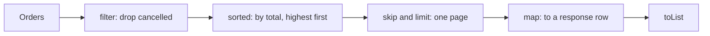

# Transforming and Filtering: map, filter, flatMap, sorted, limit

**Java · Streams · Step 13.2.3 · Fundamentals** · Last updated 2026-10-21
**Prerequisites:** [The pipeline: source, operations and laziness](02-pipeline-laziness.md) (13.2.2)

These are the intermediate operations you will write most often. **Version note**

| Item | Version |
|---|---|
| Baseline | **Java 8**: `filter`, `map`, `flatMap`, `sorted`, `distinct`, `limit`, `skip`, `Predicate.and`/`negate`, `Comparator.comparing`/`thenComparing`/`reversed` |
| Newer features | **Java 16**: `mapMulti` (described, not used); the examples use records and `Stream.toList()` (Java 16) and `List.of` (Java 9) |
| Hands-on baseline | **Java 21**, tested with OpenJDK 21.0.8 (Temurin) |

Every example is a complete program; run it, compare with the **Expected output**, then try the experiment. How to run them on your Mac is in [the Java overview](../01-java-overview.md), section 5.

## 1. What it is and why it matters

**What is it?** Five intermediate operations that reshape a stream: `filter` keeps some elements, `map` turns each element into another value, `flatMap` turns each element into several, `sorted` puts them in order, and `limit` and `skip` cut out a window.

**Why do we need it?** Most backend data work is exactly this: pick the relevant records, convert them to the shape a caller needs, flatten nested data (orders and their lines), order them, and return one page. Getting the operations right, and in the right order, decides whether the result is correct.

**When would I meet it?** Building API responses from entities, report endpoints, search results, "top N" lists and pagination over data already in memory.

> [!TIP]
> **Memory hook:** a sorting office. `filter` throws out wrong addresses, `map` re-labels each parcel, `flatMap` opens boxes and puts every item on the belt, `sorted` lines them up, and `limit`/`skip` take one cartload.

## 2. Industry terms

| Term | Simple meaning | Why it matters | Example | Related terms |
|---|---|---|---|---|
| **Predicate** | A function that answers true or false for an element | What `filter` uses; can be named and combined | `o -> o.status() == Status.PAID` | `and`, `or`, `negate` |
| **Mapping** | Turning each element into exactly one new value | Changes the stream's element type | `Order` → `OrderSummary` | DTO |
| **Flattening** | Turning each element into zero or more elements, all in one stream | Works with nested collections | Orders → their lines | `flatMap`, `mapMulti` |
| **Comparator** | A rule saying which of two elements comes first | What `sorted` uses | `Comparator.comparingLong(Order::totalCents)` | `thenComparing`, `reversed` |
| **Stable sort** | Elements that compare equal keep their original order | Predictable results with ties | Two orders by the same customer | Encounter order |
| **Pagination** | Returning results one page at a time | Bounded responses | `skip(2).limit(2)` = page 2 of size 2 | Offset |
| **DTO** | A data transfer object: the shape sent to a caller | Keeps internal entities out of APIs | `OrderSummary` record | Mapping |

## 3. In a real system (ShopFlow)

**The business problem.** The Order Service has an order-history endpoint: leave out cancelled orders, sort by amount (highest first), return two orders per page, and send a summary row per order rather than the internal `Order` object.

From this note on, each order also carries its **lines** (the products bought), so we can flatten orders into lines. The orders and their totals are the same as in earlier notes, and each order's lines add up to its total:

| Order | Customer | Status | Lines | Total |
|---|---|---|---|---|
| o-1001 | ana | PAID | MUG ×2 at 15.00, TEE ×1 at 50.00 | 80.00 |
| o-1002 | ben | CANCELLED | MUG ×2 at 15.00 | 30.00 |
| o-1003 | ana | PAID | SOCKS ×1 at 25.00 | 25.00 |
| o-1004 | cy | PENDING | MUG ×3 at 15.00 | 45.00 |
| o-1005 | cy | PAID | HOODIE ×1 at 95.00, SOCKS ×1 at 25.00 | 120.00 |

Each program repeats this setup (an `OrderLine` record and an `Order` record with a `lines` list) so it runs on its own. The endpoint itself is built in "Putting it together" below.

## 4. How it works



1. `filter` and `map` are **stateless**: each element is handled on its own, so (in a sequential stream) it flows straight through.
2. `flatMap` replaces each element with a small stream of elements, and passes them on one by one.
3. `sorted` is **stateful**: it must see every element before it passes any on ([13.2.2](02-pipeline-laziness.md)).
4. `skip` and `limit` count elements in encounter order and **short-circuit**: once `limit` has its count, upstream stops.
5. The **order of operations matters**: filtering before sorting sorts less data; sorting before `limit` is what makes "top N" correct.

### `filter`: keep what matches

**Concept.** `filter` takes a predicate and keeps the elements for which it returns `true`. Several `filter` calls in a row act like "and". Named predicates (`Predicate<Order>`) can be combined with `and`, `or` and `negate`, so business rules read like sentences and can be reused.

```java
// File: FilterDemo.java (runnable, Java 21)
import java.util.List;
import java.util.function.Predicate;

public class FilterDemo {

    enum Status { PAID, PENDING, CANCELLED }

    record OrderLine(String sku, int quantity, long unitCents) {}

    record Order(String id, String customer, Status status, long totalCents, List<OrderLine> lines) {}

    static List<Order> sampleOrders() {               // the same five ShopFlow orders, with their lines
        return List.of(
            new Order("o-1001", "ana", Status.PAID,      8_000, List.of(new OrderLine("MUG", 2, 1_500), new OrderLine("TEE", 1, 5_000))),
            new Order("o-1002", "ben", Status.CANCELLED, 3_000, List.of(new OrderLine("MUG", 2, 1_500))),
            new Order("o-1003", "ana", Status.PAID,      2_500, List.of(new OrderLine("SOCKS", 1, 2_500))),
            new Order("o-1004", "cy",  Status.PENDING,   4_500, List.of(new OrderLine("MUG", 3, 1_500))),
            new Order("o-1005", "cy",  Status.PAID,     12_000, List.of(new OrderLine("HOODIE", 1, 9_500), new OrderLine("SOCKS", 1, 2_500))));
    }

    public static void main(String[] args) {
        List<Order> orders = sampleOrders();

        // filter keeps the elements for which the predicate returns true
        List<String> bigPaid = orders.stream()
                .filter(o -> o.status() == Status.PAID)
                .filter(o -> o.totalCents() > 5_000)             // over EUR 50
                .map(Order::id)
                .toList();
        System.out.println("paid and over EUR 50: " + bigPaid);

        // The same rules as named, reusable predicates
        Predicate<Order> paid = o -> o.status() == Status.PAID;
        Predicate<Order> overFifty = o -> o.totalCents() > 5_000;
        System.out.println("paid.and(overFifty):  " + orders.stream().filter(paid.and(overFifty)).map(Order::id).toList());
        System.out.println("paid.negate():        " + orders.stream().filter(paid.negate()).map(Order::id).toList());
    }
}
```

**Expected output** (run on OpenJDK 21.0.8, 2026-10-21):

```text
paid and over EUR 50: [o-1001, o-1005]
paid.and(overFifty):  [o-1001, o-1005]
paid.negate():        [o-1002, o-1004]
```

**Walkthrough.**

| Order | Status | `PAID`? | Over 5,000? | Kept |
|---|---|---|---|---|
| o-1001 | PAID | yes | 8,000: yes | yes |
| o-1002 | CANCELLED | no | (not checked) | no |
| o-1003 | PAID | yes | 2,500: no | no |
| o-1004 | PENDING | no | (not checked) | no |
| o-1005 | PAID | yes | 12,000: yes | yes |

`paid.negate()` keeps exactly the orders `paid` rejects: o-1002 and o-1004.

**Experiment.** In the first pipeline only, change `> 5_000` to `>= 2_500`. Predict the first line. (Answer at the end.)

### `map`: turn each element into something else

**Concept.** `map` applies a function to every element and passes on the result, one result per element. The element type can change, here from `Order` to an `OrderSummary` record shaped for the API, so internal fields such as `lines` don't leak to callers.

```java
// File: MapDemo.java (runnable, Java 21)
import java.util.List;

public class MapDemo {

    enum Status { PAID, PENDING, CANCELLED }

    record OrderLine(String sku, int quantity, long unitCents) {}

    record Order(String id, String customer, Status status, long totalCents, List<OrderLine> lines) {}

    static List<Order> sampleOrders() {               // the same five ShopFlow orders, with their lines
        return List.of(
            new Order("o-1001", "ana", Status.PAID,      8_000, List.of(new OrderLine("MUG", 2, 1_500), new OrderLine("TEE", 1, 5_000))),
            new Order("o-1002", "ben", Status.CANCELLED, 3_000, List.of(new OrderLine("MUG", 2, 1_500))),
            new Order("o-1003", "ana", Status.PAID,      2_500, List.of(new OrderLine("SOCKS", 1, 2_500))),
            new Order("o-1004", "cy",  Status.PENDING,   4_500, List.of(new OrderLine("MUG", 3, 1_500))),
            new Order("o-1005", "cy",  Status.PAID,     12_000, List.of(new OrderLine("HOODIE", 1, 9_500), new OrderLine("SOCKS", 1, 2_500))));
    }

    record OrderSummary(String id, String customer, String total) {}    // what the API returns

    static String eur(long cents) {                     // 8000 -> "EUR 80.00"
        return String.format("EUR %d.%02d", cents / 100, cents % 100);
    }

    public static void main(String[] args) {
        List<OrderSummary> summaries = sampleOrders().stream()          // Stream<Order>
                .filter(o -> o.status() == Status.PAID)
                .map(o -> new OrderSummary(o.id(), o.customer(), eur(o.totalCents())))   // Stream<OrderSummary>
                .toList();

        for (OrderSummary s : summaries) {
            System.out.println(s.id() + " | " + s.customer() + " | " + s.total());
        }
    }
}
```

**Expected output** (run on OpenJDK 21.0.8, 2026-10-21):

```text
o-1001 | ana | EUR 80.00
o-1003 | ana | EUR 25.00
o-1005 | cy | EUR 120.00
```

**Walkthrough.** After `filter`, three orders remain. `map` calls the lambda once per order: o-1001 becomes `OrderSummary("o-1001", "ana", "EUR 80.00")`, and so on. The stream's type changes from `Stream<Order>` to `Stream<OrderSummary>`, so after `map` you can no longer call `Order` methods. The program prints each field explicitly rather than relying on a record's generated `toString()`, whose format the Java documentation says is subject to change and should not be parsed.

**Experiment.** Delete the `filter` line. Predict how many rows you get and which new ones appear. (Answer at the end.)

### `flatMap`: one element in, several out

**Concept.** When each element contains a collection, `map` gives you a stream of collections. `flatMap` takes a function that returns a *stream* for each element, and joins all those streams into one. Use it to go from orders to all their lines.

```java
// File: FlatMapDemo.java (runnable, Java 21)
import java.util.List;

public class FlatMapDemo {

    enum Status { PAID, PENDING, CANCELLED }

    record OrderLine(String sku, int quantity, long unitCents) {}

    record Order(String id, String customer, Status status, long totalCents, List<OrderLine> lines) {}

    static List<Order> sampleOrders() {               // the same five ShopFlow orders, with their lines
        return List.of(
            new Order("o-1001", "ana", Status.PAID,      8_000, List.of(new OrderLine("MUG", 2, 1_500), new OrderLine("TEE", 1, 5_000))),
            new Order("o-1002", "ben", Status.CANCELLED, 3_000, List.of(new OrderLine("MUG", 2, 1_500))),
            new Order("o-1003", "ana", Status.PAID,      2_500, List.of(new OrderLine("SOCKS", 1, 2_500))),
            new Order("o-1004", "cy",  Status.PENDING,   4_500, List.of(new OrderLine("MUG", 3, 1_500))),
            new Order("o-1005", "cy",  Status.PAID,     12_000, List.of(new OrderLine("HOODIE", 1, 9_500), new OrderLine("SOCKS", 1, 2_500))));
    }

    public static void main(String[] args) {
        List<Order> paid = sampleOrders().stream().filter(o -> o.status() == Status.PAID).toList();

        // map: one List per order -> a stream of lists (3 elements)
        List<List<OrderLine>> nested = paid.stream().map(Order::lines).toList();
        System.out.println("map(Order::lines): " + nested.size() + " elements, list sizes "
                + nested.stream().map(List::size).toList());

        // flatMap: each order's lines flattened into one stream of lines (5 elements)
        List<OrderLine> lines = paid.stream().flatMap(o -> o.lines().stream()).toList();
        System.out.println("flatMap(...):      " + lines.size() + " lines");
        for (OrderLine l : lines) {
            System.out.println("   " + l.sku() + " x" + l.quantity());
        }

        int unitsSold = paid.stream()
                .flatMap(o -> o.lines().stream())
                .mapToInt(OrderLine::quantity)
                .sum();
        System.out.println("units sold in paid orders: " + unitsSold);
    }
}
```

**Expected output** (run on OpenJDK 21.0.8, 2026-10-21):

```text
map(Order::lines): 3 elements, list sizes [2, 1, 2]
flatMap(...):      5 lines
   MUG x2
   TEE x1
   SOCKS x1
   HOODIE x1
   SOCKS x1
units sold in paid orders: 6
```

**Walkthrough.**

| Paid order | `map(Order::lines)` produces | `flatMap(o -> o.lines().stream())` produces |
|---|---|---|
| o-1001 | one element: a list of 2 lines | two elements: MUG ×2, TEE ×1 |
| o-1003 | one element: a list of 1 line | one element: SOCKS ×1 |
| o-1005 | one element: a list of 2 lines | two elements: HOODIE ×1, SOCKS ×1 |
| **Total** | **3 elements** (lists) | **5 elements** (lines); quantities 2+1+1+1+1 = **6** |

If the function returns `null` instead of a stream, `flatMap` treats it as an empty stream. Java 16 added `mapMulti`, which the documentation recommends when each element produces only a few results or when pushing results imperatively is simpler; `flatMap` remains the clearer choice for "each order's lines".

**Experiment.** Change the first line of `main` so `paid` holds *all* orders (`List<Order> paid = sampleOrders();`). Predict the three numbers. (Answer at the end.)

### `sorted`: put elements in order

**Concept.** `sorted()` uses natural order (for example alphabetical strings); `sorted(comparator)` uses your rule. Build comparators from keys: `Comparator.comparing(...)` for objects such as `String`, `comparingLong(...)` for `long` values, `thenComparing(...)` for a tie-breaker, and `reversed()` for the opposite order. For ordered streams the sort is **stable**: elements that compare equal keep their original order.

```java
// File: SortedDemo.java (runnable, Java 21)
import java.util.Comparator;
import java.util.List;

public class SortedDemo {

    enum Status { PAID, PENDING, CANCELLED }

    record OrderLine(String sku, int quantity, long unitCents) {}

    record Order(String id, String customer, Status status, long totalCents, List<OrderLine> lines) {}

    static List<Order> sampleOrders() {               // the same five ShopFlow orders, with their lines
        return List.of(
            new Order("o-1001", "ana", Status.PAID,      8_000, List.of(new OrderLine("MUG", 2, 1_500), new OrderLine("TEE", 1, 5_000))),
            new Order("o-1002", "ben", Status.CANCELLED, 3_000, List.of(new OrderLine("MUG", 2, 1_500))),
            new Order("o-1003", "ana", Status.PAID,      2_500, List.of(new OrderLine("SOCKS", 1, 2_500))),
            new Order("o-1004", "cy",  Status.PENDING,   4_500, List.of(new OrderLine("MUG", 3, 1_500))),
            new Order("o-1005", "cy",  Status.PAID,     12_000, List.of(new OrderLine("HOODIE", 1, 9_500), new OrderLine("SOCKS", 1, 2_500))));
    }

    public static void main(String[] args) {
        List<Order> orders = sampleOrders();

        // One key, reversed: most expensive first
        System.out.println("total, highest first: " + orders.stream()
                .sorted(Comparator.comparingLong(Order::totalCents).reversed())
                .map(Order::id).toList());

        // Two keys: customer A to Z, then total highest first (reverse only the second key)
        System.out.println("customer, then total: " + orders.stream()
                .sorted(Comparator.comparing(Order::customer)
                        .thenComparing(Comparator.comparingLong(Order::totalCents).reversed()))
                .map(Order::id).toList());

        // Stable sort: orders with the same customer keep their original order
        System.out.println("customer only:        " + orders.stream()
                .sorted(Comparator.comparing(Order::customer))
                .map(Order::id).toList());

        // Natural order of strings
        System.out.println("customers, natural:   " + orders.stream()
                .map(Order::customer).distinct().sorted().toList());
    }
}
```

**Expected output** (run on OpenJDK 21.0.8, 2026-10-21):

```text
total, highest first: [o-1005, o-1001, o-1004, o-1002, o-1003]
customer, then total: [o-1001, o-1003, o-1002, o-1005, o-1004]
customer only:        [o-1001, o-1003, o-1002, o-1004, o-1005]
customers, natural:   [ana, ben, cy]
```

**Walkthrough.**

- *Total, highest first:* 12,000, 8,000, 4,500, 3,000, 2,500.
- *Customer, then total:* ana's two orders (8,000 before 2,500), then ben, then cy's (12,000 before 4,500). Only the second key is reversed, because `reversed()` is applied to that key's comparator before it is chained.
- *Customer only:* ana's o-1001 and o-1003, and cy's o-1004 and o-1005, keep their original order: that is the stability guarantee at work.
- *Natural order:* `distinct` keeps the first occurrence of each name, and `sorted()` orders them alphabetically.

**Experiment.** On the "customer only" line, add `.reversed()` after `Comparator.comparing(Order::customer)`. Predict the order, including how the two ana orders and the two cy orders are arranged. (Answer at the end.)

### `limit` and `skip`: take a window

**Concept.** `limit(n)` keeps the first `n` elements; `skip(n)` drops the first `n`. Together they make a page: page `p` of size `s` is `skip((p - 1) * s).limit(s)`. Both count in encounter order, so they must come **after** `sorted` when you want "the top N" or a page of sorted results.

```java
// File: LimitSkipDemo.java (runnable, Java 21)
import java.util.Comparator;
import java.util.List;

public class LimitSkipDemo {

    enum Status { PAID, PENDING, CANCELLED }

    record OrderLine(String sku, int quantity, long unitCents) {}

    record Order(String id, String customer, Status status, long totalCents, List<OrderLine> lines) {}

    static List<Order> sampleOrders() {               // the same five ShopFlow orders, with their lines
        return List.of(
            new Order("o-1001", "ana", Status.PAID,      8_000, List.of(new OrderLine("MUG", 2, 1_500), new OrderLine("TEE", 1, 5_000))),
            new Order("o-1002", "ben", Status.CANCELLED, 3_000, List.of(new OrderLine("MUG", 2, 1_500))),
            new Order("o-1003", "ana", Status.PAID,      2_500, List.of(new OrderLine("SOCKS", 1, 2_500))),
            new Order("o-1004", "cy",  Status.PENDING,   4_500, List.of(new OrderLine("MUG", 3, 1_500))),
            new Order("o-1005", "cy",  Status.PAID,     12_000, List.of(new OrderLine("HOODIE", 1, 9_500), new OrderLine("SOCKS", 1, 2_500))));
    }

    static List<String> page(List<Order> orders, int pageNumber, int pageSize) {   // pageNumber starts at 1
        return orders.stream()
                .sorted(Comparator.comparingLong(Order::totalCents).reversed())
                .skip((long) (pageNumber - 1) * pageSize)
                .limit(pageSize)
                .map(Order::id)
                .toList();
    }

    public static void main(String[] args) {
        List<Order> orders = sampleOrders();

        System.out.println("top 3 by total: " + orders.stream()
                .sorted(Comparator.comparingLong(Order::totalCents).reversed())
                .limit(3)
                .map(Order::id).toList());

        System.out.println("page 1 (size 2): " + page(orders, 1, 2));
        System.out.println("page 2 (size 2): " + page(orders, 2, 2));

        // MISTAKE: limit before sorted takes the first two in list order, then sorts only those
        System.out.println("limit then sorted (wrong top 2): " + orders.stream()
                .limit(2)
                .sorted(Comparator.comparingLong(Order::totalCents).reversed())
                .map(Order::id).toList());
    }
}
```

**Expected output** (run on OpenJDK 21.0.8, 2026-10-21):

```text
top 3 by total: [o-1005, o-1001, o-1004]
page 1 (size 2): [o-1005, o-1001]
page 2 (size 2): [o-1004, o-1002]
limit then sorted (wrong top 2): [o-1001, o-1002]
```

**Walkthrough.** The sorted order is o-1005, o-1001, o-1004, o-1002, o-1003. "Top 3" takes the first three; page 1 skips 0 and takes 2; page 2 skips 2 and takes 2. The last line is the mistake: `limit(2)` first took the first two orders *in list order* (o-1001, o-1002) and only then sorted them, so o-1005, the most expensive order, is missing.

**Experiment.** Add a line that prints `page(orders, 3, 2)`. Predict the result. (Answer at the end.)

### Putting it together: an order-history page

**Concept.** The endpoint from section 3 is one pipeline: a business rule (`filter`), a predictable order (`sorted` with a tie-breaker), a window (`skip`/`limit`) and the response shape (`map`). The order of the steps is part of the logic.

```java
// File: OrderHistoryPage.java (runnable, Java 21)
import java.util.Comparator;
import java.util.List;

public class OrderHistoryPage {

    enum Status { PAID, PENDING, CANCELLED }

    record OrderLine(String sku, int quantity, long unitCents) {}

    record Order(String id, String customer, Status status, long totalCents, List<OrderLine> lines) {}

    static List<Order> sampleOrders() {               // the same five ShopFlow orders, with their lines
        return List.of(
            new Order("o-1001", "ana", Status.PAID,      8_000, List.of(new OrderLine("MUG", 2, 1_500), new OrderLine("TEE", 1, 5_000))),
            new Order("o-1002", "ben", Status.CANCELLED, 3_000, List.of(new OrderLine("MUG", 2, 1_500))),
            new Order("o-1003", "ana", Status.PAID,      2_500, List.of(new OrderLine("SOCKS", 1, 2_500))),
            new Order("o-1004", "cy",  Status.PENDING,   4_500, List.of(new OrderLine("MUG", 3, 1_500))),
            new Order("o-1005", "cy",  Status.PAID,     12_000, List.of(new OrderLine("HOODIE", 1, 9_500), new OrderLine("SOCKS", 1, 2_500))));
    }

    record OrderRow(String id, String customer, String total, int items) {}   // one row in the API response

    static String eur(long cents) {                     // 8000 -> "EUR 80.00"
        return String.format("EUR %d.%02d", cents / 100, cents % 100);
    }

    // GET /orders?excludeCancelled=true&sort=total,desc&page=N&size=2, written as one pipeline
    static List<OrderRow> page(List<Order> orders, int pageNumber, int pageSize) {
        return orders.stream()
                .filter(o -> o.status() != Status.CANCELLED)                           // 1. business rule
                .sorted(Comparator.comparingLong(Order::totalCents).reversed()
                        .thenComparing(Order::id))                                     // 2. stable, predictable order
                .skip((long) (pageNumber - 1) * pageSize)                              // 3. page window
                .limit(pageSize)
                .map(o -> new OrderRow(o.id(), o.customer(), eur(o.totalCents()),
                        o.lines().stream().mapToInt(OrderLine::quantity).sum()))      // 4. to the response shape
                .toList();
    }

    public static void main(String[] args) {
        List<Order> orders = sampleOrders();
        for (int p = 1; p <= 3; p++) {
            System.out.println("page " + p + ":");
            for (OrderRow r : page(orders, p, 2)) {
                System.out.println("   " + r.id() + " | " + r.customer() + " | " + r.total() + " | units: " + r.items());
            }
        }
    }
}
```

**Expected output** (run on OpenJDK 21.0.8, 2026-10-21):

```text
page 1:
   o-1005 | cy | EUR 120.00 | units: 2
   o-1001 | ana | EUR 80.00 | units: 3
page 2:
   o-1004 | cy | EUR 45.00 | units: 3
   o-1003 | ana | EUR 25.00 | units: 1
page 3:
```

**Walkthrough: how the data changes at each stage** (page 2):

| Stage | Data after the stage |
|---|---|
| Source | o-1001, o-1002, o-1003, o-1004, o-1005 |
| `filter` not cancelled | o-1001, o-1003, o-1004, o-1005 (o-1002 removed) |
| `sorted` total desc, then id | o-1005 (12,000), o-1001 (8,000), o-1004 (4,500), o-1003 (2,500) |
| `skip(2)` | o-1004, o-1003 |
| `limit(2)` | o-1004, o-1003 |
| `map` to `OrderRow` | o-1004 cy EUR 45.00 units 3; o-1003 ana EUR 25.00 units 1 |

Page 3 is empty: after skipping four orders there is nothing left, which is the correct answer for a page past the end. The `thenComparing(Order::id)` tie-breaker doesn't change this data, but it guarantees a predictable order if two orders ever have the same total, so pages never overlap or skip rows.

## 5. Failure scenarios

### Comparing strings with `==` in a filter

- **What happened?** An endpoint filtered orders by the customer from the request with `o.customer() == requestedCustomer` and returned nothing.
- **Why?** `==` compares object identity, not characters. A value built at run time (from a request, a database or a concatenation) is a different `String` object from the literal in your data, even when the text is the same.

```java
// File: FilterStringMistake.java (runnable, Java 21)
import java.util.List;

public class FilterStringMistake {

    enum Status { PAID, PENDING, CANCELLED }

    record OrderLine(String sku, int quantity, long unitCents) {}

    record Order(String id, String customer, Status status, long totalCents, List<OrderLine> lines) {}

    static List<Order> sampleOrders() {               // the same five ShopFlow orders, with their lines
        return List.of(
            new Order("o-1001", "ana", Status.PAID,      8_000, List.of(new OrderLine("MUG", 2, 1_500), new OrderLine("TEE", 1, 5_000))),
            new Order("o-1002", "ben", Status.CANCELLED, 3_000, List.of(new OrderLine("MUG", 2, 1_500))),
            new Order("o-1003", "ana", Status.PAID,      2_500, List.of(new OrderLine("SOCKS", 1, 2_500))),
            new Order("o-1004", "cy",  Status.PENDING,   4_500, List.of(new OrderLine("MUG", 3, 1_500))),
            new Order("o-1005", "cy",  Status.PAID,     12_000, List.of(new OrderLine("HOODIE", 1, 9_500), new OrderLine("SOCKS", 1, 2_500))));
    }

    public static void main(String[] args) {
        // In a real service this value comes from the request; here it is built at run time the same way
        String prefix = args.length > 0 ? args[0] : "an";
        String requestedCustomer = prefix + "a";              // "ana", but a new String object

        List<String> wrong = sampleOrders().stream()
                .filter(o -> o.customer() == requestedCustomer)          // MISTAKE: compares object identity
                .map(Order::id)
                .toList();
        List<String> right = sampleOrders().stream()
                .filter(o -> o.customer().equals(requestedCustomer))     // compares the characters
                .map(Order::id)
                .toList();

        System.out.println("requested customer: " + requestedCustomer);
        System.out.println("with == : " + wrong);
        System.out.println("with equals: " + right);
    }
}
```

**Expected output** (run on OpenJDK 21.0.8, 2026-10-21):

```text
requested customer: ana
with == : []
with equals: [o-1001, o-1003]
```

- **What you see:** an empty result and no error. In tests with literals it may even pass, because identical string literals share one object.
- **Solution:** compare with `equals` (or `Objects.equals` when either side may be `null`).

### `reversed()` reverses the whole comparator chain

- **What happened?** "Customer A to Z, highest total first" was written as `comparing(customer).thenComparingLong(total).reversed()`.
- **Why?** `reversed()` returns the reverse of the comparator it is called on; called at the end of a chain, it reverses every key, including the customer.

```java
// File: ReversedChainMistake.java (runnable, Java 21)
import java.util.Comparator;
import java.util.List;

public class ReversedChainMistake {

    enum Status { PAID, PENDING, CANCELLED }

    record OrderLine(String sku, int quantity, long unitCents) {}

    record Order(String id, String customer, Status status, long totalCents, List<OrderLine> lines) {}

    static List<Order> sampleOrders() {               // the same five ShopFlow orders, with their lines
        return List.of(
            new Order("o-1001", "ana", Status.PAID,      8_000, List.of(new OrderLine("MUG", 2, 1_500), new OrderLine("TEE", 1, 5_000))),
            new Order("o-1002", "ben", Status.CANCELLED, 3_000, List.of(new OrderLine("MUG", 2, 1_500))),
            new Order("o-1003", "ana", Status.PAID,      2_500, List.of(new OrderLine("SOCKS", 1, 2_500))),
            new Order("o-1004", "cy",  Status.PENDING,   4_500, List.of(new OrderLine("MUG", 3, 1_500))),
            new Order("o-1005", "cy",  Status.PAID,     12_000, List.of(new OrderLine("HOODIE", 1, 9_500), new OrderLine("SOCKS", 1, 2_500))));
    }

    public static void main(String[] args) {
        // Goal: customer A to Z, and within a customer the highest total first
        Comparator<Order> wrong = Comparator.comparing(Order::customer)
                .thenComparingLong(Order::totalCents)
                .reversed();                                  // MISTAKE: reverses the whole chain, customers too
        Comparator<Order> right = Comparator.comparing(Order::customer)
                .thenComparing(Comparator.comparingLong(Order::totalCents).reversed());

        System.out.println("wrong: " + sampleOrders().stream().sorted(wrong).map(o -> o.customer() + "/" + o.id()).toList());
        System.out.println("right: " + sampleOrders().stream().sorted(right).map(o -> o.customer() + "/" + o.id()).toList());
    }
}
```

**Expected output** (run on OpenJDK 21.0.8, 2026-10-21):

```text
wrong: [cy/o-1005, cy/o-1004, ben/o-1002, ana/o-1001, ana/o-1003]
right: [ana/o-1001, ana/o-1003, ben/o-1002, cy/o-1005, cy/o-1004]
```

- **Solution:** reverse only the key that should be descending, before chaining it: `thenComparing(Comparator.comparingLong(Order::totalCents).reversed())`.

### `limit` before `sorted`, and `map` where `flatMap` was meant

Both are shown above: `limit(2)` before `sorted` returned the wrong "top 2" (the `limit` and `skip` example), and `map(Order::lines)` produced three lists instead of five lines (the `flatMap` example). Neither throws; both quietly return a wrong result, so test them with data where the right answer is known.

## 6. Architectural decisions

| Need | Use | Watch out for |
|---|---|---|
| Keep some elements | `filter` with a clear (named) predicate | `==` on strings; side effects in the predicate |
| Change the shape | `map` to a DTO record | Leaking internal entities to callers |
| Flatten nested data | `flatMap(o -> o.lines().stream())` | `map(Order::lines)` gives lists, not lines |
| Order results | `sorted(Comparator...)` with a tie-breaker | `reversed()` at the end of a chain |
| Top N or one page | `sorted` then `skip`/`limit` | `limit` before `sorted` |

- **Order of operations:** filter early (less data to sort and map), sort before `limit`/`skip`, map to the response shape last.
- **Pagination belongs in the database for real data.** These operations page through data already in memory. For a table of orders, page in the query (`LIMIT`/`OFFSET`, or keyset pagination) so you don't load every row to return two; use stream `skip`/`limit` for small, already-loaded collections.
- **Parallel streams:** the documentation warns that `limit` and `skip` can be expensive on ordered parallel pipelines, because they must respect encounter order; that trade-off is part of 13.2.8 (planned).
- **Common mistakes:** sorting without a tie-breaker when results are paged; relying on a record's `toString()` format in tests or logs that are parsed.

## 7. Try it yourself

Use the shared setup with lines (the `Status` enum, the `OrderLine` and `Order` records and `sampleOrders()`) from any example above. Write each program, run it, then compare with the solutions at the end.

1. **Products in paid orders.** Print the distinct product codes (SKUs) in `PAID` orders, alphabetically. Expected: `[HOODIE, MUG, SOCKS, TEE]`.
2. **Mugs ordered.** Print how many `MUG` units appear in orders that are not cancelled. Expected: `5`.
3. **A page by customer.** Sort all orders by customer, then by id, and print page 2 with a page size of 2. Expected: `[o-1002, o-1004]`.
4. **Most valuable lines.** Across `PAID` orders, print the two order lines with the highest amount (quantity × unit price), highest first, as `SKU xQUANTITY = EUR amount`. Expected: `HOODIE x1 = EUR 95.00`, then `TEE x1 = EUR 50.00`.

## 8. Check your understanding

1. What is the difference between `map(Order::lines)` and `flatMap(o -> o.lines().stream())`, in element type and count, for the three paid orders?
2. Why must `sorted` come before `limit` when you want the three most expensive orders?
3. A filter `o.customer() == name` works in a unit test but returns nothing in production. Why?
4. You need "customer A to Z, then newest first". Where does `reversed()` go, and why?
5. Why add `thenComparing(Order::id)` to a sort used for pagination?

Answers are at the end of this note.

## 9. Revision

**Remember**
- **`filter` keeps, `map` converts one to one, `flatMap` converts one to many.**
- **Build comparators from keys**; reverse only the key that should be descending.
- **`sorted` is stable** for ordered streams.
- **Sort before `limit`/`skip`**, and add a tie-breaker when paging.
- **Compare strings with `equals`**, never `==`.

**Explain in 15 seconds:** "filter selects, map converts each element, flatMap flattens nested data, sorted orders with a comparator, and skip plus limit take a page; their order in the pipeline is part of the logic."

**Explain in 60 seconds:**
> "I filter early with clear predicates, map entities to DTO records for callers, and use flatMap when each element holds a collection, such as orders and their lines; map would give me a stream of lists instead. I sort with comparators built from keys, reversing only the key that should be descending, and add a tie-breaker so pages are predictable; the sort is stable for ordered streams. Then skip and limit take the page, always after sorting. For large data the paging belongs in the database query; streams page through what is already in memory."

**Likely follow-up questions:**
- **When would you use `mapMulti` instead of `flatMap`?** When each element produces only a few results, or when pushing results imperatively is simpler (Java 16+).
- **What happens if the `flatMap` function returns `null`?** It is treated as an empty stream.
- **How do you page a database table of orders?** In the query, with `LIMIT`/`OFFSET` or keyset pagination, not by loading every row and calling `skip`.

**Architect's takeaway:** treat the order of stream operations as business logic, and push filtering, sorting and paging down to the database whenever the data lives there.

**Next topic:** [Terminal operations and Optional](04-terminal-operations-optional.md) (13.2.4)

## 10. Verification and sources

> [!NOTE]
> Checked 2026-10-21 against the Java SE 21 documentation and the Java Language Specification. Every program marked runnable in this note, including the solutions, is run automatically on OpenJDK 21.0.8 and its output compared with this note (`tools/check-java-examples.py`); each was also run twice to confirm the output is the same.

- **Confirmed (`Stream` Javadoc, Java SE 21):** `sorted()` uses natural order and may throw `ClassCastException` for elements that aren't `Comparable`; for ordered streams the sort is stable; `distinct()` uses `Object.equals` and keeps the first occurrence for ordered streams; in `flatMap` each mapped stream is closed after its contents are placed in the result, and a `null` mapped stream is treated as empty; `mapMulti` is since Java 16 and preferable when replacing each element with a small number of elements or when an imperative style is easier; `limit` and `skip` are generally cheap on sequential pipelines but can be expensive on ordered parallel pipelines.
- **Confirmed (`Comparator` Javadoc):** `reversed()` returns a comparator that imposes the reverse ordering of the comparator it is called on; `thenComparing` is consulted only when the first comparator considers two elements equal.
- **Confirmed (JLS SE 21, section 3.10.5):** string literals are interned; strings computed by concatenation at run time are newly created and therefore distinct, which is why `==` failed in the filter example.
- **Confirmed (`Record` Javadoc):** the precise format of a record's implicitly provided `toString()` "is subject to change" and "should not be parsed", so the examples print fields explicitly.
- **Observed (OpenJDK 21.0.8):** every expected output above, the experiment results and the exercise solutions.
- **Assumptions and illustrations:** the ShopFlow data, the endpoint shape and the `OrderSummary`/`OrderRow` records.
- **To verify:** your ORM's or database's pagination support (for example Spring Data's `Pageable`) when paging real tables.
- **Decision rule:** filter early, map to the response shape, flatten with `flatMap`, sort with explicit comparators and a tie-breaker, and only then `skip`/`limit`.

**Sources:** Java SE 21 API documentation, `java.util.stream.Stream`, `java.util.Comparator`, `java.lang.Record`; Java Language Specification, Java SE 21 Edition, section 3.10.5.

## Answers

1. `map(Order::lines)` produces a `Stream<List<OrderLine>>` with 3 elements, one list per order. `flatMap(o -> o.lines().stream())` produces a `Stream<OrderLine>` with 5 elements, every line of every paid order.
2. `limit` counts elements in encounter order. Before `sorted`, it takes whichever three come first in the list and then sorts only those; after `sorted`, the first three are the most expensive.
3. `==` compares object identity. In the test, both sides were the same string literal, which Java shares as one object; in production, the name comes from a request or a database, so it is a different object with the same text. Use `equals`.
4. Reverse only the date key, before chaining it: `Comparator.comparing(Order::customer).thenComparing(Comparator.comparing(Order::createdAt).reversed())`, assuming an order has a `createdAt` field (the sample `Order` doesn't). Calling `reversed()` at the end of the chain would reverse the customer order too.
5. A stable sort keeps ties in the order the data arrived, and that order isn't always fixed: rows loaded by separate queries without a unique `ORDER BY` can come back in a different order each time. Two orders with the same total could then swap between requests, so one could appear on two pages or on none. A unique tie-breaker such as the id makes the order complete and repeatable.

**Experiment results** (each change made to the program above, then run on OpenJDK 21.0.8):

- *`filter`, `>= 2_500`:* the first line becomes `paid and over EUR 50: [o-1001, o-1003, o-1005]`, because o-1003's 2,500 now passes. The other two lines don't change.
- *`map` without `filter`:* five rows instead of three. The new ones are `o-1002 | ben | EUR 30.00` and `o-1004 | cy | EUR 45.00`, in list order.
- *`flatMap` over all orders:* `map(Order::lines): 5 elements, list sizes [2, 1, 1, 1, 2]`, then `flatMap(...): 7 lines` (MUG x2 and MUG x3 are added), and `units sold in paid orders: 11` (the label still says "paid", but it now counts all orders).
- *`customer only` reversed:* `[o-1004, o-1005, o-1002, o-1001, o-1003]`. cy comes first, then ben, then ana, and within each customer the original order is kept (o-1004 before o-1005, o-1001 before o-1003): the sort is still stable.
- *Page 3:* `page 3 (size 2): [o-1003]`, the one order left after skipping four.

**Exercise solutions** (run on OpenJDK 21.0.8; your version may differ in style but should print the same):

```java
// File: ProductNames.java (runnable, Java 21)
import java.util.List;

public class ProductNames {

    enum Status { PAID, PENDING, CANCELLED }

    record OrderLine(String sku, int quantity, long unitCents) {}

    record Order(String id, String customer, Status status, long totalCents, List<OrderLine> lines) {}

    static List<Order> sampleOrders() {               // the same five ShopFlow orders, with their lines
        return List.of(
            new Order("o-1001", "ana", Status.PAID,      8_000, List.of(new OrderLine("MUG", 2, 1_500), new OrderLine("TEE", 1, 5_000))),
            new Order("o-1002", "ben", Status.CANCELLED, 3_000, List.of(new OrderLine("MUG", 2, 1_500))),
            new Order("o-1003", "ana", Status.PAID,      2_500, List.of(new OrderLine("SOCKS", 1, 2_500))),
            new Order("o-1004", "cy",  Status.PENDING,   4_500, List.of(new OrderLine("MUG", 3, 1_500))),
            new Order("o-1005", "cy",  Status.PAID,     12_000, List.of(new OrderLine("HOODIE", 1, 9_500), new OrderLine("SOCKS", 1, 2_500))));
    }

    public static void main(String[] args) {
        List<String> products = sampleOrders().stream()
                .filter(o -> o.status() == Status.PAID)
                .flatMap(o -> o.lines().stream())
                .map(OrderLine::sku)
                .distinct()
                .sorted()
                .toList();
        System.out.println("products in paid orders: " + products);
    }
}
```

**Expected output**:

```text
products in paid orders: [HOODIE, MUG, SOCKS, TEE]
```

```java
// File: MugUnits.java (runnable, Java 21)
import java.util.List;

public class MugUnits {

    enum Status { PAID, PENDING, CANCELLED }

    record OrderLine(String sku, int quantity, long unitCents) {}

    record Order(String id, String customer, Status status, long totalCents, List<OrderLine> lines) {}

    static List<Order> sampleOrders() {               // the same five ShopFlow orders, with their lines
        return List.of(
            new Order("o-1001", "ana", Status.PAID,      8_000, List.of(new OrderLine("MUG", 2, 1_500), new OrderLine("TEE", 1, 5_000))),
            new Order("o-1002", "ben", Status.CANCELLED, 3_000, List.of(new OrderLine("MUG", 2, 1_500))),
            new Order("o-1003", "ana", Status.PAID,      2_500, List.of(new OrderLine("SOCKS", 1, 2_500))),
            new Order("o-1004", "cy",  Status.PENDING,   4_500, List.of(new OrderLine("MUG", 3, 1_500))),
            new Order("o-1005", "cy",  Status.PAID,     12_000, List.of(new OrderLine("HOODIE", 1, 9_500), new OrderLine("SOCKS", 1, 2_500))));
    }

    public static void main(String[] args) {
        int mugs = sampleOrders().stream()
                .filter(o -> o.status() != Status.CANCELLED)
                .flatMap(o -> o.lines().stream())
                .filter(l -> l.sku().equals("MUG"))
                .mapToInt(OrderLine::quantity)
                .sum();
        System.out.println("mugs in orders that are not cancelled: " + mugs);
    }
}
```

**Expected output**:

```text
mugs in orders that are not cancelled: 5
```

o-1001 (2) and o-1004 (3) count; o-1002's two mugs don't, because it is cancelled.

```java
// File: CustomerPageTwo.java (runnable, Java 21)
import java.util.Comparator;
import java.util.List;

public class CustomerPageTwo {

    enum Status { PAID, PENDING, CANCELLED }

    record OrderLine(String sku, int quantity, long unitCents) {}

    record Order(String id, String customer, Status status, long totalCents, List<OrderLine> lines) {}

    static List<Order> sampleOrders() {               // the same five ShopFlow orders, with their lines
        return List.of(
            new Order("o-1001", "ana", Status.PAID,      8_000, List.of(new OrderLine("MUG", 2, 1_500), new OrderLine("TEE", 1, 5_000))),
            new Order("o-1002", "ben", Status.CANCELLED, 3_000, List.of(new OrderLine("MUG", 2, 1_500))),
            new Order("o-1003", "ana", Status.PAID,      2_500, List.of(new OrderLine("SOCKS", 1, 2_500))),
            new Order("o-1004", "cy",  Status.PENDING,   4_500, List.of(new OrderLine("MUG", 3, 1_500))),
            new Order("o-1005", "cy",  Status.PAID,     12_000, List.of(new OrderLine("HOODIE", 1, 9_500), new OrderLine("SOCKS", 1, 2_500))));
    }

    public static void main(String[] args) {
        List<String> pageTwo = sampleOrders().stream()
                .sorted(Comparator.comparing(Order::customer).thenComparing(Order::id))
                .skip(2)                                      // page 1 held the first 2 orders
                .limit(2)
                .map(Order::id)
                .toList();
        System.out.println("page 2 by customer, then id: " + pageTwo);
    }
}
```

**Expected output**:

```text
page 2 by customer, then id: [o-1002, o-1004]
```

Sorted by customer, then id: o-1001, o-1003 (ana), o-1002 (ben), o-1004, o-1005 (cy). Page 2 skips the first two.

```java
// File: TopLines.java (runnable, Java 21)
import java.util.Comparator;
import java.util.List;

public class TopLines {

    enum Status { PAID, PENDING, CANCELLED }

    record OrderLine(String sku, int quantity, long unitCents) {}

    record Order(String id, String customer, Status status, long totalCents, List<OrderLine> lines) {}

    static List<Order> sampleOrders() {               // the same five ShopFlow orders, with their lines
        return List.of(
            new Order("o-1001", "ana", Status.PAID,      8_000, List.of(new OrderLine("MUG", 2, 1_500), new OrderLine("TEE", 1, 5_000))),
            new Order("o-1002", "ben", Status.CANCELLED, 3_000, List.of(new OrderLine("MUG", 2, 1_500))),
            new Order("o-1003", "ana", Status.PAID,      2_500, List.of(new OrderLine("SOCKS", 1, 2_500))),
            new Order("o-1004", "cy",  Status.PENDING,   4_500, List.of(new OrderLine("MUG", 3, 1_500))),
            new Order("o-1005", "cy",  Status.PAID,     12_000, List.of(new OrderLine("HOODIE", 1, 9_500), new OrderLine("SOCKS", 1, 2_500))));
    }

    static String eur(long cents) {                     // 8000 -> "EUR 80.00"
        return String.format("EUR %d.%02d", cents / 100, cents % 100);
    }

    public static void main(String[] args) {
        sampleOrders().stream()
                .filter(o -> o.status() == Status.PAID)
                .flatMap(o -> o.lines().stream())
                .sorted(Comparator.comparingLong((OrderLine l) -> l.quantity() * l.unitCents()).reversed())
                .limit(2)
                .forEach(l -> System.out.println(l.sku() + " x" + l.quantity() + " = " + eur(l.quantity() * l.unitCents())));
    }
}
```

**Expected output**:

```text
HOODIE x1 = EUR 95.00
TEE x1 = EUR 50.00
```

The paid lines are worth 3,000 (MUG ×2), 5,000 (TEE), 2,500 (SOCKS), 9,500 (HOODIE) and 2,500 (SOCKS). The type in `(OrderLine l) -> ...` is written out because Java can't infer the lambda's parameter type when `.reversed()` is chained directly onto `comparingLong`: without it, `l` is treated as `Object` and the program doesn't compile (checked on OpenJDK 21.0.8).

Back to [the streams overview](01-streams-overview.md) · [Index](../../README.md) · [Roadmap](../../roadmap.md).
