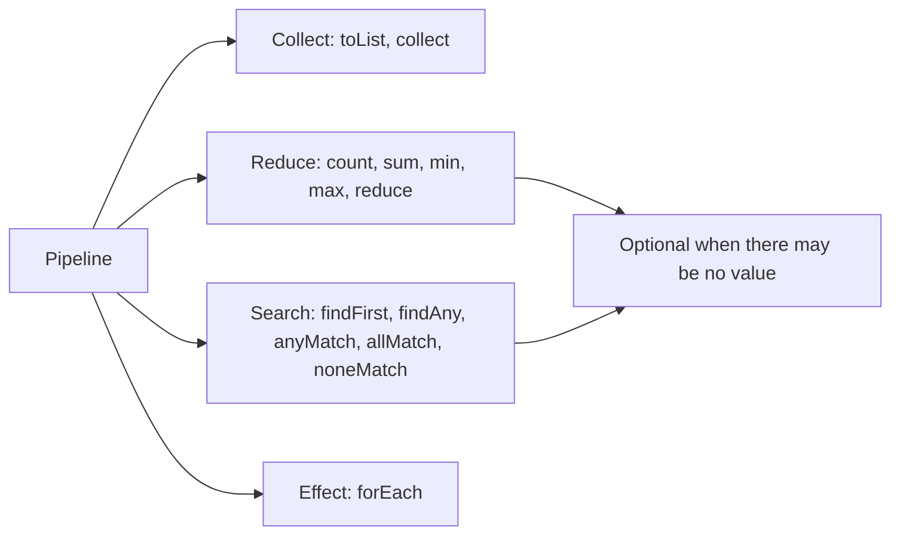

# Terminal Operations and Optional

**Java · Streams · Step 13.2.4 · Fundamentals** · Last updated 2026-10-22
**Prerequisites:** [The pipeline: source, operations and laziness](02-pipeline-laziness.md) (13.2.2), [Transforming and filtering](03-transforming-filtering.md) (13.2.3)

**Version note**

| Item | Version |
|---|---|
| Baseline | **Java 8**: `collect`, `reduce`, `count`, `min`/`max`, `findFirst`/`findAny`, `anyMatch`/`allMatch`/`noneMatch`, `forEach`, and `Optional` |
| Newer features covered | **Java 9**: `Optional.ifPresentOrElse`, `or`, `stream`. **Java 10**: `Optional.orElseThrow()` without arguments, `Collectors.toUnmodifiableList()`. **Java 11**: `Optional.isEmpty()`. **Java 16**: `Stream.toList()` |
| Hands-on baseline | **Java 21**, tested with OpenJDK 21.0.8 (Temurin) |

The terminal operation is the step that runs a pipeline and produces its result. Every example is a complete program using the shared ShopFlow orders with their lines (listed in [13.2.3](03-transforming-filtering.md)). How to run them on your Mac is in [the Java overview](../01-java-overview.md), section 5.

## 1. What it is and why it matters

**What is it?** A terminal operation ends a pipeline and gives you something back: a collection (`toList`, `collect`), one value (`count`, `sum`, `max`, `reduce`), an answer to a question (`anyMatch`, `findFirst`), or a side effect (`forEach`). When the answer may not exist, for example "the largest paid order of a customer who has none", the result is an **`Optional`**.

**Why do we need it?** The terminal operation decides what the pipeline *means*. The wrong choice gives wrong results quietly: an `allMatch` that is `true` for a customer with no orders, a `reduce` with the wrong starting value, or a `get()` that crashes when nothing was found.

**When would I meet it?** At the end of every stream, and in every service method that returns "maybe a result": find an order, the cheapest item, the first matching rule.

> [!TIP]
> **Memory hook:** the end of the belt decides what you take home: a box of items (collect), one number (reduce), a yes or no (match), or a parcel that may be empty (`Optional`).

## 2. Industry terms

| Term | Simple meaning | Why it matters | Example | Related terms |
|---|---|---|---|---|
| **Terminal operation** | The step that runs the pipeline and returns a result | Without it nothing runs | `toList()`, `sum()` | Intermediate operation |
| **Reduction** | Combining all elements into one value | Totals, counts, minimum, maximum | `reduce(0L, Long::sum)` | Fold |
| **Identity (of a reduction)** | The starting value that changes nothing | Must be neutral, or the result is wrong | `0` for `+`, `1` for `×` | Accumulator |
| **Short-circuiting terminal operation** | Can return before reading every element | Faster; side effects may not run | `findFirst`, `anyMatch` | [13.2.2](02-pipeline-laziness.md) |
| **`Optional`** | A container that holds one value or none | Makes "no result" part of the type | `Optional<Order>` | `null` |
| **Vacuous truth** | "All of nothing" is true | `allMatch` on an empty stream is `true` | All of dan's orders are paid: `true` | `noneMatch` |

## 3. In a real system (ShopFlow)

**The business problem.** The Order Service needs dashboard numbers (count and revenue of paid orders, the largest order) and an endpoint `GET /customers/{c}/largest-paid-order` that answers `200` with the order, or `404` when the customer has no paid order. "No result" is a normal outcome here, not an error.

Each question maps to a different terminal operation, and the endpoint maps an `Optional` to a response in one place. Both are built below.

## 4. How it works



1. The terminal operation starts the run ([13.2.2](02-pipeline-laziness.md)).
2. **Collect** operations gather elements; **reduce** operations combine them into one value; **search** operations look for an element or answer a yes/no question and may stop early; **effect** operations do something with each element.
3. When an operation may have no answer (`max` of nothing, `findFirst` of nothing), it returns an `Optional` instead of `null`.

### Four families of terminal operations

**Concept.** Before writing a pipeline, decide what you want back: a collection, one value, an answer, or an effect. That choice picks the terminal operation.

```java
// File: TerminalFamilies.java (runnable, Java 21)
import java.util.Comparator;
import java.util.List;
import java.util.Optional;

public class TerminalFamilies {

    enum Status { PAID, PENDING, CANCELLED }

    record OrderLine(String sku, int quantity, long unitCents) {}

    record Order(String id, String customer, Status status, long totalCents, List<OrderLine> lines) {}

    static List<Order> sampleOrders() {               // the same five ShopFlow orders, with their lines
        return List.of(
            new Order("o-1001", "ana", Status.PAID,      8_000, List.of(new OrderLine("MUG", 2, 1_500), new OrderLine("TEE", 1, 5_000))),
            new Order("o-1002", "ben", Status.CANCELLED, 3_000, List.of(new OrderLine("MUG", 2, 1_500))),
            new Order("o-1003", "ana", Status.PAID,      2_500, List.of(new OrderLine("SOCKS", 1, 2_500))),
            new Order("o-1004", "cy",  Status.PENDING,   4_500, List.of(new OrderLine("MUG", 3, 1_500))),
            new Order("o-1005", "cy",  Status.PAID,     12_000, List.of(new OrderLine("HOODIE", 1, 9_500), new OrderLine("SOCKS", 1, 2_500))));
    }

    public static void main(String[] args) {
        List<Order> orders = sampleOrders();

        // 1. Collect: gather results
        List<String> paidIds = orders.stream().filter(o -> o.status() == Status.PAID).map(Order::id).toList();
        System.out.println("collect  toList: " + paidIds);

        // 2. Reduce to one value: count, sum, min, max
        long paidCount = orders.stream().filter(o -> o.status() == Status.PAID).count();
        long paidRevenue = orders.stream().filter(o -> o.status() == Status.PAID).mapToLong(Order::totalCents).sum();
        Optional<Order> largest = orders.stream().max(Comparator.comparingLong(Order::totalCents));
        System.out.println("reduce   count: " + paidCount + ", sum: " + paidRevenue + ", max: " + largest.map(Order::id).orElse("none"));

        // 3. Search: find and match (short-circuiting)
        Optional<Order> firstPending = orders.stream().filter(o -> o.status() == Status.PENDING).findFirst();
        boolean anyCancelled = orders.stream().anyMatch(o -> o.status() == Status.CANCELLED);
        boolean allHaveLines = orders.stream().allMatch(o -> !o.lines().isEmpty());
        boolean noneFree = orders.stream().noneMatch(o -> o.totalCents() == 0);
        System.out.println("search   first pending: " + firstPending.map(Order::id).orElse("none")
                + ", any cancelled: " + anyCancelled + ", all have lines: " + allHaveLines + ", none free: " + noneFree);

        // 4. Side effect at the end: forEach
        System.out.print("forEach  customers: ");
        orders.stream().map(Order::customer).distinct().forEach(c -> System.out.print(c + " "));
        System.out.println();
    }
}
```

**Expected output** (run on OpenJDK 21.0.8, 2026-10-22):

```text
collect  toList: [o-1001, o-1003, o-1005]
reduce   count: 3, sum: 22500, max: o-1005
search   first pending: o-1004, any cancelled: true, all have lines: true, none free: true
forEach  customers: ana ben cy 
```

**Walkthrough.**

| Family | Operation | Result | Why |
|---|---|---|---|
| Collect | `toList()` | `[o-1001, o-1003, o-1005]` | The three paid orders |
| Reduce | `count()`, `sum()` | 3 and 22,500 | 8,000 + 2,500 + 12,000 |
| Reduce | `max(comparator)` | `Optional` holding o-1005 | 12,000 is the largest total; `max` returns an `Optional` because a stream can be empty |
| Search | `findFirst()` | `Optional` holding o-1004 | The only pending order |
| Search | `anyMatch`, `allMatch`, `noneMatch` | `true`, `true`, `true` | o-1002 is cancelled; every order has lines; no order is free |
| Effect | `forEach` | prints the names | For output or logging, not for building results |

**Experiment.** Change the `allMatch` condition to `o -> o.totalCents() > 2_500`. Predict the "all have lines" value. (Answer at the end.)

### What terminal operations return on an empty stream

**Concept.** A stream can be empty: a customer with no orders, a filter that matches nothing. Each terminal operation has a defined answer for that case, and two of them surprise people.

```java
// File: EmptyStreamResults.java (runnable, Java 21)
import java.util.Comparator;
import java.util.List;

public class EmptyStreamResults {

    enum Status { PAID, PENDING, CANCELLED }

    record OrderLine(String sku, int quantity, long unitCents) {}

    record Order(String id, String customer, Status status, long totalCents, List<OrderLine> lines) {}

    static List<Order> sampleOrders() {               // the same five ShopFlow orders, with their lines
        return List.of(
            new Order("o-1001", "ana", Status.PAID,      8_000, List.of(new OrderLine("MUG", 2, 1_500), new OrderLine("TEE", 1, 5_000))),
            new Order("o-1002", "ben", Status.CANCELLED, 3_000, List.of(new OrderLine("MUG", 2, 1_500))),
            new Order("o-1003", "ana", Status.PAID,      2_500, List.of(new OrderLine("SOCKS", 1, 2_500))),
            new Order("o-1004", "cy",  Status.PENDING,   4_500, List.of(new OrderLine("MUG", 3, 1_500))),
            new Order("o-1005", "cy",  Status.PAID,     12_000, List.of(new OrderLine("HOODIE", 1, 9_500), new OrderLine("SOCKS", 1, 2_500))));
    }

    public static void main(String[] args) {
        // dan has no orders at all: every pipeline below runs on an empty stream
        List<Order> dans = sampleOrders().stream().filter(o -> o.customer().equals("dan")).toList();

        System.out.println("count:     " + dans.stream().count());
        System.out.println("sum:       " + dans.stream().mapToLong(Order::totalCents).sum());
        System.out.println("max:       " + dans.stream().max(Comparator.comparingLong(Order::totalCents)).map(Order::id).orElse("(empty Optional)"));
        System.out.println("anyMatch:  " + dans.stream().anyMatch(o -> o.status() == Status.PAID));
        System.out.println("allMatch:  " + dans.stream().allMatch(o -> o.status() == Status.PAID));
        System.out.println("noneMatch: " + dans.stream().noneMatch(o -> o.status() == Status.PAID));
    }
}
```

**Expected output** (run on OpenJDK 21.0.8, 2026-10-22):

```text
count:     0
sum:       0
max:       (empty Optional)
anyMatch:  false
allMatch:  true
noneMatch: true
```

**Walkthrough.** `count` and `sum` give `0`; `max` gives an **empty `Optional`**, not `null` and not an exception. `anyMatch` is `false` (nothing matched). `allMatch` and `noneMatch` are both **`true`**: the documentation says that for an empty stream they return `true` without evaluating the predicate. "All of dan's orders are paid" is true because dan has none. If "dan has orders, and all are paid" is what the business means, check that the list isn't empty as well.

**Experiment.** Change `"dan"` to `"ben"`. Predict all six lines. (Answer at the end.)

### `reduce`: combine the elements into one value

**Concept.** `reduce(identity, accumulator)` starts from the identity and combines it with each element in turn. `reduce(accumulator)` has no starting value, so it returns an `Optional` (empty when there are no elements). The identity must be **neutral** (adding it changes nothing), and the accumulator must be **associative** (grouping doesn't change the result), so the stream may also run it in parallel.

```java
// File: ReduceDemo.java (runnable, Java 21)
import java.util.List;
import java.util.Optional;

public class ReduceDemo {

    enum Status { PAID, PENDING, CANCELLED }

    record OrderLine(String sku, int quantity, long unitCents) {}

    record Order(String id, String customer, Status status, long totalCents, List<OrderLine> lines) {}

    static List<Order> sampleOrders() {               // the same five ShopFlow orders, with their lines
        return List.of(
            new Order("o-1001", "ana", Status.PAID,      8_000, List.of(new OrderLine("MUG", 2, 1_500), new OrderLine("TEE", 1, 5_000))),
            new Order("o-1002", "ben", Status.CANCELLED, 3_000, List.of(new OrderLine("MUG", 2, 1_500))),
            new Order("o-1003", "ana", Status.PAID,      2_500, List.of(new OrderLine("SOCKS", 1, 2_500))),
            new Order("o-1004", "cy",  Status.PENDING,   4_500, List.of(new OrderLine("MUG", 3, 1_500))),
            new Order("o-1005", "cy",  Status.PAID,     12_000, List.of(new OrderLine("HOODIE", 1, 9_500), new OrderLine("SOCKS", 1, 2_500))));
    }

    public static void main(String[] args) {
        List<Order> orders = sampleOrders();

        // reduce(identity, accumulator): start from 0, add each total
        long revenue = orders.stream()
                .filter(o -> o.status() == Status.PAID)
                .map(Order::totalCents)
                .reduce(0L, Long::sum);
        System.out.println("paid revenue (reduce): " + revenue);

        // reduce(accumulator) with no identity: an Optional, empty if there were no elements
        Optional<String> longestName = orders.stream()
                .map(Order::customer)
                .reduce((a, b) -> b.length() > a.length() ? b : a);
        System.out.println("longest customer name: " + longestName.orElse("none"));

        // MISTAKE: an identity that isn't neutral for the operation changes the answer
        long wrong = orders.stream()
                .filter(o -> o.status() == Status.PAID)
                .map(Order::totalCents)
                .reduce(100L, Long::sum);                  // 100 is not neutral for +
        System.out.println("paid revenue with identity 100: " + wrong);
    }
}
```

**Expected output** (run on OpenJDK 21.0.8, 2026-10-22):

```text
paid revenue (reduce): 22500
longest customer name: ana
paid revenue with identity 100: 22600
```

**Walkthrough.**

| Step | Running value (identity 0) | Running value (identity 100, the mistake) |
|---|---|---|
| Start | 0 | 100 |
| + o-1001 (8,000) | 8,000 | 8,100 |
| + o-1003 (2,500) | 10,500 | 10,600 |
| + o-1005 (12,000) | **22,500** | **22,600** |

With identity 100 the sequential result is off by 100. In a parallel stream the identity can be used once per chunk of work, so the error could grow with the number of chunks; that is why the documentation requires a true identity. For plain sums prefer `mapToLong(...).sum()`; use `reduce` when the combining rule is your own. In the second pipeline the names "ana" and "ben" have the same length, and the accumulator keeps the earlier one, so `ana` wins.

**Experiment.** In the first pipeline, replace `Long::sum` with `Math::max`. Predict the result, and say what the pipeline now computes. (Answer at the end.)

### `Optional`: a result that may be missing

**Concept.** `Optional<T>` either holds a value or is empty. Instead of checking for `null`, you transform it (`map`, `filter`) and decide at the end what an empty result means (`orElse`, `orElseGet`, `orElseThrow`, `ifPresentOrElse`). The documentation describes `Optional` as intended mainly as a **return type** where "no result" must be represented.

```java
// File: OptionalDemo.java (runnable, Java 21)
import java.util.Comparator;
import java.util.List;
import java.util.Optional;

public class OptionalDemo {

    enum Status { PAID, PENDING, CANCELLED }

    record OrderLine(String sku, int quantity, long unitCents) {}

    record Order(String id, String customer, Status status, long totalCents, List<OrderLine> lines) {}

    static List<Order> sampleOrders() {               // the same five ShopFlow orders, with their lines
        return List.of(
            new Order("o-1001", "ana", Status.PAID,      8_000, List.of(new OrderLine("MUG", 2, 1_500), new OrderLine("TEE", 1, 5_000))),
            new Order("o-1002", "ben", Status.CANCELLED, 3_000, List.of(new OrderLine("MUG", 2, 1_500))),
            new Order("o-1003", "ana", Status.PAID,      2_500, List.of(new OrderLine("SOCKS", 1, 2_500))),
            new Order("o-1004", "cy",  Status.PENDING,   4_500, List.of(new OrderLine("MUG", 3, 1_500))),
            new Order("o-1005", "cy",  Status.PAID,     12_000, List.of(new OrderLine("HOODIE", 1, 9_500), new OrderLine("SOCKS", 1, 2_500))));
    }

    static String eur(long cents) {                     // 8000 -> "EUR 80.00"
        return String.format("EUR %d.%02d", cents / 100, cents % 100);
    }

    // A service method: "maybe a result" is part of its type
    static Optional<Order> largestPaidOrder(List<Order> orders, String customer) {
        return orders.stream()
                .filter(o -> o.customer().equals(customer))
                .filter(o -> o.status() == Status.PAID)
                .max(Comparator.comparingLong(Order::totalCents));
    }

    public static void main(String[] args) {
        List<Order> orders = sampleOrders();

        for (String customer : List.of("cy", "ben")) {
            Optional<Order> largest = largestPaidOrder(orders, customer);

            String id = largest.map(Order::id).orElse("none");                        // transform, with a default
            String bigOne = largest.filter(o -> o.totalCents() > 10_000)                 // keep only if it matches
                    .map(o -> o.id() + " (" + eur(o.totalCents()) + ")")
                    .orElse("no paid order over EUR 100");
            System.out.println(customer + ": largest paid = " + id + "; big = " + bigOne + "; empty = " + largest.isEmpty());

            largest.ifPresentOrElse(                                                    // Java 9
                    o -> System.out.println("   200 OK, " + o.id()),
                    () -> System.out.println("   404 Not Found: no paid order for " + customer));
        }
    }
}
```

**Expected output** (run on OpenJDK 21.0.8, 2026-10-22):

```text
cy: largest paid = o-1005; big = o-1005 (EUR 120.00); empty = false
   200 OK, o-1005
ben: largest paid = none; big = no paid order over EUR 100; empty = true
   404 Not Found: no paid order for ben
```

**Walkthrough.**

| Step | For cy | For ben |
|---|---|---|
| `largestPaidOrder` | `Optional` holding o-1005 | empty (ben's only order is cancelled) |
| `.map(Order::id).orElse("none")` | `o-1005` | `none` |
| `.filter(total > 10,000)` | still holds o-1005 (12,000) | still empty |
| `.isEmpty()` (Java 11) | `false` | `true` |
| `.ifPresentOrElse(...)` (Java 9) | prints `200 OK` | prints `404 Not Found` |

`map` and `filter` on an empty `Optional` do nothing and return an empty `Optional`, so the whole chain is safe without a single `null` check.

**Experiment.** Add `"ana"` to the list of customers. Predict her two lines. (Answer at the end.)

### `orElse` versus `orElseGet`

**Concept.** Both provide a fallback when the `Optional` is empty, but `orElse(value)` takes a ready-made value, while `orElseGet(supplier)` takes a function. Java evaluates a method's arguments before calling it, so the expression inside `orElse(...)` runs **every time**, even when a value is present.

```java
// File: OrElseVsOrElseGet.java (runnable, Java 21)
import java.util.List;
import java.util.Optional;

public class OrElseVsOrElseGet {

    enum Status { PAID, PENDING, CANCELLED }

    record OrderLine(String sku, int quantity, long unitCents) {}

    record Order(String id, String customer, Status status, long totalCents, List<OrderLine> lines) {}

    static List<Order> sampleOrders() {               // the same five ShopFlow orders, with their lines
        return List.of(
            new Order("o-1001", "ana", Status.PAID,      8_000, List.of(new OrderLine("MUG", 2, 1_500), new OrderLine("TEE", 1, 5_000))),
            new Order("o-1002", "ben", Status.CANCELLED, 3_000, List.of(new OrderLine("MUG", 2, 1_500))),
            new Order("o-1003", "ana", Status.PAID,      2_500, List.of(new OrderLine("SOCKS", 1, 2_500))),
            new Order("o-1004", "cy",  Status.PENDING,   4_500, List.of(new OrderLine("MUG", 3, 1_500))),
            new Order("o-1005", "cy",  Status.PAID,     12_000, List.of(new OrderLine("HOODIE", 1, 9_500), new OrderLine("SOCKS", 1, 2_500))));
    }

    static String loadDefaultCustomer() {                 // imagine a database or HTTP call
        System.out.println("   (loading default customer...)");
        return "guest";
    }

    public static void main(String[] args) {
        Optional<String> present = sampleOrders().stream().map(Order::customer).findFirst();   // "ana"

        System.out.println("orElse:");
        String a = present.orElse(loadDefaultCustomer());          // argument is evaluated before the call
        System.out.println("   result " + a);

        System.out.println("orElseGet:");
        String b = present.orElseGet(() -> loadDefaultCustomer()); // a function, called only if needed
        System.out.println("   result " + b);
    }
}
```

**Expected output** (run on OpenJDK 21.0.8, 2026-10-22):

```text
orElse:
   (loading default customer...)
   result ana
orElseGet:
   result ana
```

**Walkthrough.** The `Optional` holds `"ana"`, so neither fallback is needed. `orElse(loadDefaultCustomer())` still called the method (the "loading" line), because the argument is computed before `orElse` runs. `orElseGet(() -> loadDefaultCustomer())` received a function, and in this run it was not called. Use `orElse` for constants and `orElseGet` when the fallback costs something (a query, an HTTP call, an object you'd rather not create).

**Experiment.** Make the `Optional` empty by adding `.filter(c -> c.equals("dan"))` before `findFirst()`. Predict both results and how many "loading" lines appear. (Answer at the end.)

### `Stream.toList()` or `Collectors.toList()`?

**Concept.** All three below gather elements into a `List` in encounter order, but they promise different things. `toList()` (Java 16+) returns an **unmodifiable** list. `Collectors.toList()` makes **no promise** about the list's type, mutability, serializability or thread safety. When you need a list you will change, ask for one explicitly with `Collectors.toCollection(ArrayList::new)`. The program checks only the guaranteed behaviour, so it never calls `add` on the `Collectors.toList()` result. (It uses the earlier `Order` model without lines; that doesn't affect the point.)

```java
// File: ToListDemo.java (runnable, Java 21)
import java.util.ArrayList;
import java.util.List;
import java.util.stream.Collectors;

public class ToListDemo {

    enum Status { PAID, PENDING, CANCELLED }

    record Order(String id, String customer, Status status, long totalCents) {}

    static List<Order> sampleOrders() {               // the same five ShopFlow orders in every example
        return List.of(
            new Order("o-1001", "ana", Status.PAID,      8_000),
            new Order("o-1002", "ben", Status.CANCELLED, 3_000),
            new Order("o-1003", "ana", Status.PAID,      2_500),
            new Order("o-1004", "cy",  Status.PENDING,   4_500),
            new Order("o-1005", "cy",  Status.PAID,     12_000));
    }

    public static void main(String[] args) {
        List<Order> orders = sampleOrders();

        List<String> fixed    = orders.stream().map(Order::id).toList();                                   // Java 16+: unmodifiable
        List<String> anyList  = orders.stream().map(Order::id).collect(Collectors.toList());               // type and mutability unspecified
        List<String> editable = orders.stream().map(Order::id).collect(Collectors.toCollection(ArrayList::new)); // always an ArrayList

        // Guaranteed for all three: the same elements, in encounter order
        System.out.println("same elements, same order: " + (fixed.equals(anyList) && anyList.equals(editable)));

        // Guaranteed: Stream.toList() rejects changes
        try {
            fixed.add("o-9999");
        } catch (UnsupportedOperationException e) {
            System.out.println("Stream.toList(): add rejected with UnsupportedOperationException");
        }

        // Guaranteed: toCollection(ArrayList::new) gives a list you may change
        editable.add("o-9999");
        System.out.println("toCollection(ArrayList::new): add accepted, size " + editable.size());

        // Collectors.toList(): neither outcome is promised, so don't depend on add() working or failing
        System.out.println("Collectors.toList(): " + anyList.size() + " ids; mutability not specified, so not modified here");
    }
}
```

**Expected output** (run on OpenJDK 21.0.8, 2026-10-22):

```text
same elements, same order: true
Stream.toList(): add rejected with UnsupportedOperationException
toCollection(ArrayList::new): add accepted, size 6
Collectors.toList(): 5 ids; mutability not specified, so not modified here
```

| You need | Use | Why |
|---|---|---|
| A result nobody should change (most service and DTO results) | `stream.toList()` | Unmodifiable, short, Java 16+ |
| A list you will add to or sort in place | `Collectors.toCollection(ArrayList::new)` | Guaranteed `ArrayList` |
| Older code, or a collector inside another collector | `Collectors.toList()` | Fine for reading; treat it as "some list": its type and mutability are not part of the contract |
| An unmodifiable list on Java 10 to 15 | `Collectors.toUnmodifiableList()` | Java 10+; also rejects `null` elements |

**Observation, not a guarantee.** On OpenJDK 21.0.8, `Collectors.toList()` returned a `java.util.ArrayList` (checked with `getClass()`), so code that adds to its result happens to work there. That is an implementation detail of this JDK, not part of the API.

**Practical implication.** Switching a method from `collect(Collectors.toList())` to `toList()` can break a caller that adds to the returned list: it will now get `UnsupportedOperationException` at run time. That caller was already relying on unspecified behaviour; if it needs to change the list, return `Collectors.toCollection(ArrayList::new)` (or let the caller copy the list).

### Putting it together: an endpoint that may find nothing

**Concept.** The service returns `Optional<Order>`, because "no paid order" is a normal answer. The controller converts that `Optional` to a response in one place: `map` for the found case, `orElseGet` for the missing one.

```java
// File: OrderLookupController.java (runnable, Java 21)
import java.util.Comparator;
import java.util.List;
import java.util.Optional;

public class OrderLookupController {

    enum Status { PAID, PENDING, CANCELLED }

    record OrderLine(String sku, int quantity, long unitCents) {}

    record Order(String id, String customer, Status status, long totalCents, List<OrderLine> lines) {}

    static List<Order> sampleOrders() {               // the same five ShopFlow orders, with their lines
        return List.of(
            new Order("o-1001", "ana", Status.PAID,      8_000, List.of(new OrderLine("MUG", 2, 1_500), new OrderLine("TEE", 1, 5_000))),
            new Order("o-1002", "ben", Status.CANCELLED, 3_000, List.of(new OrderLine("MUG", 2, 1_500))),
            new Order("o-1003", "ana", Status.PAID,      2_500, List.of(new OrderLine("SOCKS", 1, 2_500))),
            new Order("o-1004", "cy",  Status.PENDING,   4_500, List.of(new OrderLine("MUG", 3, 1_500))),
            new Order("o-1005", "cy",  Status.PAID,     12_000, List.of(new OrderLine("HOODIE", 1, 9_500), new OrderLine("SOCKS", 1, 2_500))));
    }

    static String eur(long cents) {                     // 8000 -> "EUR 80.00"
        return String.format("EUR %d.%02d", cents / 100, cents % 100);
    }

    record Response(int status, String body) {}

    // Service: returns Optional, because "no order" is a normal outcome, not an error
    static Optional<Order> findLargestPaidOrder(List<Order> orders, String customer) {
        return orders.stream()
                .filter(o -> o.customer().equals(customer) && o.status() == Status.PAID)
                .max(Comparator.comparingLong(Order::totalCents).thenComparing(Order::id));
    }

    // Controller: turns the Optional into an HTTP-style response in one place
    static Response largestPaid(List<Order> orders, String customer) {
        return findLargestPaidOrder(orders, customer)
                .map(o -> new Response(200, o.id() + " " + eur(o.totalCents())))
                .orElseGet(() -> new Response(404, "no paid order for " + customer));
    }

    public static void main(String[] args) {
        for (String customer : List.of("ana", "ben", "cy", "dan")) {
            Response r = largestPaid(sampleOrders(), customer);
            System.out.println("GET /customers/" + customer + "/largest-paid-order -> " + r.status() + " " + r.body());
        }
    }
}
```

**Expected output** (run on OpenJDK 21.0.8, 2026-10-22):

```text
GET /customers/ana/largest-paid-order -> 200 o-1001 EUR 80.00
GET /customers/ben/largest-paid-order -> 404 no paid order for ben
GET /customers/cy/largest-paid-order -> 200 o-1005 EUR 120.00
GET /customers/dan/largest-paid-order -> 404 no paid order for dan
```

**Walkthrough.** For ana, the paid orders are o-1001 (8,000) and o-1003 (2,500), so `max` picks o-1001 and `map` builds a `200`. For ben (only a cancelled order) and dan (no orders) the `Optional` is empty, `map` is skipped and `orElseGet` builds the `404`. The `thenComparing(Order::id)` tie-breaker makes the choice predictable if two orders ever have the same total. No `null` and no exception travel between the layers.

## 5. Failure scenarios

### `get()` on an empty `Optional`, and `null` inside a stream

- **What happened?** Code called `optional.get()` "because there is always an order", and a stream over a nullable column called `findFirst()`.
- **Why?** `get()` throws `NoSuchElementException` when the `Optional` is empty. `findFirst()` throws `NullPointerException` if the element it selects is `null`, because an `Optional` can't hold `null`.

```java
// File: OptionalMistakes.java (runnable, Java 21)
import java.util.Arrays;
import java.util.List;
import java.util.NoSuchElementException;
import java.util.Objects;
import java.util.Optional;

public class OptionalMistakes {

    enum Status { PAID, PENDING, CANCELLED }

    record OrderLine(String sku, int quantity, long unitCents) {}

    record Order(String id, String customer, Status status, long totalCents, List<OrderLine> lines) {}

    static List<Order> sampleOrders() {               // the same five ShopFlow orders, with their lines
        return List.of(
            new Order("o-1001", "ana", Status.PAID,      8_000, List.of(new OrderLine("MUG", 2, 1_500), new OrderLine("TEE", 1, 5_000))),
            new Order("o-1002", "ben", Status.CANCELLED, 3_000, List.of(new OrderLine("MUG", 2, 1_500))),
            new Order("o-1003", "ana", Status.PAID,      2_500, List.of(new OrderLine("SOCKS", 1, 2_500))),
            new Order("o-1004", "cy",  Status.PENDING,   4_500, List.of(new OrderLine("MUG", 3, 1_500))),
            new Order("o-1005", "cy",  Status.PAID,     12_000, List.of(new OrderLine("HOODIE", 1, 9_500), new OrderLine("SOCKS", 1, 2_500))));
    }

    public static void main(String[] args) {
        // Mistake 1: get() on an empty Optional
        Optional<Order> bensPaid = sampleOrders().stream()
                .filter(o -> o.customer().equals("ben") && o.status() == Status.PAID)
                .findFirst();
        try {
            System.out.println(bensPaid.get().id());
        } catch (NoSuchElementException e) {
            System.out.println("get() on empty: NoSuchElementException");
        }
        System.out.println("safer: " + bensPaid.map(Order::id).orElse("no paid order for ben"));

        // Mistake 2: findFirst() when the first element is null
        List<String> couponCodes = Arrays.asList(null, "WELCOME10", "SALE5");   // e.g. a nullable column
        try {
            couponCodes.stream().findFirst();
        } catch (NullPointerException e) {
            System.out.println("findFirst() on a null element: NullPointerException");
        }
        System.out.println("safer: " + couponCodes.stream().filter(Objects::nonNull).findFirst().orElse("no coupon"));
    }
}
```

**Expected output** (run on OpenJDK 21.0.8, 2026-10-22):

```text
get() on empty: NoSuchElementException
safer: no paid order for ben
findFirst() on a null element: NullPointerException
safer: WELCOME10
```

- **Solution:** decide what "empty" means with `map`/`orElse`/`orElseGet`, or use `orElseThrow()` (Java 10, the documented preferred alternative to `get()`) when absence really is a bug, so the intent is explicit. Remove `null` elements before searching (`filter(Objects::nonNull)`).

### Two quiet logic errors

- **`allMatch` on an empty stream** returns `true` (shown above). A check such as "every order of this customer is paid" passes for a customer with no orders. Add an explicit non-empty check when the rule needs at least one element.
- **A non-neutral identity in `reduce`** shifts the result (22,600 instead of 22,500 above), and the error can grow in parallel. Use `0` for sums, `1` for products, or a dedicated method such as `sum()`.

## 6. Architectural decisions

| You want | Use | Not |
|---|---|---|
| A list of results | `toList()` (Java 16+) | `forEach(list::add)` |
| A total or count | `mapToLong(...).sum()`, `count()` | `reduce` with a hand-written identity, when a built-in exists |
| The largest or smallest | `max`/`min` with a comparator and a tie-breaker | Sorting everything and taking the first |
| "Is there any / are all / is none" | `anyMatch`/`allMatch`/`noneMatch` | `filter(...).count() > 0` (reads every element) |
| Maybe one result | `Optional` as the **return type** | Returning `null` |

- **Where `Optional` belongs:** the documentation recommends it mainly as a method return type, and says a variable of type `Optional` should never itself be `null`. Fields, method parameters and collections of `Optional` usually add noise; use a plain value, a default or an empty collection there.
- **`findFirst` or `findAny`:** `findFirst` for a predictable result; `findAny` only when any match is acceptable and the stream may run in parallel ([13.2.2](02-pipeline-laziness.md)).
- **Common mistakes:** `get()` without a check; `orElse(expensiveCall())`; comparing an `Optional` with `Optional.empty()` using `==` (the documentation says `empty()` isn't guaranteed to be a single instance; use `isEmpty()` or `isPresent()`).

## 7. Try it yourself

Use the shared setup with lines (the `Status` enum, the `OrderLine` and `Order` records and `sampleOrders()`) from any example above. The solutions are at the end.

1. **Every paid order has lines.** Print whether every `PAID` order has at least one line. Expected: `true`.
2. **Cheapest pending order.** Print the id of the cheapest `PENDING` order, or `none`. Expected: `o-1004`.
3. **Units with `reduce`.** Using `reduce` (not `sum`), print the total number of units in all orders. Expected: `11`.
4. **A customer with a big order.** Print the customer of the largest order if it is over EUR 200, otherwise `nobody`, without any `if` or `null`. Expected: `nobody`.

## 8. Check your understanding

1. What does `allMatch` return on an empty stream, and why can that hide a bug?
2. Why does `reduce(accumulator)` return an `Optional`, while `reduce(identity, accumulator)` returns a plain value?
3. In `optional.orElse(loadDefault())`, when does `loadDefault()` run? How would you change it so it runs only when needed?
4. Your service method sometimes has no result. Should it return `null`, throw an exception, or return `Optional`? Explain the choice.
5. Why is `filter(...).count() > 0` worse than `anyMatch(...)`?

Answers are at the end of this note.

## 9. Revision

**Remember**
- **Decide what you want back:** a collection, one value, an answer, or an effect.
- **`allMatch` and `noneMatch` are `true` on an empty stream.**
- **`reduce` needs a neutral identity and an associative operation.**
- **`Optional` is for return values**; transform it with `map`/`filter` and decide at the end.
- **`orElse` evaluates its argument always; `orElseGet` only when needed.**

**Explain in 15 seconds:** "Terminal operations run the pipeline and produce a collection, one value, a match result or an effect; when there may be no answer, they return an Optional, which I map and resolve at the edge."

**Explain in 60 seconds:**
> "A terminal operation decides what the pipeline means. I collect with toList, reduce with count, sum, min, max or reduce, search with findFirst and the match methods, and keep forEach for side effects at the end. Empty streams have defined answers: zero for count and sum, an empty Optional for max, false for anyMatch, and true for allMatch, which can hide a missing-data bug. reduce needs a true identity and an associative operation, or results drift, especially in parallel. When a result may be missing, I return an Optional, transform it with map and filter, and resolve it in one place, using orElseGet for costly fallbacks and orElseThrow when absence is a bug."

**Likely follow-up questions:**
- **`Optional.get()` or `orElseThrow()`?** `orElseThrow()` (Java 10): same behaviour, but the name says what happens; the Javadoc calls it the preferred alternative.
- **Should a JPA entity field be `Optional`?** Usually not; `Optional` is designed mainly as a method return type.
- **Why is `max` an `Optional` but `sum` a number?** The sum of nothing has a natural answer (0); the maximum of nothing doesn't.

**Architect's takeaway:** make "no result" explicit in service signatures with `Optional`, and convert it to an HTTP status or a default in exactly one layer.

**Next topic:** collectors: `groupingBy`, `toMap`, `partitioningBy` and `teeing` (13.2.5, planned).

## 10. Verification and sources

> [!NOTE]
> Checked 2026-10-22 against the Java SE 21 documentation. Every program marked runnable in this note, including the solutions, is run automatically on OpenJDK 21.0.8 and its output compared with this note (`tools/check-java-examples.py`); each was also run twice to confirm the output is the same.

- **Confirmed (`Stream` Javadoc):** for `reduce(identity, accumulator)` the identity must be an identity for the accumulator (for all `t`, `accumulator.apply(identity, t)` equals `t`) and the accumulator must be associative; `reduce(accumulator)` returns an `Optional` and throws `NullPointerException` if the result is `null`; on an empty stream `allMatch` and `noneMatch` return `true` and `anyMatch` returns `false` without evaluating the predicate; `min` and `max` return `Optional` and throw `NullPointerException` if the selected element is `null`; `findFirst` throws `NullPointerException` if the selected element is `null`; `count()` is a reduction that may skip the pipeline for a sized source.
- **Confirmed (`Optional` Javadoc):** `Optional` is "primarily intended for use as a method return type"; a variable of type `Optional` should never itself be `null`; `get()` throws `NoSuchElementException` when empty and `orElseThrow()` (since 10) is "the preferred alternative"; `map` returns an empty `Optional` if the mapping function returns `null`; `Optional.empty()` is not guaranteed to be a singleton, so don't compare with `==`. Since versions: `Optional` 1.8; `stream`, `or`, `ifPresentOrElse` 9; `orElseThrow()` 10; `isEmpty` 11.
- **Confirmed (`Collectors` Javadoc):** `toList()` gives no guarantees on type, mutability, serializability or thread safety; `toUnmodifiableList()` (since 10) disallows `null`; `toCollection` collects in encounter order into the supplied collection.
- **Observed (OpenJDK 21.0.8):** every expected output above, the experiment results and the exercise solutions; that `orElseGet`'s supplier was not called when a value was present (the Javadoc describes the result, and Java's rule that arguments are evaluated before a method call explains why `orElse` always evaluates its argument).
- **Assumptions and illustrations:** the ShopFlow data and the endpoint shape.
- **To verify:** how your web framework maps an empty `Optional` from a controller (for example Spring's `ResponseEntity.of(Optional)`), before relying on it.
- **Decision rule:** pick the terminal operation by what you want back; return `Optional` for maybe-results; never `get()` without knowing it is present.

**Sources:** Java SE 21 API documentation, `java.util.stream.Stream`, `java.util.Optional`, `java.util.stream.Collectors`.

## Answers

1. `true`, without evaluating the predicate ("all of nothing" is vacuously true). A rule such as "every order of this customer is paid" then passes for a customer who has no orders; check for an empty list first when at least one element is required.
2. With no identity there is no answer for an empty stream, so the result must be able to say "none": an `Optional`. With an identity, the empty stream's answer is the identity itself.
3. Every time: Java evaluates `loadDefault()` before calling `orElse`, even when a value is present. Use `orElseGet(() -> loadDefault())` (or `orElseGet(this::loadDefault)`), which calls the function only when the `Optional` is empty.
4. Return `Optional` when "no result" is a normal, expected outcome (like "no paid order for this customer"), so the caller must decide what it means. Throw when absence means something went wrong (a required record is missing). Avoid `null`, which hides the case from the type and leads to `NullPointerException`s.
5. `filter(...).count()` has to examine every element to count them, while `anyMatch` stops at the first match, and it states the question directly.

**Experiment results** (each change made to the program above, then run on OpenJDK 21.0.8):

- *`allMatch(o -> o.totalCents() > 2_500)`:* the third line ends `all have lines: false`, because o-1003's total is exactly 2,500, not more. The label still says "lines" because only the predicate changed.
- *`"ben"` instead of `"dan"`:* `count: 1`, `sum: 3000`, `max: o-1002`, `anyMatch: false` (his order is cancelled, not paid), `allMatch: false`, `noneMatch: true`. With one element, `allMatch` really checks it.
- *`Math::max` instead of `Long::sum`:* `paid revenue (reduce): 12000`. The pipeline now computes the largest paid total (o-1005); `0` is still a valid identity for `max` here, because no total is negative.
- *Adding `"ana"`:* `ana: largest paid = o-1001; big = no paid order over EUR 100; empty = false`, then `200 OK, o-1001`. Her largest paid order is 8,000, so `filter(> 10,000)` empties the `Optional` for the "big" text only.
- *An empty `Optional`:* both results become `guest`, and the "loading" line now appears **twice**: once for `orElse` (as before) and once for `orElseGet`, because this time the value is really needed.

**Exercise solutions** (run on OpenJDK 21.0.8; your version may differ in style but should print the same):

```java
// File: AllPaidHaveLines.java (runnable, Java 21)
import java.util.List;

public class AllPaidHaveLines {

    enum Status { PAID, PENDING, CANCELLED }

    record OrderLine(String sku, int quantity, long unitCents) {}

    record Order(String id, String customer, Status status, long totalCents, List<OrderLine> lines) {}

    static List<Order> sampleOrders() {               // the same five ShopFlow orders, with their lines
        return List.of(
            new Order("o-1001", "ana", Status.PAID,      8_000, List.of(new OrderLine("MUG", 2, 1_500), new OrderLine("TEE", 1, 5_000))),
            new Order("o-1002", "ben", Status.CANCELLED, 3_000, List.of(new OrderLine("MUG", 2, 1_500))),
            new Order("o-1003", "ana", Status.PAID,      2_500, List.of(new OrderLine("SOCKS", 1, 2_500))),
            new Order("o-1004", "cy",  Status.PENDING,   4_500, List.of(new OrderLine("MUG", 3, 1_500))),
            new Order("o-1005", "cy",  Status.PAID,     12_000, List.of(new OrderLine("HOODIE", 1, 9_500), new OrderLine("SOCKS", 1, 2_500))));
    }

    public static void main(String[] args) {
        boolean ok = sampleOrders().stream()
                .filter(o -> o.status() == Status.PAID)
                .allMatch(o -> !o.lines().isEmpty());
        System.out.println("every paid order has at least one line: " + ok);
    }
}
```

**Expected output**:

```text
every paid order has at least one line: true
```

```java
// File: CheapestPending.java (runnable, Java 21)
import java.util.Comparator;
import java.util.List;

public class CheapestPending {

    enum Status { PAID, PENDING, CANCELLED }

    record OrderLine(String sku, int quantity, long unitCents) {}

    record Order(String id, String customer, Status status, long totalCents, List<OrderLine> lines) {}

    static List<Order> sampleOrders() {               // the same five ShopFlow orders, with their lines
        return List.of(
            new Order("o-1001", "ana", Status.PAID,      8_000, List.of(new OrderLine("MUG", 2, 1_500), new OrderLine("TEE", 1, 5_000))),
            new Order("o-1002", "ben", Status.CANCELLED, 3_000, List.of(new OrderLine("MUG", 2, 1_500))),
            new Order("o-1003", "ana", Status.PAID,      2_500, List.of(new OrderLine("SOCKS", 1, 2_500))),
            new Order("o-1004", "cy",  Status.PENDING,   4_500, List.of(new OrderLine("MUG", 3, 1_500))),
            new Order("o-1005", "cy",  Status.PAID,     12_000, List.of(new OrderLine("HOODIE", 1, 9_500), new OrderLine("SOCKS", 1, 2_500))));
    }

    public static void main(String[] args) {
        String id = sampleOrders().stream()
                .filter(o -> o.status() == Status.PENDING)
                .min(Comparator.comparingLong(Order::totalCents))
                .map(Order::id)
                .orElse("none");
        System.out.println("cheapest pending order: " + id);
    }
}
```

**Expected output**:

```text
cheapest pending order: o-1004
```

```java
// File: UnitsByReduce.java (runnable, Java 21)
import java.util.List;

public class UnitsByReduce {

    enum Status { PAID, PENDING, CANCELLED }

    record OrderLine(String sku, int quantity, long unitCents) {}

    record Order(String id, String customer, Status status, long totalCents, List<OrderLine> lines) {}

    static List<Order> sampleOrders() {               // the same five ShopFlow orders, with their lines
        return List.of(
            new Order("o-1001", "ana", Status.PAID,      8_000, List.of(new OrderLine("MUG", 2, 1_500), new OrderLine("TEE", 1, 5_000))),
            new Order("o-1002", "ben", Status.CANCELLED, 3_000, List.of(new OrderLine("MUG", 2, 1_500))),
            new Order("o-1003", "ana", Status.PAID,      2_500, List.of(new OrderLine("SOCKS", 1, 2_500))),
            new Order("o-1004", "cy",  Status.PENDING,   4_500, List.of(new OrderLine("MUG", 3, 1_500))),
            new Order("o-1005", "cy",  Status.PAID,     12_000, List.of(new OrderLine("HOODIE", 1, 9_500), new OrderLine("SOCKS", 1, 2_500))));
    }

    public static void main(String[] args) {
        int units = sampleOrders().stream()
                .flatMap(o -> o.lines().stream())
                .map(OrderLine::quantity)
                .reduce(0, Integer::sum);
        System.out.println("units in all orders: " + units);
    }
}
```

**Expected output**:

```text
units in all orders: 11
```

Units: 2 + 1 (o-1001), 2 (o-1002), 1 (o-1003), 3 (o-1004), 1 + 1 (o-1005) = 11. `0` is the identity for `+`.

```java
// File: BigCustomer.java (runnable, Java 21)
import java.util.Comparator;
import java.util.List;

public class BigCustomer {

    enum Status { PAID, PENDING, CANCELLED }

    record OrderLine(String sku, int quantity, long unitCents) {}

    record Order(String id, String customer, Status status, long totalCents, List<OrderLine> lines) {}

    static List<Order> sampleOrders() {               // the same five ShopFlow orders, with their lines
        return List.of(
            new Order("o-1001", "ana", Status.PAID,      8_000, List.of(new OrderLine("MUG", 2, 1_500), new OrderLine("TEE", 1, 5_000))),
            new Order("o-1002", "ben", Status.CANCELLED, 3_000, List.of(new OrderLine("MUG", 2, 1_500))),
            new Order("o-1003", "ana", Status.PAID,      2_500, List.of(new OrderLine("SOCKS", 1, 2_500))),
            new Order("o-1004", "cy",  Status.PENDING,   4_500, List.of(new OrderLine("MUG", 3, 1_500))),
            new Order("o-1005", "cy",  Status.PAID,     12_000, List.of(new OrderLine("HOODIE", 1, 9_500), new OrderLine("SOCKS", 1, 2_500))));
    }

    public static void main(String[] args) {
        String who = sampleOrders().stream()
                .max(Comparator.comparingLong(Order::totalCents))
                .filter(o -> o.totalCents() > 20_000)          // over EUR 200
                .map(Order::customer)
                .orElse("nobody");
        System.out.println("customer with an order over EUR 200: " + who);
    }
}
```

**Expected output**:

```text
customer with an order over EUR 200: nobody
```

The largest order is o-1005 at 12,000 (EUR 120.00), so `filter(> 20,000)` empties the `Optional` and `orElse` supplies `nobody`.

Back to [the streams overview](01-streams-overview.md) · [Index](../../README.md) · [Roadmap](../../roadmap.md).
