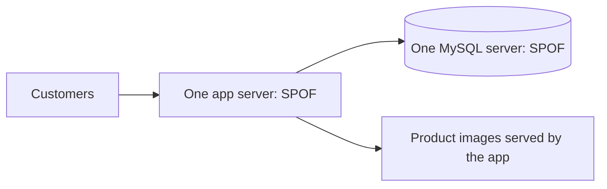
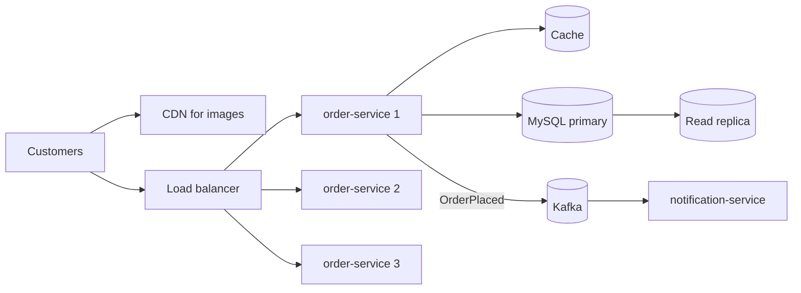
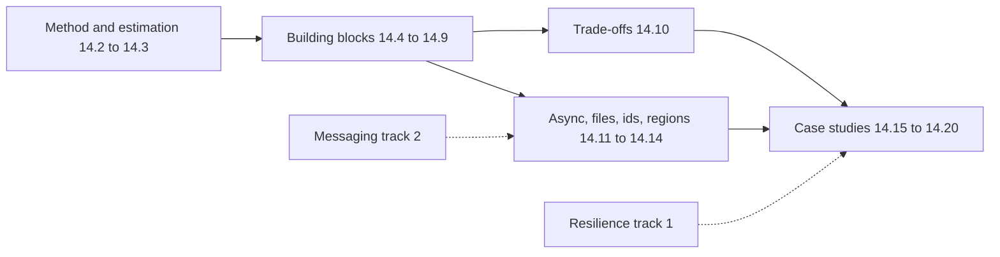

# System Design: The Big Picture

**System design · Step 14.1 · Overview** · Last updated 2026-10-22
**Prerequisites:** none. Helpful: [Resilience patterns](../01-resilience/01-resilience-overview.md) (1.1) and [Messaging and event-driven design](../02-messaging/01-messaging-overview.md) (2.1), which this area uses as building blocks.

Read this first. It is the map of the system design area: the problem it solves, the method, the building blocks, how they relate, and the learning order.

## 1. What it is and why it matters

**What is it?** System design is deciding which components a system has, where its data lives and how the parts talk to each other, so that it does what users need at the scale, speed and reliability the business needs. Just as important, it is explaining **why** you chose that design over the alternatives.

**Why do we need it?** Code that works for a hundred users often fails at a hundred thousand. Something becomes the slowest part, a single server becomes the only thing standing between customers and an outage, or the data no longer fits on one machine. System design finds those limits on paper, before customers find them in production.

**When would I meet it?** When a new service or feature is planned, when traffic is about to grow (a sale, a new market), when an incident shows a design limit, in design reviews, and in architect and senior engineer interviews.

> [!TIP]
> **Memory hook:** requirements and numbers first, boxes second. Every box in a design must be there because a requirement or a number asked for it.

## 2. Mental model: a restaurant at the dinner rush

A small restaurant has one cook and one host. On a quiet evening that is enough. On a busy evening the owner adds cooks who can each cook any dish, a host who seats guests where there is space, prepared sauces on the counter so common dishes go out faster, and a rail of order tickets so waiters don't stand in the kitchen waiting.

| In the analogy | In the real system |
|---|---|
| Guests | Users and client apps |
| The menu | The API: what the system offers |
| Several cooks who can each cook any dish | **Stateless** service instances behind each other (**horizontal scaling**) |
| The host who seats guests at free tables | **Load balancer** |
| Prepared sauces on the counter | **Cache**: a fast copy of frequently used data |
| The pantry and its stock book | The **database**: the source of truth |
| The rail of order tickets | A **message queue**: work done a little later, at the kitchen's pace |
| How many guests the kitchen can serve per hour | **Throughput** (capacity) |

**Where the analogy breaks:** food is not copied, but data is. A cache, a replica and the database can hold different versions of the same fact, and deciding how much disagreement is acceptable (**consistency**) is a central system design question. Software also fails differently: one bug is deployed to every instance at once, and a dependency that is slow looks alive while it ties up everything that waits for it.

## 3. Industry terms

| Term | Simple meaning | Why it matters | Example | Related terms |
|---|---|---|---|---|
| **Functional requirement** | What the system must do | Defines the features and the API | "A customer can place an order" | Use case |
| **Non-functional requirement (NFR)** | How well it must do it: scale, speed, availability, consistency, security, cost. Also called a **quality attribute** | NFRs, not features, decide most of the design | "Checkout p99 under 500 ms during a sale" | SLO, constraint |
| **Latency** | Time to serve one request; usually given as a **percentile** (p50, p99) rather than an average | Users feel the slow requests, which an average hides | p99 = 99% of requests are faster than this | Response time |
| **Throughput** | How much work per unit of time, often **QPS** (queries per second) | Sizes servers, databases and links | 2,300 product page reads per second at peak | RPS, capacity |
| **Scalability** | Handling more load by adding resources, without a redesign | Growth shouldn't mean a rewrite | Adding instances for a sale | **Vertical scaling** (bigger machine), **horizontal scaling** (more machines) |
| **Availability** | The share of time, or of requests, that the system serves successfully | Usually stated in "nines" (99.9%) and promised in SLAs | 99.9% allows about 8.8 hours of downtime a year | SLA, SLO, error budget |
| **Single point of failure (SPOF)** | A part whose failure stops the whole system | Removing SPOFs is the first step to availability | One app server, one database server | Redundancy |
| **Bottleneck** | The part that limits throughput first | Scaling anything else doesn't help | Database connections at peak | Hot spot |
| **Replication** | Keeping copies of the same data on several machines | Survives machine loss and spreads reads | MySQL primary with read replicas | Replication lag |
| **Partitioning (sharding)** | Splitting data across machines, each holding a part | Data or writes too big for one machine | Orders split by customer id | Partition key, hot partition |
| **Consistency** | Whether every reader sees the latest write | Copies (caches, replicas) can be stale | A stock count read from a lagging replica | Strong and eventual consistency |

## 4. In a real system (ShopFlow)

**The business problem.** ShopFlow, our example online shop, started as one Spring Boot application on one server and one MySQL database. Marketing plans a sale and expects about ten times the normal traffic for a few hours. The business needs the shop to stay up and fast during those hours, because a sale that crashes loses both revenue and customer trust.

With the first version, several things go wrong at once: the one server runs out of threads and CPU, the database runs out of connections, product images use the server's bandwidth, and restarting the server for a deploy takes the whole shop down. The server and the database are both single points of failure.

**How the topics help.** Each later note adds one building block, and only for a reason the requirements or the numbers give:

**What it costs.** More moving parts to build, run, monitor and pay for. Copies of data (the cache, the replica) can be stale. Work done later through Kafka is eventually consistent. Every arrow is a network call that can be slow or fail, which is why the resilience patterns of track 1 come with every design.

**Elsewhere:** a concert-ticket site faces a huge spike in the first minutes of a sale, so it needs fair queueing more than raw capacity; a ride-hailing app receives a location update from every driver every few seconds, so it is dominated by writes; a video platform is dominated by bandwidth, so content delivery networks matter more than its databases.

## 5. How it works: the method, the building blocks and the case studies

The area has three parts. First a **method** and the **numbers** that every design decision is justified with. Then the **building blocks**, in the order a growing system usually needs them. Finally **case studies**, which combine everything.

| Step | Topic | The question it answers |
|---|---|---|
| 14.2 | [Requirements and the design method](02-requirements-design-method.md) | What exactly are we building, how well must it work, and in what order do we decide? |
| 14.3 | [Back-of-the-envelope estimation](03-back-of-the-envelope-estimation.md) | How much traffic, storage, bandwidth and downtime are we talking about? |
| 14.4 | [Scaling out: stateless services](04-scaling-out-stateless-services.md) | How do we add capacity by adding machines? |
| 14.5 | [Load balancing](05-load-balancing.md) | How are requests spread across those machines, and how are dead ones avoided? |
| 14.6 | [Caching](06-caching.md) | How do we serve frequent reads fast without hitting the database every time? |
| 14.7 | [Choosing a database](07-choosing-a-database.md) | Which kind of database fits these access patterns? |
| 14.8 | [Replication and read replicas](08-replication-read-replicas.md) | How do we survive losing a database machine and spread the reads? |
| 14.9 | [Partitioning and sharding](09-partitioning-sharding.md) | What do we do when the data or the writes outgrow one machine? |
| 14.10 | [Consistency trade-offs: CAP, PACELC and quorums](10-consistency-cap-pacelc-quorums.md) | When copies disagree, what do we promise readers? |
| 14.11 | [Asynchronous processing: queues, workers and fan-out](11-asynchronous-processing.md) | Which work can happen later, and how? |
| 14.12 | [Object storage and content delivery networks](12-object-storage-cdn.md) | Where do files and images live, and how do they reach users quickly? |
| 14.13 | [Unique ID generation](13-unique-id-generation.md) | How do many machines create ids that never clash? |
| 14.14 | [Multi-region design and disaster recovery](14-multi-region-disaster-recovery.md) | What if a whole data centre or region fails? |
| 14.15 to 14.20 | Case studies | [URL shortener](15-case-url-shortener.md), [distributed rate limiter](16-case-distributed-rate-limiter.md), [notification system](17-case-notification-system.md), [news feed](18-case-news-feed.md), [chat system](19-case-chat-system.md), [ShopFlow flash sale](20-case-shopflow-flash-sale.md) |

How the topics relate:

1. **The method and the numbers come first** (14.2 and 14.3). They are not building blocks; they are how you decide which building blocks you need.
2. **The building blocks build on each other.** Adding stateless instances ([14.4](04-scaling-out-stateless-services.md)) needs a load balancer ([14.5](05-load-balancing.md)). Growing reads lead to caches ([14.6](06-caching.md)) and read replicas ([14.8](08-replication-read-replicas.md)). Data that outgrows one machine leads to partitioning ([14.9](09-partitioning-sharding.md)). Choosing the database ([14.7](07-choosing-a-database.md)) comes before replication and partitioning, because each kind of database does them differently.
3. **Copies create consistency questions** ([14.10](10-consistency-cap-pacelc-quorums.md)). Caches and replicas are both copies, so both make readers see stale data sometimes; 14.10 explains the choices.
4. **Other tracks are building blocks too.** Asynchronous processing ([14.11](11-asynchronous-processing.md)) uses the [messaging notes](../02-messaging/01-messaging-overview.md), and every design uses the [resilience patterns](../01-resilience/01-resilience-overview.md) for its failure paths. This area links to them instead of repeating them.
5. **The case studies combine everything**, and each one practises the method of 14.2 from start to finish.

**Overlaps with other tracks.** Some planned topics in other tracks cover the same ground at a different depth. This area teaches them at design level first; the later tracks go deeper and link back instead of repeating:

| Other track (planned) | Overlap here | Who teaches what |
|---|---|---|
| 5.2 Quality attributes | 14.2 | 14.2 uses NFRs as design inputs; 5.2 treats them as architecture practice (quality attribute scenarios, utility trees) |
| 6.2 Consistency, 6.4 Caching, 6.5 Replication and sharding | 14.10, 14.6, 14.8, 14.9 | This area: design choices; track 6: database internals (for example MySQL isolation and locking) |
| 12.6 System design interview practice | 14.2, 14.15 to 14.20 | 12.6 becomes a practice plan that uses this area's method and case studies |

## 6. Architectural decisions

The same few decisions come back in almost every design. Each later note goes into one of them; this table is the summary:

| Decision | Choose the first when | Choose the second when |
|---|---|---|
| Scale up (bigger machine) or scale out (more machines) | Load is moderate and simplicity matters; a database that is hard to split | You need redundancy anyway, load keeps growing, the service is stateless |
| Synchronous call or asynchronous message | The caller needs the answer now (price, payment authorisation) | The work can follow the response, several services react, bursts must be absorbed |
| Relational or non-relational database | Transactions across rows, flexible queries, moderate scale | A simple, known access pattern at very large scale, or a data shape that doesn't fit tables |
| Cache or always read the source | Reads repeat, slightly stale data is acceptable | Every read must be current, or reads rarely repeat |
| Strong or eventual consistency | Money, stock, anything where a stale read causes a wrong decision | Feeds, counters, recommendations, where a short delay is harmless |
| One region or several | The business accepts a regional outage of hours | Downtime or latency for distant users costs more than running several regions |

**The guiding principle of this area:** a good design meets today's requirements with the simplest set of components, and has a clear, known next step when load grows by about ten times. It is not the design with the most boxes.

**Running the examples.** [14.3](03-back-of-the-envelope-estimation.md) to [14.20](20-case-shopflow-flash-sale.md) contain small runnable Java 21 programs: arithmetic for the estimates, and simulations that make design problems visible. How to run them on a Mac, from the terminal or VS Code, is in [the Java overview](../13-java/01-java-overview.md), section 5.

## 7. Notes in this area, in learning order

All twenty steps are written (completed 2026-10-22).

**Fundamentals: the method and the numbers**

| Step | Topic | Prerequisites | Status |
|---|---|---|---|
| 14.1 | This overview | none | Done |
| 14.2 | [Requirements and the design method](02-requirements-design-method.md) | 14.1 | Done |
| 14.3 | [Back-of-the-envelope estimation](03-back-of-the-envelope-estimation.md) | 14.2 | Done |

**Fundamentals: the building blocks**

| Step | Topic | Prerequisites | Status |
|---|---|---|---|
| 14.4 | [Scaling out: stateless services and horizontal scaling](04-scaling-out-stateless-services.md) | 14.3 | Done |
| 14.5 | [Load balancing](05-load-balancing.md) | 14.4 | Done |
| 14.6 | [Caching](06-caching.md) | 14.4 | Done |
| 14.7 | [Choosing a database](07-choosing-a-database.md) | 14.3 | Done |
| 14.8 | [Replication and read replicas](08-replication-read-replicas.md) | 14.7 | Done |
| 14.9 | [Partitioning and sharding](09-partitioning-sharding.md) | 14.8 | Done |

**Intermediate and advanced**

| Step | Topic | Prerequisites | Status |
|---|---|---|---|
| 14.10 | [Consistency trade-offs: CAP, PACELC and quorums](10-consistency-cap-pacelc-quorums.md) | 14.6, 14.8 | Done |
| 14.11 | [Asynchronous processing: queues, workers and fan-out](11-asynchronous-processing.md) | 14.4, messaging 2.1 | Done |
| 14.12 | [Object storage and content delivery networks](12-object-storage-cdn.md) | 14.5 | Done |
| 14.13 | [Unique ID generation](13-unique-id-generation.md) | 14.9 | Done |
| 14.14 | [Multi-region design and disaster recovery](14-multi-region-disaster-recovery.md) | 14.8, 14.10 | Done |

**Case studies (practice)**

| Step | Topic | Prerequisites | Status |
|---|---|---|---|
| 14.15 | [URL shortener](15-case-url-shortener.md) | 14.2 to 14.9 | Done |
| 14.16 | [Distributed rate limiter](16-case-distributed-rate-limiter.md) | 14.15, resilience 1.7 | Done |
| 14.17 | [Notification system](17-case-notification-system.md) | 14.11 | Done |
| 14.18 | [News feed](18-case-news-feed.md) | 14.6, 14.11 | Done |
| 14.19 | [Chat system](19-case-chat-system.md) | 14.11, 14.13 | Done |
| 14.20 | [ShopFlow flash sale](20-case-shopflow-flash-sale.md) | all of the above | Done |

Revision: the [system design cheat sheet](99-system-design-cheat-sheet.md), which grows with each note.

## 8. Check your understanding

1. ShopFlow's single app server is restarted for every deploy, and the shop is down for two minutes each time. What is the name of the problem, and what is the usual first fix?
2. Average checkout latency is 120 ms, but customers complain that checkout is slow. What should you look at instead, and why?
3. A colleague's first design for a small new feature has a cache, Kafka, three databases and a CDN. What is the first question you would ask?
4. Why do caches and read replicas raise consistency questions, while adding more stateless instances of a service does not?

Answers are at the end of this note.

## 9. Revision

**Remember**
- System design = components, data and interactions chosen to meet **functional and non-functional requirements** at the expected scale, plus the reasons.
- **NFRs drive the design**: latency (as percentiles), throughput, availability, consistency, durability, security, cost.
- Learn in order: **method and numbers**, then **building blocks**, then **trade-offs**, then **case studies**.
- Every **copy** of data (cache, replica) is a consistency decision; every **arrow** is a failure path.

**Explain in 15 seconds:** "System design is choosing the components, data and interactions of a system so it meets its requirements, especially the non-functional ones like scale, latency and availability, and being able to defend the trade-offs."

**Explain in 60 seconds:**
> "I start from requirements: what the system must do, and how well, with numbers: users, requests per second at peak, latency percentiles, availability and consistency needs. A quick estimate tells me whether one machine is enough or where the bottleneck will be. Then I sketch the simplest design that works and walk a request through it, and only add building blocks when a number asks for them: stateless instances behind a load balancer, a cache and read replicas for heavy reads, partitioning when data outgrows a machine, queues for work that can wait. Each addition has a cost. Copies of data can be stale, so I state the consistency each part needs, and every network call can fail, so I design the failure paths too."

**Likely follow-up questions:**
- **Why percentiles instead of averages?** An average hides the slow tail; p99 shows what the slowest 1% of requests, often the most valuable customers with the biggest carts, experience.
- **What is the difference between scalability and performance?** Performance is how fast one request is served; scalability is whether that stays true as load grows when you add resources.
- **What do you remove first to improve availability?** Single points of failure, by adding redundancy.
- **When is one big server the right answer?** When the load fits with headroom, redundancy needs are met (for example with a standby), and simplicity saves more than scaling out would.

**Architect's takeaway:** justify every component with a requirement or a number, and name what it costs. The simplest design that meets the requirements, with a known next step for ten times the load, beats an impressive one.

**Next topic:** [Requirements and the design method](02-requirements-design-method.md) (14.2)

## 10. Verification and sources

> [!NOTE]
> Checked 2026-10-22 by reading the sources below. Re-verify when you revisit this note.

- **Confirmed:** availability is measured either as the share of uptime or as the request success rate, and 99.99% allows about 52.56 minutes of downtime a year (Google, *Site Reliability Engineering*, chapter "Embracing Risk", read online 2026-10-22); a four-step interview framework (understand the problem and scope, high-level design, deep dive, wrap up) is the basis of Alex Xu's *System Design Interview* (described in secondary summaries and the library catalogue record; the book's exact step titles were not checked).
- **Assumptions and illustrations:** ShopFlow and its sale traffic are illustrative; the "after" diagram is a simplified example of a common evolution, not a recommended architecture for every shop. The "Elsewhere" cases describe common patterns, not specific companies. The topic list of this area was a proposal when the area started; all of it is now written.
- **To verify:** the exact wording of the framework steps in Xu's book; the related chapters of the second edition of *Designing Data-Intensive Applications*, when used as a source in later notes.
- **Decision rule:** start from requirements and numbers; add a component only when one of them asks for it, and write down what it costs.

**Sources:** Google, *Site Reliability Engineering* (sre.google/sre-book), chapter "Embracing Risk"; Martin Kleppmann, *Designing Data-Intensive Applications*; Alex Xu, *System Design Interview: An Insider's Guide*.

## Answers

1. It is a **single point of failure**. The usual first fix is redundancy: run at least two instances behind a load balancer, and deploy them one at a time (a rolling deploy), so one instance always serves traffic. This needs the service to be **stateless** (no session kept only in one server's memory), which is the subject of [14.4](04-scaling-out-stateless-services.md).
2. Look at **latency percentiles**, especially p95 and p99. The average mixes many fast requests with a few very slow ones; if 2% of checkouts take 5 seconds, the average can still look fine while those customers leave.
3. **"Which requirement or number needs each of these?"** If the feature has small traffic and no special consistency or availability needs, most of those components add cost and failure paths without benefit. Ask for the requirements and a quick estimate first.
4. Caches and read replicas are **copies of data**, and a copy can lag behind the original, so a reader can see an old value. Stateless instances hold **no data of their own**; they all read and write the same source, so adding more of them changes capacity, not what readers see.

Back to [the index](../README.md) · [Roadmap](../roadmap.md).
