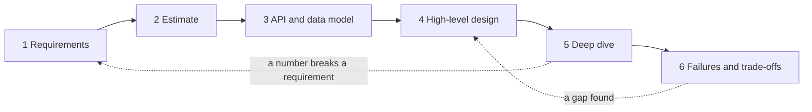
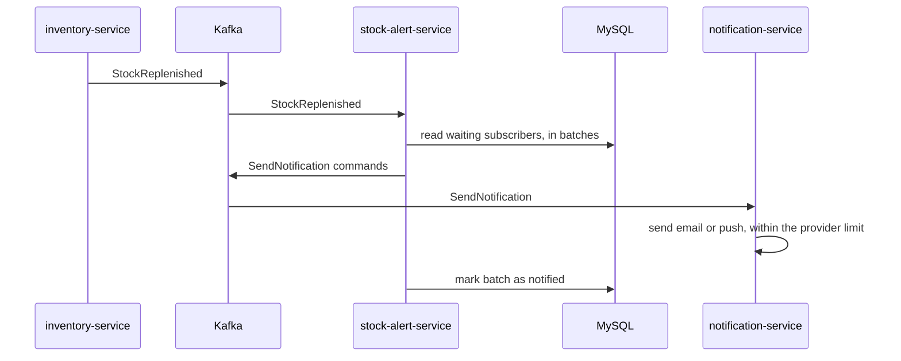

# Requirements and the Design Method

**System design · Step 14.2 · Fundamentals** · Last updated 2026-10-22
**Prerequisites:** [System design: the big picture](01-system-design-overview.md) (14.1)

## 1. What it is and why it matters

**What is it?** A repeatable order of steps that takes you from a vague request ("customers want to be told when an item is back in stock") to a design you can defend. It starts with writing down the **requirements**: what the system must do, how well it must do it, and what you are not allowed to change.

**Why do we need it?** Most bad designs are not caused by a wrong technology. They come from answering the wrong question: building for a scale nobody needs, missing the one limit that matters, or never asking how fast "fast" must be. A fixed order of steps makes you ask the important questions before you draw anything.

**When would I meet it?** At the start of every new service or larger feature, in design reviews ("what are the requirements behind this?"), and in every system design interview, where the first ten minutes decide most of the result.

> [!TIP]
> **Memory hook:** *ask, count, contract, sketch, dig, break.* Ask for requirements, count the load, define the contract (API and data), sketch the design, dig into the hard part, then break it on purpose (failures and trade-offs).

## 2. Industry terms

| Term | Simple meaning | Why it matters | Example | Related terms |
|---|---|---|---|---|
| **Functional requirement** | A behaviour the system must have | Defines the features, the API and the data | "A customer can subscribe to a sold-out product" | Use case, user story |
| **Non-functional requirement (NFR)** | A quality the system must have, ideally with a number | Decides most of the architecture | "Subscribe responds in under 200 ms at p99" | **Quality attribute** (the term used in architecture literature) |
| **Constraint** | Something fixed that you must design within | Removes options before you start | "Use the existing MySQL and Kafka"; "the email provider accepts 100 messages a second" | Assumption |
| **Assumption** | Something you believe but haven't confirmed | Must be written down so it can be checked later | "Most products have fewer than 1,000 subscribers" | Risk |
| **Out of scope** | What you deliberately won't build now | Keeps the design small and the discussion focused | "No price-drop alerts in this version" | Non-goal |
| **Access pattern** | How the data is read and written: by which key, how often, in what order | Decides the data model and the database | "Find all waiting subscribers of one product" | Query pattern |
| **SLO (service level objective)** | An internal target for an NFR, measured over a period | Turns "reliable" into a number you can check | "99.9% of subscribe requests succeed each month" | **SLI** (the measurement), **SLA** (a contract with customers, with consequences) |
| **Deep dive** | Detailed design of the hardest part | Shows where the real risk is | The burst when a popular product is restocked | Bottleneck |

## 3. In a real system (ShopFlow)

**The business problem.** During sales, popular products sell out and customers leave the shop. The product team asks for a "Notify me when it's back in stock" button. The request is one sentence; the design questions are not: how many people subscribe, how fast must they hear, by email or push, and what if a thousand units come back for two hundred thousand subscribers?

**Without the method,** a team might start with "a table, a scheduled job that checks stock every minute, and an email for each subscriber", and only discover in production that the email provider sends at most 100 messages a second, that the scheduled job reads the whole table every minute, and that customers received the same alert twice after a restart.

**How the method helps.** It forces those questions at the start. Section 4 walks through the whole method for this feature.

**What it costs.** Time and conversations before any code: an hour or two of questions and a page of writing for a feature like this. Some answers will be guesses; the method says to write them down as assumptions and revisit them, not to wait for certainty.

## 4. How it works



The six steps are this note's synthesis of common practice; interview books use four or five steps with the same content (see Verification). The dotted lines matter: when a later step shows that a requirement can't be met, you go back and renegotiate it, which is normal, not a failure.

### Step 1: Requirements

Write three short lists and one line.

**Functional requirements** for the stock alert:
- A signed-in customer can subscribe to a sold-out product, by email or push.
- A customer can unsubscribe.
- When the product is restocked, waiting subscribers are notified once.
- A subscription expires after 90 days (an assumption to confirm with product).

**Non-functional requirements**, each with a number where possible. A useful checklist:

| Quality | Question to ask | Stock alert answer |
|---|---|---|
| Scale | How many users, items, requests, and how spiky? | Up to 2 million waiting subscriptions; one popular product can have 200,000 |
| Latency | How fast, at which percentile? | Subscribe: p99 under 200 ms. Alerts: within 5 minutes of the restock |
| Availability | What may be down, for how long? | Subscribe: 99.9% a month. Alerts may be late, but not lost |
| Consistency | Can someone see old data, and what happens then? | An alert may arrive after the product sold out again; acceptable if the email says so |
| Durability | Can data be lost? | No subscription may be lost once confirmed |
| Security and privacy | Who may see or do what? | A customer sees only their own subscriptions; unsubscribe links can't be guessed |
| Cost | Any budget limits? | Use the existing email contract |

**Constraints:** Spring Boot services, MySQL and Kafka as today; the email provider accepts **100 messages a second** for ShopFlow's account (an illustrative figure); three engineers for six weeks.

**Out of scope:** price-drop alerts, a preferences page.

Two habits make requirements useful. **Make them measurable:** "fast" can't be tested; "p99 under 200 ms at 50 requests a second" can. **Rank them:** usually two or three NFRs drive the design. Here they are "within 5 minutes", "never lost" and "notified once".

### Step 2: Estimate

Rough numbers, explained in [the next note](03-back-of-the-envelope-estimation.md) (14.3):
- **Storage:** 2 million subscriptions × about 100 bytes = about 200 MB. That fits easily in the existing MySQL; no special database is needed.
- **Subscribe traffic:** small compared with page views, a few requests a second.
- **The burst:** 200,000 alerts ÷ 100 emails a second = **2,000 seconds, about 33 minutes**.

The last number already breaks the 5-minute requirement. That is the most important result of the whole exercise, and it was found with one division before any design was drawn.

### Step 3: API and data model

The **contract** first, because the rest of the design serves it:

```text
POST   /products/{productId}/stock-alerts       body: {"channel": "EMAIL"}   -> 201 Created
DELETE /products/{productId}/stock-alerts/me                                 -> 204 No Content
Event consumed:  StockReplenished {productId, restockId, quantity}
```

The data model follows the **access pattern** "find the waiting subscribers of one product, oldest first". *Untested sketch (MySQL):*

```sql
CREATE TABLE stock_alert (
  product_id   BIGINT      NOT NULL,
  customer_id  BIGINT      NOT NULL,
  channel      VARCHAR(10) NOT NULL,
  created_at   TIMESTAMP   NOT NULL,
  notified_at  TIMESTAMP   NULL,          -- set once the alert has been sent
  PRIMARY KEY (product_id, customer_id),  -- one subscription per customer and product
  KEY waiting (product_id, notified_at, created_at)
);
```

The primary key gives "one subscription per customer and product" for free, and the second index serves the main query without reading other products' rows.

### Step 4: High-level design

The simplest design that meets the functional requirements, then one request walked through it:



1. The Inventory Service already publishes `StockReplenished` to Kafka when stock arrives; a new **stock-alert-service** reads it. Nothing scans the table on a timer.
2. It reads waiting subscribers for that product in batches, oldest first.
3. For each batch it publishes `SendNotification` commands, which the existing Notification Service sends, then marks the batch as notified.
4. If anything fails, Kafka keeps the event and the commands, and processing resumes from the last committed position.

### Step 5: Deep dive

Pick the one to three parts with the most risk, guided by the ranked NFRs and the numbers. Here it is **the burst**: 200,000 alerts can't go out in 5 minutes at 100 emails a second. The options:

| Option | Effect | Cost |
|---|---|---|
| Ask the provider for a higher limit | Faster bursts | A bigger contract; may still not reach 5 minutes |
| Prefer push notifications where the customer has the app | Spreads the load over another channel | Push services have their own limits; not every customer has the app |
| Notify about as many subscribers as there are units, oldest first, and the rest at the next restock | 1,000 units means a few thousand alerts, not 200,000 | A product decision: fairness and wording must be agreed |
| Change the requirement to "first alerts within 5 minutes, all within an hour" | Honest about what is possible | Needs product agreement |

A realistic outcome is the third option together with the fourth, agreed with the product team. The point is not this particular answer; it is that the **number changed the requirement**, which is the dotted line back to step 1.

The second deep dive is **"notified once"**. Kafka delivers at least once, so after a crash the service can process the same batch again ([offset commits and delivery guarantees](../02-messaging/02-kafka/05-offset-commits-delivery-guarantees.md)). Each command carries an idempotency key, `restockId + customerId`, and the Notification Service skips keys it has already sent ([idempotency](../01-resilience/04-idempotency.md)). The `notified_at` column keeps already-notified rows out of later batches.

### Step 6: Failures and trade-offs

Break the design on purpose, one dependency at a time:

| What fails | What happens | Requirement affected |
|---|---|---|
| stock-alert-service is down for 20 minutes | Events wait in Kafka; alerts go out late when it returns | "Within 5 minutes" missed; "never lost" kept |
| The email provider is down | Sends are retried with backoff, then parked in a dead-letter topic ([2.2.8](../02-messaging/02-kafka/08-error-handling-retries-dlt.md)) | Alerts late |
| MySQL is down | Subscribe returns an error | Uses the 99.9% monthly budget |

Then name the trade-offs you accepted: alerts are **eventually consistent** with stock (one may arrive after the item sold out again), and the design depends on the Inventory Service publishing every restock. Finally, the next step at ten times the load: more stock-alert-service instances (up to one per Kafka partition) and, much later, partitioning the table by `product_id`.

## 5. Failure scenarios

### A constraint discovered in production

1. **What happened?** A popular product was restocked, and 200,000 alert emails were queued at once.
2. **Why?** Nobody asked about the email provider's limit, so the 33-minute burst was never calculated.
3. **What did users see?** Most subscribers were notified after the item had sold out again. Worse, **order confirmation emails** waited in the same queue behind the alerts, because both used one sender account and one limit.
4. **Solutions:** ask for third-party limits in step 1; send transactional messages (order confirmations) and bulk messages (alerts) through separate queues and limits, so one can't starve the other, which is the [bulkhead](../01-resilience/06-bulkhead.md) idea; cap the burst as in step 5.
5. **What they cost:** more configuration and possibly a second sender account; a product decision about who is notified first.

### A requirement nobody could test

1. **What happened?** The requirement said "highly available and fast". One team built a multi-region deployment for an internal report; another shipped a checkout change that was slow at p99.
2. **Why?** Neither requirement had a number, so each team guessed.
3. **What did the business see?** Money spent where it wasn't needed, and lost sales where it was.
4. **Solutions:** measurable NFRs with a percentile and a load ("p99 under 500 ms at 2,500 requests a second"), ranked, and written as SLOs that monitoring can check.
5. **What they cost:** conversations with the product team, and numbers that are partly guesses; write them as assumptions and revisit them after launch with real metrics.

## 6. Architectural decisions

| Use the full method when | A lighter version is enough when | Alternatives and complements |
|---|---|---|
| A new service, a feature with real scale or consistency needs, or a change that affects several teams | A small change inside one service with known load: a short design note with requirements and risks | A **spike** (a small throw-away prototype) to measure an unknown; an **architecture decision record** (planned in 5.6) to record the choice and why |

**Common mistakes:** starting with a technology ("let's use Cassandra") instead of a requirement; designing for a scale nobody asked for; spending the deep dive on the easy part; drawing only the success path.

## 7. Try it yourself

A paper exercise; nothing to run. Apply step 1 and step 3 to a new ShopFlow feature: **"Customers can see their order history, newest first."** Write:

1. Three functional requirements and one item that is out of scope.
2. Four NFRs, each with a number (invent reasonable ones and mark them as assumptions).
3. The main access pattern, and a primary key or index that serves it.

A model answer is in the Answers section.

## 8. Check your understanding

1. Classify each as functional, non-functional or constraint: (a) "a customer can cancel an order within one hour"; (b) "cancellation responds within 300 ms at p99"; (c) "we must use the company's existing MySQL"; (d) "a confirmed cancellation is never lost".
2. Why is "the system must be fast" a weak requirement? Rewrite it.
3. In the stock alert design, why did the email provider's limit matter more than the size of the database?
4. Why does the method go back from the deep dive to the requirements, and why is that not a failure?

Answers are at the end of this note.

## 9. Revision

**Remember**
- **Functional** = what it does; **non-functional** = how well, with numbers; **constraints** = what you can't change; write **assumptions** and **out of scope** down.
- Six steps: **requirements, estimate, API and data, high-level design, deep dive, failures and trade-offs**.
- **Rank** the NFRs; two or three drive the design.
- A number can break a requirement; going back to **renegotiate** is part of the method.

**Explain in 15 seconds:** "I write down functional and non-functional requirements with numbers, estimate the load, define the API and data model, sketch the simplest design, dig into the riskiest part, and then walk through failures and trade-offs."

**Explain in 60 seconds:**
> "I start by asking what the system must do and how well: functional requirements, then non-functional ones with numbers, such as p99 latency at a stated load, availability, consistency and durability, plus constraints like the existing stack or a third-party limit, and what's out of scope. A quick estimate often shows the real problem early; for a back-in-stock alert, 200,000 emails at 100 a second is 33 minutes, which breaks a 5-minute requirement. Then I define the API and the data model from the access patterns, sketch the simplest design and walk one request through it, and spend the deep dive on the riskiest part. I finish by failing each dependency in turn and stating the trade-offs. When a number breaks a requirement, I go back and renegotiate it."

**Likely follow-up questions:**
- **What is the difference between an SLA and an SLO?** An SLO is an internal target measured by an SLI; an SLA is a contract with users that includes consequences. Set the SLA more conservatively than the SLO, so there is room to react before the contract is broken.
- **How do you handle unknown numbers?** State an assumption, design for it, and note what would change if it's wrong by ten times.
- **Why define the API before the components?** The API is the contract the design must serve; it also shows the access patterns that drive the data model.
- **How much time on requirements in an interview?** Enough to agree on the main features and the two or three NFRs that matter; typically the first few minutes, not half the session.

**Architect's takeaway:** most design arguments are really disagreements about requirements. Write them down, with numbers and a ranking, and the design discussion becomes much shorter.

**Next topic:** [Back-of-the-envelope estimation](03-back-of-the-envelope-estimation.md) (14.3)

## 10. Verification and sources

> [!NOTE]
> Checked 2026-10-22. The method is a synthesis of common practice, not a standard. Re-verify when you revisit this note.

- **Confirmed:** SLI, SLO and SLA as measurement, internal target and customer contract follow Google's *Site Reliability Engineering*, chapter "Service Level Objectives" (an SLA is "an explicit or implicit contract with your users that includes consequences"; the chapter advises being "conservative in what you advertise to users"); the request-success-rate view of availability is from the chapter "Embracing Risk" (both read online 2026-10-22). Interview frameworks with a scope step, a high-level design, a deep dive and a wrap-up are described in summaries of Alex Xu's *System Design Interview* (secondary sources).
- **Assumptions and illustrations:** the stock alert feature, its numbers (2 million subscriptions, 200,000 for one product, 100 emails a second) and the six-step order are illustrative. The SQL is an untested sketch. "Quality attribute" as the architecture term for NFRs follows common usage in architecture literature, for example the SEI's work on quality attribute scenarios.
- **To verify:** the exact step names in Xu's book; your email and push providers' real rate limits before using numbers like these in a design.
- **Decision rule:** no component without a requirement or a number behind it; no requirement without a number or an owner who will give one.

**Sources:** Google, *Site Reliability Engineering* (sre.google/sre-book), chapters "Service Level Objectives" and "Embracing Risk"; Alex Xu, *System Design Interview: An Insider's Guide*; Len Bass, Paul Clements and Rick Kazman, *Software Architecture in Practice* (quality attributes).

## Answers

**Check your understanding**

1. (a) **Functional**: a behaviour. (b) **Non-functional** (latency). (c) **Constraint**: fixed, not a quality. (d) **Non-functional** (durability).
2. It can't be tested and doesn't say which operation, under what load, or at which percentile. Better: "Search returns results in under 300 ms at p99 with 1,000 searches a second." Now it can be load-tested and monitored.
3. The database holds about 200 MB, which a single MySQL server stores easily, so it creates no design pressure. The provider limit turns one restock into a 33-minute burst, which breaks the most important NFR. Design effort goes where a number breaks a requirement.
4. Because the deep dive produces numbers the requirements didn't anticipate. Changing a requirement with the product team (for example "first alerts within 5 minutes, all within an hour") is a normal, informed decision; pretending the original requirement is met would be the failure.

**Try it yourself, model answer** (one reasonable answer; yours can differ)

1. Functional: list my orders newest first, 20 per page; open one order with its lines and status; filter by status. Out of scope: search by product name.
2. NFRs (assumptions): first page p99 under 300 ms; 99.9% availability a month; a new order appears in the history within 5 seconds of being placed (eventual consistency is acceptable); a customer can only see their own orders.
3. Access pattern: "orders of one customer, newest first, one page at a time". An index on `(customer_id, created_at DESC)` serves it, and paging by the last seen `created_at` and id (**keyset pagination**) keeps later pages as fast as the first, unlike a large `OFFSET`.

Back to [the System design overview](01-system-design-overview.md) · [the index](../README.md) · [Roadmap](../roadmap.md).
