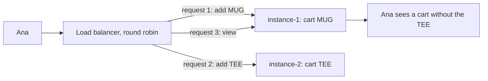

# Scaling Out: Stateless Services and Horizontal Scaling

**System design · Step 14.4 · Fundamentals** · Last updated 2026-10-22
**Prerequisites:** [Back-of-the-envelope estimation](03-back-of-the-envelope-estimation.md) (14.3); helpful: [Rate limiting](../01-resilience/07-rate-limiting.md) (1.7)

## 1. What it is and why it matters

**What is it?** Two ways to give a service more capacity. **Scaling up** (vertical scaling) moves it to a bigger machine. **Scaling out** (horizontal scaling) runs more copies of it, called **instances**, side by side. Scaling out only works well when the service is **stateless**: any instance can handle any request, because nothing a later request needs is kept inside one instance.

**Why do we need it?** One machine has a size limit, and it is a single point of failure. Several instances give more capacity *and* redundancy: one can crash, or be restarted for a deploy, while the others keep serving.

**When would I meet it?** The first time a service runs with more than one instance, which in Kubernetes is usually from day one; when you add autoscaling before a sale; and when a bug appears only "sometimes", because it depends on which instance answered.

> [!TIP]
> **Memory hook:** treat instances as interchangeable. If losing one instance loses something a customer cares about, that something is in the wrong place.

## 2. Industry terms

| Term | Simple meaning | Why it matters | Example | Related terms |
|---|---|---|---|---|
| **Vertical scaling (scale up)** | A bigger machine: more CPU, memory, disk | Simple, no code change; but there is a largest machine, and it is still one machine | Moving MySQL to a larger instance type | Scale down |
| **Horizontal scaling (scale out)** | More instances of the same service | Capacity and redundancy grow together | 3 to 15 `order-service` pods for the sale | Scale in |
| **Stateless service** | Keeps no request-to-request data in its own memory or disk | Any instance can serve any request, so instances can be added, removed and restarted freely | `order-service` reads the cart from a shared store | **Stateful** service (a database, a broker) |
| **Externalised state** | State moved out of the instances into a shared store | What makes a service stateless | Sessions in Redis; files in object storage | **Shared-nothing**: instances share no memory or disk |
| **Session affinity (sticky sessions)** | The load balancer sends one user to the same instance every time | A quick fix for in-memory sessions, with real costs (section 6) | A cookie that pins Ana to instance 1 | Stateless design |
| **Autoscaling** | The platform adds or removes instances from a metric | Follows the load without manual work | Kubernetes HorizontalPodAutoscaler (HPA) | Scheduled scaling |
| **Availability zone** | A separate data centre within a cloud region, with its own power and network | Spreading instances over zones survives the loss of one | Three zones in one AWS region | Region ([14.14](14-multi-region-disaster-recovery.md)) |
| **Connection pool** | A fixed set of open database connections that one instance reuses | Every new instance opens its own pool, so the database sees instances × pool size | HikariCP, Spring Boot's default pool | `max_connections` |

## 3. In a real system (ShopFlow)

**The business problem.** For the sale, ShopFlow must serve about ten times the usual traffic, and it can't go down for deploys during the sale week. The estimate in [14.3](03-back-of-the-envelope-estimation.md) gave about 2,300 catalogue and checkout requests a second at peak, which one instance can't serve.

**What goes wrong when you simply add instances.** The first version of `order-service` keeps each customer's cart in the HTTP session, in the memory of the instance that served the request. With one instance that worked. With two instances behind a load balancer:



Ana adds two items and sees one. Every deploy restarts the instances and empties every cart. The cart is **state inside an instance**.

**How scaling out helps, done properly.** Move the carts to a shared store that every instance reads and writes, and the instances become interchangeable. Then capacity is a matter of running enough of them, spread over zones, and the platform can replace or add instances at any time.

**What it costs.** A network call to the shared store for every request, and a new component (Redis or a database table) that must itself be available and sized. Shared state also needs **atomic updates**, or two instances overwrite each other (worked example 2). And more instances put more load on whatever they share, above all the database (worked example 3).

**Elsewhere:** a ticketing site scales its web tier out for an on-sale, while seat reservations stay in one strongly consistent store; a video-processing service scales workers out with the length of its job queue; an online game keeps players of one match on one server on purpose, because the match state changes many times a second, which is a deliberately stateful design.

## 4. How it works

**Making a service stateless** follows a short checklist. Look for every kind of state an instance keeps, and give it a home outside the instance:

| Hidden state in an instance | What breaks with several instances | Usual home |
|---|---|---|
| HTTP session, cart | Split between instances; lost on restart | A shared session store (for example Spring Session with Redis or JDBC), or a cart stored by the service in its database |
| Login state | Only one instance knows the user | A signed token every instance can verify (track 8, planned) |
| In-memory cache | Instances return different values; a clear reaches one instance | Accept short staleness, or a shared cache ([14.6](06-caching.md)) |
| Files on local disk | Uploaded to one instance, missing on the others, gone after restart | Object storage ([14.12](12-object-storage-cdn.md)) |
| Scheduled jobs | Run once **per instance** | A shared lock, a single scheduler, or a Kubernetes CronJob |
| In-memory counters, rate limits | The limit is multiplied by the number of instances | A shared counter ([1.7](../01-resilience/07-rate-limiting.md)) |
| `synchronized` blocks and in-JVM locks | Protect one JVM only | An atomic database update or optimistic locking |
| Long-lived connections (WebSocket) | Tied to the instance that accepted them | Accept affinity for the connection, and pass messages between instances ([14.19](19-case-chat-system.md)) |

The **flow of a request** in a stateless service is then always the same: the load balancer picks any healthy instance ([14.5](05-load-balancing.md)); the instance reads what it needs from shared stores, using the session id or token in the request; it writes changes back with atomic operations; it returns the response and keeps nothing.

The three programs below make the important points visible. They are simulations in one JVM, written so the output is exact: "instances" are objects, the "load balancer" is a loop, and the "database" is a field. How to run them is in [the Java overview](../13-java/01-java-overview.md), section 5.

### Worked example 1: where the cart lives

**Concept.** The same two instances and the same five requests, once with carts in each instance's memory and once with one shared store.

```java
// File: StatelessCartDemo.java (runnable, Java 21)
import java.util.ArrayList;
import java.util.HashMap;
import java.util.List;
import java.util.Map;

public class StatelessCartDemo {

    // Where the carts live. In production a shared store is Redis or a database; here it is a map.
    static class CartStore {
        private final Map<String, List<String>> carts = new HashMap<>();

        List<String> cart(String sessionId) {
            return carts.computeIfAbsent(sessionId, id -> new ArrayList<>());
        }
    }

    record Instance(String name, CartStore store) {
        String handle(String sessionId, String action) {
            List<String> cart = store.cart(sessionId);
            if (action.startsWith("add ")) {
                cart.add(action.substring(4));
            }
            return name + "  " + action + " -> cart " + cart;
        }
    }

    // A round-robin load balancer: request number i goes to instance i mod n.
    static void run(String title, List<Instance> instances) {
        System.out.println(title);
        List<String> actions = List.of("add MUG", "add TEE", "view", "add SOCKS", "view");
        for (int i = 0; i < actions.size(); i++) {
            Instance target = instances.get(i % instances.size());
            System.out.println("  " + target.handle("session-ana", actions.get(i)));
        }
    }

    public static void main(String[] args) {
        run("Carts in each instance's memory", List.of(
                new Instance("instance-1", new CartStore()),
                new Instance("instance-2", new CartStore())));

        CartStore shared = new CartStore();
        run("Carts in one shared store", List.of(
                new Instance("instance-1", shared),
                new Instance("instance-2", shared)));
    }
}
```

**Expected output**:

```text
Carts in each instance's memory
  instance-1  add MUG -> cart [MUG]
  instance-2  add TEE -> cart [TEE]
  instance-1  view -> cart [MUG]
  instance-2  add SOCKS -> cart [TEE, SOCKS]
  instance-1  view -> cart [MUG]
Carts in one shared store
  instance-1  add MUG -> cart [MUG]
  instance-2  add TEE -> cart [MUG, TEE]
  instance-1  view -> cart [MUG, TEE]
  instance-2  add SOCKS -> cart [MUG, TEE, SOCKS]
  instance-1  view -> cart [MUG, TEE, SOCKS]
```

**Walkthrough.**

| Request | Instance | Cart in instance memory | Cart in a shared store |
|---|---|---|---|
| add MUG | 1 | instance-1 has `[MUG]` | `[MUG]` |
| add TEE | 2 | instance-2 starts empty: `[TEE]` | `[MUG, TEE]` |
| view | 1 | instance-1 never saw the TEE: `[MUG]` | `[MUG, TEE]` |
| add SOCKS | 2 | `[TEE, SOCKS]` | `[MUG, TEE, SOCKS]` |
| view | 1 | still `[MUG]` | `[MUG, TEE, SOCKS]` |

With local carts, Ana has two half-carts, and which one she sees depends on the load balancer. With the shared store, the instance that answers no longer matters.

**Experiment.** Predict first: make the load balancer "sticky" by sending every request to the first instance (`instances.get(0)` instead of `instances.get(i % instances.size())`). Does the in-memory version now work, and is the problem solved? The result is in Answers.

### Worked example 2: shared state needs atomic updates

**Concept.** Moving state out of the instances is necessary, but not enough. If two instances **read, then write** a shared value in two steps, they can both act on the same old value. The update must be one atomic step.

```java
// File: OversellDemo.java (runnable, Java 21)
import java.util.List;

public class OversellDemo {

    record Request(String customer, int instance) {}

    static final List<Request> REQUESTS = List.of(
            new Request("ana", 1), new Request("ben", 2), new Request("cy", 1));

    // 1. Each instance loaded the stock count at start-up and keeps its own copy.
    static void localCopies() {
        System.out.println("Each instance keeps its own stock count (1 HOODIE left)");
        int[] stockPerInstance = {0, 1, 1};              // index 1 and 2: the copy in instance-1 and instance-2
        int reserved = 0;
        for (Request r : REQUESTS) {
            boolean ok = stockPerInstance[r.instance()] > 0;
            if (ok) {
                stockPerInstance[r.instance()]--;
                reserved++;
            }
            print(r, ok);
        }
        System.out.println("  reserved " + reserved + " of 1");
    }

    // A shared database row: quantity of HOODIE.
    static class Database {
        private int quantity = 1;

        int read() { return quantity; }

        void write(int value) { quantity = value; }

        // One statement, applied atomically by the database:
        // UPDATE stock SET quantity = quantity - 1 WHERE sku = 'HOODIE' AND quantity > 0
        // "1 row affected" means reserved, "0 rows affected" means sold out.
        boolean decrementIfAvailable() {
            if (quantity > 0) {
                quantity--;
                return true;
            }
            return false;
        }
    }

    // 2. Shared state, but read and write are two steps, and two requests interleave.
    static void readThenWrite() {
        System.out.println("Shared database, read then write in two steps");
        Database db = new Database();
        Request ana = REQUESTS.get(0), ben = REQUESTS.get(1);
        int seenByAna = db.read();                       // both read 1 before either writes
        int seenByBen = db.read();
        int reserved = 0;
        if (seenByAna > 0) { db.write(seenByAna - 1); reserved++; }
        print(ana, seenByAna > 0);
        if (seenByBen > 0) { db.write(seenByBen - 1); reserved++; }
        print(ben, seenByBen > 0);
        System.out.println("  reserved " + reserved + " of 1");
    }

    // 3. Shared state changed with one conditional, atomic update.
    static void conditionalUpdate() {
        System.out.println("Shared database, one conditional update");
        Database db = new Database();
        int reserved = 0;
        for (Request r : REQUESTS) {
            boolean ok = db.decrementIfAvailable();
            if (ok) reserved++;
            print(r, ok);
        }
        System.out.println("  reserved " + reserved + " of 1");
    }

    static void print(Request r, boolean ok) {
        System.out.println("  " + r.customer() + " via instance-" + r.instance() + ": " + (ok ? "reserved" : "sold out"));
    }

    public static void main(String[] args) {
        localCopies();
        readThenWrite();
        conditionalUpdate();
    }
}
```

**Expected output**:

```text
Each instance keeps its own stock count (1 HOODIE left)
  ana via instance-1: reserved
  ben via instance-2: reserved
  cy via instance-1: sold out
  reserved 2 of 1
Shared database, read then write in two steps
  ana via instance-1: reserved
  ben via instance-2: reserved
  reserved 2 of 1
Shared database, one conditional update
  ana via instance-1: reserved
  ben via instance-2: sold out
  cy via instance-1: sold out
  reserved 1 of 1
```

**Walkthrough.**

| Version | What happens to the last HOODIE | Result |
|---|---|---|
| Local copies | Each instance loaded "1 left" at start-up; each sells it | 2 sold, 1 in stock: **oversold** |
| Read, then write | Ana's and Ben's requests both read 1 before either writes 0 | 2 sold: **oversold**, although the state is shared |
| Conditional update | The check and the decrement are one statement; Ben's update finds 0 and changes no row | 1 sold: correct |

In MySQL the third version is the statement in the comment: `UPDATE stock SET quantity = quantity - 1 WHERE sku = ? AND quantity > 0`. InnoDB locks the row while it updates it, so concurrent updates of that row happen one after another, and the application checks "rows affected": 1 means reserved, 0 means sold out. A Java `synchronized` block would not help here, because it only stops threads inside one JVM, and each instance is a separate JVM.

### Worked example 3: how many instances, and what they share

**Concept.** The number of instances comes from the peak, the capacity of one instance (measured by a load test), headroom, and the failure you want to survive. Then check what the instances share.

```java
// File: InstanceCount.java (runnable, Java 21)
public class InstanceCount {

    public static void main(String[] args) {
        // Illustrative inputs: the peak from the 14.3 estimate, the capacity from a load test.
        double peakRps = 2_315;
        double rpsPerInstanceAtTarget = 400;     // what one instance serves while p99 stays on target
        double maxUtilisation = 0.7;             // keep 30% headroom for bursts and slow moments
        int zones = 3;

        int neededLive = (int) Math.ceil(peakRps / (rpsPerInstanceAtTarget * maxUtilisation));
        // After losing one zone, the remaining zones must still run neededLive instances.
        int perZone = (int) Math.ceil((double) neededLive / (zones - 1));
        int total = perZone * zones;

        System.out.println("instances needed at peak       " + neededLive);
        System.out.println("per zone, surviving one zone   " + perZone);
        System.out.println("total across " + zones + " zones          " + total);

        // Every instance opens its own database connection pool.
        int poolPerInstance = 10;                // HikariCP's default maximumPoolSize
        int mysqlMaxConnections = 151;           // MySQL 8.4 default max_connections
        for (int instances : new int[] {total, 20}) {
            int connections = instances * poolPerInstance;
            System.out.println(instances + " instances x " + poolPerInstance + " connections = " + connections
                    + (connections > mysqlMaxConnections ? "  > " : "  <= ") + mysqlMaxConnections + " allowed by MySQL");
        }
    }
}
```

**Expected output**:

```text
instances needed at peak       9
per zone, surviving one zone   5
total across 3 zones          15
15 instances x 10 connections = 150  <= 151 allowed by MySQL
20 instances x 10 connections = 200  > 151 allowed by MySQL
```

**Walkthrough.**
1. 2,315 requests a second ÷ (400 × 0.7) = 8.3, so **9 instances** must be running at peak.
2. To survive the loss of one of three zones, the other two zones must still hold 9: **5 per zone, 15 in total**. Redundancy, not load, sets this number.
3. Each instance has a pool of 10 connections (HikariCP's default `maximumPoolSize`). 15 instances need 150 connections, just under MySQL's default `max_connections` of 151. If the autoscaler is allowed to go to **20 instances**, they need 200, and new instances fail to connect exactly when they are needed most.

**Experiment.** Predict first: the load test shows only 250 requests a second per instance (change `rpsPerInstanceAtTarget` to 250). How many instances in total, and how many connections? The result is in Answers.

### Autoscaling

Kubernetes' **HorizontalPodAutoscaler** compares a metric with a target and sets the number of pods, roughly `desiredReplicas = ceil(currentReplicas × currentValue / targetValue)`, checking every 15 seconds by default. By default it scales up immediately and waits for a 5-minute stabilisation window before scaling down, so a short dip doesn't remove pods that are needed again a minute later. Three practical points:

1. **Choose the metric that tracks the load.** CPU works for CPU-bound services. A service that mostly waits for the database can be overloaded while its CPU stays low; a custom metric such as requests per second per pod tracks it better.
2. **Scale before a known peak.** New JVM instances need time to start and warm up, so for a sale that starts at 09:00, raise the minimum number of pods beforehand instead of letting the autoscaler react at 09:00.
3. **Set a maximum that the shared parts can take.** The maximum number of pods × the pool size must fit the database (worked example 3).

## 5. Failure scenarios

### Carts lost after scaling out

1. **What happened?** After `order-service` went from one instance to three, customers reported items disappearing from their carts, and every deploy emptied all carts.
2. **Why?** The cart was kept in the in-memory HTTP session; each instance had its own.
3. **What did users see?** Missing items, abandoned purchases, and support tickets that nobody could reproduce on one instance.
4. **Solutions:** move the cart to a shared store; as a short-term bridge, sticky sessions.
5. **What they cost:** a shared store to run and a network call per request; sticky sessions still lose carts when an instance dies or is redeployed.

### The nightly job ran three times

1. **What happened?** Every customer with an unpaid order got three payment-reminder emails at 02:00.
2. **Why?** The `@Scheduled` job ran in every instance, and there were three.
3. **What did users see?** Spam from the shop, and unsubscribes.
4. **Solutions:** a shared lock so that one instance runs the job (practice exercise 2), a dedicated scheduler, or a Kubernetes CronJob; and make the job idempotent ([1.4](../01-resilience/04-idempotency.md)), so a second run sends nothing new.
5. **What they cost:** a lock table or one more deployment; the lock needs an expiry, or a crashed instance holds it forever.

### Scaling out made it worse

1. **What happened?** During the sale, latency rose, and the autoscaler added pods. Latency rose further, and new pods failed with connection errors.
2. **Why?** The bottleneck was the database, not `order-service`. Each new pod added 10 more connections and more queries, past the database's connection limit.
3. **What did users see?** Errors at checkout at the busiest moment.
4. **Solutions:** find the bottleneck before scaling (14.2's deep dive); cap the autoscaler's maximum so that maximum pods × pool size fits the database; reduce load on the database with caching and read replicas ([14.6](06-caching.md), [14.8](08-replication-read-replicas.md)); shed excess load at the edge ([1.8](../01-resilience/08-load-shedding-backpressure.md)).
5. **What they cost:** a ceiling on capacity until the database is scaled; work on caching or replicas.

## 6. Architectural decisions

| Choice | Use when | Don't use when | Costs |
|---|---|---|---|
| **Scale up** | The load fits a bigger machine with headroom; the component is hard to split, as most databases are; you need capacity quickly | You need redundancy from more machines anyway, or the load will outgrow the largest machine | Still one machine; resizing usually means a restart; the largest machines are expensive |
| **Scale out a stateless service** | Request-serving services (`order-service`, the catalogue API), workers reading from a queue | The state can't be moved out at reasonable cost, for example one game match | Shared stores, atomic updates, load balancing, more instances to monitor |
| **Sticky sessions** | A legacy application that can't move its sessions yet; connections that are stateful by nature, such as WebSockets | As the long-term design for request/response services | Uneven load; sessions lost when an instance dies; deploys disturb users. The twelve-factor methodology calls sticky sessions a violation that should never be relied on |

**A common combination:** scale out the stateless services, scale up the database first, and add read replicas or partitioning ([14.8](08-replication-read-replicas.md), [14.9](09-partitioning-sharding.md)) only when the numbers say so. Note also that a Kafka consumer group can't use more consumers than its topic has partitions ([consumer groups](../02-messaging/02-kafka/04-consumers-consumer-groups.md)), so scaling out workers has a ceiling set by the topic (practice exercise 3).

**Common mistakes:** autoscaling on CPU for a service that waits on I/O; no maximum on the autoscaler; in-memory caches that disagree between instances without anyone deciding it is acceptable; `synchronized` used as if it protected all instances.

## 7. Try it yourself

Try each exercise first; the solutions are in the Answers section, the last two as runnable programs.

1. **Find the hidden state.** Which lines of this sketch break when `catalog-service` runs as three instances, and what is the fix for each? *(Untested sketch, Spring Boot style; not runnable on its own.)*

```java
@Service
class CatalogService {
    private final Map<Long, Product> cache = new HashMap<>();          // line A
    private int stockOfHoodie = 1;                                     // line B

    synchronized boolean reserveHoodie() {                             // line C
        if (stockOfHoodie > 0) { stockOfHoodie--; return true; }
        return false;
    }

    void saveImage(long productId, byte[] image) throws IOException {
        Files.write(Path.of("/tmp/images/" + productId + ".jpg"), image); // line D
    }

    @Scheduled(cron = "0 0 2 * * *")                                   // line E
    void sendPaymentReminders() { /* emails every customer with an unpaid order */ }
}
```

2. **One reminder, not three.** Write a simulation in which three instances reach the 02:00 job and only one sends the reminders, using a shared lock.
3. **Consumers have a ceiling.** A worker group must handle 3,000 events a second at peak; one consumer handles 400 a second; the topic has 6 partitions. How many consumers do you want, how many can actually work, and what must change?

## 8. Check your understanding

1. A service runs as three instances. Restarting one of them logs some customers out. What does that tell you, and what is the fix?
2. Why doesn't moving the stock count into a shared database, on its own, prevent overselling?
3. The autoscaler for `order-service` scales on CPU, but during the sale latency climbs while CPU stays at 30%. What is likely happening, and what would you change?
4. When is scaling up the better choice than scaling out?

Answers are at the end of this note.

## 9. Revision

**Remember**
- **Scale up** = bigger machine; **scale out** = more instances. Scaling out gives capacity **and** redundancy, if the service is **stateless**.
- Hunt the hidden state: sessions, local caches, local files, scheduled jobs, in-memory counters, in-JVM locks.
- Shared state needs **atomic updates** ("update where quantity > 0"), not read-then-write.
- More instances mean more load on what they share: **instances × pool size** must fit the database.

**Explain in 15 seconds:** "Scaling out means running more identical instances behind a load balancer. It works when the service is stateless: state lives in shared stores, updated atomically, so any instance can serve any request and instances can come and go."

**Explain in 60 seconds:**
> "You can scale up, onto a bigger machine, or scale out, by running more instances. Scaling out also gives redundancy and rolling deploys, but only if the service is stateless, so I look for state hidden in instances: sessions and carts in memory, local caches, files on local disk, scheduled jobs that run on every instance, in-memory rate limits and synchronized blocks, which only protect one JVM. Each gets a home outside the instance: a session store, object storage, a shared lock, the database. Shared state must change atomically, for example with a conditional update, or two instances oversell the last item. Then I size the instances from the peak, the measured capacity per instance and the zone I want to survive losing, and I check that the database can take all their connections."

**Likely follow-up questions:**
- **Is a database ever stateless?** No; databases are the stateful part, which is why they are scaled with replication and partitioning instead of simply adding copies.
- **Why spread instances over zones?** So that losing one zone leaves enough instances; size each zone for that case.
- **How do you scale a WebSocket service?** Accept that each connection sticks to one instance, and pass messages between instances through a shared channel such as a pub/sub system.
- **Do serverless functions remove the problem?** They are stateless by design, so state must live outside, and they add their own limits, such as cold starts and concurrency limits on the downstream database.

**Architect's takeaway:** make instances disposable. Then capacity, redundancy and deploys become configuration, and the hard questions move to the shared stores, which is where they belong.

**Next topic:** [Load balancing](05-load-balancing.md) (14.5)

## 10. Verification and sources

> [!NOTE]
> Checked 2026-10-22. All programs were run on OpenJDK 21.0.8, and the repository's example checker compares their output. Re-verify when you revisit this note.

- **Confirmed:** "Twelve-factor processes are stateless and share-nothing", session state belongs in a datastore with time expiration such as Memcached or Redis, and "Sticky sessions are a violation of twelve-factor and should never be used or relied upon" (12factor.net, "VI. Processes", read 2026-10-22). MySQL 8.4 `max_connections` defaults to 151 (MySQL 8.4 Reference Manual, server system variables), and mysqld permits one extra connection for accounts with `CONNECTION_ADMIN`. HikariCP's `maximumPoolSize` defaults to 10 (HikariCP README). The HPA formula, the 15-second default sync period, immediate scale-up and the 300-second default scale-down stabilisation window are from the Kubernetes documentation, "Horizontal Pod Autoscaling" (read 2026-10-22).
- **Assumptions and illustrations:** the programs are single-JVM simulations: "instances" are objects and the "database" is a field, so they show where state lives, not real concurrency. The capacity per instance (400 a second), the headroom (70%), the consumer rate and all ShopFlow numbers are illustrative. The InnoDB row-lock behaviour of a single `UPDATE` is standard MySQL behaviour, summarised here; check the isolation and locking chapters of the MySQL manual for details.
- **To verify:** your Spring Boot version's pool settings (Spring Boot configures HikariCP by default; check `spring.datasource.hikari.maximum-pool-size`); your managed database's real connection limit, which cloud providers often derive from the instance size; the current ShedLock version and configuration if you use it.
- **Decision rule:** scale out what is stateless, scale up what is stateful until the numbers say otherwise, and cap every autoscaler at what its shared dependencies can take.

**Sources:** The Twelve-Factor App, "VI. Processes" (12factor.net/processes); MySQL 8.4 Reference Manual, "Server System Variables" and "Too many connections"; HikariCP README (github.com/brettwooldridge/HikariCP); Kubernetes documentation, "Horizontal Pod Autoscaling".

## Answers

**Experiments**

- **Sticky routing** (worked example 1): with every request on `instance-1`, the in-memory version now shows `[MUG]`, `[MUG, TEE]`, `[MUG, TEE]`, `[MUG, TEE, SOCKS]`, `[MUG, TEE, SOCKS]`, the same as the shared store. It *looks* solved, but the cart still lives in one instance: if `instance-1` crashes or is redeployed, Ana's cart is gone, and sticky routing can pile many users onto one instance. Affinity hides the state; it doesn't move it.
- **250 requests a second per instance** (worked example 3): 14 instances needed at peak, 7 per zone, **21 in total**, needing **210 connections**, above MySQL's default 151. Even the planned size no longer fits: the pool size, the database limit or the database's capacity must change, which is a design decision, not an autoscaler setting.

**Check your understanding**

1. Login state is kept in that instance's memory, so the service isn't stateless. Move sessions to a shared store, or use signed tokens that any instance can verify.
2. Because two instances can still **read** the same value and then both **write**, as the "read then write" run shows. The check and the change must be one atomic operation: a conditional `UPDATE ... WHERE quantity > 0` with a check of rows affected, or optimistic locking with a version column.
3. The service is probably waiting on something, most likely the database or its connection pool, so CPU is low while requests queue. Scale on a metric that tracks the load (requests per second per pod, or pool wait time), find and relieve the real bottleneck, and cap the maximum pods so the database isn't overwhelmed.
4. When the load fits a bigger machine with headroom and the component is hard to split, as most databases are; when you need capacity quickly without code changes; and when the extra redundancy of more machines is provided another way (for example a standby replica).

**Practice exercises**

1. **Hidden state:** line A: each instance caches its own copy, so they disagree after a change; accept a short expiry or use a shared cache. Line B: each instance has its own stock count, so each sells the last hoodie; keep stock in the database. Line C: `synchronized` protects one JVM only; use an atomic conditional update in the database. Line D: the image is on one instance's disk and disappears on restart; store it in object storage. Line E: the job runs on all three instances; use a shared lock, a single scheduler or a CronJob, and make the job idempotent.

2. **One reminder, not three:**

```java
// File: JobLockDemo.java (runnable, Java 21)
import java.util.List;
import java.util.Map;
import java.util.concurrent.ConcurrentHashMap;

public class JobLockDemo {

    // A shared lock table. In production: a database table (for example via ShedLock) or another shared store.
    static final Map<String, String> locks = new ConcurrentHashMap<>();

    static boolean tryLock(String job, String holder) {
        return locks.putIfAbsent(job, holder) == null;      // only the first caller gets it
    }

    public static void main(String[] args) {
        List<String> instances = List.of("instance-1", "instance-2", "instance-3");

        System.out.println("02:00, no lock");
        int emails = 0;
        for (String instance : instances) {
            System.out.println("  " + instance + " sends the payment reminders");
            emails++;
        }
        System.out.println("  each customer got " + emails + " reminders");

        System.out.println("02:00, with a shared lock");
        emails = 0;
        String job = "payment-reminders:2026-10-23";        // job name plus run date
        for (String instance : instances) {
            if (tryLock(job, instance)) {
                System.out.println("  " + instance + " sends the payment reminders");
                emails++;
            } else {
                System.out.println("  " + instance + " skips: locked by " + locks.get(job));
            }
        }
        System.out.println("  each customer got " + emails + " reminder");
    }
}
```

**Expected output**:

```text
02:00, no lock
  instance-1 sends the payment reminders
  instance-2 sends the payment reminders
  instance-3 sends the payment reminders
  each customer got 3 reminders
02:00, with a shared lock
  instance-1 sends the payment reminders
  instance-2 skips: locked by instance-1
  instance-3 skips: locked by instance-1
  each customer got 1 reminder
```

The lock key includes the run date, so tomorrow's run gets a new lock. A real lock (a row in a database table, as libraries such as ShedLock use) also needs an expiry, so a crashed instance doesn't block the job forever.

3. **Consumers have a ceiling:**

```java
// File: ConsumerScaling.java (runnable, Java 21)
import java.util.Locale;

public class ConsumerScaling {

    public static void main(String[] args) {
        double peakEventsPerSecond = 3_000;
        double eventsPerSecondPerConsumer = 400;    // measured for one consumer instance
        int partitions = 6;

        int wanted = (int) Math.ceil(peakEventsPerSecond / eventsPerSecondPerConsumer);
        int active = Math.min(wanted, partitions);   // one partition is read by at most one consumer in a group
        double capacity = active * eventsPerSecondPerConsumer;

        System.out.println("consumers wanted      " + wanted);
        System.out.println("consumers that work   " + active + " (the topic has " + partitions + " partitions)");
        System.out.println("idle consumers        " + (wanted - active));
        System.out.printf(Locale.ROOT, "capacity              %.0f events/s for a peak of %.0f%n", capacity, peakEventsPerSecond);
        int partitionsNeeded = wanted;
        System.out.println("partitions needed     at least " + partitionsNeeded);
    }
}
```

**Expected output**:

```text
consumers wanted      8
consumers that work   6 (the topic has 6 partitions)
idle consumers        2
capacity              2400 events/s for a peak of 3000
partitions needed     at least 8
```

You want 8 consumers, but only 6 can work, because each partition is read by at most one consumer of the group; the other 2 sit idle, and capacity stops at 2,400 events a second. The topic needs at least 8 partitions, better more for growth, chosen with care because adding partitions later changes which partition a key maps to ([partition planning](../02-messaging/02-kafka/11-ordering-partition-planning-hot-partitions.md)).

Back to [the System design overview](01-system-design-overview.md) · [the index](../README.md) · [Roadmap](../roadmap.md).
