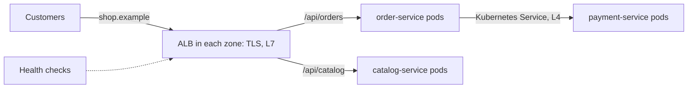

# Load Balancing

**System design · Step 14.5 · Fundamentals** · Last updated 2026-10-22
**Prerequisites:** [Scaling out: stateless services and horizontal scaling](04-scaling-out-stateless-services.md) (14.4); helpful: [Timeouts](../01-resilience/02-timeouts.md) (1.2) and [Bulkhead](../01-resilience/06-bulkhead.md) (1.6)

## 1. What it is and why it matters

**What is it?** A **load balancer** sits in front of a group of instances, gives clients one stable address, and passes each request (or connection) to one healthy instance. It decides **which** instance using a **routing algorithm**, and it learns which instances are healthy from **health checks**.

**Why do we need it?** Scaling out ([14.4](04-scaling-out-stateless-services.md)) gives you fifteen interchangeable instances, but customers can't be asked to pick one. Something must spread the load, stop sending to an instance that has died, and let instances come and go during deploys without customers noticing.

**When would I meet it?** Every time traffic reaches more than one instance: the public entry of a site, calls between services inside a Kubernetes cluster, and connections to read replicas. You meet it most when it goes wrong: errors during every deploy, one slow instance dragging down the whole service, or all traffic landing on one pod.

> [!TIP]
> **Memory hook:** a load balancer answers three questions for every request: **where may it go** (healthy targets), **where should it go** (the algorithm), and **when must it stop going there** (draining).

## 2. Industry terms

| Term | Simple meaning | Why it matters | Example | Related terms |
|---|---|---|---|---|
| **Layer 4 (L4) load balancer** | Balances network **connections** by IP address and port, without reading the request | Fast and protocol-neutral, but every request on one connection goes to the same instance | AWS Network Load Balancer (NLB); a Kubernetes Service through kube-proxy | Transport layer, TCP |
| **Layer 7 (L7) load balancer** | Reads each HTTP **request**: host, path, headers, cookies | Can route `/api/orders` and `/api/catalog` to different services and balance per request | AWS Application Load Balancer (ALB), NGINX, Envoy, Kubernetes Ingress or Gateway API controllers | **Reverse proxy**, API gateway (4.5, planned) |
| **Routing algorithm** | The rule for picking an instance | Decides how evenly load and slowness are spread | Round robin, least outstanding requests, weighted, hash of a key | Load-balancing method |
| **Health check** | A test that decides whether an instance should receive traffic. **Active**: the balancer calls a URL regularly. **Passive**: it watches real requests fail | Too slow a check keeps sending to a dead instance; too strict a check removes healthy ones | ALB calls `/actuator/health/readiness` every 30 s by default | Readiness and liveness probes |
| **Connection draining** | Stop sending **new** requests to an instance, let in-progress ones finish, then remove it | The difference between deploys with and without errors | ALB deregistration delay (300 s by default) | Graceful shutdown |
| **TLS termination** | The balancer decrypts HTTPS and forwards to the instances | One place for certificates; lets an L7 balancer read the request | ALB with a certificate for the shop's domain | End-to-end TLS |
| **Fail open** | When every target looks unhealthy, send traffic to all of them anyway | Better than a total outage when the health check itself is wrong | ALB behaviour when all targets fail | Fail closed |
| **Little's law** | Requests in progress = arrival rate × time each request takes (L = λW) | Turns rates and latencies into "how many at once": threads, connections, requests lost in a deploy | 154 requests a second × 0.2 s = about 31 in progress | Concurrency |

## 3. In a real system (ShopFlow)

**The business problem.** ShopFlow now runs 15 `order-service` instances in three zones (the result of [14.4](04-scaling-out-stateless-services.md)), plus a catalogue service. Customers must reach all of it at one address, `shop.example`. The business needs three things: an instance that crashes during the sale must not turn into errors for customers; deploys during sale week must cause no errors; and a slow instance must not slow everyone down.

**Without a load balancer**, the domain name could return all instance addresses and let each client pick one. Clients and resolvers cache those addresses, so a dead instance keeps receiving traffic until the cached answers expire; there is no per-request choice, no draining and no routing by path.

**How a load balancer helps.** Customers reach an ALB in every zone. It terminates TLS, routes by path to the right service, picks a healthy pod with its algorithm, and takes pods out of rotation during deploys. Inside the cluster, calls such as `order-service` to `payment-service` go through a Kubernetes Service, which balances connections to the ready pods.



**What it costs.** One more network hop on every request (small inside one region, but not zero); the balancer must itself be redundant (managed balancers run nodes in several zones); and its settings (health checks, timeouts, draining) need tuning, because the defaults suit no particular service.

**Elsewhere:** a payment gateway uses L4 balancing for long-lived connections from banks and L7 balancing for its public REST API; a video platform sends the same video id to the same cache server with a hash-based algorithm, so each server's cache holds different videos; an online game balances players at match start and then keeps them on one server for the whole match.

## 4. How it works

**The flow of one request** through an L7 balancer:

1. The client resolves `shop.example` with DNS and gets the addresses of the balancer's nodes, one per zone.
2. The balancer accepts the connection and **terminates TLS**.
3. It matches the request against its **rules** (host, path, headers) and selects a **target group**, for example the `order-service` pods.
4. From the **healthy** targets in that group, it picks one with the **routing algorithm**.
5. It forwards the request, usually over a connection it keeps open to that target, and waits up to its **idle timeout**.
6. It returns the response and records metrics (request count, latency, 5xx errors per target).

If the chosen target refuses the connection or doesn't answer, the client gets an error such as 502 or 504, unless something retries on another target. A balancer retry is safe only for idempotent requests ([idempotency](../01-resilience/04-idempotency.md)).

**Where balancing happens.** Usually in several layers at once:

| Layer | Example in ShopFlow | What it balances |
|---|---|---|
| Edge | ALB (often created by a Kubernetes Ingress or Gateway API controller) | HTTP requests from the internet |
| Inside the cluster | A Kubernetes Service. In kube-proxy's iptables mode, the default mode in current Kubernetes, the rules "select a backend Pod at random" | Connections to ready pods |
| In the client | A client-side balancer library, or a service-mesh sidecar such as Envoy | Requests, with retries and outlier detection |

The programs below are simulations and arithmetic in one JVM, so their output is exact; how to run them is in [the Java overview](../13-java/01-java-overview.md), section 5.

### Worked example 1: round robin versus least outstanding requests

**Concept.** **Round robin** sends requests to targets in turn, ignoring how busy each one is. **Least outstanding requests** (AWS's name; NGINX has the similar `least_conn`) sends each request to the target with the fewest requests in progress. When instances differ in speed, that difference matters a lot.

```java
// File: BalancingAlgorithms.java (runnable, Java 21)
import java.util.ArrayList;
import java.util.List;
import java.util.Locale;

public class BalancingAlgorithms {

    // A request arrives every 2 ms. Each instance works on one request at a time.
    // instance-3 is slower (a noisy neighbour, long GC pauses, a smaller machine).
    static final int ARRIVAL_EVERY = 2;
    static final int[] SERVICE_TIME = {5, 5, 8};
    static final int REQUESTS = 90;

    interface Picker {
        int pick(int now, List<List<Integer>> finishTimes, int requestNumber);
    }

    static final Picker ROUND_ROBIN = (now, finishTimes, n) -> n % finishTimes.size();

    // Least outstanding requests: the instance with the fewest requests not yet finished.
    static final Picker LEAST_OUTSTANDING = (now, finishTimes, n) -> {
        int best = 0;
        for (int i = 1; i < finishTimes.size(); i++) {
            if (outstanding(finishTimes.get(i), now) < outstanding(finishTimes.get(best), now)) {
                best = i;                                // ties go to the lower-numbered instance
            }
        }
        return best;
    };

    static long outstanding(List<Integer> finishes, int now) {
        return finishes.stream().filter(f -> f > now).count();
    }

    static void simulate(String name, Picker picker) {
        List<List<Integer>> finishTimes = new ArrayList<>();
        for (int i = 0; i < SERVICE_TIME.length; i++) {
            finishTimes.add(new ArrayList<>());
        }
        int[] busyUntil = new int[SERVICE_TIME.length];
        int[] maxLatency = new int[SERVICE_TIME.length];
        long totalLatency = 0;

        for (int n = 0; n < REQUESTS; n++) {
            int now = n * ARRIVAL_EVERY;                         // arrival time in ms
            int i = picker.pick(now, finishTimes, n);
            int start = Math.max(now, busyUntil[i]);             // wait for earlier requests on that instance
            int finish = start + SERVICE_TIME[i];
            busyUntil[i] = finish;
            finishTimes.get(i).add(finish);
            int latency = finish - now;
            maxLatency[i] = Math.max(maxLatency[i], latency);
            totalLatency += latency;
        }

        System.out.println(name);
        for (int i = 0; i < SERVICE_TIME.length; i++) {
            System.out.println(String.format(Locale.ROOT, "  instance-%d (%d ms per request): %2d requests, slowest %3d ms",
                    i + 1, SERVICE_TIME[i], finishTimes.get(i).size(), maxLatency[i]));
        }
        int worst = Math.max(maxLatency[0], Math.max(maxLatency[1], maxLatency[2]));
        System.out.println(String.format(Locale.ROOT, "  average %.1f ms, worst %d ms", (double) totalLatency / REQUESTS, worst));
    }

    public static void main(String[] args) {
        simulate("Round robin", ROUND_ROBIN);
        simulate("Least outstanding requests", LEAST_OUTSTANDING);
    }
}
```

**Expected output**:

```text
Round robin
  instance-1 (5 ms per request): 30 requests, slowest   5 ms
  instance-2 (5 ms per request): 30 requests, slowest   5 ms
  instance-3 (8 ms per request): 30 requests, slowest  66 ms
  average 15.7 ms, worst 66 ms
Least outstanding requests
  instance-1 (5 ms per request): 37 requests, slowest  10 ms
  instance-2 (5 ms per request): 32 requests, slowest   6 ms
  instance-3 (8 ms per request): 21 requests, slowest   8 ms
  average 7.0 ms, worst 10 ms
```

**Walkthrough.**

| | Round robin | Least outstanding requests |
|---|---|---|
| Share for the slow instance | Exactly one third, 30 of 90 | 21 of 90: fewer, because it finishes more slowly |
| What happens to it | A request arrives for it every 6 ms, but it needs 8 ms each, so its queue only grows | It gets a new request only when it has fewer in progress than the others |
| Worst latency | 66 ms, and growing the longer the run | 10 ms, stable |

Round robin is fair to the **instances**; least outstanding requests is fair to the **requests**. With identical instances and similar requests, both behave the same (the experiment shows this), which is why round robin is a sensible default. When requests vary in cost, or one instance is slow (a noisy neighbour, long garbage-collection pauses), an algorithm that looks at load protects the users.

**Experiment.** Predict first: make all three instances equally fast (`SERVICE_TIME = {5, 5, 5}`). Which algorithm wins now? The result is in Answers.

**Other algorithms in one line each.** **Weighted** variants send more to bigger instances. **Random** (AWS's weighted random, NGINX's `random`) needs no shared state between balancer nodes. **Hash-based** routing (NGINX `hash` and `ip_hash`) always sends the same key, for example a product id, to the same target, which keeps per-instance caches useful; its "consistent" variant, which moves few keys when targets change, is explained with partitioning ([14.9](09-partitioning-sharding.md)).

### Health checks

A balancer can only avoid a dead instance once it **knows** the instance is dead.

1. **Active checks.** An ALB, with its defaults for instance and IP targets, calls the health check path every **30 seconds**, waits **5 seconds** for an answer, takes a target out after **2** consecutive failures and puts it back after **5** consecutive successes. A new target must pass a check before it receives traffic.
2. **Passive checks.** Open-source NGINX watches real requests: with its defaults (`max_fails=1`, `fail_timeout=10s`) one failed attempt marks a server unavailable for 10 seconds, and the request is passed to the next server.
3. **Kubernetes readiness probes.** If a pod's readiness probe fails, "the EndpointSlice controller removes the Pod's IP address from the EndpointSlices of all Services that match the Pod", so the Service stops sending it traffic. A **liveness** probe is different: when it fails, the container is restarted.
4. **When everything looks unhealthy**, an ALB **fails open** and sends traffic to all targets, on the reasoning that a wrong health check is more likely than every instance being dead.

**What a readiness check should test:** "can *this* instance serve requests now?" (started, warmed up, its own connection pool working). It should **not** fail because a dependency that every instance shares, such as the database, is briefly slow: then every instance fails its check at the same moment and the whole service disappears from the balancer (failure scenario 1). With Spring Boot Actuator, the readiness and liveness health groups (`/actuator/health/readiness`, `/actuator/health/liveness`) give each check its own content.

### Worked example 2: deploys without errors

**Concept.** During a rolling deploy each old pod is stopped. Two things must happen in the right order: every balancer must **stop sending** new requests to it, and only then may it **stop accepting** requests, after finishing the ones in progress. Little's law says how many are in progress.

```java
// File: DeployDraining.java (runnable, Java 21)
import java.util.Locale;

public class DeployDraining {

    public static void main(String[] args) {
        // Illustrative numbers for one order-service instance at peak (from 14.3 and 14.4).
        double requestsPerSecond = 2_315.0 / 15;     // about 154 per instance
        double secondsPerRequest = 0.2;              // average time a request is in progress
        double removalDelay = 2.0;                   // seconds until every load balancer stops sending to a stopping pod
        int instances = 15;

        // Little's law: requests in progress = arrival rate x time in the system.
        double inFlight = requestsPerSecond * secondsPerRequest;
        double sentDuringRemoval = requestsPerSecond * removalDelay;

        System.out.println(fmt("requests per second per instance   %.1f", requestsPerSecond));
        System.out.println(fmt("requests in progress (Little's law) %.1f", inFlight));
        System.out.println("Failed requests during one rolling deploy of " + instances + " instances");
        // 1. The process is killed at once: everything in progress fails, and so does
        //    everything still sent to it until the load balancers notice.
        print("kill immediately", (inFlight + sentDuringRemoval) * instances);
        // 2. Graceful shutdown: in-progress requests finish, but the server refuses new ones
        //    while the load balancers still send them for removalDelay seconds.
        print("graceful shutdown only", sentDuringRemoval * instances);
        // 3. Wait (for example a preStop sleep) until traffic has stopped, then shut down gracefully.
        print("wait for removal, then graceful", 0);
    }

    static void print(String strategy, double failed) {
        System.out.println(fmt("  %-32s %,6.0f", strategy, failed));
    }

    static String fmt(String pattern, Object... args) {
        return String.format(Locale.ROOT, pattern, args);
    }
}
```

**Expected output**:

```text
requests per second per instance   154.3
requests in progress (Little's law) 30.9
Failed requests during one rolling deploy of 15 instances
  kill immediately                  5,093
  graceful shutdown only            4,630
  wait for removal, then graceful       0
```

**Walkthrough.**
1. **Little's law:** 154 requests a second × 0.2 s = about **31 requests** in progress on each instance at any moment.
2. **Kill immediately:** those 31 fail, and so do the 309 requests the balancers still send during the 2 seconds before they notice: about 340 per instance, **5,093 per deploy** of 15 instances.
3. **Graceful shutdown only:** Spring Boot shuts down gracefully by default (since 3.4): it finishes in-progress requests within a timeout (`spring.lifecycle.timeout-per-shutdown-phase`, 30 s by default) and rejects new ones. In Kubernetes, removing the pod from the Service endpoints and sending the shutdown signal happen at about the same time, so requests still arrive during the removal delay and are rejected: **4,630** failures.
4. **Wait, then shut down gracefully:** a short pause before shutdown (commonly a `preStop` hook that sleeps a few seconds) lets every balancer stop sending first; then graceful shutdown finishes the remaining requests: **0** failures, as long as the pause covers the removal delay and the in-progress requests finish within the pod's termination grace period (30 seconds by default).

The 2-second removal delay is an illustrative assumption; measure your own (the time from pod deletion until requests stop arriving). An ALB has the matching setting on its side: its **deregistration delay** (300 seconds by default) lets in-flight requests complete before a target is removed.

**Experiment.** Predict first: the removal delay turns out to be 5 seconds (change `removalDelay` to 5.0). How many requests fail with each strategy? The result is in Answers.

### Layer 4 and long-lived connections

An L4 balancer chooses a target **once per connection**. That is fine for short HTTP/1.1 connections, but HTTP/2 and gRPC send many requests over **one long-lived connection**. Through a Kubernetes Service (L4), a gRPC client therefore sends every request to whichever pod it connected to first, and new pods added by the autoscaler get nothing (failure scenario 3). The fixes balance per request: an L7 balancer that understands HTTP/2, a client-side balancer that opens connections to several pods, or a service mesh.

## 5. Failure scenarios

### A health check that took the whole service out

1. **What happened?** The database had a 20-second slowdown. Within a minute, every `order-service` pod was marked unready, and the shop returned 503 everywhere, for longer than the slowdown itself.
2. **Why?** The readiness check included a database query with a short timeout. All pods share the database, so all failed together; Kubernetes removed them all from the Service, and they returned only after their checks passed again.
3. **What did users see?** A full outage instead of a few slow requests.
4. **Solutions:** readiness checks that test only the instance's own ability to serve; handle a slow dependency with [timeouts](../01-resilience/02-timeouts.md), a [circuit breaker](../01-resilience/05-circuit-breaker.md) and [fallbacks](../01-resilience/09-fallbacks-graceful-degradation.md) in the request path instead; never put dependency checks in liveness probes, which restart containers.
5. **What they cost:** an instance can now be "ready" while its database is down, so errors must be handled and reported in requests and alerts rather than hidden by the balancer.

### Errors on every deploy

1. **What happened?** Each rolling deploy produced a few seconds of 502 and 503 errors.
2. **Why?** Pods stopped immediately, or stopped accepting requests before the balancers stopped sending them (worked example 2).
3. **What did users see?** Failed checkouts during deploys, so the team stopped deploying during the sale week, which made fixes slower.
4. **Solutions:** graceful shutdown, a pre-stop pause longer than the removal delay, a matching deregistration delay on the ALB, and retries of idempotent requests on another target.
5. **What they cost:** deploys take a little longer; the pause must be measured, not guessed.

### All gRPC traffic on one pod

1. **What happened?** `order-service` called `pricing-service` over gRPC. One of five pricing pods ran at 100% CPU; the other four were idle; autoscaling added pods that also stayed idle.
2. **Why?** The Kubernetes Service balances connections (L4), and each `order-service` instance kept one HTTP/2 connection open, so all its requests went to one pod.
3. **What did users see?** Slow price lookups at peak, while the dashboards showed plenty of spare capacity.
4. **Solutions:** request-level (L7) balancing for gRPC: client-side balancing across all pod addresses (for example through a headless Service), an HTTP/2-aware proxy, or a service mesh.
5. **What they cost:** more client configuration, or a mesh or proxy to run.

## 6. Architectural decisions

| Choice | Use when | Avoid when | Alternatives |
|---|---|---|---|
| **L7 balancer** | HTTP and gRPC APIs; routing by path or host; per-request balancing; TLS termination | Non-HTTP protocols; extreme connection rates where the extra work matters | L4 in front of L7 proxies |
| **L4 balancer** | Non-HTTP TCP or UDP traffic; very high connection rates; when the client's IP must reach the target unchanged | HTTP/2 or gRPC that needs per-request spreading | L7, client-side balancing |
| **Round robin** | Similar instances, similar requests | Instances of different speed, or requests that vary a lot in cost | Least outstanding requests |
| **Least outstanding requests** | Requests of very different cost; occasional slow instances | AWS: you need slow start for warming up new targets (the two can't be combined on an ALB) | Weighted random |
| **Hash-based** | Per-instance caches or state you want to reuse by key | Uneven keys (a hot key overloads one target) | A shared cache ([14.6](06-caching.md)) |
| **Managed balancer** (ALB, NLB) | You run on a cloud and want redundancy across zones without operating it | You need behaviour it doesn't offer | NGINX, HAProxy, Envoy run by you |

**Common mistakes:** health checks that test shared dependencies; default health-check timings left unchanged for a fast service; balancer timeouts shorter than the service's own (the balancer gives up while the service still works); retries on non-idempotent requests; sticky sessions used to hide state ([14.4](04-scaling-out-stateless-services.md)).

## 7. Try it yourself

Try each exercise first; the solutions are in the Answers section, the first two as runnable programs.

1. **How long does a dead instance get traffic?** With the ALB defaults (interval 30 s, timeout 5 s, 2 failures to remove), how long, in the worst case, does a hung instance keep receiving requests, and how many requests is that at 154 a second? What if the interval is 5 s and the timeout 2 s?
2. **Threads in use.** An instance gets 154 requests a second, and Tomcat has 200 worker threads (Spring Boot's default for platform threads). Using Little's law, how many threads are busy when a request takes 0.2 s, when the payment provider makes it 1.5 s, and when the provider hangs until a 5-second timeout?
3. **Pick the balancing.** Choose a balancer type and algorithm for: (a) a chat service using WebSockets; (b) an API where some requests export a report (20 s) and most read one product (20 ms); (c) image resizing workers with a local cache of resized images per product; (d) internal gRPC calls between services in Kubernetes.

## 8. Check your understanding

1. `order-service` uses round robin, and one instance has long garbage-collection pauses. What do users see, and what would you change?
2. Why should a readiness check not fail when the shared database is briefly slow?
3. Every deploy causes a few seconds of 502 and 503 errors. What is the likely cause, and the fix?
4. A gRPC client sends all its requests to one of five pods behind a Kubernetes Service. Why, and what fixes it?

Answers are at the end of this note.

## 9. Revision

**Remember**
- A load balancer gives one address, picks a **healthy** target with an **algorithm**, and **drains** targets that are leaving.
- **L4** balances connections; **L7** reads and balances each HTTP request, and can route by path.
- **Round robin** is fair to instances; **least outstanding requests** is fair to requests when speeds differ.
- Health checks test **this instance**, not shared dependencies; deploys need **stop sending, then stop accepting**.
- **Little's law**: in progress = rate × time.

**Explain in 15 seconds:** "A load balancer spreads requests across healthy instances behind one address, using health checks to avoid dead ones, an algorithm to pick a target, and connection draining so instances can leave without dropping requests."

**Explain in 60 seconds:**
> "Clients reach one address, and the balancer, usually a layer 7 one for HTTP, terminates TLS, routes by host or path, and picks a healthy target. Round robin is fine when instances and requests are similar; when they aren't, least outstanding requests keeps a slow instance from building a queue. Health checks decide which targets are eligible; they should test whether this instance can serve, not shared dependencies, or one database blip removes every instance at once. Deploys need ordering: stop sending new requests first, then let the instance finish what's in progress; Little's law tells you how many that is. Layer 4 balancers pick a target per connection, which breaks down for long-lived HTTP/2 and gRPC connections, so those need request-level balancing."

**Likely follow-up questions:**
- **Is the load balancer a single point of failure?** It would be if it were one machine; managed balancers run nodes in every zone, and DNS spreads clients across them.
- **Where do you terminate TLS?** Usually at the edge balancer; re-encrypt to the instances when the network inside isn't trusted or rules require it.
- **How does a balancer handle a slow, not dead, instance?** Health checks often still pass; a load-aware algorithm, outlier detection in a mesh, or AWS's anomaly mitigation route around it.
- **DNS load balancing versus a load balancer?** DNS spreads clients across addresses but is cached and can't drain or route per request; it is used across regions ([14.14](14-multi-region-disaster-recovery.md)), with load balancers inside each.

**Architect's takeaway:** most load-balancing incidents come from defaults and ordering, not from the balancer: health checks that test the wrong thing, timings left at defaults, and deploys that stop accepting before traffic stops arriving. Decide those three explicitly for every service.

**Next topic:** [Caching](06-caching.md) (14.6)

## 10. Verification and sources

> [!NOTE]
> Checked 2026-10-22 against the official documentation below. All programs were run on OpenJDK 21.0.8, and the repository's example checker compares their output. Re-verify when you revisit this note.

- **Confirmed:** ALB routing algorithms are round robin (default), least outstanding requests and weighted random; slow start can't be combined with the other two; the default deregistration delay is 300 seconds; WebSocket connections are inherently sticky (AWS, "Edit target group attributes for your Application Load Balancer"). ALB health-check defaults for instance and IP targets: interval 30 s, timeout 5 s, healthy threshold 5, unhealthy threshold 2; if all targets are unhealthy the load balancer fails open (AWS, "Health checks for Application Load Balancer target groups"). NGINX's default method is weighted round robin; `least_conn`, `ip_hash`, `hash` (with `consistent` for ketama hashing) and `random` exist; `max_fails` defaults to 1 and `fail_timeout` to 10 seconds (nginx.org, `ngx_http_upstream_module`). kube-proxy's iptables rules select a backend pod at random by default, and iptables is the default mode, with nftables announced as a future default (Kubernetes, "Virtual IPs and Service Proxies"). A failed readiness probe removes the pod's IP from the Services' EndpointSlices, and the default termination grace period is 30 seconds (Kubernetes, "Pod Lifecycle"). In current Spring Boot, `server.shutdown` defaults to `graceful`, `spring.lifecycle.timeout-per-shutdown-phase` to 30 s and `server.tomcat.threads.max` to 200, which doesn't apply when virtual threads are enabled (Spring Boot application properties appendix); graceful shutdown became the default in Spring Boot 3.4 (Spring blog, "Bootiful Spring Boot 3.4"). All read 2026-10-22.
- **Assumptions and illustrations:** the simulations use whole milliseconds and one worker per instance; real servers handle many requests at once, so the numbers show the mechanism, not real latencies. The 2-second removal delay, 0.2-second request time and every ShopFlow number are illustrative. The health-check worst case is approximated as threshold × interval + timeout for an instance that hangs just after passing a check. The `preStop` pause is a common practice, not a Kubernetes default.
- **To verify:** Kubernetes' default readiness probe timings (`periodSeconds`, `failureThreshold`), which were not found on the pages read; your ingress or gateway controller's own defaults; current gRPC load-balancing guidance for your client library.
- **Decision rule:** L7 with per-request balancing for HTTP and gRPC; a load-aware algorithm when instances or requests differ; readiness checks that test only the instance; and a deploy order of stop sending, then stop accepting.

**Sources:** AWS Elastic Load Balancing documentation, "Edit target group attributes for your Application Load Balancer" and "Health checks for Application Load Balancer target groups"; nginx.org, "Module ngx_http_upstream_module"; Kubernetes documentation, "Virtual IPs and Service Proxies" and "Pod Lifecycle"; Spring Boot reference documentation, "Graceful Shutdown" and the application properties appendix; Spring blog, "Bootiful Spring Boot 3.4: Spring Boot" (2024-11-24).

## Answers

**Experiments**

- **Equal speeds** (worked example 1): both algorithms give 30 requests to each instance, every request takes 5 ms, average 5.0 ms and worst 5 ms. With identical instances and similar requests, round robin is just as good, and simpler.
- **A 5-second removal delay** (worked example 2): kill immediately **12,038** failures per deploy, graceful shutdown only **11,575**, wait then graceful **0**. The failures grow with the delay, so the pause before shutdown must be at least as long as the real removal delay; measure it.

**Check your understanding**

1. During each pause, the slow instance keeps receiving its full third of the requests, which queue behind the pause, so some users see long delays or timeouts, while the average looks acceptable. Use a load-aware algorithm such as least outstanding requests, look at per-target latency, and fix the cause (heap size, garbage collector settings, a noisy neighbour).
2. Because all instances share the database, so they would all fail their checks at once and be removed together, turning a short slowdown into a full outage. Readiness should answer "can this instance serve?"; a slow dependency is handled per request with timeouts, a breaker and fallbacks.
3. Pods stop accepting requests, or are killed, before every balancer has stopped sending to them, and in-progress requests are cut. Fix: graceful shutdown, a pause before shutdown longer than the removal delay (for example a `preStop` sleep), a matching ALB deregistration delay, and retries of idempotent requests.
4. The Kubernetes Service balances **connections** (layer 4), and gRPC uses one long-lived HTTP/2 connection for many requests, so every request follows the first connection to one pod. Fix with request-level balancing: client-side balancing over all pod addresses (a headless Service), an HTTP/2-aware proxy, or a service mesh.

**Practice exercises**

1. **How long does a dead instance get traffic?**

```java
// File: HealthCheckTiming.java (runnable, Java 21)
import java.util.Locale;

public class HealthCheckTiming {

    record Settings(String name, int intervalSeconds, int timeoutSeconds, int unhealthyThreshold) {
        // Worst case for an instance that hangs just after passing a check: the next
        // `unhealthyThreshold` checks must each time out before it is taken out of service.
        int worstSecondsToRemove() {
            return unhealthyThreshold * intervalSeconds + timeoutSeconds;
        }
    }

    public static void main(String[] args) {
        double requestsPerSecondPerInstance = 2_315.0 / 15;
        for (Settings s : new Settings[] {
                new Settings("ALB defaults (30 s, 5 s, 2)", 30, 5, 2),
                new Settings("tuned (5 s, 2 s, 2)", 5, 2, 2)}) {
            int seconds = s.worstSecondsToRemove();
            System.out.println(String.format(Locale.ROOT, "%-28s removed after up to %2d s, %,6.0f requests sent to it",
                    s.name(), seconds, seconds * requestsPerSecondPerInstance));
        }
    }
}
```

**Expected output**:

```text
ALB defaults (30 s, 5 s, 2)  removed after up to 65 s, 10,032 requests sent to it
tuned (5 s, 2 s, 2)          removed after up to 12 s,  1,852 requests sent to it
```

With the defaults, a hung instance can receive about **10,000 requests over 65 seconds** before it is removed; with a 5-second interval, about 1,850 over 12 seconds. Faster checks cost more health-check traffic and a higher risk of removing an instance during a short hiccup; retries of idempotent requests on another target hide most of the remaining errors.

2. **Threads in use:**

```java
// File: ThreadsInFlight.java (runnable, Java 21)
import java.util.Locale;

public class ThreadsInFlight {

    public static void main(String[] args) {
        double requestsPerSecond = 154;      // per instance at peak
        int maxThreads = 200;                // Spring Boot's default server.tomcat.threads.max (platform threads)

        // Little's law: busy threads = requests per second x seconds each request holds a thread.
        print("normal, 0.2 s per request", requestsPerSecond * 0.2, maxThreads);
        print("payment provider slow, 1.5 s", requestsPerSecond * 1.5, maxThreads);
        print("provider hangs, 5 s timeout", requestsPerSecond * 5.0, maxThreads);
    }

    static void print(String label, double busy, int max) {
        System.out.println(String.format(Locale.ROOT, "%-30s %5.0f threads busy of %d%s",
                label, busy, max, busy > max ? "  -> requests queue and time out" : ""));
    }
}
```

**Expected output**:

```text
normal, 0.2 s per request         31 threads busy of 200
payment provider slow, 1.5 s     231 threads busy of 200  -> requests queue and time out
provider hangs, 5 s timeout      770 threads busy of 200  -> requests queue and time out
```

Normally about 31 of 200 threads are busy. A provider that slows to 1.5 s already needs 231, more than the pool, and a hanging provider needs 770. Requests then queue, time out, and the instance looks dead to the balancer, although only one dependency is slow. This is why calls to the provider need a short [timeout](../01-resilience/02-timeouts.md) and their own limited pool, a [bulkhead](../01-resilience/06-bulkhead.md), so they can't take every thread.

3. **Pick the balancing:** (a) WebSockets: an L7 balancer that supports the upgrade; each connection stays on one instance by nature, so pick the target by least outstanding requests or connections, and pass messages between instances through a shared channel. (b) Mixed report and product requests: least outstanding requests, and better still separate target groups or services for reports, so 20-second exports never queue in front of 20-millisecond reads (a bulkhead at the routing level). (c) Resizing workers with local caches: hash-based routing on the product id, consistent hashing so adding a worker moves few products, and watch for hot products. (d) Internal gRPC: request-level balancing on the client side or in a mesh, not a plain Kubernetes Service.

Back to [the System design overview](01-system-design-overview.md) · [the index](../README.md) · [Roadmap](../roadmap.md).
