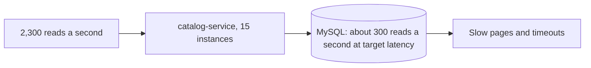

# Caching

**System design · Step 14.6 · Fundamentals** · Last updated 2026-10-22
**Prerequisites:** [Scaling out: stateless services and horizontal scaling](04-scaling-out-stateless-services.md) (14.4); helpful: [Back-of-the-envelope estimation](03-back-of-the-envelope-estimation.md) (14.3)

## 1. What it is and why it matters

**What is it?** A **cache** keeps a copy of data that is read often in a place that is faster to read than the original, usually memory, so most reads skip the slow work. The original stays the **source of truth**; the cache only holds copies.

**Why do we need it?** In a read-heavy system the same data is read again and again: ShopFlow's catalogue is read about 400 times for every order written ([14.3](03-back-of-the-envelope-estimation.md)). Serving every read from the database makes the database the bottleneck long before anything else. A cache absorbs the repeated reads, which lowers latency and protects the database.

**When would I meet it?** When a database's read load climbs, when one page is slow because it runs an expensive query, before a sale, and in incidents: customers seeing an old price, or the database collapsing the moment the cache empties.

> [!TIP]
> **Memory hook:** a cache is a fast copy that is allowed to be wrong for a while. Decide **how wrong, for how long**, and **what happens when it's gone**.

## 2. Industry terms

| Term | Simple meaning | Why it matters | Example | Related terms |
|---|---|---|---|---|
| **Hit, miss, hit ratio** | Found in the cache, not found; the share of reads that were hits | The hit ratio decides how much load is left for the database | 95% hits: 116 of 2,315 reads a second reach MySQL | Miss ratio |
| **TTL (time to live)** | How long an entry may be used before it expires | Puts an upper limit on staleness when invalidation fails | Product details cached for 60 s | Expiry |
| **Cache-aside (lazy loading)** | The application reads the cache; on a miss it reads the source and fills the cache | The most common pattern; the cache only holds what was asked for | Spring's `@Cacheable` | Read-through |
| **Read-through, write-through, write-behind** | The cache library loads misses itself; writes go to cache and source together; writes go to the cache and reach the source later | Different trade-offs of simplicity, freshness and data loss | Caffeine `LoadingCache` (read-through) | Write-back |
| **Invalidation** | Removing or replacing a cached copy when the source changes | Without it, readers see old data until the TTL | Delete `product:MUG` after a price change | Eviction |
| **Eviction** | Removing entries to make room, by a policy such as **LRU** (least recently used) or **LFU** (least frequently used) | A full cache must decide what to drop | Redis `allkeys-lru` | `maxmemory` |
| **Cache stampede** | Many requests miss the same key at once and all go to the source | A popular key expiring can overload the database | 50 loads of one product in 50 ms | **Thundering herd**, dogpile |
| **Request coalescing** | Only one request loads a missing key; the others wait for its result | Turns a stampede into one load | `@Cacheable(sync = true)` | Single flight |
| **Negative caching** | Caching "this doesn't exist" | Stops repeated lookups of missing keys reaching the database | A bot scanning random product ids | Cache penetration |
| **Local and distributed cache** | In each instance's memory, or in a shared cache service | Local is fastest but differs per instance; distributed is shared but one network hop away | Caffeine (local), Redis or Memcached (distributed) | Near cache |

## 3. In a real system (ShopFlow)

**The business problem.** During the sale, product pages get about 2,300 reads a second, and a load test shows that the catalogue's MySQL database serves only about 300 product reads a second within its latency target (an illustrative figure). Product details change rarely, but prices change several times during the sale, and a customer must never pay a price different from the one checkout shows.



**How caching helps.** The catalogue service checks a shared Redis cache first and goes to MySQL only on a miss. With a hit ratio of about 90% or more, the database receives a few hundred reads a second, within its capacity (practice exercise 1). When a price changes, the service deletes the cached product so the next read loads the new price, and checkout reads the price from the source, not from the cache.

**What it costs.** Readers can see old data, up to the TTL if an invalidation is lost. The cache becomes a dependency with its own memory, failure modes and operations. And the database has quietly been sized for the cache's hit ratio: if the cache empties, the database receives the full load (failure scenario 3).

**Elsewhere:** a news site caches each article at the CDN for a minute, because a minute-old article is fine; a banking app caches the list of branches for a day but never the account balance; a social network caches a user's profile and refreshes it when the profile changes, through an event.

## 4. How it works

**Where caches live.** A request can pass several:

| Layer | Example | Shared by | Typical use |
|---|---|---|---|
| Browser and HTTP caches | `Cache-Control` headers | One user, or a proxy's users | Static files, public pages |
| CDN | Edge servers near users ([14.12](12-object-storage-cdn.md)) | All users in a region | Images, scripts, public pages |
| In-process | Caffeine inside each `catalog-service` instance | One instance | Small, very hot, rarely changing data |
| Distributed | Redis or Memcached | All instances | Product details, computed results |
| The database itself | MySQL's buffer pool keeps hot pages in memory | The database | Automatic; not a substitute for the others |

**The cache-aside flow** (the pattern in all the examples):

1. **Read:** look up the key in the cache. On a hit, return it.
2. On a miss, read the **source of truth**, store the result with a **TTL**, and return it.
3. **Write:** update the source first, then **delete** the cached key, so the next read loads the new value. Deleting is preferred to writing the new value into the cache, because two concurrent writers can put their values into the cache in the wrong order, while a delete is always safe to repeat.
4. **Expiry:** the TTL limits how long a copy can stay wrong if a delete is lost.

With Spring's cache abstraction, `@Cacheable` on a read method gives steps 1 and 2, and `@CacheEvict` on the update method gives step 3.

The programs below are single-JVM simulations with a fake clock, so their output is exact; how to run them is in [the Java overview](../13-java/01-java-overview.md), section 5.

### Worked example 1: cache-aside and invalidation

**Concept.** The same reads and the same price change, once with only a TTL and once with a delete on every write.

```java
// File: CacheAsideDemo.java (runnable, Java 21)
import java.util.HashMap;
import java.util.Locale;
import java.util.Map;

public class CacheAsideDemo {

    // The source of truth: product prices in cents, and a counter of database reads.
    static class Database {
        final Map<String, Long> prices = new HashMap<>(Map.of("MUG", 1_500L, "TEE", 5_000L));
        int reads = 0;

        long read(String sku) {
            reads++;
            return prices.get(sku);
        }
    }

    record Entry(long value, long expiresAt) {}

    // Cache-aside: the application checks the cache first and fills it on a miss.
    static class ProductService {
        final Database db;
        final Map<String, Entry> cache = new HashMap<>();
        final long ttlSeconds;
        final boolean evictOnWrite;

        ProductService(Database db, long ttlSeconds, boolean evictOnWrite) {
            this.db = db;
            this.ttlSeconds = ttlSeconds;
            this.evictOnWrite = evictOnWrite;
        }

        String price(String sku, long now) {
            Entry e = cache.get(sku);
            if (e != null && now < e.expiresAt()) {
                return eur(e.value()) + " (hit)";
            }
            long value = db.read(sku);                                // miss or expired: go to the source
            cache.put(sku, new Entry(value, now + ttlSeconds));
            return eur(value) + " (miss, read the database)";
        }

        void changePrice(String sku, long cents) {
            db.prices.put(sku, cents);                                // 1. update the source of truth
            if (evictOnWrite) {
                cache.remove(sku);                                    // 2. delete the cached copy
            }
        }
    }

    static void run(String title, boolean evictOnWrite) {
        System.out.println(title);
        Database db = new Database();
        ProductService service = new ProductService(db, 60, evictOnWrite);
        System.out.println("  t=0   MUG " + service.price("MUG", 0));
        System.out.println("  t=1   MUG " + service.price("MUG", 1));
        System.out.println("  t=2   TEE " + service.price("TEE", 2));
        service.changePrice("MUG", 1_200);
        System.out.println("  t=3   price of MUG changed to EUR 12.00 in the database");
        System.out.println("  t=4   MUG " + service.price("MUG", 4));
        System.out.println("  t=61  MUG " + service.price("MUG", 61));
        System.out.println("  database reads: " + db.reads);
    }

    static String eur(long cents) {
        return String.format(Locale.ROOT, "EUR %d.%02d", cents / 100, cents % 100);
    }

    public static void main(String[] args) {
        run("TTL 60 s, no eviction on write", false);
        run("TTL 60 s, delete the cached copy on write", true);
    }
}
```

**Expected output**:

```text
TTL 60 s, no eviction on write
  t=0   MUG EUR 15.00 (miss, read the database)
  t=1   MUG EUR 15.00 (hit)
  t=2   TEE EUR 50.00 (miss, read the database)
  t=3   price of MUG changed to EUR 12.00 in the database
  t=4   MUG EUR 15.00 (hit)
  t=61  MUG EUR 12.00 (miss, read the database)
  database reads: 3
TTL 60 s, delete the cached copy on write
  t=0   MUG EUR 15.00 (miss, read the database)
  t=1   MUG EUR 15.00 (hit)
  t=2   TEE EUR 50.00 (miss, read the database)
  t=3   price of MUG changed to EUR 12.00 in the database
  t=4   MUG EUR 12.00 (miss, read the database)
  t=61  MUG EUR 12.00 (hit)
  database reads: 3
```

**Walkthrough.**

| Time | TTL only | Delete on write |
|---|---|---|
| t=0 | Miss: loads EUR 15.00, valid until t=60 | Same |
| t=1 | Hit | Hit |
| t=3 | Database now says EUR 12.00; the cache still holds EUR 15.00 | Database updated, cache entry deleted |
| t=4 | **Hit, but wrong: EUR 15.00** | Miss: loads EUR 12.00 |
| t=61 | Expired: loads EUR 12.00 | Hit |

Both runs read the database three times. Deleting on write costs no extra reads here; it moves one miss earlier, to the moment the data changed, which is exactly when a fresh read is needed. The TTL alone makes the price wrong for up to a minute.

**Experiment.** Predict first: without deletion, but with a TTL of 2 seconds instead of 60, is the t=4 price right, and how many database reads are there? The result is in Answers.

### Worked example 2: what the hit ratio buys

**Concept.** Database load is proportional to the **miss** ratio. Average latency mixes fast hits with slow misses.

```java
// File: HitRatioMath.java (runnable, Java 21)
import java.util.Locale;

public class HitRatioMath {

    public static void main(String[] args) {
        double readsPerSecond = 2_315;      // catalogue peak from 14.3
        double cacheMs = 1;                 // illustrative: a cache lookup over the network
        double databaseMs = 10;             // illustrative: a database query

        System.out.println("hit ratio   database reads/s   average latency");
        for (double hit : new double[] {0, 0.80, 0.90, 0.95, 0.99}) {
            double dbReads = readsPerSecond * (1 - hit);
            // A hit costs the cache lookup; a miss costs the lookup and then the database.
            double avgMs = hit * cacheMs + (1 - hit) * (cacheMs + databaseMs);
            System.out.println(String.format(Locale.ROOT, "  %3.0f%%       %,8.0f          %5.2f ms",
                    hit * 100, dbReads, avgMs));
        }
    }
}
```

**Expected output**:

```text
hit ratio   database reads/s   average latency
    0%          2,315          11.00 ms
   80%            463           3.00 ms
   90%            231           2.00 ms
   95%            116           1.50 ms
   99%             23           1.10 ms
```

**Walkthrough.** Going from 90% to 99% hits looks like a small step, but it cuts the misses from 10% to 1%: **ten times less** database load (231 to 23 reads a second). Latency improves much less, from 2.00 to 1.10 ms, because every request still pays for the cache lookup. Caches are mostly about **protecting the source**; the latency gain is a bonus. The latencies are illustrative assumptions.

### Worked example 3: a stale set, and leases

**Concept.** Even with delete on write, cache-aside has a classic race: a reader that loaded an **old** value before a write can store it **after** the writer's delete, leaving the cache wrong until the TTL. One fix is a **lease**: on a miss, the cache gives the reader a token, a delete cancels outstanding tokens, and a fill with a cancelled token is rejected. Leases were described for Facebook's memcache in the paper "Scaling Memcache at Facebook" (NSDI 2013); the program is a small simulation of the idea.

```java
// File: StaleSetRace.java (runnable, Java 21)
import java.util.HashMap;
import java.util.Map;

public class StaleSetRace {

    static class Cache {
        final Map<String, Long> values = new HashMap<>();
        final Map<String, Integer> leases = new HashMap<>();   // key -> lease token handed out on a miss
        int nextToken = 1;
        final boolean useLeases;

        Cache(boolean useLeases) { this.useLeases = useLeases; }

        // On a miss, the caller gets a token that allows it to fill the key later.
        int missAndLease(String key) {
            int token = nextToken++;
            leases.put(key, token);
            return token;
        }

        void delete(String key) {
            values.remove(key);
            leases.remove(key);                                // a delete cancels any outstanding lease
        }

        String set(String key, long value, int token) {
            if (useLeases && !Integer.valueOf(token).equals(leases.get(key))) {
                return "rejected (lease cancelled by the delete)";
            }
            values.put(key, value);
            leases.remove(key);
            return "stored";
        }
    }

    static void run(String title, boolean useLeases) {
        System.out.println(title);
        Map<String, Long> database = new HashMap<>(Map.of("MUG", 1_500L));
        Cache cache = new Cache(useLeases);

        int token = cache.missAndLease("MUG");
        System.out.println("  1 reader: cache miss for MUG");
        long readerSaw = database.get("MUG");
        System.out.println("  2 reader: reads the database, gets " + readerSaw);
        database.put("MUG", 1_200L);
        System.out.println("  3 writer: updates the database to 1200");
        cache.delete("MUG");
        System.out.println("  4 writer: deletes MUG from the cache");
        System.out.println("  5 reader: sets MUG = " + readerSaw + " in the cache: " + cache.set("MUG", readerSaw, token));
        System.out.println("  result: database " + database.get("MUG") + ", cache " + (cache.values.containsKey("MUG") ? cache.values.get("MUG") : "empty"));
    }

    public static void main(String[] args) {
        run("Cache-aside, no protection", false);
        run("Cache-aside with leases", true);
    }
}
```

**Expected output**:

```text
Cache-aside, no protection
  1 reader: cache miss for MUG
  2 reader: reads the database, gets 1500
  3 writer: updates the database to 1200
  4 writer: deletes MUG from the cache
  5 reader: sets MUG = 1500 in the cache: stored
  result: database 1200, cache 1500
Cache-aside with leases
  1 reader: cache miss for MUG
  2 reader: reads the database, gets 1500
  3 writer: updates the database to 1200
  4 writer: deletes MUG from the cache
  5 reader: sets MUG = 1500 in the cache: rejected (lease cancelled by the delete)
  result: database 1200, cache empty
```

**Walkthrough.** The order of the five steps is what matters. In the first run, the reader's step 5 writes a value that was already out of date at step 3; nothing removes it until the TTL. In the second run, the delete at step 4 cancels the reader's lease, so its fill is rejected, the cache stays empty, and the next reader loads EUR 12.00. Without leases, the practical defences are a modest TTL as a safety net and, for data where a stale value is harmful, reading the source of truth at the moment of decision (checkout reads the price from the database).

### Worked example 4: a stampede, and coalescing

**Concept.** When a popular key expires, every request that arrives before the reload finishes is a miss. If each one loads the value itself, the database receives a burst of identical queries. **Request coalescing** lets the first miss load the value while the others wait for it.

```java
// File: StampedeDemo.java (runnable, Java 21)
public class StampedeDemo {

    // A popular key expires at t = 0 ms. One request arrives every millisecond for 100 ms.
    // Loading the value from the database takes 50 ms.
    static final int REQUESTS = 100;
    static final int LOAD_MS = 50;

    public static void main(String[] args) {
        // Without coalescing: every request that finds the key missing starts its own load.
        int loads = 0;
        int valueReadyAt = Integer.MAX_VALUE;
        for (int t = 0; t < REQUESTS; t++) {
            if (t < valueReadyAt) {
                loads++;
                valueReadyAt = Math.min(valueReadyAt, t + LOAD_MS);
            }
        }
        System.out.println("No coalescing:   " + loads + " database loads for one key");

        // With coalescing (single flight): the first miss loads; later misses wait for that load.
        loads = 0;
        int waited = 0;
        boolean loading = false;
        valueReadyAt = Integer.MAX_VALUE;
        for (int t = 0; t < REQUESTS; t++) {
            if (t >= valueReadyAt) {
                continue;                     // a hit
            }
            if (!loading) {
                loads++;
                loading = true;
                valueReadyAt = t + LOAD_MS;
            } else {
                waited++;                     // joins the load already in progress
            }
        }
        System.out.println("With coalescing: " + loads + " database load, " + waited + " requests waited for it");
    }
}
```

**Expected output**:

```text
No coalescing:   50 database loads for one key
With coalescing: 1 database load, 49 requests waited for it
```

**Walkthrough.** Without coalescing, each of the first 50 requests (one a millisecond, for the 50 ms the load takes) starts its own load: the number of loads is the request rate × the load time, Little's law again ([14.5](05-load-balancing.md)). With coalescing, one load runs and 49 requests wait for it. A slow query under load therefore makes stampedes worse: the slower the reload, the more duplicates.

**Experiment.** Predict first: if the load takes 5 ms instead of 50 ms (`LOAD_MS = 5`), how many loads happen without coalescing? The result is in Answers.

**Defences against stampedes, in practice:**
- **Coalesce per key.** Spring's `@Cacheable(sync = true)` asks the cache provider to lock the entry "while the value is being computed", so "only one thread is busy computing the value". This works **per instance**: 15 instances can still send 15 loads. Global coalescing needs a lock or lease in the shared cache.
- **Add jitter to TTLs**, so keys loaded at the same moment (a warm-up before the sale) don't all expire at the same moment.
- **Refresh before expiry**, for example Caffeine's refresh-after-write, which reloads a hot key in the background while the old value is still served.
- **Serve the stale value briefly** while one request reloads it, when a slightly old value is acceptable.

### Memory and eviction

A cache that runs out of memory must drop something. Two Redis defaults surprise people:
- `maxmemory` is **0 (no limit)** on 64-bit systems, so a Redis cache can grow until the machine runs out of memory unless a limit is set.
- `maxmemory-policy` defaults to **`noeviction`**: when the limit is reached, Redis keeps every key and returns an error to commands that would add data, while reads still work.

For a pure cache, set a limit and an eviction policy; Redis's documentation calls `allkeys-lru` "a good default option if you have no reason to prefer any others", with `allkeys-lfu` as the alternative for stable popularity. Keep data that is **not** a cache, such as sessions ([14.4](04-scaling-out-stateless-services.md)), out of a cache that evicts, preferably in a separate instance, as the Redis documentation also suggests. In-process, Caffeine evicts with Window TinyLFU, chosen "due to its high hit rate and low memory footprint".

## 5. Failure scenarios

### The old price

1. **What happened?** A price was lowered for the sale. For a minute, product pages showed the old price, while checkout, reading the database, charged the new one.
2. **Why?** The product was cached with a 60-second TTL, and the price update didn't delete the cached copy.
3. **What did users see?** One price on the page, another at checkout: complaints and abandoned carts. With the opposite change, a price increase, customers would be charged more than the page showed.
4. **Solutions:** delete the cached product on every write (or publish a change event that every cache subscribes to, for example from [change data capture](../02-messaging/02-kafka/15-kafka-connect-cdc.md)); keep a TTL as a safety net; and decide money at checkout from the source of truth, never from a cache.
5. **What they cost:** every code path that writes a product must evict, which is easy to miss; event-driven invalidation adds a pipeline to run.

### The stampede at 09:00

1. **What happened?** The cache was warmed at 08:55 with a 5-minute TTL. At 09:00, the sale started, every hot key expired at once, and the catalogue database was overwhelmed for a minute.
2. **Why?** Identical TTLs from one warm-up, no coalescing, and slow queries under load, which made each stampede bigger.
3. **What did users see?** Slow and failing product pages in the first, busiest minute.
4. **Solutions:** jittered TTLs; coalescing per key; refresh-ahead for the hottest keys; [load shedding](../01-resilience/08-load-shedding-backpressure.md) on the database path as the last line.
5. **What they cost:** somewhat older data with refresh-ahead and stale serving; more cache configuration to understand.

### A full cache that said no

1. **What happened?** Redis reached the memory limit the platform team had set. Writes to the cache started failing, the catalogue service treated the cache error as a failed request, and product pages returned errors.
2. **Why?** The default policy, `noeviction`, rejects new data when full, and the code didn't treat the cache as optional.
3. **What did users see?** Errors on product pages, although the database was healthy.
4. **Solutions:** set `allkeys-lru` (or `allkeys-lfu`) on a cache instance; treat cache errors as misses, with a short timeout on cache calls; protect the database for the case where the cache is empty or down, because it then receives the full load: a limit on concurrent database reads, coalescing, and shedding.
5. **What they cost:** monitoring of memory, evictions and hit ratio; with an empty cache, some requests will still be rejected, but in a controlled way.

## 6. Architectural decisions

| Cache when | Don't cache when | Alternatives |
|---|---|---|
| Reads clearly outnumber writes, the same data is read repeatedly, a short staleness is acceptable, or the result is expensive to compute | Every read must be current (stock at checkout, payment status, balances), reads rarely repeat, or the data is written as often as read | Read replicas ([14.8](08-replication-read-replicas.md)) for read scale without staleness rules of your own; better queries and indexes; precomputed tables |

| Choice | Choose the first when | Choose the second when |
|---|---|---|
| **Local or distributed** | Very hot, small, rarely changing data; the lowest latency; instances may briefly disagree | Data shared by all instances; one invalidation must reach everyone; the data set is larger than one instance's memory |
| **Short or long TTL** | Data changes often and invalidation is unreliable | Data rarely changes and every write evicts reliably |
| **Cache-aside or write-through** | Most reads are for a small hot set; simplicity | Data written is almost always read soon after |

**Common mistakes:** caching without a TTL; deciding money or stock from a cached value; a cache that evicts holding data that isn't a cache; sizing the database for the hit ratio without a plan for an empty cache; no metrics for hit ratio, evictions and memory.

## 7. Try it yourself

Try each exercise first; the solutions are in the Answers section, the first two as runnable programs.

1. **How good must the cache be?** Peak catalogue reads are 2,315 a second. The database serves 300 product reads a second at its latency target, and you want to use at most 80% of that. What hit ratio do you need? How much memory do the values of 100,000 products at 2 KB each need?
2. **Bots and missing products.** Customers look up 50 popular products ten times each; a bot looks up 20 product ids that don't exist, ten times each. How many database reads are there with plain cache-aside, and with negative caching?
3. **What and how to cache.** For each, decide whether to cache, where, and how to keep it fresh: (a) product descriptions and images; (b) the "in stock" label on the product page; (c) the stock count used when an order is placed; (d) the sale price; (e) customer sessions.

## 8. Check your understanding

1. Going from 0% to 95% hits cuts database reads twenty times, but average latency only about seven times (worked example 2). Why the difference?
2. Why does cache-aside delete the cached entry on a write instead of writing the new value into the cache?
3. All 15 catalogue instances use `@Cacheable(sync = true)` with a local cache, and a hot key expires. How many database loads can that cause, and why?
4. The product page shows a stock count cached for 30 seconds. Is that acceptable? What about the stock check when an order is placed?

Answers are at the end of this note.

## 9. Revision

**Remember**
- A cache is a **copy**; the database stays the **source of truth**.
- **Cache-aside**: read cache, on a miss load and store with a TTL; on a write, update the source and **delete** the key.
- Database load follows the **miss ratio**; plan for the day the cache is **empty**.
- Stampedes: **coalesce**, **jitter** TTLs, **refresh ahead**. Stale sets: **leases**, or a TTL as safety net.
- Redis defaults: no memory limit and **`noeviction`**; set a limit and `allkeys-lru` for a cache.

**Explain in 15 seconds:** "A cache keeps fast copies of frequently read data so most reads skip the database. With cache-aside, the application loads on a miss and deletes the copy on a write, and a TTL limits how long a copy can be wrong."

**Explain in 60 seconds:**
> "Caching trades freshness for speed and database protection. The usual pattern is cache-aside: read the cache, on a miss load from the database and store it with a TTL, and on a write update the database and delete the cached key. Database load follows the miss ratio, so going from 90 to 99% hits cuts it ten times, and the database must still survive an empty cache. The hard parts are invalidation and concurrency: a reader can store an old value after a writer's delete, which leases or a TTL as safety net handle, and a hot key expiring causes a stampede, which coalescing, jittered TTLs and refresh-ahead prevent. I never decide money or stock from a cache; checkout reads the source."

**Likely follow-up questions:**
- **Redis or Memcached?** Both are fast distributed caches; Redis adds data structures, persistence and replication; Memcached is a simpler multithreaded key-value cache. Choose by the features you need, not by speed alone.
- **How do you invalidate caches in other services?** Publish change events (or use change data capture) and let each service evict its own copies; keep a TTL in case an event is missed.
- **What is a hot key?** One key read so often that a single cache node becomes the bottleneck; replicate it, add a small local cache in front, or split it.
- **How do you measure a cache?** Hit ratio, evictions, memory, latency of cache calls, and database load, together.

**Architect's takeaway:** for every cache, write down three things: how stale it may be, how it is invalidated, and what protects the database when it is empty. A cache without those answers is a future incident.

**Next topic:** [Choosing a database](07-choosing-a-database.md) (14.7)

## 10. Verification and sources

> [!NOTE]
> Checked 2026-10-22. All programs were run on OpenJDK 21.0.8, and the repository's example checker compares their output. Re-verify when you revisit this note.

- **Confirmed:** Redis eviction policies (`noeviction`, `allkeys-lru`, `allkeys-lfu`, `allkeys-random`, the `volatile-*` policies, and `allkeys-lrm`/`volatile-lrm` from Redis 8.6), that `noeviction` returns an error to commands that add data while reads still work, that `maxmemory` 0 means no limit on 64-bit systems, that `allkeys-lru` is "a good default option", that LRU and LFU are approximated by sampling, and the advice to use separate instances for cache and persistent keys (redis.io, "Key eviction"); the default `maxmemory-policy noeviction` (redis.conf in the Redis repository). Caffeine uses Window TinyLFU "due to its high hit rate and low memory footprint" (Caffeine wiki, "Efficiency"). `@Cacheable`, `@CachePut`, `@CacheEvict` and `sync = true`, which locks the entry so only one thread computes the value, and which providers may not support (Spring Framework reference, "Declarative Annotation-based Caching"). All read 2026-10-22.
- **Assumptions and illustrations:** the programs are simulations with a fake clock; the 300 reads a second, 1 ms and 10 ms latencies, 2 KB per product and all ShopFlow figures are illustrative. The lease mechanism is described from secondary sources (course notes and summaries of Nishtala et al., "Scaling Memcache at Facebook", NSDI 2013); the original paper's exact rules were not checked, and the program shows only the idea.
- **To verify:** the exact lease semantics in the original paper; Caffeine's documentation for the atomicity of `get(key, mappingFunction)` and for `refreshAfterWrite` before relying on them; your managed Redis service's default eviction policy, which can differ from open-source Redis.
- **Decision rule:** cache what is read often and may be briefly stale; delete on write and keep a TTL; never decide money or stock from a cache; size the database for the day the cache is empty.

**Sources:** redis.io, "Key eviction"; redis.conf (github.com/redis/redis); Caffeine wiki, "Efficiency" (github.com/ben-manes/caffeine); Spring Framework reference documentation, "Declarative Annotation-based Caching"; Rajesh Nishtala et al., "Scaling Memcache at Facebook", USENIX NSDI 2013.

## Answers

**Experiments**

- **TTL 2 s, no deletion** (worked example 1): t=4 is now a **miss and correct**, EUR 12.00, because the entry from t=0 expired at t=2; t=61 is another miss. Database reads rise from **3 to 4**. A short TTL buys freshness with database load; deleting on write buys it without the extra load, as long as every write path deletes.
- **A 5 ms load** (worked example 4): **5 loads** without coalescing, 1 with it (4 requests wait). Duplicates = request rate × load time, so fast reloads shrink stampedes, and slow ones under pressure make them grow.

**Check your understanding**

1. Database reads depend only on the misses: 100% to 5% of reads is twenty times fewer. Latency is an average in which every request still pays for the cache lookup (1 ms here), so it can't fall below that, and it falls from 11 ms to 1.5 ms, about seven times.
2. Because concurrent writers can store their values into the cache in a different order from the order their database writes happened, leaving an old value cached. A delete doesn't depend on order and is safe to repeat; the next read loads whatever the database holds now.
3. Up to **15**: `sync = true` coalesces within one instance, and each instance has its own local cache, so each instance's first miss loads the key once. Global coalescing needs a shared cache with a lock or lease, or a refresh-ahead that keeps the key from expiring.
4. On the product page, a 30-second-old "in stock" is usually acceptable, because it only informs; label it carefully ("few left") if it matters. When an order is placed, **no**: reserve stock with an atomic update in the database ([14.4](04-scaling-out-stateless-services.md), worked example 2), so the decision uses the source of truth.

**Practice exercises**

1. **How good must the cache be?**

```java
// File: RequiredHitRatio.java (runnable, Java 21)
import java.util.Locale;

public class RequiredHitRatio {

    public static void main(String[] args) {
        double peakReads = 2_315;
        double databaseCanServe = 300;           // measured in a load test
        double headroom = 0.8;                   // use at most 80% of it

        double allowedMisses = databaseCanServe * headroom;
        double requiredHit = 1 - allowedMisses / peakReads;

        long products = 100_000;
        long bytesPerProduct = 2_000;            // the cached JSON for one product

        System.out.println(String.format(Locale.ROOT, "misses the database can take   %.0f reads/s", allowedMisses));
        System.out.println(String.format(Locale.ROOT, "required hit ratio             %.1f%%", requiredHit * 100));
        System.out.println(String.format(Locale.ROOT, "whole catalogue in the cache   %.0f MB of values, plus per-key overhead",
                products * bytesPerProduct / 1e6));
    }
}
```

**Expected output**:

```text
misses the database can take   240 reads/s
required hit ratio             89.6%
whole catalogue in the cache   200 MB of values, plus per-key overhead
```

At least about **90% hits** at peak, measured, not hoped for. The values of the whole catalogue are about 200 MB, which fits easily in one Redis instance; real memory use is higher because every key has overhead, so measure it with a sample. Caching everything is possible here, which makes a high hit ratio realistic.

2. **Bots and missing products:**

```java
// File: NegativeCacheDemo.java (runnable, Java 21)
import java.util.HashMap;
import java.util.Map;
import java.util.Optional;

public class NegativeCacheDemo {

    static int run(boolean cacheNotFound) {
        int[] databaseReads = {0};
        Map<Integer, Optional<String>> cache = new HashMap<>();   // Optional.empty() = "known not to exist"

        java.util.function.IntFunction<Optional<String>> lookup = id -> {
            Optional<String> cached = cache.get(id);
            if (cached != null) {
                return cached;
            }
            databaseReads[0]++;
            Optional<String> found = id < 1_000 ? Optional.of("product-" + id) : Optional.empty();
            if (found.isPresent() || cacheNotFound) {
                cache.put(id, found);                // with negative caching, "not found" is cached too
            }
            return found;
        };

        for (int round = 0; round < 10; round++) {
            for (int id = 0; id < 50; id++) {
                lookup.apply(id);                    // customers: 50 popular products
            }
            for (int id = 900_000; id < 900_020; id++) {
                lookup.apply(id);                    // a bot: 20 ids that don't exist
            }
        }
        return databaseReads[0];
    }

    public static void main(String[] args) {
        System.out.println("700 lookups: 500 for real products, 200 for missing ones");
        System.out.println("  without negative caching: " + run(false) + " database reads");
        System.out.println("  with negative caching:    " + run(true) + " database reads");
    }
}
```

**Expected output**:

```text
700 lookups: 500 for real products, 200 for missing ones
  without negative caching: 250 database reads
  with negative caching:    70 database reads
```

Without negative caching, every bot request reaches the database (200 of the 250 reads). Caching "not found" for a short TTL cuts that to one read per missing id (70 in total). Keep that TTL short, so a product created later appears quickly, and rate-limit clients that scan ([rate limiting](../01-resilience/07-rate-limiting.md)).

3. **What and how to cache:** (a) Descriptions and images: yes; images at the CDN, descriptions in the shared cache with a long TTL and deletion on change. (b) The "in stock" label: yes, briefly (seconds), as information only. (c) The stock count used for an order: no; an atomic update in the database. (d) The sale price: yes for display, with deletion on every change and a short TTL as safety net; checkout reads the price from the source. (e) Sessions: they are not a cache but the only copy, so they belong in a store that doesn't evict them (a separate Redis instance with `noeviction` and persistence, or a database), with an expiry per session.

Back to [the System design overview](01-system-design-overview.md) · [the index](../README.md) · [Roadmap](../roadmap.md).
