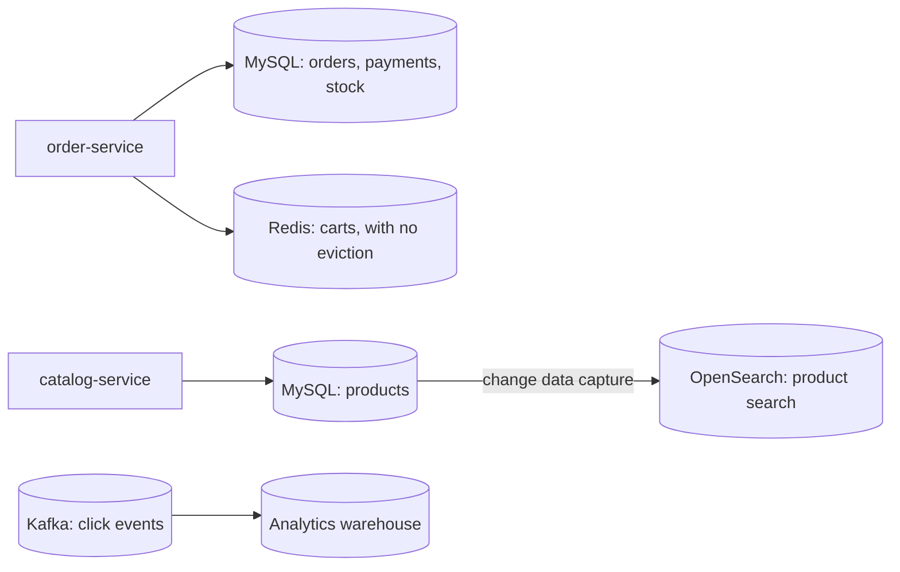

# Choosing a Database

**System design · Step 14.7 · Fundamentals** · Last updated 2026-10-22
**Prerequisites:** [Back-of-the-envelope estimation](03-back-of-the-envelope-estimation.md) (14.3); helpful: [Requirements and the design method](02-requirements-design-method.md) (14.2) and [Caching](06-caching.md) (14.6)

## 1. What it is and why it matters

**What is it?** Deciding which kind of database holds each kind of data: a **relational** database with tables and transactions, or one of the **non-relational** ("NoSQL") families (key-value, document, wide-column), or a specialised store such as a **search engine**. The decision follows from how the data is **read and written** (its access patterns), how **consistent** it must be, and how **big** and **busy** it gets.

**Why do we need it?** A database is the hardest component to change later: the data model shapes the code, and migrating live data is slow and risky. The wrong choice shows up as queries that can't be served efficiently, consistency bugs that a transaction would have prevented, or an operational burden the team can't carry.

**When would I meet it?** When a new service is designed, when a query becomes slow at scale, when someone proposes "moving to NoSQL for scale", and when a new need (search, analytics) doesn't fit the existing database.

> [!TIP]
> **Memory hook:** list the questions before you pick the database. Access patterns first, then consistency, then size and load, then who will run it.

## 2. Industry terms

| Term | Simple meaning | Why it matters | Example | Related terms |
|---|---|---|---|---|
| **Relational database** | Data in tables with a fixed schema, related by keys, queried with SQL | Flexible queries and joins; transactions across rows and tables | MySQL, PostgreSQL | RDBMS, SQL |
| **ACID transaction** | A group of writes that is **A**tomic (all or nothing), **C**onsistent (keeps the rules), **I**solated (concurrent transactions don't see half-done work) and **D**urable (survives a crash once committed) | Prevents half-finished business operations | Reserve stock and create the order together | Isolation level (track 6, planned) |
| **Index** | A sorted structure that finds rows by a key without reading the whole table | Decides which queries are fast; each index slows writes a little | A B-tree index on `(customer_id, created_at)` | Composite index, full scan |
| **Normalisation, denormalisation** | Store each fact once and join it; or copy data where it's read, to avoid joins | Joins are flexible; copies are fast to read but must be kept up to date | Product names in one table, or copied into each order | Embedding |
| **Key-value store** | Get and put a value by its key, nothing more | Very fast and simple to scale; no queries on the value | Redis, Amazon DynamoDB used by key | Hash table |
| **Document database** | Stores self-contained documents (JSON-like) that can nest related data | One read returns a whole aggregate; a single-document write is atomic | MongoDB, DynamoDB items with nested attributes | Aggregate |
| **Wide-column store** | Rows grouped by a partition key and sorted within it, spread over many machines | Very high write volume across machines; queries designed around the key | Apache Cassandra | Partition key, LSM tree |
| **Search engine** | An index of words and fields, built for text search, ranking and facets | Relational `LIKE '%mug%'` can't use a normal index | OpenSearch, Elasticsearch | Inverted index |
| **Access pattern** | A specific read or write the application performs, with its frequency | The unit you design a data model and its indexes around | "A customer's orders, newest first, 20 per page" | Query pattern |
| **Polyglot persistence** | Using different storage technologies for different kinds of data | Each store fits its data better; together they cost more to run and keep consistent | MySQL for orders, Redis for carts, OpenSearch for search | Database per service (4.7, planned) |

## 3. In a real system (ShopFlow)

**The business problem.** ShopFlow stores very different kinds of data: orders and payments, which must never be half-written; the product catalogue; carts and sessions; product search with typo tolerance and filters; and click events for analytics. A new architect proposes moving everything to one NoSQL database "because it scales". The business needs correct orders, fast pages and a team that can operate what it builds.

**What the numbers say.** From [14.3](03-back-of-the-envelope-estimation.md): about 6 order writes a second at peak and about 550 GB of order data over five years, copies included. That load fits one relational database comfortably; scale is not a reason to leave MySQL for orders. The reads are covered by caching ([14.6](06-caching.md)) and, later, read replicas ([14.8](08-replication-read-replicas.md)).

**How the choice is made.** One question per kind of data: how is it read and written, and what happens if two writes interleave or one is lost?



**What it costs.** Each store is another system to secure, back up, monitor and upgrade, and data copied between stores (products into the search index) is **eventually consistent**: a new product appears in search a few seconds after it is saved. Fowler's description of polyglot persistence warns that it "will come at a cost in complexity".

**Elsewhere:** a bank keeps accounts and ledgers in a relational database for its transactions, and a separate search index for customer support lookups; an IoT platform writes millions of sensor readings a minute to a wide-column or time-series store keyed by device and time; a content site stores each article as one document with its sections and tags.

## 4. How it works

**The families, side by side:**

| Family | Data model | Good at | Weak at | Examples |
|---|---|---|---|---|
| Relational | Tables, rows, joins | Transactions across rows; ad-hoc queries; constraints | Very large write volume on one primary (partitioning is extra work, [14.9](09-partitioning-sharding.md)) | MySQL, PostgreSQL |
| Key-value | Key → value | Lookups by key at any scale | Any query not by key | Redis, DynamoDB |
| Document | Key → nested document | Reading and writing a whole aggregate at once | Relationships across documents; data repeated in many documents | MongoDB, DynamoDB |
| Wide-column | Partition key → rows sorted by a clustering key | Huge write volume spread over many machines | Queries that don't start from the partition key; transactions across partitions | Cassandra |
| Search engine | Inverted index of terms | Text search, ranking, facets | Being the source of truth; strict consistency | OpenSearch, Elasticsearch |

**How to choose, step by step:**

1. **List the access patterns**, each with a frequency: "order by id: 50 a second; a customer's orders newest first: 30 a second; orders over EUR 100 last month: once a day, for marketing".
2. **Mark the consistency needs**: which writes must succeed or fail together (a transaction), and which reads must see the latest write.
3. **Describe the shape**: an aggregate read as a whole (an order with its lines), or many relationships queried in different ways.
4. **Add the numbers** from the estimate: writes a second, data size, growth.
5. **Choose the simplest store that serves the frequent patterns well**, and decide how the rare ones are served (an extra index, a copy in another store, a warehouse).
6. **Check the operations**: managed service or self-run, backups and restore, the team's experience, cost.

For most business systems, steps 1 to 5 point to a **relational database as the default** for the core data, with specialised stores added for specific patterns, which is how ShopFlow ends up above.

The programs below are single-JVM simulations: a `TreeMap` stands in for a sorted index, and a map for a table. How to run them is in [the Java overview](../13-java/01-java-overview.md), section 5.

### Worked example 1: an index is designed for an access pattern

**Concept.** A database finds rows quickly only if an index is **sorted the way the query asks**. An index on `(customer_id, created_at)` keeps each customer's orders together, in time order, so "a customer's newest 10 orders" reads 10 entries instead of the whole table.

```java
// File: IndexDemo.java (runnable, Java 21)
import java.util.ArrayList;
import java.util.Comparator;
import java.util.List;
import java.util.NavigableMap;
import java.util.TreeMap;

public class IndexDemo {

    record Order(String id, String customer, long createdAt, String status) {}

    // An index entry is sorted by customer, then by time: like a B-tree index on (customer_id, created_at).
    record Key(String customer, long createdAt) {}

    static final Comparator<Key> KEY_ORDER =
            Comparator.comparing(Key::customer).thenComparingLong(Key::createdAt);

    static List<Order> orders() {
        List<Order> all = new ArrayList<>();
        for (int i = 0; i < 100_000; i++) {
            String status = i % 10 == 0 ? "PENDING" : "PAID";
            all.add(new Order("o-" + i, "c" + (i % 5_000), i, status));   // 5,000 customers, 20 orders each
        }
        return all;
    }

    public static void main(String[] args) {
        List<Order> table = orders();
        String customer = "c42";

        // Without an index: read every row, keep the matches, sort, take 10.
        int examined = 0;
        List<Order> matches = new ArrayList<>();
        for (Order o : table) {
            examined++;
            if (o.customer().equals(customer)) {
                matches.add(o);
            }
        }
        matches.sort(Comparator.comparingLong(Order::createdAt).reversed());
        List<Order> newestByScan = matches.subList(0, 10);
        System.out.println("Full scan:  examined " + examined + " rows, first three: " + ids(newestByScan));

        // With an index on (customer, createdAt): jump to the customer's range and read it backwards.
        NavigableMap<Key, Order> index = new TreeMap<>(KEY_ORDER);
        for (Order o : table) {
            index.put(new Key(o.customer(), o.createdAt()), o);
        }
        NavigableMap<Key, Order> range = index.subMap(
                new Key(customer, Long.MIN_VALUE), true, new Key(customer, Long.MAX_VALUE), true);
        examined = 0;
        List<Order> newestByIndex = new ArrayList<>();
        for (Order o : range.descendingMap().values()) {
            examined++;
            newestByIndex.add(o);
            if (newestByIndex.size() == 10) {
                break;
            }
        }
        System.out.println("Index:      examined " + examined + " entries, first three: " + ids(newestByIndex));
        System.out.println("Same result: " + newestByScan.equals(newestByIndex));
    }

    static List<String> ids(List<Order> orders) {
        return orders.stream().limit(3).map(Order::id).toList();
    }
}
```

**Expected output**:

```text
Full scan:  examined 100000 rows, first three: [o-95042, o-90042, o-85042]
Index:      examined 10 entries, first three: [o-95042, o-90042, o-85042]
Same result: true
```

**Walkthrough.**

| Approach | What it reads | Rows examined |
|---|---|---|
| Full scan | Every one of the 100,000 orders, keeps the 20 of `c42`, sorts them, takes 10 | 100,000 |
| Index on (customer, createdAt) | Jumps to the start of `c42`'s range, reads backwards from the newest | 10 |

Both return the same orders. The index works because its **first column** matches the equality in the query (`customer = c42`) and its **second column** matches the order (`created_at DESC`). In MySQL's InnoDB, the table itself is stored in primary-key order (the **clustered index**), and each **secondary index** entry "contains the primary key columns for the row", which InnoDB then uses to fetch the row. `EXPLAIN` shows whether a query uses an index and roughly how many rows it examines.

**Experiment.** Predict first: change the data so there are only 50 customers with 2,000 orders each (`i % 50`). How many rows does each approach examine now? The result is in Answers.

### Worked example 2: why transactions matter

**Concept.** Placing an order changes two things: the stock and the orders. If the service crashes between the two writes, a database without a transaction around them is left half-done.

```java
// File: AtomicityDemo.java (runnable, Java 21)
import java.util.ArrayList;
import java.util.HashMap;
import java.util.List;
import java.util.Locale;
import java.util.Map;

public class AtomicityDemo {

    // The committed state of the database.
    static Map<String, Integer> stock = new HashMap<>();
    static List<String> orders = new ArrayList<>();

    static void reset() {
        stock = new HashMap<>(Map.of("HOODIE", 1));
        orders = new ArrayList<>();
    }

    // Two separate writes, each committed on its own.
    static void placeOrderWithoutTransaction(boolean crashBetween) {
        stock.merge("HOODIE", -1, Integer::sum);                  // write 1: reserve stock
        if (crashBetween) {
            throw new IllegalStateException("instance crashed");
        }
        orders.add("o-2001 HOODIE");                              // write 2: create the order
    }

    // One transaction: changes go to a working copy and become visible only at commit.
    static void placeOrderInTransaction(boolean crashBetween) {
        Map<String, Integer> txStock = new HashMap<>(stock);
        List<String> txOrders = new ArrayList<>(orders);
        txStock.merge("HOODIE", -1, Integer::sum);
        if (crashBetween) {
            throw new IllegalStateException("instance crashed");  // nothing committed: rolled back
        }
        txOrders.add("o-2001 HOODIE");
        stock = txStock;                                          // commit: both changes at once
        orders = txOrders;
    }

    static void attempt(String title, Runnable action) {
        reset();
        try {
            action.run();
        } catch (IllegalStateException e) {
            title += " (" + e.getMessage() + ")";
        }
        System.out.println(String.format(Locale.ROOT, "%-55s stock %d, orders %s", title, stock.get("HOODIE"), orders));
    }

    public static void main(String[] args) {
        attempt("No transaction, crash between writes", () -> placeOrderWithoutTransaction(true));
        attempt("Transaction, crash between writes", () -> placeOrderInTransaction(true));
        attempt("Transaction, no crash", () -> placeOrderInTransaction(false));
    }
}
```

**Expected output**:

```text
No transaction, crash between writes (instance crashed) stock 0, orders []
Transaction, crash between writes (instance crashed)    stock 1, orders []
Transaction, no crash                                   stock 0, orders [o-2001 HOODIE]
```

**Walkthrough.** Without a transaction, the stock write was already committed when the crash came: the last hoodie is reserved by an order that doesn't exist, and nobody can buy it. With a transaction, the changes become visible only at commit; the crash happens before commit, so the database is unchanged and the customer can simply retry. A relational database gives this for any rows and tables in one database. A document database gives it for **one document**; MongoDB's documentation says that, with embedded documents, "multi-document transactions are not necessary for many practical use cases", while warning that distributed transactions cost more and are no "replacement for effective schema design".

### Worked example 3: embed or reference

**Concept.** Copying data into the place where it is read (embedding, denormalisation) makes reads simple and fast, and it freezes the copy. Whether that is right depends on what the data **means**.

```java
// File: EmbedOrReference.java (runnable, Java 21)
import java.util.ArrayList;
import java.util.HashMap;
import java.util.List;
import java.util.Map;

public class EmbedOrReference {

    // Relational style: the order line refers to the product; the name lives in one place.
    record OrderLineRow(String orderId, String sku, int quantity) {}

    // Document style: the order embeds what it needs, copied at the time of purchase.
    record LineDoc(String sku, String name, int quantity) {}
    record OrderDoc(String id, String customerEmail, List<LineDoc> lines) {}

    public static void main(String[] args) {
        Map<String, String> productNames = new HashMap<>(Map.of("MUG", "Mug"));
        OrderLineRow row = new OrderLineRow("o-1001", "MUG", 2);
        OrderDoc doc = new OrderDoc("o-1001", "ana@example.com", List.of(new LineDoc("MUG", "Mug", 2)));

        productNames.put("MUG", "Mug, 350 ml");                    // the product is renamed later
        System.out.println("Product renamed. Showing last year's order o-1001:");
        System.out.println("  relational (join):  " + row.quantity() + " x " + productNames.get(row.sku()));
        System.out.println("  document (copied):  " + doc.lines().get(0).quantity() + " x " + doc.lines().get(0).name());

        // Ana changes her email address, and she has 1,000 orders.
        List<OrderDoc> anasOrders = new ArrayList<>();
        for (int i = 0; i < 1_000; i++) {
            anasOrders.add(new OrderDoc("o-" + i, "ana@example.com", List.of()));
        }
        int writesIfReferenced = 1;                                 // one row in the customers table
        int writesIfEmbedded = anasOrders.size();                   // every order document holds a copy
        System.out.println("Ana changes her email address:");
        System.out.println("  referenced: " + writesIfReferenced + " write");
        System.out.println("  embedded:   " + writesIfEmbedded + " writes");
    }
}
```

**Expected output**:

```text
Product renamed. Showing last year's order o-1001:
  relational (join):  2 x Mug, 350 ml
  document (copied):  2 x Mug
Ana changes her email address:
  referenced: 1 write
  embedded:   1000 writes
```

**Walkthrough.**
- **The product name:** an order is a record of what was bought, so the name (and price) **at the time of purchase** is the correct one. The join shows today's name on last year's invoice, which is wrong. This is why relational order tables also copy name and price into the order lines: a deliberate denormalisation.
- **The email address:** the current email is the one that matters, and it is shared by all of a customer's orders. Embedded in 1,000 order documents, one change means 1,000 writes, and a failure halfway leaves them inconsistent. Referenced from a customers table, it is one write.

The rule: **copy facts that should be frozen; reference facts that should stay current.**

### Storage engines in one paragraph

Databases also differ in how they write to disk. **B-tree** storage (MySQL's InnoDB) updates sorted pages in place, which suits mixed reads and writes. **Log-structured merge (LSM) tree** storage (Cassandra, among others) first appends each write to a commit log and an in-memory table, then flushes it to immutable sorted files (Cassandra's "SSTables are immutable") that are merged in the background. LSM storage takes very high write rates well; a read may have to check several files, and background merging (compaction) needs spare I/O. You rarely choose the engine directly, but it explains why some databases suit write-heavy workloads.

## 5. Failure scenarios

### "NoSQL for scale" that lost the transactions

1. **What happened?** Orders and stock were moved to a store whose transactions don't span items. After a few crashes during the sale, some orders existed without reserved stock, and some stock was reserved for no order.
2. **Why?** The move was made for scale the numbers didn't show (6 writes a second), and the order flow depended on a transaction across stock and orders.
3. **What did the business see?** Overselling, stuck stock, and manual clean-up by support.
4. **Solutions:** keep transactional data in a store with the transactions it needs; or model the order and its reservation as one atomic item; or redesign the flow as a saga with compensations (4.8, planned), which is a much larger change.
5. **What they cost:** staying relational may mean partitioning later ([14.9](09-partitioning-sharding.md)); a saga adds states, compensations and monitoring.

### A query nobody planned

1. **What happened?** Orders were stored in a key-value store keyed by customer. Marketing asked for "all orders over EUR 100 last month", and the only way was to read the entire table, which was slow, expensive and slowed down the live service.
2. **Why?** Key-value and wide-column stores serve the access patterns they were designed for; others need a full scan or a new index or table.
3. **What did the business see?** A report that took a day, and slower order pages while it ran.
4. **Solutions:** list rare and future access patterns at design time; serve analytics from a copy (change data capture into a warehouse, [2.2.15](../02-messaging/02-kafka/15-kafka-connect-cdc.md)), not from the live store; add secondary indexes for frequent new patterns.
5. **What they cost:** another pipeline and store, with data that is minutes old.

### Search with LIKE

1. **What happened?** Product search used `WHERE name LIKE '%mug%'`. At sale traffic, the catalogue database's CPU reached 100%.
2. **Why?** A leading wildcard can't use a B-tree index, so every search read the whole products table; and the business also wanted typo tolerance and ranking, which `LIKE` can't give.
3. **What did users see?** Slow search, and slow product pages that shared the database.
4. **Solutions:** a search engine fed from the catalogue database by change data capture; MySQL's full-text indexes for simple needs.
5. **What they cost:** a second store to run, and search results that lag behind edits by seconds.

## 6. Architectural decisions

| Choose | When | Avoid when |
|---|---|---|
| **Relational** (the default for core business data) | Transactions across rows; queries you can't fully predict; relationships; moderate write volume (most business systems) | Writes beyond what one primary can take even after scaling up, with access patterns that are few and known |
| **Key-value** | Lookup by key only: sessions, carts, feature flags, cached results | You will need to query by anything other than the key |
| **Document** | Aggregates read and written as a whole (an order with its lines, an article), flexible attributes | Data shared by many aggregates and changed often; many cross-document queries |
| **Wide-column** | Very high write rates and data volumes, queries known in advance and keyed by partition (events by device and time) | Ad-hoc queries; transactions across partitions; small data |
| **Search engine** | Text search, ranking, facets, as a **copy** of data held elsewhere | As the only copy of important data |

**Common mistakes:** choosing by fashion or by the scale of a famous company instead of your own numbers; designing tables before listing the access patterns; using one store for everything, or a different store for every table; running analytics queries on the live transactional database; forgetting that every copy (search index, cache, warehouse) is eventually consistent.

## 7. Try it yourself

Try each exercise first; the solutions are in the Answers section, the second as a runnable program.

1. **One store per kind of data.** Choose a store for each, and say why in one line: (a) orders and payments; (b) shopping carts; (c) product search with typo tolerance and filters; (d) click events, 20 million a day, for dashboards; (e) the product catalogue itself.
2. **A second access pattern.** The warehouse needs "the 5 oldest PENDING orders" every few seconds. Show that the `(customer, createdAt)` index of worked example 1 doesn't help, and which index does.
3. **Design keys for a key-value store.** In a store with a partition key and a sort key (such as DynamoDB), design the keys for (a) a customer's orders, newest first, and (b) one order by its id.

## 8. Check your understanding

1. Which of these queries can use an index on `(customer_id, created_at)`: (a) a customer's orders, newest first; (b) all orders placed yesterday, of every customer; (c) one customer's orders from March?
2. Why can a document database often avoid multi-document transactions for orders, and when does it still need them?
3. A team wants to move ShopFlow's orders from MySQL to a wide-column store "because it scales". Which numbers and questions do you bring to the discussion?
4. Why does an order line copy the product's name and price at the time of purchase, even in a normalised relational schema?

Answers are at the end of this note.

## 9. Revision

**Remember**
- Choose by **access patterns**, then **consistency**, then **numbers**, then **operations**.
- **Relational** is the default for core business data: transactions and flexible queries.
- Indexes serve queries whose **leading columns** match: equality first, then the sort or range.
- **Copy** facts that should be frozen (the price paid); **reference** facts that should stay current (the email).
- Every extra store is a **copy** to keep in sync and a system to run.

**Explain in 15 seconds:** "I choose a database from the access patterns, the consistency each write needs, and the expected size and load. Relational is the default for core business data; key-value, document, wide-column and search stores are added for specific patterns."

**Explain in 60 seconds:**
> "I start by listing the reads and writes with their frequencies, and which writes must succeed or fail together. For most business data that points to a relational database: transactions across rows, flexible queries, and, at ShopFlow's numbers, plenty of headroom on one primary. I design indexes from the access patterns, equality columns first, then the sort. Specialised stores come in for specific needs: key-value for carts and sessions, a search engine for text search fed by change data capture, a wide-column store when write volume is very high and the queries are known. Document stores fit aggregates read as a whole, and embedding is right for facts that should be frozen, like the price paid. Each extra store adds operations and an eventually consistent copy, so I add them only when a pattern needs it."

**Likely follow-up questions:**
- **SQL or NoSQL for scale?** Scale alone rarely decides it; most relational databases go a long way with scaling up, caching, replicas and partitioning. The access patterns and consistency needs decide.
- **Does NoSQL mean no schema?** No: the schema moves into the application and the key design, and changing it still needs care.
- **When would you denormalise in a relational database?** For frozen facts (prices paid) and for read paths that a join makes too slow, accepting the work of keeping copies correct.
- **What is an inverted index?** A map from each word to the documents that contain it, which is what makes text search fast.

**Architect's takeaway:** the database is the decision that is hardest to undo. Write down the access patterns and consistency needs, show the numbers, and default to the boring, well-understood choice unless a specific pattern needs something else.

**Next topic:** [Replication and read replicas](08-replication-read-replicas.md) (14.8)

## 10. Verification and sources

> [!NOTE]
> Checked 2026-10-22. All programs were run on OpenJDK 21.0.8, and the repository's example checker compares their output. Re-verify when you revisit this note.

- **Confirmed:** InnoDB's clustered index "stores row data" and is typically the primary key, and each secondary index record "contains the primary key columns for the row", used to find the row in the clustered index (MySQL 8.4 Reference Manual, "Clustered and Secondary Indexes"). DynamoDB's simple and composite primary keys, the hashing of the partition key, items stored "in sorted order by sort key value", and global and local secondary indexes (AWS, "Core components of Amazon DynamoDB"). MongoDB: "an operation on a single document is atomic"; embedding makes multi-document transactions unnecessary "for many practical use cases"; transactions need feature compatibility version 4.0 on replica sets and 4.2 on sharded clusters (MongoDB manual, "Transactions"). Cassandra's storage engine is based on log-structured merge trees, with a commit log, memtables and immutable SSTables (Apache Cassandra documentation, "Storage Engine"). Fowler's "Polyglot Persistence" (2011) and its warning about complexity (martinfowler.com). All read 2026-10-22.
- **Assumptions and illustrations:** the programs are simulations (a `TreeMap` as an index, maps as tables, a working copy as a transaction); real databases add pages, locks, logs and isolation levels. All ShopFlow figures are illustrative. The "families" table summarises typical strengths; individual products differ, and several are multi-model (DynamoDB is key-value and document; PostgreSQL stores JSON documents).
- **To verify:** the transaction and secondary-index features of the exact product and version you plan to use; MySQL full-text search limits for your language before choosing it over a search engine.
- **Decision rule:** default to a relational database for core business data; add a specialised store only for a named access pattern, and say how its copy is kept in sync.

**Sources:** MySQL 8.4 Reference Manual, "Clustered and Secondary Indexes"; AWS, "Core components of Amazon DynamoDB"; MongoDB manual, "Transactions"; Apache Cassandra documentation, "Storage Engine"; Martin Fowler, "PolyglotPersistence" (martinfowler.com/bliki, 2011); Martin Kleppmann, *Designing Data-Intensive Applications*, chapters on data models and storage.

## Answers

**Experiment**

- **50 customers with 2,000 orders each** (worked example 1): the full scan still examines **100,000** rows; the index still examines **10**. The newest three are now `o-99992`, `o-99942`, `o-99892`. With the index, the cost depends on how many rows the query **returns**, not on how big the table is; without it, every query pays for the whole table.

**Check your understanding**

1. (a) **Yes**: equality on `customer_id`, then `created_at` gives the order. (b) **No**: the query doesn't fix `customer_id`, the leading column, so the index can't narrow it down; it needs an index starting with `created_at`. (c) **Yes**: equality on `customer_id` and a range on `created_at`.
2. Because the order and its lines can be one document, and a single-document write is atomic, so the whole order is written or nothing is. It still needs a multi-document transaction (or a different design) when one operation must change **several** documents together, such as the order and a separate stock document.
3. The numbers: about 6 writes a second at peak and about 550 GB over five years ([14.3](03-back-of-the-envelope-estimation.md)), well within one relational primary. The questions: which writes must be transactional (stock and order)? Which queries do support, finance and marketing run, and could they be served by the new store's keys? Who will operate it? What problem does the move solve that scaling up, caching and replicas don't?
4. Because the order records what was bought at what price. If the product is renamed or repriced later, a join would show today's values on an old order, which is wrong for invoices, refunds and disputes. The copy freezes the facts that should not change.

**Practice exercises**

1. **One store per kind of data:** (a) Orders and payments: relational, for transactions across stock, order and payment status. (b) Carts: a key-value store such as Redis, read and written by cart id, configured so carts aren't evicted, with an expiry per cart. (c) Product search: a search engine, as a copy fed from the catalogue database by change data capture. (d) Click events: Kafka, then an analytics warehouse or columnar store; never the transactional database. (e) Catalogue: relational (or a document store if products vary a lot in their attributes), cached for reads.

2. **A second access pattern:**

```java
// File: WarehouseIndex.java (runnable, Java 21)
import java.util.ArrayList;
import java.util.Comparator;
import java.util.List;
import java.util.NavigableMap;
import java.util.TreeMap;

public class WarehouseIndex {

    record Order(String id, String customer, long createdAt, String status) {}
    record Key(String first, long createdAt) {}

    static final Comparator<Key> KEY_ORDER = Comparator.comparing(Key::first).thenComparingLong(Key::createdAt);

    public static void main(String[] args) {
        List<Order> table = new ArrayList<>();
        for (int i = 0; i < 100_000; i++) {
            table.add(new Order("o-" + i, "c" + (i % 5_000), i, i % 10 == 0 ? "PENDING" : "PAID"));
        }

        // The warehouse asks: the 5 oldest PENDING orders.
        // 1. The existing index on (customer, createdAt) has the wrong first column, so it can't help:
        //    the orders of every customer must still be read.
        int examined = 0;
        List<Order> pending = new ArrayList<>();
        for (Order o : table) {
            examined++;
            if (o.status().equals("PENDING")) {
                pending.add(o);
            }
        }
        pending.sort(Comparator.comparingLong(Order::createdAt));
        System.out.println("Index on (customer, createdAt): examined " + examined + " rows, result "
                + pending.subList(0, 5).stream().map(Order::id).toList());

        // 2. An index on (status, createdAt) serves the query directly.
        NavigableMap<Key, Order> byStatus = new TreeMap<>(KEY_ORDER);
        for (Order o : table) {
            byStatus.put(new Key(o.status(), o.createdAt()), o);
        }
        examined = 0;
        List<String> oldest = new ArrayList<>();
        for (Order o : byStatus.tailMap(new Key("PENDING", Long.MIN_VALUE), true).values()) {
            if (!o.status().equals("PENDING") || oldest.size() == 5) {
                break;
            }
            examined++;
            oldest.add(o.id());
        }
        System.out.println("Index on (status, createdAt):   examined " + examined + " entries, result " + oldest);
    }
}
```

**Expected output**:

```text
Index on (customer, createdAt): examined 100000 rows, result [o-0, o-10, o-20, o-30, o-40]
Index on (status, createdAt):   examined 5 entries, result [o-0, o-10, o-20, o-30, o-40]
```

The `(customer, createdAt)` index has the wrong leading column for this query, so every row is examined. An index on `(status, createdAt)` starts at the oldest PENDING entry and reads exactly 5. Each new access pattern can need its own index; each index costs some storage and a little time on every write.

3. **Keys for a key-value store:** (a) Partition key `customerId`, sort key `createdAt#orderId` (the order id makes it unique when two orders share a timestamp); query the partition in descending sort order, 20 at a time. (b) Either a second table or item keyed by `orderId`, or a global secondary index with `orderId` as its partition key. Two access patterns, two keys: in key-value stores, you design the keys from the queries, because there is no query planner to find another way.

Back to [the System design overview](01-system-design-overview.md) · [the index](../README.md) · [Roadmap](../roadmap.md).
