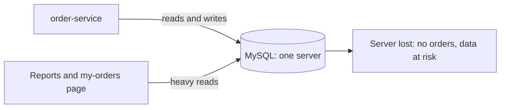
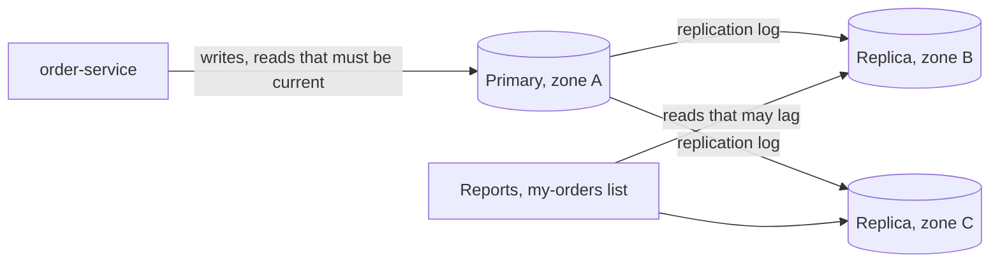

# Replication and Read Replicas

**System design · Step 14.8 · Fundamentals** · Last updated 2026-10-22
**Prerequisites:** [Choosing a database](07-choosing-a-database.md) (14.7); helpful: [Caching](06-caching.md) (14.6) and [Kafka brokers, replication and leader election](../02-messaging/02-kafka/06-brokers-replication-leader-election.md) (2.2.6), which applies the same ideas to a log

## 1. What it is and why it matters

**What is it?** **Replication** keeps copies of the same database on several machines. In the most common form, one **primary** accepts all writes and records them in a log, and one or more **replicas** read that log and apply the same changes. Replicas can serve reads (**read replicas**) and can be **promoted** to primary if the primary fails.

**Why do we need it?** For two reasons that are easy to mix up. **Availability and durability:** if the only database machine dies, the data and the service are gone until it is repaired; a replica can take over. **Read scale:** reads can be spread over replicas, so the primary handles mostly writes. Both come with one cost: a replica is usually a little **behind** the primary.

**When would I meet it?** On any production database (managed MySQL services make replicas a checkbox), when read load outgrows the primary, when a user says "I saved it, but it isn't there", and during the first failover, when the team discovers what "asynchronous" means.

> [!TIP]
> **Memory hook:** a replica is the primary's past. Ask **how far in the past** before you read from it, and **what was lost** before you promote it.

## 2. Industry terms

| Term | Simple meaning | Why it matters | Example | Related terms |
|---|---|---|---|---|
| **Primary and replica** | The machine that accepts writes, and the copies that apply its log | Only one place decides the order of writes | MySQL **source** and **replica** (MySQL's current terms) | Leader and follower, master and slave (older terms) |
| **Asynchronous replication** | The primary confirms a commit without waiting for any replica | Fast, but a replica can be missing recent commits | MySQL's default | Replication lag |
| **Semi-synchronous replication** | The primary confirms a commit only after at least one replica has **received and logged** it (not yet applied it) | Confirmed commits survive the loss of the primary | MySQL's semisynchronous replication | Synchronous replication (wait until applied) |
| **Replication lag** | How far a replica is behind the primary, in time or in log position | Decides how stale replica reads are and how much a failover can lose | `Seconds_Behind_Source` in MySQL | Staleness |
| **Read-your-writes consistency** | A user always sees their own changes after making them | The most common complaint about read replicas | Ana sees her new address straight after saving it | Session consistency |
| **Monotonic reads** | A user never sees older data after having seen newer data | Two replicas with different lag can make time go backwards | Ben's page shows the new address, then the old one | Sticky replica |
| **Failover (promotion)** | Making a replica the new primary when the primary fails | Restores writes; may lose the commits the replica hadn't received | A managed database promoting its standby | RTO, RPO ([14.14](14-multi-region-disaster-recovery.md)) |
| **Split brain and fencing** | Two machines both acting as primary; and the means of stopping the old one | Two primaries accept conflicting writes | The old primary comes back after a network cut | STONITH ("shoot the other node in the head") |
| **GTID (global transaction identifier)** | A unique id for every transaction in MySQL replication | Lets a replica, or a client, say exactly which transactions it has | Wait until the replica has executed Ana's transaction | Log position |

## 3. In a real system (ShopFlow)

**The business problem.** ShopFlow's order database is one MySQL server. If it fails, nobody can order until it is repaired, and if its disk is lost, the orders are lost. Separately, reports and the "my orders" page put read load on the same server that must accept orders during the sale.



**How replication helps.** Add replicas in other zones. The primary takes the writes; the replicas apply its log; the "my orders" list and the reports read from replicas; and if the primary fails, a replica is promoted. ShopFlow uses a managed MySQL service, so promotion and the new primary's address are handled by the platform.



**What it costs.** Every replica must apply **every** write, so replicas scale reads, not writes. Replica reads can be stale, which the application must handle (worked example 1). Failover with asynchronous replication can lose recently confirmed orders (worked example 2). And each replica is a full copy of the data to pay for.

**Elsewhere:** a news site serves almost all reads from replicas, because an article a second old is fine; a bank keeps a synchronous standby in another zone for its ledger and accepts the extra commit latency; an analytics team gets its own replica so its long queries never touch the primary.

## 4. How it works

**The flow of one write, with MySQL-style replication:**

1. The application commits a transaction on the **primary**.
2. The primary writes it to its **binary log** (and, with GTIDs, gives it a global id).
3. Each replica's **receiver** reads new log events over the network and stores them in its **relay log**.
4. The replica's **applier** threads execute the relay log (in MySQL 8.4, replicas are multithreaded by default, with `replica_parallel_workers=4`, and commit in the source's order).
5. **When the client hears "committed"** depends on the mode: asynchronous, right after step 2; semi-synchronous, after at least one replica has finished step 3 and acknowledged it; synchronous (for example MySQL's NDB Cluster), only when the replicas have applied it.

**Why replicas fall behind:** a replica on a smaller machine; a huge transaction on the primary (a batch update of millions of rows) that the replica must apply in one go; long-running queries on the replica competing for resources; network problems. Lag is normally small and occasionally large, which is why the application must be correct either way.

**Measuring lag.** MySQL's `Seconds_Behind_Source` compares the replica's clock with the timestamp of the event it is applying, but its documentation warns that it "often shows a value of 0, even if the replication receiver thread is late", so it is "useful only for fast networks". A common, more reliable approach is a **heartbeat**: write the current time to a small table on the primary every second and read it on the replica.

The programs below are simulations with a fake clock in milliseconds; how to run them is in [the Java overview](../13-java/01-java-overview.md), section 5.

### Worked example 1: stale reads, read-your-writes and monotonic reads

**Concept.** A replica applies each write some time after the primary committed it. A read in that window sees the old value. Two fixes are shown: route a user's read to the primary until the replica has reached the **position of that user's last write**, and keep a user on **one** replica so time doesn't go backwards.

```java
// File: ReplicaLagDemo.java (runnable, Java 21)
import java.util.ArrayList;
import java.util.List;

public class ReplicaLagDemo {

    // The primary's log of committed writes: position n holds the address after write n.
    static final List<Integer> commitTimes = new ArrayList<>();   // when each write committed (ms)
    static final List<String> addresses = new ArrayList<>(List.of("Old Street 1"));   // position 0: before any write

    static void write(int now, String address) {
        commitTimes.add(now);
        addresses.add(address);
    }

    // A replica applies each write lagMs after the primary committed it.
    record Replica(String name, int lagMs) {
        int position(int now) {
            int applied = 0;
            for (int t : commitTimes) {
                if (t + lagMs <= now) applied++;
            }
            return applied;
        }

        String read(int now) {
            return addresses.get(position(now));
        }
    }

    static String primaryRead() {
        return addresses.get(addresses.size() - 1);
    }

    public static void main(String[] args) {
        Replica replica = new Replica("replica-1", 500);
        write(0, "New Road 9");                                   // t=0: Ana saves her new address
        int anasPosition = commitTimes.size();                    // the position of her write

        System.out.println("1. Every read from the replica (lag " + replica.lagMs() + " ms)");
        for (int t : new int[] {100, 600}) {
            System.out.println("   t=" + t + "  Ana sees " + replica.read(t));
        }

        System.out.println("2. Read your writes: use the replica only once it has reached Ana's position");
        for (int t : new int[] {100, 600}) {
            boolean caughtUp = replica.position(t) >= anasPosition;
            String seen = caughtUp ? replica.read(t) : primaryRead();
            System.out.println("   t=" + t + "  Ana sees " + seen + (caughtUp ? "  (replica)" : "  (primary)"));
        }

        System.out.println("3. Two replicas with different lag, a page refreshed twice by Ben");
        Replica fast = new Replica("replica-1", 100);
        Replica slow = new Replica("replica-2", 900);
        System.out.println("   t=300  via " + fast.name() + ": " + fast.read(300));
        System.out.println("   t=400  via " + slow.name() + ": " + slow.read(400) + "   <- older than what he just saw");
    }
}
```

**Expected output**:

```text
1. Every read from the replica (lag 500 ms)
   t=100  Ana sees Old Street 1
   t=600  Ana sees New Road 9
2. Read your writes: use the replica only once it has reached Ana's position
   t=100  Ana sees New Road 9  (primary)
   t=600  Ana sees New Road 9  (replica)
3. Two replicas with different lag, a page refreshed twice by Ben
   t=300  via replica-1: New Road 9
   t=400  via replica-2: Old Street 1   <- older than what he just saw
```

**Walkthrough.**

| Case | What happens | Guarantee broken or kept |
|---|---|---|
| 1, t=100 | The replica hasn't applied Ana's write yet (it will at t=500) | **Read-your-writes broken**: "my address didn't save" |
| 2, t=100 | The replica's position (0) is below Ana's (1), so the read goes to the primary | Read-your-writes kept |
| 2, t=600 | The replica has caught up; the read can use it | Kept, and the primary is spared |
| 3 | Ben's first read hits the fast replica (new address), his second the slow one (old address) | **Monotonic reads broken**: the page goes back in time |

In MySQL, the "position" of a write is its GTID, and the function `WAIT_FOR_EXECUTED_GTID_SET()` lets a reader wait until a replica has executed a given set of transactions. Simpler, coarser alternatives are common: send a user's reads to the primary for a few seconds after that user writes, or read pages that follow a write (the order confirmation page) from the primary. For monotonic reads, pin each user's session to one replica.

**Experiment.** Predict first: with a replica lag of 50 ms instead of 500 ms, what does Ana see at t=100 in case 1 (change the lag of `replica` to 50)? The result is in Answers.

### Worked example 2: what a failover loses

**Concept.** With asynchronous replication, the primary tells the customer "order confirmed" before any replica has the order. If the primary dies, the promoted replica is missing whatever it hadn't received. Semi-synchronous replication waits for one replica to receive each commit before confirming it.

```java
// File: FailoverLoss.java (runnable, Java 21)
public class FailoverLoss {

    // Orders 1 to 10 commit on the primary at t = 100, 200, ..., 1000 ms. The primary crashes at
    // t = 1001 ms and the replica is promoted. What does the new primary have?
    static final int ORDERS = 10;
    static final int CRASH_AT = 1001;

    static void run(String title, int receiveDelayMs, boolean confirmAfterReplicaAck) {
        int confirmed = 0, onReplica = 0, lost = 0, unconfirmedButKept = 0;
        for (int n = 1; n <= ORDERS; n++) {
            int commitAt = n * 100;
            int receivedAt = commitAt + receiveDelayMs;               // the replica has it in its relay log
            int ackAt = receivedAt + 1;                               // its acknowledgement reaches the primary
            boolean isConfirmed = confirmAfterReplicaAck ? ackAt <= CRASH_AT : commitAt <= CRASH_AT;
            boolean isOnReplica = receivedAt <= CRASH_AT;
            if (isConfirmed) confirmed++;
            if (isOnReplica) onReplica++;
            if (isConfirmed && !isOnReplica) lost++;
            if (!isConfirmed && isOnReplica) unconfirmedButKept++;
        }
        System.out.println(title);
        System.out.println("  confirmed to customers   " + confirmed);
        System.out.println("  on the promoted replica  " + onReplica);
        System.out.println("  confirmed but lost       " + lost);
        System.out.println("  kept but never confirmed " + unconfirmedButKept);
    }

    public static void main(String[] args) {
        run("Asynchronous, replica 300 ms behind", 300, false);
        run("Semi-synchronous, 1 ms each way to the replica", 1, true);
    }
}
```

**Expected output**:

```text
Asynchronous, replica 300 ms behind
  confirmed to customers   10
  on the promoted replica  7
  confirmed but lost       3
  kept but never confirmed 0
Semi-synchronous, 1 ms each way to the replica
  confirmed to customers   9
  on the promoted replica  10
  confirmed but lost       0
  kept but never confirmed 1
```

**Walkthrough.**

| | Asynchronous (300 ms behind) | Semi-synchronous |
|---|---|---|
| Customers told "confirmed" | All 10 | 9: order 10's acknowledgement hadn't arrived at the crash |
| On the new primary | Orders 1 to 7 | All 10 |
| Confirmed but lost | **3**: customers have confirmations for orders that no longer exist | **0** |
| The price | None at commit time | Every commit waits for a round trip to a replica |

Two details matter in practice. First, MySQL's semi-synchronous mode waits only until the replica has **received and logged** the events, not applied them, so a promotion must first apply the replica's relay log. Second, if no replica acknowledges within `rpl_semi_sync_source_timeout` (10 seconds by default), the primary **reverts to asynchronous** replication until a replica catches up, so the guarantee quietly disappears while a replica is unavailable; monitor for it. The order that is kept but was never confirmed (order 10) is also a real case: the customer's client times out and retries, which is safe only if order creation is [idempotent](../01-resilience/04-idempotency.md).

**Experiment.** Predict first: if the asynchronous replica is only 50 ms behind, how many confirmed orders are lost? The result is in Answers.

### Failover and split brain

A failover has four steps: **detect** that the primary is down (by timeouts, which can't tell a dead primary from a slow network), **choose** the most up-to-date replica, **promote** it, and **redirect** clients to it (a DNS name or proxy that follows the primary). The dangerous case is a primary that was only cut off: if it comes back and still accepts writes, there are two primaries, a **split brain**, and their data diverges. **Fencing** prevents it: the old primary is made read-only, shut down or cut off before the new one accepts writes. Managed database services and tested cluster managers handle this; a home-made failover script usually doesn't.

**Other topologies, in one line each.** **Multi-leader** replication accepts writes in several places (for example one per region) and must resolve conflicting writes. **Leaderless** replication writes to several replicas and reads from several, using quorums; it is covered with the consistency trade-offs ([14.10](10-consistency-cap-pacelc-quorums.md)).

## 5. Failure scenarios

### "My address didn't save"

1. **What happened?** Customers changed their delivery address, the page reloaded, and showed the old one. Some changed it again, creating support tickets and duplicate addresses.
2. **Why?** After the save, the page read the address from a read replica that hadn't applied the write yet.
3. **What did users see?** A system that seemed to ignore them.
4. **Solutions:** read-your-writes: read from the primary right after a user's write (for a few seconds, or until the replica has reached the write's position); show the saved value from the write's response instead of re-reading.
5. **What they cost:** some reads move back to the primary; position tracking adds code.

### Confirmed orders that vanished

1. **What happened?** The primary's machine failed during the sale. The managed service promoted a replica in about a minute. Afterwards, a few customers had confirmation emails for orders that didn't exist.
2. **Why?** Asynchronous replication: the replica was about two seconds behind, so the last commits never reached it (the practice exercise below estimates how many).
3. **What did the business see?** Customers who had paid (the payment provider had their money) without an order; manual reconciliation.
4. **Solutions:** semi-synchronous replication (or a managed option that confirms commits on two zones) for data that must not be lost; reconcile with external systems after a failover, using the payment provider's records and the Kafka events already published.
5. **What they cost:** higher commit latency, a fallback to asynchronous mode to monitor, and a reconciliation process.

### Two primaries

1. **What happened?** A network cut isolated the primary. A script promoted a replica. When the network came back, the old primary still accepted writes from instances that had kept their connections.
2. **Why?** Nothing fenced the old primary.
3. **What did the business see?** Orders written to two databases with clashing ids, and hours of manual merging.
4. **Solutions:** fencing before promotion (make the old primary read-only, shut it down or cut its network); a single endpoint that only ever points to one primary; use the failover of a managed service or a tested cluster manager rather than a script.
5. **What they cost:** failover takes slightly longer, and its tooling must be tested regularly ([testing resilience](../01-resilience/10-testing-resilience.md)).

## 6. Architectural decisions

| Choice | Use when | Avoid when | Costs |
|---|---|---|---|
| **Read replicas** | Reads dominate, and many of them tolerate a little lag (lists, reports, search pages) | Writes are the bottleneck: replicas don't help writes | Staleness handling, a full copy per replica |
| **Asynchronous** | Losing the last seconds of writes in a rare failover is acceptable, or other records allow reconciliation | Losing a confirmed write is unacceptable | Possible loss on failover |
| **Semi-synchronous, or a synchronous standby** | Confirmed writes must survive the loss of the primary (orders, payments, ledgers) | Commit latency matters more than the last seconds of data | A round trip per commit; watch for the fallback to asynchronous |
| **Cache or replica for read scale** | Cache: repeated reads of the same keys, staleness defined by TTL; replica: varied queries, staleness defined by lag | | Usually both: cache in front, replicas behind |

**Which reads may use a replica?** Decide per read, not per service: anything the user has **just changed**, and anything used for a **decision** (stock, payment status, prices at checkout), goes to the primary; lists, history, search and reports can usually lag.

**Common mistakes:** sending all reads to replicas by default; trusting `Seconds_Behind_Source` alone; promoting without fencing; assuming semi-synchronous mode is on when it has fallen back; adding replicas to fix a write bottleneck.

## 7. Try it yourself

Try each exercise first; the solutions are in the Answers section, the first two as runnable programs.

1. **How many replicas?** After the cache, about 231 reads a second reach the database at peak (a 90% hit ratio, [14.6](06-caching.md)). One replica serves 300 reads a second at its latency target, used up to 80%. How many replicas do you need, with one spare? How many if the cache is empty?
2. **How much can a failover lose?** With asynchronous replication, estimate the confirmed orders at risk for a lag of 0.2 s, 2 s and 30 s, at the average (0.58 a second) and peak (5.79 a second) order rates.
3. **Primary or replica?** For each read, choose: (a) the product page; (b) the order confirmation page shown right after checkout; (c) the "my orders" list; (d) the stock check when an order is placed; (e) the monthly finance report.

## 8. Check your understanding

1. Why do read replicas help with read load but not with write load?
2. A user saves a change and immediately sees the old value. Name the guarantee that was broken and two ways to restore it.
3. With MySQL semi-synchronous replication, can a failover still lose a confirmed write? Think about what happens when no replica acknowledges for more than 10 seconds.
4. Why is a failover script that promotes a replica as soon as the primary stops answering dangerous?

Answers are at the end of this note.

## 9. Revision

**Remember**
- One **primary** orders the writes; **replicas** apply its log, usually **behind** it.
- Replicas scale **reads** and give **failover**; they don't scale writes.
- Asynchronous: fast, may **lose** the last commits on failover; semi-synchronous: confirmed commits survive, each commit waits for a replica's receipt.
- Handle staleness per read: **read-your-writes** and **monotonic reads**; decisions read the primary.
- Failover needs **fencing**, or two primaries can split the data.

**Explain in 15 seconds:** "Replication keeps copies of a database: a primary takes the writes and replicas apply its log. Replicas serve reads and can be promoted if the primary fails, but they lag a little, so reads may be stale and an asynchronous failover can lose the last writes."

**Explain in 60 seconds:**
> "With primary-replica replication, every write goes to the primary, which logs it; replicas apply that log, normally a little behind. That gives two things: failover, if a replica can be promoted, and read scale, since replicas can serve reads, but not write scale, because every replica applies every write. The lag shapes the design. Reads right after a user's own write go to the primary, or wait until the replica has reached that write's position, and a user is kept on one replica so data doesn't go backwards. Decisions such as stock checks always read the primary. For failover, asynchronous replication can lose commits the replica hadn't received; semi-synchronous replication waits for a replica's receipt before confirming, at the cost of latency and a fallback to asynchronous mode to monitor. Promotion must fence the old primary to avoid split brain."

**Likely follow-up questions:**
- **How do you route reads to replicas in Spring?** A routing data source that picks the replica for read-only transactions is a common pattern; the hard part is deciding which reads may be stale.
- **How is replication in Kafka different?** Kafka replicates each partition's log with a leader and in-sync replicas, and `acks=all` with `min.insync.replicas` plays the role of synchronous confirmation ([2.2.6](../02-messaging/02-kafka/06-brokers-replication-leader-election.md)).
- **What is delayed replication for?** A replica kept deliberately behind (MySQL supports it) gives time to recover from a destructive mistake, such as a dropped table, before it is replicated.
- **Is a replica a backup?** No: a mistake such as a bad `DELETE` is replicated within seconds. Backups and point-in-time recovery are still needed.

**Architect's takeaway:** for every read, decide whether it may be stale; for every write, decide whether it may be lost in a failover. Replication only becomes safe when both answers are written down.

**Next topic:** [Partitioning and sharding](09-partitioning-sharding.md) (14.9)

## 10. Verification and sources

> [!NOTE]
> Checked 2026-10-22 against the MySQL 8.4 Reference Manual. All programs were run on OpenJDK 21.0.8, and the repository's example checker compares their output. Re-verify when you revisit this note.

- **Confirmed (MySQL 8.4 Reference Manual, read 2026-10-22):** "Replication is asynchronous by default"; synchronous replication is a characteristic of NDB Cluster; MySQL also supports semisynchronous and delayed replication ("Replication"). With semisynchronous replication the source waits until at least one replica "has received and logged the events", not until they are executed; on timeout "the source reverts to asynchronous replication" and returns to semisynchronous when a replica catches up ("Semisynchronous Replication"); `rpl_semi_sync_source_timeout` defaults to 10000 ms, `rpl_semi_sync_source_wait_point` to `AFTER_SYNC`, and `rpl_semi_sync_source_wait_for_replica_count` to 1 ("Replication Source Options and Variables"). `replica_parallel_workers` defaults to 4, so replicas are multithreaded by default, and `replica_preserve_commit_order` defaults to ON ("Replica Server Options and Variables"). `Seconds_Behind_Source` "often shows a value of 0, even if the replication receiver thread is late" and "is useful only for fast networks" ("SHOW REPLICA STATUS").
- **Assumptions and illustrations:** the programs are simulations with fixed lags and an instant crash; real lag varies all the time. The replica capacity (300 reads a second), the lags in the exercises and all ShopFlow figures are illustrative. The routing data-source pattern in Spring is described as a common practice, not a built-in feature.
- **To verify:** your managed database's failover behaviour (how long, whether it can lose committed writes, how the endpoint moves); `WAIT_FOR_EXECUTED_GTID_SET()` in your MySQL version before relying on it; the behaviour of read replicas in your cloud provider, which may differ from self-managed MySQL.
- **Decision rule:** replicas for read scale and failover; asynchronous unless confirmed writes must survive a failover; reads that follow a user's own write, and reads for decisions, go to the primary.

**Sources:** MySQL 8.4 Reference Manual, "Replication", "Semisynchronous Replication", "Replication Source Options and Variables", "Replica Server Options and Variables" and "SHOW REPLICA STATUS Statement"; Martin Kleppmann, *Designing Data-Intensive Applications*, chapter on replication (read-your-writes and monotonic reads).

## Answers

**Experiments**

- **Lag 50 ms** (worked example 1): the write is applied at t=50, so at t=100 Ana already sees **New Road 9**, even in case 1. Low lag makes the problem rare, not impossible: one large batch job on the primary is enough to push the lag to seconds.
- **Asynchronous, 50 ms behind** (worked example 2): the replica has orders 1 to 9; **1** confirmed order (order 10) is lost. The amount lost is the lag × the write rate at the moment of the crash.

**Check your understanding**

1. A replica serves reads that would otherwise go to the primary, so reads spread out. But every replica must apply every write that the primary accepts, so adding replicas adds no write capacity; it even adds a little work for the primary, which sends its log to each one.
2. **Read-your-writes** was broken. Restore it by reading from the primary for that user right after the write (for a few seconds, or for the page that follows the write), or by reading from a replica only once it has applied the user's write (its GTID or log position), or by showing the value returned by the write itself.
3. **Yes.** If no replica acknowledges within `rpl_semi_sync_source_timeout` (10 s by default), the primary reverts to asynchronous replication and confirms commits that no replica has. A failover during that period can lose them. Monitor the semi-synchronous status, or configure the timeout to suit how much you prefer waiting over losing.
4. Because "not answering" can mean dead or only unreachable. If it is alive and later reachable again, it may still accept writes, which gives two primaries (split brain). Promotion must fence the old primary first, and the failover must be tested.

**Practice exercises**

1. **How many replicas?**

```java
// File: ReplicaCount.java (runnable, Java 21)
public class ReplicaCount {

    public static void main(String[] args) {
        double peakReads = 2_315;
        double perReplica = 300 * 0.8;           // measured capacity, used up to 80%

        for (double hitRatio : new double[] {0.90, 0.0}) {
            double dbReads = peakReads * (1 - hitRatio);
            int forLoad = (int) Math.ceil(dbReads / perReplica);
            int total = forLoad + 1;                         // one spare, to survive losing a replica
            System.out.println(String.format(java.util.Locale.ROOT,
                    "cache hit ratio %3.0f%%: %,5.0f reads/s -> %2d replica(s) for the load, %2d with a spare",
                    hitRatio * 100, dbReads, forLoad, total));
        }
        System.out.println("writes per replica: all of them, about 6 a second at peak, whatever the count");
    }
}
```

**Expected output**:

```text
cache hit ratio  90%:   231 reads/s ->  1 replica(s) for the load,  2 with a spare
cache hit ratio   0%: 2,315 reads/s -> 10 replica(s) for the load, 11 with a spare
writes per replica: all of them, about 6 a second at peak, whatever the count
```

With the cache working, **one** replica carries the read load, two with a spare. If the cache is empty, the full 2,315 reads a second would need **11**, which is too expensive to keep for a rare event; protect the database with coalescing and load shedding instead ([14.6](06-caching.md)). And the writes are unchanged: every replica applies all of them.

2. **How much can a failover lose?**

```java
// File: LossWindow.java (runnable, Java 21)
import java.util.Locale;

public class LossWindow {

    public static void main(String[] args) {
        double[] writesPerSecond = {0.58, 5.79};     // average and peak order writes, from 14.3
        double[] lagSeconds = {0.2, 2.0, 30.0};      // a healthy replica, a busy one, one stuck behind a big batch job

        for (double lag : lagSeconds) {
            for (double w : writesPerSecond) {
                System.out.println(String.format(Locale.ROOT,
                        "lag %4.1f s at %4.2f writes/s: up to %5.1f confirmed orders lost on failover", lag, w, lag * w));
            }
        }
    }
}
```

**Expected output**:

```text
lag  0.2 s at 0.58 writes/s: up to   0.1 confirmed orders lost on failover
lag  0.2 s at 5.79 writes/s: up to   1.2 confirmed orders lost on failover
lag  2.0 s at 0.58 writes/s: up to   1.2 confirmed orders lost on failover
lag  2.0 s at 5.79 writes/s: up to  11.6 confirmed orders lost on failover
lag 30.0 s at 0.58 writes/s: up to  17.4 confirmed orders lost on failover
lag 30.0 s at 5.79 writes/s: up to 173.7 confirmed orders lost on failover
```

With a healthy, sub-second lag, a failover risks around one order at peak; with a 30-second lag, which a large batch job can cause, about 174. That is why replica lag is alerted on, why big batch updates are split into small transactions, and why orders may justify semi-synchronous replication.

3. **Primary or replica:** (a) Product page: a replica, or better the cache; a moment of staleness is fine. (b) The confirmation page right after checkout: the **primary** (read-your-writes), or show the order from the write's response. (c) "My orders": a replica, unless the customer has just ordered, in which case the primary for a few seconds. (d) The stock check: the **primary**, with an atomic update ([14.4](04-scaling-out-stateless-services.md)). (e) The finance report: a replica, preferably a dedicated one, so long queries don't affect anything else.

Back to [the System design overview](01-system-design-overview.md) · [the index](../README.md) · [Roadmap](../roadmap.md).
