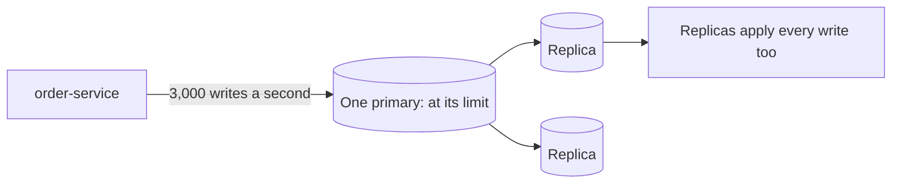
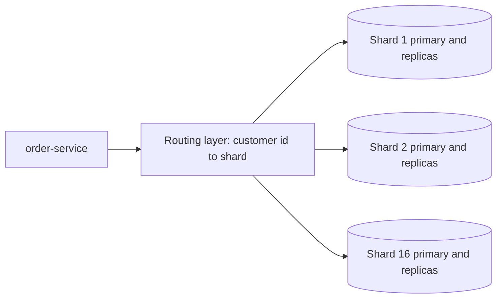

# Partitioning and Sharding

**System design · Step 14.9 · Fundamentals** · Last updated 2026-10-22
**Prerequisites:** [Replication and read replicas](08-replication-read-replicas.md) (14.8); helpful: [Kafka ordering, partition planning and hot partitions](../02-messaging/02-kafka/11-ordering-partition-planning-hot-partitions.md) (2.2.11), the same ideas in a log

## 1. What it is and why it matters

**What is it?** **Partitioning** splits one large data set into parts, each holding a subset of the rows, chosen by a **partition key**. When the parts live on **different machines**, each with its own primary, it is called **sharding**, and each part a **shard**. A routing layer sends every query to the shard that holds its data.

**Why do we need it?** Replicas spread **reads**, but every replica still applies **every write** ([14.8](08-replication-read-replicas.md)). When the writes, or the data itself, outgrow the biggest primary you can run, the only way forward is to give each machine a **different part** of the data. Sharding is the step that scales writes and storage, and it is the most expensive building block to adopt and to change.

**When would I meet it?** When a single database stays at its limit after scaling up, caching, replicas and archiving; in every large key-value or wide-column store, which shard automatically (DynamoDB, Cassandra); and in Kafka, whose partitions follow the same rules.

> [!TIP]
> **Memory hook:** the partition key decides everything. Queries with the key go to one shard; queries without it go to all of them.

## 2. Industry terms

| Term | Simple meaning | Why it matters | Example | Related terms |
|---|---|---|---|---|
| **Partitioning** | Splitting data into parts by a key | Each part can be stored, scanned and moved on its own | MySQL `PARTITION BY` splits one table **within one server** | Horizontal partitioning |
| **Sharding** | Partitioning across separate database servers, each with its own primary | Scales writes and storage beyond one machine | Orders split over 16 MySQL primaries | Shard, horizontal scaling |
| **Partition key (shard key)** | The value that decides which part a row belongs to | Decides which queries are cheap and how evenly load spreads | `customer_id` | Distribution key |
| **Range partitioning** | Each part holds a range of keys (A to F, January) | Range queries stay in one part; but new keys can all land in one part | Orders by month | Hash partitioning |
| **Hash partitioning** | A hash of the key decides the part | Spreads keys evenly; range queries touch every part | `crc32(customer_id) mod 16` | Modulo |
| **Consistent hashing** | Nodes and keys are placed on a ring; a key belongs to the next node on the ring | Adding a node moves only a share of the keys, not most of them | Many distributed caches and databases | **Virtual nodes** (many ring points per node) |
| **Rebalancing (resharding)** | Moving data when shards are added or removed | Must happen online, without breaking queries | Splitting one shard into two | Data migration |
| **Hot partition** | One part receiving far more load than the others | It becomes the bottleneck while the rest are idle | All flash-sale writes for one product | Hot key, celebrity problem |
| **Scatter-gather** | Sending a query to every shard and combining the answers | Cost and latency grow with the number of shards | "All orders over EUR 100 last month" | Fan-out query |
| **Routing layer** | The code or proxy that knows which shard holds which key | Applications shouldn't each have their own copy of the map | A library, or a proxy such as Vitess for MySQL | Shard map, directory |

## 3. In a real system (ShopFlow)

**First, the honest answer:** ShopFlow today does **not** need sharding. Its order data is about 550 GB with copies, and it writes about 6 orders a second at peak ([14.3](03-back-of-the-envelope-estimation.md)). One primary with replicas handles that easily. Sharding it now would add cost and complexity for nothing.

**The business problem, later.** Suppose ShopFlow becomes a marketplace for thousands of sellers: 30 TB of orders and 3,000 writes a second at peak (illustrative numbers). After scaling the primary up, caching and moving old orders to cheaper storage, the primary is still at its limit, and replicas can't help, because the problem is the writes.



**How sharding helps.** Orders are split by `customer_id` over 16 shards, each a primary with replicas. A routing layer sends each query to the right shard. Each shard carries about one sixteenth of the writes and the data (practice exercise 1).



**What it costs.** Queries without the shard key go to every shard. Transactions, joins and unique constraints across shards are hard or impossible. Ids must be unique across shards ([14.13](13-unique-id-generation.md)). Rebalancing must be planned. Every operational task (upgrades, backups, schema changes) is multiplied by the number of shards. And the shard key is very hard to change later.

**Elsewhere:** a chat service shards messages by conversation, so one conversation's history is on one shard; an IoT platform partitions readings by device and time bucket, so no single device or day becomes a hot spot; a social network learned that sharding by user puts celebrities with millions of followers on one shard and needs special handling for them.

## 4. How it works

**The flow, from key to machine:**

1. **Choose the partition key** from the most important access patterns: the key that the frequent queries and the transactions always know.
2. **Map key to partition** with a function: a range table, a hash, or a ring (consistent hashing).
3. **Map partition to node** with a routing table, kept by a routing layer or by the database itself.
4. **Route every query:** with the key, to one shard; without it, to all shards (scatter-gather), or to a separate index.
5. **Replicate each shard** like any database ([14.8](08-replication-read-replicas.md)): each shard has its own primary and replicas.
6. **Rebalance** by moving partitions to new nodes, while reads and writes continue.

The programs below use CRC32, a stable hash, so every run gives the same placement. How to run them is in [the Java overview](../13-java/01-java-overview.md), section 5.

### Worked example 1: the shard key decides which queries are cheap

**Concept.** The same 1,000 orders on 8 shards, sharded by customer or by order id, and two queries: a customer's orders, and one order by its id.

```java
// File: ShardKeyChoice.java (runnable, Java 21)
import java.nio.charset.StandardCharsets;
import java.util.HashSet;
import java.util.Locale;
import java.util.Set;
import java.util.zip.CRC32;

public class ShardKeyChoice {

    static final int SHARDS = 8;

    static int shardOf(String key) {
        CRC32 crc = new CRC32();
        crc.update(key.getBytes(StandardCharsets.UTF_8));
        return (int) (crc.getValue() % SHARDS);
    }

    record Order(String id, String customer) {}

    public static void main(String[] args) {
        Order[] orders = new Order[1_000];
        for (int i = 0; i < orders.length; i++) {
            orders[i] = new Order("o-" + i, "c" + (i % 100));            // 100 customers, 10 orders each
        }

        // Query A: all orders of customer c7. Query B: order o-123 by its id.
        Set<Integer> byCustomerA = new HashSet<>(), byOrderIdA = new HashSet<>();
        for (Order o : orders) {
            if (o.customer().equals("c7")) {
                byCustomerA.add(shardOf(o.customer()));
                byOrderIdA.add(shardOf(o.id()));
            }
        }
        // o-123 belongs to customer c23 (123 mod 100), so with the shard in the id it reads "o-<shard>-123".
        String idWithShard = "o-" + shardOf("c23") + "-123";
        System.out.println(String.format(Locale.ROOT, "%-26s %-22s %s", "Shard key", "A: c7's orders", "B: order o-123 by id"));
        System.out.println(String.format(Locale.ROOT, "%-26s %-22s %s", "customer id", byCustomerA.size() + " shard",
                SHARDS + " shards (the id doesn't say where)"));
        System.out.println(String.format(Locale.ROOT, "%-26s %-22s %s", "customer id, shard in id", byCustomerA.size() + " shard",
                "1 shard (id " + idWithShard + ")"));
        System.out.println(String.format(Locale.ROOT, "%-26s %-22s %s", "order id", byOrderIdA.size() + " shards", "1 shard"));
    }
}
```

**Expected output**:

```text
Shard key                  A: c7's orders         B: order o-123 by id
customer id                1 shard                8 shards (the id doesn't say where)
customer id, shard in id   1 shard                1 shard (id o-4-123)
order id                   8 shards               1 shard
```

**Walkthrough.**

| Shard key | "c7's orders" | "Order o-123" |
|---|---|---|
| Customer id | 1 shard: all of c7's orders are together | All 8: the id alone doesn't say where the order is |
| Customer id, with the shard in the order id | 1 shard | 1 shard: the id `o-4-123` names its shard |
| Order id | All 8: c7's 10 orders are spread out | 1 shard |

Sharding by customer keeps everything about one customer together, which also keeps "place an order" inside one shard, so it can still be one transaction. The cost is the lookup by order id, solved here by **putting the shard into the id** when the order is created (other options: a lookup table from order id to shard, or a global index).

### Worked example 2: adding a node

**Concept.** How many keys must move when a fifth node joins four? It depends on how keys are mapped.

```java
// File: ReshardingDemo.java (runnable, Java 21)
import java.nio.charset.StandardCharsets;
import java.util.Locale;
import java.util.Map;
import java.util.TreeMap;
import java.util.function.Function;
import java.util.zip.CRC32;

public class ReshardingDemo {

    static final int KEYS = 10_000;

    // A stable hash: the same key gives the same number on every machine and every run.
    static long hash(String s) {
        CRC32 crc = new CRC32();
        crc.update(s.getBytes(StandardCharsets.UTF_8));
        return crc.getValue();
    }

    // 1. hash mod N
    static Function<String, Integer> modulo(int nodes) {
        return key -> (int) (hash(key) % nodes);
    }

    // 2. Consistent hashing: each node owns 100 points on a ring; a key belongs to the next point.
    static Function<String, Integer> ring(int nodes) {
        TreeMap<Long, Integer> points = new TreeMap<>();
        for (int n = 0; n < nodes; n++) {
            for (int v = 0; v < 100; v++) {
                points.put(hash("node-" + n + "#" + v), n);
            }
        }
        return key -> {
            Map.Entry<Long, Integer> e = points.ceilingEntry(hash(key));
            return (e != null ? e : points.firstEntry()).getValue();      // wrap around the ring
        };
    }

    // 3. A fixed number of partitions (64); only the partition-to-node table changes.
    static Function<String, Integer> fixedPartitions(int nodes) {
        int[] owner = new int[64];
        for (int p = 0; p < 64; p++) {
            owner[p] = p % 4;                                  // the 4-node layout: 16 partitions each
        }
        if (nodes == 5) {
            for (int p = 0; p < 12; p++) {
                owner[p] = 4;                                  // the new node takes 3 partitions from each old node
            }
        }
        return key -> owner[(int) (hash(key) % 64)];
    }

    static void compare(String name, Function<Integer, Function<String, Integer>> strategy) {
        Function<String, Integer> before = strategy.apply(4), after = strategy.apply(5);
        int moved = 0;
        int[] perNode = new int[5];
        for (int i = 0; i < KEYS; i++) {
            String key = "customer-" + i;
            int a = after.apply(key);
            if (before.apply(key) != a) moved++;
            perNode[a]++;
        }
        int min = Integer.MAX_VALUE, max = 0;
        for (int c : perNode) {
            min = Math.min(min, c);
            max = Math.max(max, c);
        }
        System.out.println(String.format(Locale.ROOT, "  %-22s moved %,5d keys (%4.1f%%); keys per node %,d to %,d",
                name, moved, 100.0 * moved / KEYS, min, max));
    }

    public static void main(String[] args) {
        System.out.println(String.format(Locale.ROOT, "%,d keys, growing from 4 to 5 nodes", KEYS));
        compare("hash mod N", ReshardingDemo::modulo);
        compare("consistent hashing", ReshardingDemo::ring);
        compare("64 fixed partitions", ReshardingDemo::fixedPartitions);
    }
}
```

**Expected output**:

```text
10,000 keys, growing from 4 to 5 nodes
  hash mod N             moved 8,036 keys (80.4%); keys per node 1,979 to 2,033
  consistent hashing     moved 2,487 keys (24.9%); keys per node 1,591 to 2,487
  64 fixed partitions    moved 1,872 keys (18.7%); keys per node 1,872 to 2,039
```

**Walkthrough.**

| Strategy | Keys moved | Why |
|---|---|---|
| `hash mod N` | About **80%** | Changing N from 4 to 5 changes the result of `mod` for most keys |
| Consistent hashing, 100 points per node | About **25%** (ideal: 20%) | Only keys on the ring segments the new node takes over move; the balance depends on how many points each node has |
| 64 fixed partitions | About **19%** | Keys never change partition; whole partitions (12 of 64) move to the new node |

Consistent hashing was introduced by Karger and colleagues (STOC 1997) for distributed web caches. The **fixed-partitions** approach is what many systems use in practice: create many more partitions than nodes up front, and move whole partitions. Kafka's partitions work this way (a key's partition is fixed once the topic exists, which is why adding partitions later changes key placement, [2.2.11](../02-messaging/02-kafka/11-ordering-partition-planning-hot-partitions.md)).

**Experiment.** Predict first: with 1,000 points per node on the ring instead of 100, does the moved share get closer to 20%, and does the balance between nodes improve? The result is in Answers.

### Worked example 3: a hot partition

**Concept.** Even a perfect hash can't spread **one** key: all writes for one product land on one partition. Splitting the hot key into several sub-keys (**salting**) spreads the writes, at the price of reading all sub-keys.

```java
// File: HotPartitionDemo.java (runnable, Java 21)
import java.nio.charset.StandardCharsets;
import java.util.Locale;
import java.util.zip.CRC32;

public class HotPartitionDemo {

    static final int PARTITIONS = 8;

    static int partition(String key) {
        CRC32 crc = new CRC32();
        crc.update(key.getBytes(StandardCharsets.UTF_8));
        return (int) (crc.getValue() % PARTITIONS);
    }

    static void run(String title, boolean saltHotKey) {
        int[] writes = new int[PARTITIONS];
        for (int n = 0; n < 10_000; n++) {
            // A flash sale: 70% of stock updates are for one product, the rest for 300 others.
            String product = n % 10 < 7 ? "HOODIE" : "P-" + (n % 300);
            String key = product;
            if (saltHotKey && product.equals("HOODIE")) {
                key = product + "#" + (n % PARTITIONS);       // split the hot key into 8 sub-keys
            }
            writes[partition(key)]++;
        }
        int busiest = 0;
        for (int w : writes) busiest = Math.max(busiest, w);
        System.out.println(String.format(Locale.ROOT, "%-28s busiest partition takes %4.1f%% of writes (even would be %.1f%%)",
                title, 100.0 * busiest / 10_000, 100.0 / PARTITIONS));
    }

    public static void main(String[] args) {
        run("Key = product id", false);
        run("Hot key split into 8 parts", true);
        System.out.println("Cost of the split: reading HOODIE's total now means reading 8 keys and adding them up");
    }
}
```

**Expected output**:

```text
Key = product id             busiest partition takes 74.3% of writes (even would be 12.5%)
Hot key split into 8 parts   busiest partition takes 14.0% of writes (even would be 12.5%)
Cost of the split: reading HOODIE's total now means reading 8 keys and adding them up
```

**Walkthrough.** 70% of the writes are for `HOODIE`, so whichever partition holds it takes about three quarters of all writes: one machine at its limit, seven nearly idle, and adding machines doesn't help. With the key split into `HOODIE#0` to `HOODIE#7`, the writes spread across all partitions, and the busiest takes 14%, close to an even 12.5%. Reading the total stock of `HOODIE` now means reading eight keys and adding them up. Use this only for keys you know are hot, and keep the split count small.

**Range partitioning has its own hot spot:** partition orders by month, and every new order goes to the current month's partition, while the older ones are idle. Range partitioning by time is good for **archiving** (drop an old month in one step) and bad for **spreading writes**.

### What gets harder across shards

| Need | Within one database | Across shards | Usual answer |
|---|---|---|---|
| Transactions | One transaction | No simple transaction | Choose the key so each business operation stays in one shard; otherwise a saga (4.8, planned) |
| Joins | SQL join | Join in the application | Denormalise; keep related data on the same shard |
| Unique values (email) | A unique index | Each shard only sees its own rows | A separate lookup table keyed and sharded by the unique value |
| Queries without the key | An index | Scatter-gather to every shard | A global secondary index (usually updated asynchronously) or a copy in a search engine or warehouse |
| Ids | Auto-increment | Clashes between shards | Ids that are unique across shards ([14.13](13-unique-id-generation.md)) |

Scatter-gather has a hidden cost: the answer is as slow as the **slowest** shard, so the more shards a query touches, the worse its tail latency.

## 5. Failure scenarios

### Sharded by date

1. **What happened?** Orders were range-partitioned by month across servers. Every server but one was idle; the current month's server was at 100% during the sale.
2. **Why?** All new writes have the newest dates, so they all land in one range.
3. **What did users see?** Slow checkouts while most of the capacity sat unused.
4. **Solutions:** shard by a key that spreads writes (a hash of `customer_id`); use time ranges only within a shard, for archiving.
5. **What they cost:** "last month's orders" becomes a query across all shards, served better from a warehouse.

### Resharding with `mod N`

1. **What happened?** Going from 8 to 10 shards with `hash mod N` meant moving most of the data. The migration ran for days, competed with live traffic, and was rolled back twice.
2. **Why?** Changing N changes the shard of most keys (worked example 2).
3. **What did the business see?** A risky, slow project, and degraded performance while it ran.
4. **Solutions:** start with many fixed partitions (for example 256 or 1,024) mapped to few servers, and move whole partitions; or use consistent hashing; or a system that does this for you (a sharding proxy such as Vitess for MySQL, or a database that shards automatically).
5. **What they cost:** more upfront design, a routing table to maintain, or a new system to learn.

### One product took a shard down

1. **What happened?** During a flash sale, every stock update and every review for one product went to one shard, which became overloaded and slowed down every other customer whose data lived there.
2. **Why?** A single hot key can't be spread by hashing.
3. **What did users see?** Slow pages for unrelated customers who happened to share the hot shard.
4. **Solutions:** split known hot keys (worked example 3); cache their reads ([14.6](06-caching.md)); absorb their writes in a queue and apply them in batches; detect hot keys with per-key metrics.
5. **What they cost:** extra read work for split keys; special handling to build and remember.

## 6. Architectural decisions

| Shard when | Don't shard when | Alternatives first |
|---|---|---|
| Writes or data exceed what one primary can take, after the alternatives, with numbers to show it | The load fits one primary with headroom; the "need" is reads (use caches and replicas) | Scale the primary up; cache ([14.6](06-caching.md)); read replicas ([14.8](08-replication-read-replicas.md)); archive old data; split data by service so each has its own database (4.7, planned) |

| Strategy | Use when | Watch out for |
|---|---|---|
| **Hash of the key** (with fixed partitions or consistent hashing) | Spreading writes evenly; lookups by key | Range queries and queries without the key touch every shard |
| **Range** | Range scans by key; archiving by time | Hot spots on the newest range |
| **Directory (lookup table)** | Placing big tenants on their own shard; moving single tenants | The directory is critical: cache it, replicate it |
| **A database that shards for you** (DynamoDB, Cassandra, distributed SQL databases) | You'd rather operate a product than build sharding | You still choose the partition key, and hot keys still hurt |

**Choosing the key, in order:** it is known by the frequent queries; it keeps each business transaction in one shard; it spreads load evenly (many distinct values, none much hotter than the rest); and it rarely, ideally never, changes for a row.

**Common mistakes:** sharding too early; a key with few values (country, status); range sharding on an ever-increasing key (date, auto-increment id); scatter-gather queries on the request path; forgetting unique constraints and ids across shards; no plan for rebalancing.

## 7. Try it yourself

Try each exercise first; the solutions are in the Answers section, the first as a runnable program.

1. **How many shards?** The marketplace has 30 TB of order data (one copy) and 3,000 writes a second at peak. One primary holds 2 TB comfortably and takes 500 writes a second at its latency target. How many shards do you need, how many would you create, and how many database servers is that with two replicas per shard?
2. **Choose the partition key** for: (a) chat messages; (b) sensor readings from 1 million devices, one a minute each; (c) marketplace orders; (d) the product catalogue of 100,000 products.
3. **Unique email across shards.** Customers are sharded by `customer_id`. How do you make sure no two customers register with the same email address?

## 8. Check your understanding

1. Why do read replicas not solve a write bottleneck, while sharding does?
2. Orders are sharded by `customer_id`. Which of these are single-shard: (a) a customer's order history; (b) placing an order; (c) the warehouse's list of all PENDING orders?
3. Why does adding a fifth node move about 80% of keys with `hash mod N`, and about 20% with fixed partitions?
4. Hashing spreads keys evenly, yet one shard is overloaded. What is the likely cause, and two ways to fix it?

Answers are at the end of this note.

## 9. Revision

**Remember**
- **Sharding** = partitioning across servers, each with its own primary; it scales **writes and storage**, replicas don't.
- The **partition key** decides which queries are cheap, which transactions stay possible, and how even the load is.
- **`mod N`** moves most keys when N changes; **fixed partitions** or **consistent hashing** move about 1/N.
- **Hot keys** can't be hashed away: split them, cache them, queue their writes.
- Across shards, transactions, joins, unique values and ids need a design of their own.

**Explain in 15 seconds:** "Sharding splits data across several databases by a partition key, so each server takes part of the writes and storage. Queries with the key go to one shard; the key choice decides which queries and transactions stay simple."

**Explain in 60 seconds:**
> "When one primary can't take the writes or the data, even after scaling up, caching and replicas, I shard: split the data by a partition key across several primaries, each with its own replicas, behind a routing layer. The key is the big decision. I pick one the frequent queries and the transactions always know, like customer id for orders, so a customer's history and placing an order stay on one shard; lookups by order id use an id that carries the shard. Hashing spreads load evenly, and I create many fixed partitions up front, or use consistent hashing, so adding a server moves a fraction of the data instead of most of it. The costs are real: queries without the key fan out to every shard, cross-shard transactions and unique constraints need special designs, and hot keys still need splitting or caching. So I shard only when the numbers say so."

**Likely follow-up questions:**
- **What is the difference between partitioning and sharding?** Partitioning splits data by a key; sharding is partitioning across separate servers. MySQL's `PARTITION BY` partitions a table within one server and doesn't add write capacity across machines.
- **What are virtual nodes for?** Many ring points per node spread each node's share more evenly and let a new node take load from all others, not just one neighbour.
- **How do you reshard online?** Copy the moving partitions to their new home while replicating ongoing changes, switch the routing for those partitions, then delete the old copies; tools and managed databases automate this.
- **How do you run reports across shards?** Not on the live shards: copy the data to a warehouse with change data capture and query it there.

**Architect's takeaway:** sharding is a one-way door. Delay it with the cheaper building blocks, prove the need with numbers, and when you do it, spend most of the design time on the partition key and on the queries that don't have it.

**Next topic:** [Consistency trade-offs: CAP, PACELC and quorums](10-consistency-cap-pacelc-quorums.md) (14.10)

## 10. Verification and sources

> [!NOTE]
> Checked 2026-10-22. All programs were run on OpenJDK 21.0.8, and the repository's example checker compares their output. Re-verify when you revisit this note.

- **Confirmed:** MySQL partitioning distributes "portions of individual tables across a file system", supports RANGE, LIST, HASH and KEY (with LINEAR and COLUMNS variants) and, in MySQL 8.4, works only with InnoDB and NDB (MySQL 8.4 Reference Manual, "Overview of Partitioning in MySQL", read 2026-10-22); it is not described there as spanning servers. "Vitess is an open-source database clustering system for horizontal scaling of MySQL", which routes queries to shards and supports resharding (vitess.io, "What Is Vitess", read 2026-10-22). Consistent hashing was introduced in Karger et al., "Consistent Hashing and Random Trees: Distributed Caching Protocols for Relieving Hot Spots on the World Wide Web", STOC 1997 (bibliographic details confirmed by search, 2026-10-22). DynamoDB hashes the partition key to choose a partition ([14.7](07-choosing-a-database.md), AWS documentation).
- **Assumptions and illustrations:** the marketplace numbers (30 TB, 3,000 writes a second, 2 TB and 500 writes a second per shard) are illustrative. The programs use CRC32 for stable results; real systems use other hash functions (Kafka's default partitioner uses murmur2, for example), so exact placements differ, but the proportions moved behave the same way. The consistent-hashing result depends on the number of points per node and on the hash.
- **To verify:** the resharding features and limits of the specific tool or managed database you'd use; whether your database's global secondary indexes are updated synchronously or asynchronously.
- **Decision rule:** shard only when writes or data exceed one primary after the cheaper options; choose the key from the frequent queries and transactions; create many fixed partitions up front.

**Sources:** MySQL 8.4 Reference Manual, "Overview of Partitioning in MySQL"; vitess.io, "What Is Vitess"; David Karger et al., "Consistent Hashing and Random Trees", STOC 1997; Martin Kleppmann, *Designing Data-Intensive Applications*, chapter on partitioning.

## Answers

**Experiment**

- **1,000 points per node** (worked example 2): consistent hashing now moves **1,757 keys (17.6%)**, close to the ideal 20%, and the nodes hold **1,757 to 2,265** keys instead of 1,591 to 2,487. More points per node give a more even split, at the cost of a bigger ring to store and search. (The `mod N` and fixed-partition results don't change.)

**Check your understanding**

1. Every replica applies every write, so replicas add read capacity but the write load on each machine stays the same. Shards hold **different** data, so each primary takes only its share of the writes.
2. (a) **Single-shard**: all of a customer's orders share the key. (b) **Single-shard**: the order belongs to one customer, so it, its lines and that customer's data can be written in one transaction (stock is a separate concern, often in another service). (c) **All shards**: PENDING orders belong to every customer; serve it from a separate index or a copy built for the warehouse, not by scatter-gather on every request.
3. With `hash mod N`, the shard is the remainder of the hash divided by N, and changing N from 4 to 5 changes that remainder for most keys, about 80% here. With fixed partitions, a key's partition never changes; only whole partitions move, and the new node needs about a fifth of them (12 of 64), so about a fifth of the keys move.
4. A **hot key**: one key (a product, a celebrity, a big tenant) receives a large share of the traffic, and hashing puts all of it on one shard. Fixes: split the key into sub-keys and combine on read; cache its reads; queue and batch its writes; move a very large tenant to its own shard through a directory.

**Practice exercises**

1. **How many shards?**

```java
// File: ShardCount.java (runnable, Java 21)
public class ShardCount {

    public static void main(String[] args) {
        // Illustrative: ShopFlow grown into a marketplace.
        double dataTb = 30;                  // orders and their lines, one copy
        double writesPerSecond = 3_000;      // at peak
        double tbPerShard = 2;               // what one primary holds comfortably, with room for indexes and growth
        double writesPerShard = 500;         // measured at the latency target

        int forData = (int) Math.ceil(dataTb / tbPerShard);
        int forWrites = (int) Math.ceil(writesPerSecond / writesPerShard);
        int needed = Math.max(forData, forWrites);
        int chosen = Integer.highestOneBit(needed - 1) << 1;      // next power of two, room to grow

        System.out.println("shards for the data     " + forData);
        System.out.println("shards for the writes   " + forWrites);
        System.out.println("shards needed           " + needed);
        System.out.println("shards chosen           " + chosen + " (next power of two)");
        System.out.println("database servers        " + chosen * 3 + " (each shard: a primary and two replicas)");
    }
}
```

**Expected output**:

```text
shards for the data     15
shards for the writes   6
shards needed           15
shards chosen           16 (next power of two)
database servers        48 (each shard: a primary and two replicas)
```

The data, not the writes, sets the number here: 15 shards for 30 TB, against 6 for the writes. Creating **16** leaves a little room, and with many fixed partitions (say 1,024) mapped onto them, growing to 32 later means moving partitions, not rehashing. With two replicas per shard, that is **48** database servers to run, which is the real cost of sharding.

2. **Partition keys:** (a) Chat messages: the conversation id, so a conversation's history is on one shard and ordered; very large group chats may need splitting by time. (b) Sensor readings: device id combined with a time bucket (for example the day), so one device's recent data is together, and no partition grows forever. (c) Marketplace orders: the customer id (history and checkout stay on one shard), with the shard encoded in the order id; sellers' views of their orders come from a separate copy keyed by seller. (d) The catalogue: **don't shard**: 100,000 products is small; cache it and use replicas.

3. **Unique email across shards:** keep a separate table that maps email to customer id, partitioned by **email**. Registration first inserts into it (its unique key fails for a duplicate), then creates the customer in the customer's shard; if the second step fails, remove the reservation or retry, and make the steps idempotent. Changing an email means reserving the new one before releasing the old one.

Back to [the System design overview](01-system-design-overview.md) · [the index](../README.md) · [Roadmap](../roadmap.md).
