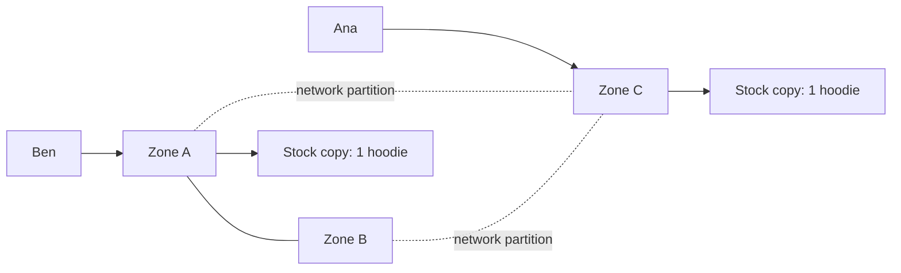

# Consistency Trade-offs: CAP, PACELC and Quorums

**System design · Step 14.10 · Intermediate** · Last updated 2026-10-22
**Prerequisites:** [Replication and read replicas](08-replication-read-replicas.md) (14.8) and [Partitioning and sharding](09-partitioning-sharding.md) (14.9); helpful: [Caching](06-caching.md) (14.6)

## 1. What it is and why it matters

**What is it?** When the same data lives on several machines, an architect must decide what readers and writers are promised when those copies **disagree**. Three ideas frame the decision. **CAP**: when the network splits the machines into groups that can't talk, each group must either refuse requests or risk inconsistent answers. **PACELC**: even when the network is fine, stronger consistency costs latency. **Quorums**: reading and writing enough copies that every read overlaps the latest write.

**Why do we need it?** Every copy introduced so far (caches in [14.6](06-caching.md), replicas in [14.8](08-replication-read-replicas.md), shards with replicas in [14.9](09-partitioning-sharding.md)) creates a moment when copies disagree. Whether the business sees an oversold hoodie, a cart that forgets an item, or an error page during a network fault depends on choices made here, usually by default and unnoticed.

**When would I meet it?** When choosing a distributed database or a consistency level, when deploying across zones or regions, after an incident in which two parts of the system "both thought they were right", and in every system design interview that says "now make it highly available".

> [!TIP]
> **Memory hook:** during a network split, a copy that can't reach the others must choose: **answer** (and risk being wrong) or **refuse** (and be unavailable). Without a split, it still chooses: **wait** for the others (slower) or **answer now** (maybe stale).

## 2. Industry terms

| Term | Simple meaning | Why it matters | Example | Related terms |
|---|---|---|---|---|
| **Linearizability (strong consistency)** | The system behaves as if there were one copy: once a write completes, every later read sees it | What most people mean by "consistent"; the C in CAP | A stock count that every checkout sees the same way | Atomic consistency |
| **Eventual consistency** | If writes stop, all copies converge to the same value, some time later | Allows answering from any copy; readers can see old values | A product review count that catches up after a few seconds | Convergence |
| **Network partition** | Machines that are running but can't reach each other | Not optional: networks do fail, so a distributed system must decide how to behave | Zone C cut off from zones A and B | Split brain ([14.8](08-replication-read-replicas.md)) |
| **CAP theorem** | During a partition, a system can't be both linearizable and available on every node | Forces a choice, per operation, for the partition case | Refuse stock reservations on the cut-off side | CP, AP |
| **PACELC** | If **P**artitioned, choose **A** or **C**; **E**lse, choose **L**atency or **C**onsistency | Most of the time there is no partition, and the everyday cost of consistency is latency | Synchronous replication to another zone adds a round trip to every write | Abadi, 2012 |
| **Quorum** | Write to W copies and read from R copies out of N, with W + R > N so every read overlaps the latest write | Tunable consistency in leaderless stores | Cassandra with replication factor 3, `QUORUM` reads and writes | Consistency level |
| **Conflict** | Two copies accepted different writes to the same data | Someone or something must resolve it | Ana removes an item on one side, adds one on the other | Concurrent writes |
| **Last write wins (LWW)** | Keep the write with the latest timestamp, drop the other | Simple, but silently loses one of two concurrent writes and depends on clocks | Cassandra's conflict rule | Version vectors |
| **CRDT (conflict-free replicated data type)** | A data structure whose copies can always be merged without conflicts | Lets copies accept writes independently and still converge correctly | An add/remove set for a cart | Merge function |

## 3. In a real system (ShopFlow)

**The business problem.** ShopFlow runs in three availability zones. One day a network fault cuts zone C off from zones A and B for ten minutes; all three keep running. Customers whose requests reach zone C are still shopping. The business wants two things that conflict: **keep selling** during the fault, and **never sell stock it doesn't have**.



**How the trade-offs help.** Not by choosing one answer for the whole shop, but one **per operation**:
- **Stock reservation** must be consistent: only the side with a **majority** of copies (A and B) may reserve; zone C refuses and asks the customer to retry. A few customers see an error; nobody gets a hoodie that doesn't exist.
- **The cart** must be available: both sides accept "add to cart", and the versions are **merged** when the network heals, carefully enough that removed items don't come back (worked example 3).
- **Product pages and reviews** may be stale for ten minutes; they are served from whatever copy is reachable.

**What it costs.** Thinking per operation, and code for each choice: errors and retries on the consistent side, merge logic on the available side. Consistent operations are also **slower** even without a fault, because they wait for other copies (PACELC).

**Elsewhere:** Brewer's own example is an ATM, which may keep allowing small withdrawals while disconnected and settle afterwards, accepting a bounded risk; collaborative editors let everyone keep typing offline and merge the edits later with CRDT-like structures; a payment ledger refuses writes on the minority side rather than ever double-spending.

## 4. How it works

**CAP, stated carefully.** The theorem, conjectured by Eric Brewer at PODC 2000 and proved by Gilbert and Lynch (2002), says: when a network partition happens, a system can't guarantee both **linearizability** and that **every** non-failed node answers. Three clarifications prevent most misunderstandings:

1. **P is not a choice.** Networks fail; what you choose is the behaviour **during** a partition.
2. **Without a partition, you can have both.** Brewer's 2012 retrospective calls "2 of 3" misleading, because "partitions are rare" and there is "little reason to forfeit C or A when the system is not partitioned".
3. **The choice is per operation**, and "can change according to the operation or even the specific data or user involved" (Brewer, 2012). Labelling a whole database "CP" or "AP" hides that.

**PACELC: the everyday cost.** Abadi (2012) pointed out that the trade-off that shapes systems most of the time is **latency versus consistency**, when there is no partition: waiting for a second zone (semi-synchronous replication, [14.8](08-replication-read-replicas.md)) or a majority of replicas makes every write slower; answering from the nearest copy is fast but may be stale.

**The spectrum between strong and eventual:**

| Guarantee | Promise | Where you met it |
|---|---|---|
| Linearizable | One-copy behaviour for everyone | The primary in [14.8](08-replication-read-replicas.md); a majority quorum, with care |
| Read-your-writes, monotonic reads | Guarantees for **one user's session** | Read routing in [14.8](08-replication-read-replicas.md) |
| Eventual | Copies converge when writes stop | Caches, asynchronous replicas, search indexes |

**Quorums, step by step** (leaderless stores such as Cassandra; also the idea behind majority-based leader election):

1. Each value is stored on **N** replicas.
2. A write is sent to all N and succeeds when **W** of them acknowledge.
3. A read asks **R** replicas and takes the newest version among the answers.
4. If **W + R > N**, the replicas that acknowledged the write and the replicas asked by the read **must overlap**, so the read sees the latest acknowledged write.
5. Replicas that missed a write are repaired later: on reads (**read repair**), from saved hints (**hinted handoff**), and by background comparison (**anti-entropy repair**).

The programs below are exact simulations; how to run them is in [the Java overview](../13-java/01-java-overview.md), section 5.

### Worked example 1: W + R > N, by counting every case

**Concept.** With three replicas, list every set of replicas the latest write could have reached and every set a read could ask, and count the combinations where the read finds **only old copies**.

```java
// File: QuorumDemo.java (runnable, Java 21)
public class QuorumDemo {

    static final int N = 3;     // replicas of each value

    // Every way the latest write could have reached exactly W replicas, and every way a read could ask
    // exactly R replicas. A read is stale if none of the replicas it asks has the latest write.
    static void check(int w, int r) {
        int total = 0, stale = 0;
        for (int writeSet = 0; writeSet < (1 << N); writeSet++) {
            if (Integer.bitCount(writeSet) != w) continue;
            for (int readSet = 0; readSet < (1 << N); readSet++) {
                if (Integer.bitCount(readSet) != r) continue;
                total++;
                if ((writeSet & readSet) == 0) stale++;          // no overlap: the read sees only old copies
            }
        }
        String rule = w + r > N ? "W+R > N" : "W+R <= N";
        System.out.println("  W=" + w + " R=" + r + "  " + rule + "  stale reads possible in " + stale + " of " + total + " cases");
    }

    public static void main(String[] args) {
        System.out.println("N = " + N + " replicas");
        check(1, 1);
        check(1, 2);
        check(2, 1);
        check(2, 2);
        check(3, 1);
        check(1, 3);
    }
}
```

**Expected output**:

```text
N = 3 replicas
  W=1 R=1  W+R <= N  stale reads possible in 6 of 9 cases
  W=1 R=2  W+R <= N  stale reads possible in 3 of 9 cases
  W=2 R=1  W+R <= N  stale reads possible in 3 of 9 cases
  W=2 R=2  W+R > N  stale reads possible in 0 of 9 cases
  W=3 R=1  W+R > N  stale reads possible in 0 of 3 cases
  W=1 R=3  W+R > N  stale reads possible in 0 of 3 cases
```

**Walkthrough.**

| W, R | Overlap guaranteed? | Typical use |
|---|---|---|
| 1, 1 | No: 6 of 9 combinations miss the write | Fastest and most available; fine for data where staleness is harmless |
| 2, 2 (Cassandra `QUORUM` with replication factor 3) | Yes | The usual balance: survives one replica down for both reads and writes |
| 3, 1 or 1, 3 | Yes | Fast reads with slow, fragile writes, or the opposite; one replica down blocks the "3" side |

Cassandra's documentation states the same rule as "W + R > RF". The overlap is what makes stale reads impossible **for acknowledged writes**; it is not, by itself, a full guarantee of linearizability (concurrent writes resolved by last-write-wins, and writes that failed on some replicas, can still surprise readers), so check what your database promises at each level.

**Experiment.** Predict first: with five replicas (`N = 5`), is `W=2, R=2` still safe? Which pair is the majority quorum? (Change `N` to 5 and add `check(3, 3)`.) The result is in Answers.

### Worked example 2: the partition choice

**Concept.** Three replicas of the stock of the last hoodie; the network separates A and B from C. Ben's request reaches A, Ana's reaches C. Compare "a write needs a majority" with "each side accepts writes".

```java
// File: PartitionDemo.java (runnable, Java 21)
import java.util.ArrayList;
import java.util.List;

public class PartitionDemo {

    // Three replicas of the HOODIE stock, one left. A network partition separates {A, B} from {C}.
    // Ben's request reaches A; Ana's request reaches C.
    static void run(String title, boolean needMajority) {
        int stockAB = 1, stockC = 1;
        List<String> reservations = new ArrayList<>();
        System.out.println(title);

        // Ben, on the majority side: A can reach B, so 2 of 3 replicas agree.
        if (stockAB > 0) {
            stockAB--;
            reservations.add("ben");
            System.out.println("  ben via A (can reach 2 of 3): reserved");
        }

        // Ana, on the minority side: C can reach only itself, 1 of 3.
        if (needMajority) {
            System.out.println("  ana via C (can reach 1 of 3): refused, try again later");
        } else if (stockC > 0) {
            stockC--;
            reservations.add("ana");
            System.out.println("  ana via C (can reach 1 of 3): reserved");
        }

        System.out.println("  after the partition heals: " + reservations.size() + " reservation(s) for 1 hoodie " + reservations);
    }

    public static void main(String[] args) {
        run("Consistency first: a write needs a majority", true);
        run("Availability first: each side accepts writes", false);
    }
}
```

**Expected output**:

```text
Consistency first: a write needs a majority
  ben via A (can reach 2 of 3): reserved
  ana via C (can reach 1 of 3): refused, try again later
  after the partition heals: 1 reservation(s) for 1 hoodie [ben]
Availability first: each side accepts writes
  ben via A (can reach 2 of 3): reserved
  ana via C (can reach 1 of 3): reserved
  after the partition heals: 2 reservation(s) for 1 hoodie [ben, ana]
```

**Walkthrough.** Requiring a majority makes the minority side **unavailable** for this operation: Ana is told to retry, and the system stays correct. Accepting writes on both sides keeps both customers happy for ten minutes, and then the system holds **two reservations for one item**: someone must cancel an order and apologise. Neither is wrong in general. For stock, ShopFlow chooses the first; for the cart, the second.

### Worked example 3: merging after a partition

**Concept.** When both sides accepted writes, the versions must be merged. Merging carts by **union** looks safe, but brings back items the customer removed. Remembering **which adds were removed** (an observed-remove set, a simple CRDT) merges correctly.

```java
// File: CartMergeDemo.java (runnable, Java 21)
import java.util.HashMap;
import java.util.HashSet;
import java.util.Map;
import java.util.Set;
import java.util.TreeSet;

public class CartMergeDemo {

    // A cart that remembers each add by a unique tag, and which tags were removed.
    record Cart(Map<String, Set<String>> adds, Set<String> removedTags) {
        static Cart of(Map<String, Set<String>> adds) {
            Map<String, Set<String>> copy = new HashMap<>();
            adds.forEach((item, tags) -> copy.put(item, new HashSet<>(tags)));
            return new Cart(copy, new HashSet<>());
        }

        Cart copy() {
            Cart c = of(adds);
            c.removedTags().addAll(removedTags);
            return c;
        }

        void add(String item, String tag) {
            adds.computeIfAbsent(item, k -> new HashSet<>()).add(tag);
        }

        void remove(String item) {
            removedTags.addAll(adds.getOrDefault(item, Set.of()));     // remove the adds seen so far
        }

        Set<String> items() {
            Set<String> visible = new TreeSet<>();
            adds.forEach((item, tags) -> {
                for (String t : tags) {
                    if (!removedTags.contains(t)) visible.add(item);
                }
            });
            return visible;
        }

        // Merging two versions: union of the adds, union of the removals.
        Cart merge(Cart other) {
            Cart m = copy();
            other.adds().forEach((item, tags) -> tags.forEach(t -> m.add(item, t)));
            m.removedTags().addAll(other.removedTags());
            return m;
        }
    }

    public static void main(String[] args) {
        Cart start = Cart.of(Map.of("MUG", Set.of("t1"), "TEE", Set.of("t2")));
        Cart sideA = start.copy();
        Cart sideC = start.copy();

        sideA.remove("TEE");                 // during the partition, Ana removes the TEE on one side
        sideC.add("SOCKS", "t3");            // and adds SOCKS on the other side

        System.out.println("before:            " + start.items());
        System.out.println("version A:         " + sideA.items());
        System.out.println("version C:         " + sideC.items());

        Set<String> unionOfItems = new TreeSet<>(sideA.items());
        unionOfItems.addAll(sideC.items());
        System.out.println("merge by union:    " + unionOfItems + "   <- the removed TEE is back");
        System.out.println("merge add/remove:  " + sideA.merge(sideC).items());
    }
}
```

**Expected output**:

```text
before:            [MUG, TEE]
version A:         [MUG]
version C:         [MUG, SOCKS, TEE]
merge by union:    [MUG, SOCKS, TEE]   <- the removed TEE is back
merge add/remove:  [MUG, SOCKS]
```

**Walkthrough.** Version A no longer has the TEE; version C still has it, because the removal happened on the other side. A union can't tell "removed on A" from "added on C", so the TEE returns. The add/remove version gives every add a unique tag and records removed tags; merging unions both, and an item is visible only if one of its adds hasn't been removed, so the TEE stays removed and SOCKS stays added. Secondary sources describing Amazon's Dynamo paper (SOSP 2007) report exactly this anomaly, deleted items reappearing in merged shopping carts; the original paper's wording was not checked here.

## 5. Failure scenarios

### Oversold during a partition

1. **What happened?** During a ten-minute network fault between zones, both sides kept reserving stock. When the network healed, 140 orders existed for stock that covered 100.
2. **Why?** The stock store was configured to accept writes on any reachable replica, the availability-first choice, for an operation that needed consistency.
3. **What did the business see?** Cancelled orders, apology emails and refunds after a sale.
4. **Solutions:** require a majority (or a single leader) for stock reservations; refuse on the minority side with a clear "please retry"; or, if the business accepts a bounded risk, reserve from a pre-split allowance per zone (each zone may sell at most its share).
5. **What they cost:** errors for some customers during faults; slower reservations because each waits for a majority.

### Last write wins lost an update

1. **What happened?** Two support agents edited the same customer note seconds apart in different zones. One edit disappeared.
2. **Why?** The store resolves conflicts by timestamp. The two writes were concurrent, and one server's clock was ahead, so the earlier edit "won".
3. **What did the business see?** A promised refund that nobody could find in the notes.
4. **Solutions:** route writes for one record to one leader; use versions and reject a write based on an old version (optimistic locking); for data that can be merged, merge instead of overwriting; keep clocks synchronised (Cassandra's documentation requires NTP).
5. **What they cost:** a leader per key, or retry logic for rejected writes, or merge code.

### Strong consistency everywhere

1. **What happened?** To be safe, every write, including page views and recommendations, used synchronous replication across two regions. Checkout latency rose by the inter-region round trip, and when the link between regions failed, nothing could be written at all.
2. **Why?** The consistency choice was made once, globally, instead of per operation.
3. **What did users see?** A slower shop, and a full outage for writes during a network fault.
4. **Solutions:** classify data by what a stale or conflicting value would cost; use strong consistency only where that cost is high; keep everything else eventually consistent and local.
5. **What they cost:** a classification to maintain, and teams who must understand two kinds of behaviour.

## 6. Architectural decisions

**Choose per operation, by the cost of being wrong versus the cost of being unavailable:**

| Data or operation | Choice | Why |
|---|---|---|
| Stock reservation, payments, unique email, account balance | Consistent: single leader or majority; refuse on the minority side | A wrong answer costs money or trust and is hard to undo |
| Cart, wishlist, preferences | Available, with a merge that respects removals | Losing an add or refusing it costs a sale; a merge can be correct |
| Product pages, reviews, counters, recommendations | Eventual, served from the nearest copy | Staleness is harmless and short |
| Session-scoped views (my orders after I order) | Read-your-writes ([14.8](08-replication-read-replicas.md)) | The user notices their own changes, not other people's |

**Ways to handle conflicts, best first:** avoid them (one leader per key, as with sharding by key in [14.9](09-partitioning-sharding.md)); detect them (versions, optimistic locking); merge them (CRDT-like structures, application merge); and only knowingly drop one (last write wins, for data where losing a concurrent update is acceptable).

**Common mistakes:** calling a whole database "CP" or "AP"; assuming "eventually" means "within a second"; last-write-wins for data people edit concurrently; strong consistency for everything; quorum settings changed for speed (`ONE`) without anyone checking which reads became stale.

## 7. Try it yourself

Try each exercise first; the solutions are in the Answers section, the first as a runnable program.

1. **What does a quorum cost in availability?** Three replicas, each up 99.9% of the time, independently. What is the availability of an operation that needs any one replica, a majority, or all three?
2. **Classify ShopFlow's data.** For each, choose consistent or available-with-merge or eventual, and say what a wrong answer would cost: (a) gift-card balance; (b) "recently viewed products"; (c) the number of likes on a review; (d) a seller's payout amount; (e) the delivery address of an order that hasn't shipped.
3. **Two regions, one name.** A customer's display name can be edited in two regions, and a profile's loyalty points are added in both. Which conflict-handling approach fits each?

## 8. Check your understanding

1. "CAP means pick two of three." What is wrong or misleading in that sentence?
2. With N=3, W=1 and R=1, can a read miss a write that was acknowledged? When would that setting still be a good choice?
3. During a partition, the cart service accepted changes on both sides. What happens when the network heals, and what goes wrong with a naive merge?
4. Why does PACELC matter even in a network that almost never partitions?

Answers are at the end of this note.

## 9. Revision

**Remember**
- Copies disagree; decide **per operation** what readers and writers are promised.
- **CAP**: during a partition, refuse (consistent) or answer and risk being wrong (available). P is not optional.
- **PACELC**: without a partition, consistency costs **latency**.
- **Quorums**: W + R > N makes reads overlap the latest acknowledged write; majority = more than half of N.
- Conflicts: **avoid** (one leader per key), **detect** (versions), **merge** (CRDTs), and only knowingly **drop** (last write wins).

**Explain in 15 seconds:** "When data has copies, a network partition forces each operation to choose between staying consistent by refusing, or staying available and reconciling later. Without partitions, the trade-off is consistency against latency. Quorums let you tune it: W plus R greater than N means reads see the latest write."

**Explain in 60 seconds:**
> "Any system with copies has moments when they disagree. CAP says that during a network partition an operation can't be both linearizable and answered by every node, so I choose per operation: stock reservations and payments need a majority or a single leader, and the cut-off side refuses; carts and preferences stay available and are merged afterwards with a structure that remembers removals; product pages can be stale. PACELC adds the everyday cost: even without partitions, waiting for other copies makes requests slower, so I use strong consistency only where a wrong answer is expensive. In leaderless stores, quorums tune this: with three replicas, quorum reads and writes, two and two, always overlap, while one and one is fast but can be stale. For conflicts I prefer avoiding them with one leader per key, then versions, then merging, and use last-write-wins only where losing a concurrent update is acceptable."

**Likely follow-up questions:**
- **Is a relational database with a primary CP or AP?** Neither label fits fully: writes to the primary are consistent and stop if it is unreachable; reads from asynchronous replicas are available but may be stale. Describe each operation instead.
- **What is causal consistency?** A guarantee that effects are seen after their causes (a reply after the message it answers), weaker than linearizability and achievable while staying available.
- **Why do consensus systems use odd numbers of nodes?** A majority of 3 or 5 tolerates 1 or 2 failures; a fourth or sixth node adds cost without tolerating more.
- **What does "eventually" mean in practice?** Usually milliseconds to seconds, but unbounded during faults; measure the lag and design for the bad case.

**Architect's takeaway:** don't ask "is our database consistent?"; ask, for each operation, "what does a stale read or a conflicting write cost here, and what does an error cost?" The answers, not the database's label, decide the design.

**Next topic:** [Asynchronous processing: queues, workers and fan-out](11-asynchronous-processing.md) (14.11)

## 10. Verification and sources

> [!NOTE]
> Checked 2026-10-22. All programs were run on OpenJDK 21.0.8, and the repository's example checker compares their output. Re-verify when you revisit this note.

- **Confirmed:** Brewer's retrospective calls "2 of 3" misleading, notes that "partitions are rare" so there is "little reason to forfeit C or A when the system is not partitioned", and says the choice "can change according to the operation or even the specific data or user involved"; it discusses ATMs that "limit the net withdrawal" during a partition and compensate afterwards, and commutative replicated data types (CRDTs) as structures that converge after a partition; it dates the conjecture to 1998 to 2000, with the PODC 2000 keynote (Eric Brewer, "CAP Twelve Years Later: How the 'Rules' Have Changed", InfoQ, read 2026-10-22). Gilbert and Lynch proved the conjecture for asynchronous networks, with linearizable ("atomic") consistency, in ACM SIGACT News 33(2), 2002 (bibliographic details and abstract confirmed by search). Abadi proposed PACELC in "Consistency Tradeoffs in Modern Distributed Database System Design", IEEE Computer 45(2), 2012 (confirmed by search). Cassandra's consistency levels (ONE, TWO, THREE, QUORUM, ALL, LOCAL_QUORUM, EACH_QUORUM, LOCAL_ONE, ANY), the rule "W + R > RF", last-write-wins by timestamp with synchronised clocks, read repair, hinted handoff and anti-entropy repair (Apache Cassandra documentation, "Dynamo", read 2026-10-22). DynamoDB reads are eventually consistent by default, strongly consistent reads are optional and not supported on global secondary indexes, and global tables offer an eventual (default) and a strong multi-Region mode (AWS, "DynamoDB read consistency", read 2026-10-22).
- **Assumptions and illustrations:** the programs are exact enumerations and simplified simulations (no clocks, no real network). The Dynamo shopping-cart anomaly is described from secondary sources (course lecture notes); the original paper was not read. The "140 orders for 100 items" and all ShopFlow numbers are illustrative. The quorum availability exercise assumes independent failures.
- **To verify:** the exact guarantees of the consistency levels of the database you use (including its behaviour for failed partial writes); the original Dynamo paper's shopping-cart discussion; Kleppmann's essay "Please stop calling databases CP or AP" for a fuller critique of the labels.
- **Decision rule:** classify each operation by the cost of a wrong answer against the cost of an error; strong consistency (majority or single leader) only where a wrong answer is expensive; merge rather than overwrite where both sides may write.

**Sources:** Eric Brewer, "CAP Twelve Years Later: How the 'Rules' Have Changed" (InfoQ, 2012); Seth Gilbert and Nancy Lynch, "Brewer's Conjecture and the Feasibility of Consistent, Available, Partition-Tolerant Web Services", SIGACT News, 2002; Daniel Abadi, "Consistency Tradeoffs in Modern Distributed Database System Design", IEEE Computer, 2012; Apache Cassandra documentation, "Dynamo"; AWS, "DynamoDB read consistency"; Giuseppe DeCandia et al., "Dynamo: Amazon's Highly Available Key-value Store", SOSP 2007; Martin Kleppmann, *Designing Data-Intensive Applications*, chapters on replication and consistency.

## Answers

**Experiment**

- **Five replicas** (worked example 1): `W=2, R=2` is **no longer safe**, 30 of 100 combinations miss the write, because 2 + 2 = 4 is not more than 5. Every pair from the three-replica run is now unsafe; the majority quorum for N=5 is **W=3, R=3** (0 of 100). A majority is always more than half of N, so it changes with N.

**Check your understanding**

1. Partition tolerance isn't something you can give up: networks fail, so the real choice is what to do **during** a partition. Without a partition, a system can be both consistent and available. And the choice isn't made once for a whole system: it is made per operation (and the C in CAP means linearizability specifically, not every kind of consistency).
2. **Yes**: the write may have reached only one replica and the read may ask a different one (6 of the 9 combinations). It is still a good choice for data where a stale read is harmless and speed and availability matter most: view counters, recently viewed items, recommendations.
3. Both versions are kept and must be merged. A naive union brings back items removed on one side, because it can't tell a removal from an add on the other side. A merge that records which adds were removed (an observed-remove set), or a merge that the application designs for the data, keeps the removal.
4. Because partitions are rare, but latency is paid on **every** request: waiting for another zone or a majority of replicas makes writes and strong reads slower all the time. PACELC makes that everyday cost part of the decision, not just the rare failure case.

**Practice exercises**

1. **What a quorum costs in availability:**

```java
// File: QuorumAvailability.java (runnable, Java 21)
import java.util.Locale;

public class QuorumAvailability {

    public static void main(String[] args) {
        double p = 0.999;                    // each replica is up 99.9% of the time, independently

        double one = 1 - Math.pow(1 - p, 3);                         // at least 1 of 3 up
        double quorum = Math.pow(p, 3) + 3 * Math.pow(p, 2) * (1 - p); // at least 2 of 3 up
        double all = Math.pow(p, 3);                                  // all 3 up

        print("ONE (any 1 of 3)", one);
        print("QUORUM (2 of 3)", quorum);
        print("ALL (3 of 3)", all);
    }

    static void print(String level, double a) {
        System.out.println(String.format(Locale.ROOT, "%-18s %.7f%%  about %6.2f minutes unavailable a year",
                level, a * 100, (1 - a) * 365 * 24 * 60));
    }
}
```

**Expected output**:

```text
ONE (any 1 of 3)   99.9999999%  about   0.00 minutes unavailable a year
QUORUM (2 of 3)    99.9997002%  about   1.58 minutes unavailable a year
ALL (3 of 3)       99.7002999%  about 1575.22 minutes unavailable a year
```

Needing any one replica is almost always possible; a majority still gives about **99.9997%**, under two minutes a year; needing all three gives about **99.70%**, about 26 hours a year, worse than one replica alone, because every replica is now in series ([14.3](03-back-of-the-envelope-estimation.md)). That is why majority quorums are the usual choice, and why "ALL" is rare. The calculation assumes independent failures, which zone-wide or software failures break.

2. **Classify ShopFlow's data:** (a) Gift-card balance: **consistent** (single leader or majority), because a double spend costs money. (b) Recently viewed products: **eventual**, because a missing item is harmless. (c) Likes on a review: **eventual**, or a mergeable counter, because a count slightly off for a while costs nothing. (d) A seller's payout: **consistent**, computed from a ledger, because errors cost money and trust. (e) The delivery address before shipping: **consistent with read-your-writes**, because the customer must see the change and the warehouse must ship to the latest address; a stale value sends a parcel to the wrong place.

3. **Two regions:** the display name: **last write wins** is acceptable, because two concurrent edits are rare and the customer can simply edit again. Loyalty points added in both regions: **merge** as a counter that adds the increments from each region (a CRDT-style counter), never last-write-wins, which would lose one region's points; spending points should go through a **single leader** so the balance can't go negative.

Back to [the System design overview](01-system-design-overview.md) · [the index](../README.md) · [Roadmap](../roadmap.md).
