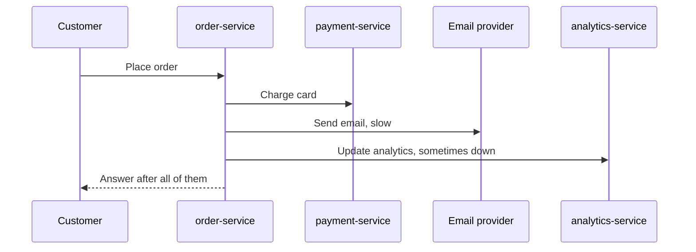

# Asynchronous Processing: Queues, Workers and Fan-out

**System design · Step 14.11 · Intermediate** · Last updated 2026-10-22
**Prerequisites:** [Scaling out](04-scaling-out-stateless-services.md) (14.4) and [Messaging and event-driven design](../02-messaging/01-messaging-overview.md) (2.1); helpful: [Load shedding and backpressure](../01-resilience/08-load-shedding-backpressure.md) (1.8)

This note is about the **design decision**: which work leaves the request, and how the system around it is sized and kept correct. How the brokers themselves work is in the [messaging track](../02-messaging/01-messaging-overview.md), which this note links to instead of repeating.

## 1. What it is and why it matters

**What is it?** Doing part of the work **after** the response, instead of during it. The request does only what the user must wait for, records the rest as a message in a queue or log, and returns. **Workers** take messages and do the work at their own pace. One event can **fan out** to several independent consumers.

**Why do we need it?** Every step in the request adds its latency and its failure rate to the user's experience ([14.3](03-back-of-the-envelope-estimation.md), steps in series). Work the user doesn't need to wait for (emails, analytics, image processing, reports) makes the request slower and less available for no benefit. A queue also **absorbs bursts**: work that arrives faster than it can be done waits, instead of overloading the system.

**When would I meet it?** When a request is slow because of a step the user doesn't need to wait for; when a burst (a sale, a campaign) arrives faster than a service can handle; when several services must react to one event; and when long jobs (exports, video processing) can't fit in an HTTP request.

> [!TIP]
> **Memory hook:** in the request, only what the user must **see now**; everything else becomes a message. Then size the workers for the burst, and make every handler safe to run twice.

## 2. Industry terms

| Term | Simple meaning | Why it matters | Example | Related terms |
|---|---|---|---|---|
| **Synchronous / asynchronous** | The caller waits for the result / the caller hands the work over and continues | Decides latency, availability and what the user sees | Charging the card is synchronous; the email is asynchronous | Request-response, fire-and-forget |
| **Work queue (competing consumers)** | Messages shared out among workers, each handled by one | Scales work by adding workers | Resize-image jobs on Amazon SQS | Point-to-point channel |
| **Fan-out (publish-subscribe)** | One event delivered to every interested consumer | Adds consumers without changing the producer | `OrderPlaced` read by notification, analytics and fraud services | Topic, subscription |
| **Backlog** | Messages waiting to be handled | A growing backlog means arrivals exceed capacity; its **age** is the delay users feel | 60,000 emails waiting | Queue depth, consumer lag |
| **At-least-once delivery** | A message may be delivered more than once, but isn't lost | Handlers must be **idempotent** | Amazon SQS standard queues | Idempotent consumer ([1.4](../01-resilience/04-idempotency.md)) |
| **Dead-letter queue (DLQ)** | Where messages go after failing repeatedly | Stops one bad message from blocking or looping forever | An email with an invalid address | Poison message, DLT for Kafka ([2.2.8](../02-messaging/02-kafka/08-error-handling-retries-dlt.md)) |
| **Dual write** | Writing to the database and publishing a message as two separate steps | A crash between them loses or invents events | Save the order, then publish `OrderPlaced` | Transactional outbox |
| **Transactional outbox** | Write the event into an outbox table in the same transaction as the data; a relay publishes it later | Data and event are saved together or not at all | `orders` and `outbox` rows in one MySQL transaction | Change data capture ([2.2.15](../02-messaging/02-kafka/15-kafka-connect-cdc.md)) |
| **202 Accepted** | The HTTP status for "accepted for processing, not finished" | The honest response for long jobs; it should point to a status resource | `POST /exports` returns 202 and `/exports/77` | Polling, webhook |

## 3. In a real system (ShopFlow)

**The business problem.** ShopFlow's first checkout did everything in the request: charge the card, reserve stock, send the confirmation email, update analytics. Checkout was slow (the email provider is slow) and failed whenever the email provider or analytics had a problem, even though the order itself was fine. Later, a marketing campaign queued 120,000 emails in ten minutes, and order confirmations, which customers wait for, arrived ten minutes late.



**How asynchronous processing helps.** The request now charges the card and reserves stock, which the customer must know about, writes the order and an `OrderPlaced` event in one transaction (the outbox), and answers. The event fans out to the Notification Service and the Analytics Service, which work at their own pace. Order confirmations and campaign emails use **separate queues and limits**, so a campaign can't delay a confirmation.

**What it costs.** The email now arrives a little after the response, which is eventually consistent; the system has a broker, workers and an outbox relay to run; every handler must be idempotent because messages can arrive twice; and failures move from the user's screen to a dead-letter queue that someone must watch.

**Elsewhere:** a video platform accepts an upload in seconds and transcodes it in a work queue for minutes; a bank's statement generation runs as a nightly batch of messages; a ride-hailing app sends the trip-completed event to billing, receipts and driver ratings independently.

## 4. How it works

**The flow of an asynchronous request:**

1. **Split the work:** what must the user see in the response (payment authorised, stock reserved, order id)? Everything else can follow.
2. **Do the synchronous part** in the request, with timeouts ([1.2](../01-resilience/02-timeouts.md)).
3. **Record the rest durably, together with the data:** in the same database transaction, write the order and an outbox row; a relay (or change data capture) publishes it to the broker.
4. **Answer the user.** For long jobs, answer **202 Accepted** with a status resource the client can poll, or notify later (a push message, a webhook).
5. **Workers consume** from a queue (each message to one worker) or a topic (each consumer group gets every event). Each handler is **idempotent**, because delivery is at least once.
6. **Failures** are retried with backoff and jitter ([1.3](../01-resilience/03-retries-backoff-jitter.md)); after a limit, the message goes to a **dead-letter queue** for investigation.
7. **Watch the age of the oldest message**, not only the count: it is the delay users experience.

**Patterns, one question each:**

| Pattern | The question | Example |
|---|---|---|
| Work queue | "Do this once, by whoever is free" | Resize this image |
| Fan-out | "This happened; whoever cares, react" | `OrderPlaced` to email, analytics, fraud |
| Asynchronous request-reply | "Do this long job and let me know" | Export my order history: 202, then poll or get notified |
| Separate queues per priority | "Don't let bulk work delay urgent work" | Confirmations and campaigns on different queues and limits |

Whether to use a **queue** (RabbitMQ, SQS) or a **log** (Kafka) is covered in the [messaging overview](../02-messaging/01-messaging-overview.md): queues for tasks done once, logs for facts many teams read and replay.

The programs below are simulations and arithmetic; how to run them is in [the Java overview](../13-java/01-java-overview.md), section 5.

### Worked example 1: what leaving the request buys

**Concept.** The same four checkout steps, all in the request or with email and analytics moved after an event. Latencies and availabilities are illustrative.

```java
// File: AsyncCheckout.java (runnable, Java 21)
import java.util.List;
import java.util.Locale;

public class AsyncCheckout {

    record Step(String name, int latencyMs, double availability, boolean customerMustWait) {}

    // Illustrative latencies and availabilities for the steps of ShopFlow's checkout.
    static final List<Step> STEPS = List.of(
            new Step("charge the card (payment-service)", 300, 0.999, true),
            new Step("reserve stock (inventory-service)", 50, 0.9995, true),
            new Step("send the confirmation email", 800, 0.995, false),
            new Step("update analytics", 100, 0.99, false));

    static final Step PUBLISH = new Step("publish OrderPlaced to Kafka", 5, 0.9995, true);

    public static void main(String[] args) {
        int syncMs = 0;
        double syncAvailability = 1;
        for (Step s : STEPS) {
            syncMs += s.latencyMs();
            syncAvailability *= s.availability();          // every step in series multiplies, as in note 14.3
        }

        int asyncMs = PUBLISH.latencyMs();
        double asyncAvailability = PUBLISH.availability();
        for (Step s : STEPS) {
            if (s.customerMustWait()) {
                asyncMs += s.latencyMs();
                asyncAvailability *= s.availability();
            }
        }

        print("All steps in the request", syncMs, syncAvailability);
        print("Email and analytics after an event", asyncMs, asyncAvailability);
    }

    static void print(String label, int ms, double availability) {
        System.out.println(String.format(Locale.ROOT, "%-36s response %,5d ms, checkout available %.2f%%",
                label, ms, availability * 100));
    }
}
```

**Expected output**:

```text
All steps in the request             response 1,250 ms, checkout available 98.36%
Email and analytics after an event   response   355 ms, checkout available 99.80%
```

**Walkthrough.**

| | All in the request | Email and analytics after an event |
|---|---|---|
| Response time | 300 + 50 + 800 + 100 = 1,250 ms | 300 + 50 + 5 = 355 ms |
| Steps in series | Four: the email provider at 99.5% and analytics at 99% drag the product down | Three: payment, stock, the broker |
| Availability | 98.36%, about 6 days a year | 99.80%, about 18 hours a year |

The email is still sent; it just no longer decides whether the customer can buy. The broker joins the chain instead, which is why it must be highly available itself.

### Worked example 2: a queue absorbs a burst, and the wait grows

**Concept.** For ten minutes, 200 messages a second arrive; four workers handle 100 a second. Nothing is lost or overloaded; the work **waits**. The wait for a new message is the backlog divided by the capacity.

```java
// File: BacklogDemo.java (runnable, Java 21)
import java.util.Locale;

public class BacklogDemo {

    static final int WORKERS = 4;
    static final int PER_WORKER = 25;              // messages a second one worker handles

    public static void main(String[] args) {
        int capacity = WORKERS * PER_WORKER;
        long backlog = 0;
        System.out.println(WORKERS + " workers, " + capacity + " messages a second");
        System.out.println("minute  arriving/s  backlog   wait for a new message");
        for (int second = 0; second <= 30 * 60; second++) {
            int arriving = second < 600 ? 200 : 20;    // a 10-minute burst, then normal traffic
            if (second % 300 == 0) {
                System.out.println(String.format(Locale.ROOT, "%4d    %6d     %,7d   %5.0f s",
                        second / 60, arriving, backlog, (double) backlog / capacity));
            }
            backlog = Math.max(0, backlog + arriving - capacity);
        }
    }
}
```

**Expected output**:

```text
4 workers, 100 messages a second
minute  arriving/s  backlog   wait for a new message
   0       200           0       0 s
   5       200      30,000     300 s
  10        20      60,000     600 s
  15        20      36,000     360 s
  20        20      12,000     120 s
  25        20           0       0 s
  30        20           0       0 s
```

**Walkthrough.** During the burst, the backlog grows by 100 messages a second, to 60,000 after ten minutes; a message arriving then waits **600 seconds**. After the burst, the workers drain 80 a second more than arrive, so the backlog empties 750 seconds later, at minute 22.5. The queue turned an overload into a **delay**. Whether that delay is acceptable is a requirement ("confirmation within 5 minutes"), which is what the workers must be sized for (practice exercise 1).

**Experiment.** Predict first: with 6 workers (150 a second), what is the longest wait, and when is the backlog empty? The result is in Answers.

### Worked example 3: the dual write and the outbox

**Concept.** Saving the order and publishing its event are two writes to two systems. A crash between them leaves them disagreeing. The outbox writes both in **one** database transaction and publishes afterwards, which can repeat a publish but never lose or invent one.

```java
// File: OutboxDemo.java (runnable, Java 21)
import java.util.ArrayList;
import java.util.HashSet;
import java.util.List;
import java.util.Set;

public class OutboxDemo {

    static List<String> ordersTable, outboxTable, kafka, emailsSent;

    static void reset() {
        ordersTable = new ArrayList<>();
        outboxTable = new ArrayList<>();
        kafka = new ArrayList<>();
        emailsSent = new ArrayList<>();
    }

    // The notification consumer remembers event ids it has handled (an idempotent consumer).
    static void consume() {
        Set<String> seen = new HashSet<>();
        for (String event : kafka) {
            if (seen.add(event)) {
                emailsSent.add("email for " + event.replace("OrderPlaced:", ""));
            }
        }
    }

    static void report(String title) {
        consume();
        System.out.println(title);
        System.out.println("  orders " + ordersTable + ", events " + kafka + ", emails " + emailsSent);
    }

    public static void main(String[] args) {
        // 1. Save, then publish: the instance crashes between the two.
        reset();
        ordersTable.add("o-3001");
        // crash here: the publish never happens
        report("1. Commit the order, crash before publishing");

        // 2. Publish, then save: the database commit fails afterwards.
        reset();
        kafka.add("OrderPlaced:o-3002");
        // the commit fails: no order row
        report("2. Publish first, then the commit fails");

        // 3. Transactional outbox: the order and its event are written in one transaction.
        reset();
        ordersTable.add("o-3003");
        outboxTable.add("OrderPlaced:o-3003");         // same transaction as the order
        // A relay publishes outbox rows. It publishes, then crashes before marking the row as sent,
        // so after restarting it publishes the same row again.
        kafka.add(outboxTable.get(0));
        kafka.add(outboxTable.get(0));
        report("3. Outbox, relay crashes after publishing once");
    }
}
```

**Expected output**:

```text
1. Commit the order, crash before publishing
  orders [o-3001], events [], emails []
2. Publish first, then the commit fails
  orders [], events [OrderPlaced:o-3002], emails [email for o-3002]
3. Outbox, relay crashes after publishing once
  orders [o-3003], events [OrderPlaced:o-3003, OrderPlaced:o-3003], emails [email for o-3003]
```

**Walkthrough.**

| Case | Result | Why |
|---|---|---|
| 1. Save, then publish, crash in between | An order with no event: **no confirmation, no analytics** | The second write never happened |
| 2. Publish, then save, commit fails | An email for an order that **doesn't exist** | The event escaped before the data was safe |
| 3. Outbox | The order and its event exist together; the relay published twice, the consumer sent **one** email | One transaction for data and event; at-least-once publishing; an idempotent consumer |

The outbox doesn't make delivery exactly once: it guarantees the event is published **at least once** if and only if the data was committed, and the consumer's deduplication handles the rest. The relay can be a polling job or change data capture, as in [Kafka Connect and CDC](../02-messaging/02-kafka/15-kafka-connect-cdc.md); the pattern itself returns with sagas in the microservices track (4.8, planned).

## 5. Failure scenarios

### A campaign delayed the order confirmations

1. **What happened?** A marketing campaign put 120,000 emails into the same queue and the same provider limit as order confirmations. Confirmations waited up to ten minutes.
2. **Why?** One queue and one limit for work with very different urgency.
3. **What did users see?** "Did my order go through?" support tickets, and some duplicate orders from customers who tried again.
4. **Solutions:** separate queues for transactional and bulk messages, each with its own workers and its own share of the provider limit (a [bulkhead](../01-resilience/06-bulkhead.md)); rate-limit campaigns; alert on the oldest confirmation's age.
5. **What they cost:** more queues to run; a second sender account or a negotiated limit.

### Events that never left

1. **What happened?** After a deploy, some orders never got confirmation emails, and analytics was missing them.
2. **Why?** The service saved the order and then published the event; instances killed during the deploy had committed orders but not yet published.
3. **What did the business see?** Customers without confirmations; analytics that didn't match the orders table.
4. **Solutions:** the transactional outbox or change data capture; a reconciliation job that compares orders with published events.
5. **What they cost:** an outbox table and a relay to run; events arrive slightly later.

### One message that blocked everything

1. **What happened?** One malformed message failed every time; the worker retried it immediately, forever, and the queue behind it stopped moving.
2. **Why?** No retry limit and no dead-letter queue; with in-order processing, one message holds up the rest.
3. **What did users see?** No emails at all for an hour.
4. **Solutions:** a retry limit with backoff, then a dead-letter queue; an alert on the DLQ; tooling to inspect and replay its messages ([2.2.8](../02-messaging/02-kafka/08-error-handling-retries-dlt.md)).
5. **What they cost:** a DLQ process with an owner; messages in it are delayed until someone acts.

### Asynchronous where the user needed the answer

1. **What happened?** To make checkout faster, payment authorisation was moved after the response. Customers saw "Order placed", then, minutes later, "Payment failed".
2. **Why?** The user's next decision depended on the result, so it wasn't safe to defer.
3. **What did users see?** Confusing reversals, and some who thought they had bought something and didn't.
4. **Solutions:** keep steps the user's decision depends on in the request; if a step must be asynchronous, show an honest **pending** state ("We're confirming your payment") and notify the outcome.
5. **What they cost:** a slower response, or a pending state designed into the user experience.

## 6. Architectural decisions

| Keep it synchronous when | Make it asynchronous when | Watch out for |
|---|---|---|
| The user needs the result to decide or continue (payment authorisation, stock, price) | The user doesn't need to wait (emails, analytics, search indexing, thumbnails) | Asynchronous steps fail silently; monitor them |
| The step is fast and reliable, and asynchrony would add complexity for nothing | The work is slow, bursty, or done by several consumers | Eventual consistency: what does the user see meanwhile? |
| | The job is longer than an HTTP request should last | Use 202 Accepted with a status resource |

**Sizing workers:** capacity must exceed the **average** arrival rate, or the backlog grows forever; the **burst** decides the longest wait (worked example 2). Scale workers on the age of the oldest message, and remember the ceilings: a Kafka consumer group can't use more consumers than partitions ([14.4](04-scaling-out-stateless-services.md)), and downstream limits (an email provider) cap the useful number of workers (practice exercise 1).

**Common mistakes:** dual writes instead of an outbox; handlers that aren't idempotent; one queue for urgent and bulk work; no dead-letter queue, or one nobody watches; alerting on queue length instead of message age; making the user's decisions asynchronous.

## 7. Try it yourself

Try each exercise first; the solutions are in the Answers section, the first as a runnable program.

1. **Size the email workers.** A campaign adds 200 emails a second for 10 minutes. Each worker sends 25 a second, and the email provider accepts at most 100 a second. The requirement: every email within 5 minutes. With 4, 6 or 8 workers, what is the longest wait, with and without the provider limit? What must change?
2. **Synchronous or asynchronous?** For each checkout step, choose and say why: (a) validate the cart's prices; (b) authorise the payment; (c) reserve stock; (d) send the confirmation email; (e) update the recommendation model; (f) notify the warehouse to pick the order.
3. **A long export.** Customers can export five years of orders as a file; it takes up to two minutes. Design the API and the flow.

## 8. Check your understanding

1. Moving the email out of the request raised checkout availability, but the email is still needed. Why does availability go up anyway?
2. A queue holds 60,000 messages and the workers handle 100 a second. How long will a message arriving now wait? Which metric would you alert on?
3. Why is "save the order, then publish the event" unsafe? What does the transactional outbox guarantee, and what doesn't it?
4. Give two signs that a step must stay synchronous.

Answers are at the end of this note.

## 9. Revision

**Remember**
- In the request: only what the user must **see now**; the rest becomes a **message**.
- A queue turns overload into **delay**: wait = backlog ÷ capacity. Size workers for the **burst** and the required delay; alert on the **oldest message's age**.
- **Never dual-write**: the outbox (or CDC) saves data and event together; publishing is at least once.
- Handlers are **idempotent**; failing messages go to a **dead-letter queue** after limited retries.
- Separate queues for **urgent** and **bulk** work.

**Explain in 15 seconds:** "Asynchronous processing keeps only what the user must wait for in the request, records the rest as messages, and lets workers do it later. It makes requests faster and more available and absorbs bursts, at the cost of eventual consistency, idempotent handlers and a broker to run."

**Explain in 60 seconds:**
> "I split each request into what the user must see now, like payment authorisation and stock, and what can follow, like emails, analytics and indexing. The request does the first part, writes the data and an outbox event in one transaction, and answers; a relay publishes the event, which fans out to consumers. That removes slow or flaky steps from the chain, so checkout gets faster and more available. Queues absorb bursts by turning overload into delay; the delay is the backlog divided by the capacity, so I size workers for the burst and the delay the requirements allow, and I watch the oldest message's age. Delivery is at least once, so handlers are idempotent, and failures go to a dead-letter queue after limited retries. Urgent and bulk work get separate queues. And anything the user's next decision depends on stays synchronous, or gets an honest pending state."

**Likely follow-up questions:**
- **How does the client learn the result of an asynchronous job?** Poll a status resource returned with 202, receive a push notification or webhook, or read the result when it's ready.
- **Exactly-once processing?** Not end to end; at-least-once delivery plus idempotent handlers gives the effect of once ([2.2.9](../02-messaging/02-kafka/09-idempotent-producer-transactions.md) for what Kafka transactions cover).
- **How do you keep ordering?** Per key: one partition or message group per entity (an order), and a consumer that handles one key in order.
- **Outbox or CDC?** Both publish from committed data; CDC reads the database log without a polling relay, and an outbox table gives explicit event content; they are often combined.

**Architect's takeaway:** asynchrony moves failures from the user's screen into queues. That is a good trade only if the queues are sized, watched, idempotent and separated by urgency.

**Next topic:** [Object storage and content delivery networks](12-object-storage-cdn.md) (14.12)

## 10. Verification and sources

> [!NOTE]
> Checked 2026-10-22. All programs were run on OpenJDK 21.0.8, and the repository's example checker compares their output. Re-verify when you revisit this note.

- **Confirmed:** "The 202 (Accepted) status code indicates that the request has been accepted for processing, but the processing has not been completed", and its representation "ought to describe the request's current status and point to (or embed) a status monitor" (RFC 9110, section 15.3.3, read 2026-10-22). Amazon SQS standard queues "ensure at-least-once message delivery", may deliver more than one copy and occasionally out of order, and store messages in several availability zones before acknowledging (AWS, "Amazon SQS standard queues"); the default visibility timeout is 30 seconds, after which an undeleted message becomes visible again, with dead-letter queues for repeated failures (AWS, "Amazon SQS visibility timeout"). Both read 2026-10-22.
- **Assumptions and illustrations:** the programs are simulations with fixed rates; all latencies, availabilities, worker rates and burst sizes are illustrative. The outbox simulation shows the order of writes, not a real transaction or relay.
- **To verify:** your broker's delivery guarantees, retry and dead-letter settings; the autoscaling options for your workers (for example scaling on queue age); the email provider's real limits.
- **Decision rule:** synchronous only for what the user's next step depends on; everything else through an outbox into a queue or log, with idempotent handlers, a dead-letter queue, and workers sized for the burst and the allowed delay.

**Sources:** RFC 9110, "HTTP Semantics", section 15.3.3; AWS, "Amazon SQS standard queues" and "Amazon SQS visibility timeout"; Gregor Hohpe and Bobby Woolf, *Enterprise Integration Patterns* (competing consumers, publish-subscribe, dead letter channel); Chris Richardson, "Pattern: Transactional outbox" (microservices.io).

## Answers

**Experiment**

- **6 workers** (worked example 2): capacity 150 a second, so the backlog grows by 50 a second, to **30,000** at minute 10, where the longest wait is **200 seconds**. Afterwards it drains at 130 a second and is **empty before minute 15** (about 231 seconds after the burst). Two more workers cut the longest wait from 10 minutes to just over 3.

**Check your understanding**

1. Because availability of checkout is the product of the steps it **waits for**. The email provider and analytics are no longer in that chain; when they fail, their messages wait in the queue and are processed later, while customers keep buying. The broker joins the chain, but it is far more available than the steps it replaced.
2. 60,000 ÷ 100 = **600 seconds**, 10 minutes, if nothing else arrives. Alert on the **age of the oldest message** (or consumer lag in time), because that is the delay users experience, whatever the count.
3. Because the two writes can be separated by a crash or failure, leaving an order without its event or an event without its order. The outbox writes the event in the same transaction as the order, so the event exists **if and only if** the order was committed, and the relay publishes it **at least once**. It doesn't prevent duplicate publishes (consumers must deduplicate) and doesn't by itself guarantee order across different entities.
4. Any two of: the user's next decision depends on the result (payment declined, out of stock); the result must be shown in the response (the order id, the final price); deferring it would mean telling the user something that may turn out to be false; or the step is fast and reliable, so asynchrony adds complexity without benefit.

**Practice exercises**

1. **Size the email workers:**

```java
// File: WorkerCount.java (runnable, Java 21)
import java.util.Locale;

public class WorkerCount {

    public static void main(String[] args) {
        int burstPerSecond = 200, burstSeconds = 600;  // a campaign queues 120,000 emails in 10 minutes
        int perWorker = 25;
        int providerLimit = 100;                       // the email provider's limit (from 14.2)

        System.out.println("workers  capacity  longest wait   with the provider limit");
        for (int workers = 4; workers <= 8; workers += 2) {
            int capacity = workers * perWorker;
            int limited = Math.min(capacity, providerLimit);
            System.out.println(String.format(Locale.ROOT, "%4d     %5d/s   %6.0f s      %6.0f s (%d/s)",
                    workers, capacity, longestWait(burstPerSecond, burstSeconds, capacity),
                    longestWait(burstPerSecond, burstSeconds, limited), limited));
        }
    }

    // The backlog peaks at the end of the burst; a message arriving then waits for all of it.
    static double longestWait(int arriving, int seconds, int capacity) {
        double backlog = Math.max(0, (double) (arriving - capacity) * seconds);
        return backlog / capacity;
    }
}
```

**Expected output**:

```text
workers  capacity  longest wait   with the provider limit
   4       100/s      600 s         600 s (100/s)
   6       150/s      200 s         600 s (100/s)
   8       200/s        0 s         600 s (100/s)
```

Without the provider limit, 6 workers bring the longest wait to 200 s (under 5 minutes) and 8 workers remove the backlog. **With** the 100-a-second limit, no number of workers helps: the wait stays at **600 s**, because the provider, not the workers, is the bottleneck. What must change: separate the campaign from transactional emails, so confirmations never wait behind it; spread the campaign over a longer period; or negotiate a higher limit. This is the same conclusion as the stock alerts in [14.2](02-requirements-design-method.md): a downstream limit decides the design.

2. **Synchronous or asynchronous:** (a) Validate prices: **synchronous**, the customer must see the price they pay. (b) Authorise the payment: **synchronous** (or an honest pending state), the outcome decides whether the order exists. (c) Reserve stock: **synchronous**, with an atomic update. (d) Confirmation email: **asynchronous**, through the outbox. (e) Recommendation model: **asynchronous**, eventual and harmless if late. (f) Notify the warehouse: **asynchronous**, but reliable: an event through the outbox, with monitoring of its age, because a lost message means an unshipped order.

3. **A long export:** `POST /exports` with the date range creates an export job, stores it with status `PENDING`, publishes a command through the outbox, and returns **202 Accepted** with `Location: /exports/77`. A worker builds the file, uploads it to object storage ([14.12](12-object-storage-cdn.md)), and marks the job `READY` with a link that expires. The client polls `GET /exports/77` (with a `Retry-After` hint) or receives a notification. The `POST` accepts an idempotency key, so a retried request doesn't start a second export; jobs older than a few days are deleted.

Back to [the System design overview](01-system-design-overview.md) · [the index](../README.md) · [Roadmap](../roadmap.md).
