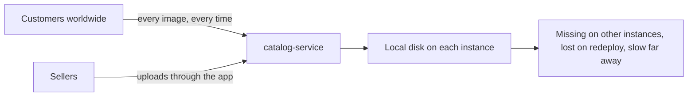
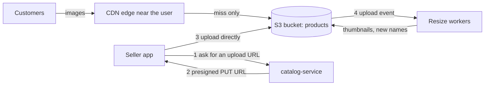

# Object Storage and Content Delivery Networks

**System design · Step 14.12 · Intermediate** · Last updated 2026-10-22
**Prerequisites:** [Load balancing](05-load-balancing.md) (14.5) and [Caching](06-caching.md) (14.6); helpful: [Scaling out](04-scaling-out-stateless-services.md) (14.4), where files on local disk were listed as hidden state

## 1. What it is and why it matters

**What is it?** **Object storage** keeps files (images, videos, PDFs, exports, backups) as **objects** in **buckets**, each found by a **key**, behind an HTTP API, with practically unlimited capacity. Amazon S3 is the best-known example. A **content delivery network (CDN)** is a set of caching servers at **edge locations** around the world that serve those files, and other cacheable responses, from near the user, fetching from the **origin** only on a miss.

**Why do we need it?** Files don't belong on application servers: a file on one instance's disk is missing on the others and lost when the instance is replaced ([14.4](04-scaling-out-stateless-services.md)), and serving large files through the application uses its bandwidth and threads. Files don't belong in the database either, which is expensive per gigabyte and slow for large blobs. And users far from the data centre wait for every byte to cross the world; a CDN shortens that trip.

**When would I meet it?** For every image, video, document or download a product has; for user uploads; for static web assets (scripts, stylesheets); for exports and reports ([14.11](11-asynchronous-processing.md)); and whenever a page is slow for users on another continent.

> [!TIP]
> **Memory hook:** bytes go to **object storage**, users get them from the **edge**, and the application only hands out **names and permissions**.

## 2. Industry terms

| Term | Simple meaning | Why it matters | Example | Related terms |
|---|---|---|---|---|
| **Object storage** | Files stored as objects with metadata, found by bucket and key, over HTTP | Scales without managing disks; shared by all instances | `s3://shopflow-media/products/hoodie.9b1c.jpg` | Block storage (disks), file storage (shared file systems) |
| **CDN and edge location** | Caching servers near users, and the places they run | Shorter distance, lower latency, less load on the origin | Amazon CloudFront edge locations | Point of presence (PoP) |
| **Origin** | Where the CDN fetches content it doesn't have | Must survive the CDN's misses | The S3 bucket, or `catalog-service` for HTML | Origin shield |
| **TTL and `Cache-Control`** | How long a cache may keep a response, set by HTTP headers or CDN settings | Decides freshness and origin load | `Cache-Control: public, max-age=31536000, immutable` | `s-maxage`, `private`, `no-store` |
| **Invalidation** | Telling the CDN to drop cached copies before they expire | Fixes mistakes; slower and costlier than renaming | Invalidate `/img/logo.png` | Purge |
| **Versioned (fingerprinted) URL** | A new file name for every new version, often a content hash | New content appears at once; old copies can be cached forever | `hoodie.3f2a.jpg` becomes `hoodie.9b1c.jpg` | Cache busting |
| **Presigned (signed) URL** | A URL that carries a time-limited permission, checked by the storage service | Clients upload or download directly, without streaming bytes through the application | A 5-minute link to Ana's invoice | Bearer token |
| **Multipart upload** | Uploading a large object in parts, which can be sent in parallel and retried one by one | Large uploads survive network errors | A 10 GB video in 100 parts | Resumable upload |
| **Storage class and lifecycle** | Cheaper tiers for rarely read data, and rules that move or delete objects over time | Storage cost over years | Exports deleted after 7 days; old invoices moved to an archive tier | Archive, retention |

## 3. In a real system (ShopFlow)

**The business problem.** ShopFlow shows about ten images on every product page, sellers in its marketplace upload photos and videos, and every order has a PDF invoice that only its customer may download. The first version stored images on the application servers' disks, served them through `catalog-service`, and accepted uploads through the same service.



With 15 instances, an image uploaded to one instance was missing on the others; deploys lost uploads; image traffic used the bandwidth and threads that checkout needed; and customers in other continents waited for every image to cross the ocean.

**How object storage and a CDN help.**



Images live in a bucket and reach customers through the CDN with versioned names and long TTLs. Sellers upload **directly** to the bucket with a presigned URL; an upload event starts the resize workers ([14.11](11-asynchronous-processing.md)). Invoices sit in a private bucket and are downloaded through short-lived signed URLs, so the application checks who may download, but never streams the file itself.

**What it costs.** Storage and, above all, **data transfer** are billed, so egress needs watching. CDN behaviour depends on headers that are easy to get wrong (a private file cached publicly, or a changed file served for a day). And uploads that bypass the application need their checks elsewhere: size and type limits in the presigned request, and validation or scanning after upload.

**Elsewhere:** a video platform stores each video in several resolutions and streams small segments through a CDN, so most bytes never touch its own servers; a news site puts whole article pages behind a CDN for a minute, absorbing traffic spikes from breaking news; a software vendor serves downloads through signed URLs so that only paying customers can fetch them.

## 4. How it works

**Object storage, in five points:**

1. **Objects, keys, buckets:** an object is the file plus metadata (content type, cache headers); the key is its unique name within a bucket. There are no real folders, only key prefixes such as `products/`.
2. **Whole-object writes:** a `PUT` replaces the whole object; there is no editing in place. Amazon S3 states that updates to a single key are atomic: a concurrent read gets "either the old data or the new data, but never partial or corrupt data".
3. **Consistency:** S3 "provides strong read-after-write consistency for PUT and DELETE requests" in all regions: once a `PUT` succeeds, later reads and listings see it. (AWS announced this on 1 December 2020; before that, S3 was eventually consistent, so a write was not always visible to every read straight away, which is why older designs avoided overwriting keys.) Two concurrent `PUT`s to one key are resolved by last writer wins.
4. **Durability and availability:** S3 Standard is "designed to provide 99.999999999% durability and 99.99% availability of objects over a given year". Durability (not losing data) and availability (being able to read it now) are different numbers.
5. **Large objects:** S3 recommends multipart upload from about 100 MB; parts are 5 MiB to 5 GiB, at most 10,000 per upload, and an object can be up to 48.8 TiB.

**A CDN request, step by step:**

1. DNS sends the user to a nearby edge location.
2. The edge looks up the response by its **cache key** (by default, essentially the URL).
3. **Hit:** it returns the cached copy, within its TTL.
4. **Miss or expired:** it asks the origin (or a regional cache in between, an **origin shield**); if the content hasn't changed, the origin can answer `304 Not Modified`, which saves sending it again.
5. It stores the response for as long as the TTL allows, which comes from the origin's `Cache-Control` header, bounded by the CDN's minimum and maximum TTL. CloudFront, without a cache policy and without headers from the origin, keeps objects for **24 hours** by default.

The programs below are illustrations and arithmetic; how to run them is in [the Java overview](../13-java/01-java-overview.md), section 5.

### Worked example 1: a signed URL carries the permission

**Concept.** The application decides **who** may download a file and creates a URL that includes the path, an expiry time and a signature over both, made with a secret the storage service also knows. The storage service checks the signature on each request, so it can serve the file without asking the application. This program uses a simple HMAC scheme to show the idea; S3's presigned URLs use AWS Signature Version 4, and CloudFront's signed URLs use key pairs.

```java
// File: SignedUrlDemo.java (runnable, Java 21)
import java.nio.charset.StandardCharsets;
import java.security.MessageDigest;
import java.util.HexFormat;
import javax.crypto.Mac;
import javax.crypto.spec.SecretKeySpec;

public class SignedUrlDemo {

    // Known only to order-service and the storage service. Illustration only: real services
    // use their own schemes (S3: AWS Signature Version 4; CloudFront: key pairs).
    static final byte[] SECRET = "demo-secret-do-not-use".getBytes(StandardCharsets.UTF_8);

    static String sign(String method, String path, long expiresAt) throws Exception {
        Mac mac = Mac.getInstance("HmacSHA256");
        mac.init(new SecretKeySpec(SECRET, "HmacSHA256"));
        byte[] sig = mac.doFinal((method + "\n" + path + "\n" + expiresAt).getBytes(StandardCharsets.UTF_8));
        return HexFormat.of().formatHex(sig);
    }

    // What the storage service checks on every request, without asking order-service.
    static String verify(String method, String path, long expiresAt, String signature, long now) throws Exception {
        if (now > expiresAt) {
            return "403 expired";
        }
        byte[] expected = sign(method, path, expiresAt).getBytes(StandardCharsets.UTF_8);
        boolean ok = MessageDigest.isEqual(expected, signature.getBytes(StandardCharsets.UTF_8));   // constant-time compare
        return ok ? "200 OK, file sent" : "403 bad signature";
    }

    public static void main(String[] args) throws Exception {
        long now = 1_800_000_000L;                         // seconds
        long expires = now + 300;                          // valid for 5 minutes
        String path = "/invoices/o-1001.pdf";
        String sig = sign("GET", path, expires);

        System.out.println("URL given to Ana: " + path + "?expires=" + expires + "&sig=" + sig.substring(0, 16) + "...");
        System.out.println("Ana, after 1 minute:          " + verify("GET", path, expires, sig, now + 60));
        System.out.println("Ana, after 10 minutes:        " + verify("GET", path, expires, sig, now + 600));
        System.out.println("Ben edits the path to o-1002: " + verify("GET", "/invoices/o-1002.pdf", expires, sig, now + 60));
        System.out.println("Ben extends the expiry:       " + verify("GET", path, expires + 86_400, sig, now + 60));
    }
}
```

**Expected output**:

```text
URL given to Ana: /invoices/o-1001.pdf?expires=1800000300&sig=a75f1996ac1bd662...
Ana, after 1 minute:          200 OK, file sent
Ana, after 10 minutes:        403 expired
Ben edits the path to o-1002: 403 bad signature
Ben extends the expiry:       403 bad signature
```

**Walkthrough.** Ana's URL works for five minutes. Changing the path or the expiry changes what the signature should be, and Ben can't compute the right one without the secret, so both edits are rejected. Anyone who **has** the URL can use it until it expires, though; it is a bearer token, which AWS's documentation says to "protect appropriately". Keep signed URLs short-lived for private files. S3's own presigned URLs can be valid for up to 7 days with long-term IAM user credentials, and they expire earlier if the credentials that signed them (for example a role's temporary credentials) expire first.

### Worked example 2: replacing a file behind a CDN

**Concept.** A CDN keeps a cached copy for its TTL. Replacing a file **under the same URL** means users see the old version until the TTL ends (or an invalidation). Uploading the new version **under a new name** and linking to it shows it immediately, and the old copy can stay cached harmlessly.

```java
// File: CdnVersioningDemo.java (runnable, Java 21)
import java.util.HashMap;
import java.util.Map;

public class CdnVersioningDemo {

    // The origin (object storage) and one CDN edge with a 24-hour TTL. Time is in hours.
    static final Map<String, String> origin = new HashMap<>();
    static final Map<String, String> edge = new HashMap<>();
    static final Map<String, Integer> cachedAt = new HashMap<>();
    static final int TTL_HOURS = 24;
    static int originFetches = 0;

    static String get(String url, int hour) {
        Integer at = cachedAt.get(url);
        if (at != null && hour < at + TTL_HOURS) {
            return edge.get(url) + " (edge)";
        }
        originFetches++;
        edge.put(url, origin.get(url));
        cachedAt.put(url, hour);
        return edge.get(url) + " (origin)";
    }

    public static void main(String[] args) {
        System.out.println("Same URL, file replaced in place");
        origin.put("/img/hoodie.jpg", "red hoodie photo");
        System.out.println("  hour 0   " + get("/img/hoodie.jpg", 0));
        origin.put("/img/hoodie.jpg", "blue hoodie photo");          // the product photo is replaced
        System.out.println("  hour 1   photo replaced at the origin");
        System.out.println("  hour 2   " + get("/img/hoodie.jpg", 2));
        System.out.println("  hour 25  " + get("/img/hoodie.jpg", 25));

        System.out.println("Versioned URL: a new name for new content");
        origin.put("/img/hoodie.3f2a.jpg", "red hoodie photo");
        System.out.println("  hour 0   " + get("/img/hoodie.3f2a.jpg", 0));
        origin.put("/img/hoodie.9b1c.jpg", "blue hoodie photo");     // uploaded under a new name
        System.out.println("  hour 1   new photo uploaded as hoodie.9b1c.jpg; the page now links to it");
        System.out.println("  hour 2   " + get("/img/hoodie.9b1c.jpg", 2));
        System.out.println("  hour 3   " + get("/img/hoodie.9b1c.jpg", 3));
        System.out.println("origin fetches in total: " + originFetches);
    }
}
```

**Expected output**:

```text
Same URL, file replaced in place
  hour 0   red hoodie photo (origin)
  hour 1   photo replaced at the origin
  hour 2   red hoodie photo (edge)
  hour 25  blue hoodie photo (origin)
Versioned URL: a new name for new content
  hour 0   red hoodie photo (origin)
  hour 1   new photo uploaded as hoodie.9b1c.jpg; the page now links to it
  hour 2   blue hoodie photo (origin)
  hour 3   blue hoodie photo (edge)
origin fetches in total: 4
```

**Walkthrough.**

| | Same URL | Versioned URL |
|---|---|---|
| Hour 2, after the change | **Red** photo from the edge: wrong for up to 24 hours | **Blue** photo: a new URL is a guaranteed miss |
| How to fix it faster | Invalidate the path at the CDN (takes time, may cost money) | Nothing to do |
| TTL you can afford | Short, because the content may change | Very long: the content behind a name never changes |

This is why CloudFront's documentation recommends "a version identifier in file names or in folder names", and why build tools fingerprint static assets. With versioned names, the response can say `Cache-Control: public, max-age=31536000, immutable`: RFC 8246's `immutable` tells clients that "the origin server will not update the representation of that resource during the freshness lifetime", so browsers don't even revalidate on reload.

**Experiment.** Predict first: with a 1-hour TTL instead of 24 (`TTL_HOURS = 1`), does the same-URL case show the right photo at hour 2, and what happens to the number of origin fetches? The result is in Answers.

### Worked example 3: why the origin needs a shield

**Concept.** Every edge location caches independently, so a popular file is fetched from the origin once per edge per TTL. A **regional cache layer** (CloudFront calls it Origin Shield) in front of the origin collapses those fetches.

```java
// File: OriginShield.java (runnable, Java 21)
import java.util.Locale;

public class OriginShield {

    public static void main(String[] args) {
        long hotImages = 10_000;          // images requested everywhere, every day
        long edgeLocations = 300;         // illustrative
        long shields = 1;                 // one regional cache layer between the edges and the origin

        System.out.println("TTL      origin fetches a day without a shield   with a shield");
        for (int ttlHours : new int[] {1, 24}) {
            long refreshesPerDay = 24 / ttlHours;
            long withoutShield = hotImages * edgeLocations * refreshesPerDay;   // every edge refreshes on its own
            long withShield = hotImages * shields * refreshesPerDay;            // the edges refresh from the shield
            System.out.println(String.format(Locale.ROOT, "%3d h    %,18d                    %,10d",
                    ttlHours, withoutShield, withShield));
        }
    }
}
```

**Expected output**:

```text
TTL      origin fetches a day without a shield   with a shield
  1 h            72,000,000                       240,000
 24 h             3,000,000                        10,000
```

**Walkthrough.** With 300 edges, each refreshing 10,000 hot images every hour, the origin receives 72 million requests a day. A shield receives them instead and asks the origin once per image per TTL: 240,000. The longer the TTL, the smaller both numbers, which is another argument for versioned names with long TTLs. The figures assume every hot image is requested at every edge in every TTL period, the worst case; real numbers are lower and depend on traffic.

### Choosing `Cache-Control` per kind of response

| Response | Header | Why |
|---|---|---|
| Fingerprinted image, script, stylesheet | `public, max-age=31536000, immutable` | A new version gets a new name |
| Product page HTML | A short shared lifetime, for example `s-maxage=60` (the CDN may keep it 60 s), with a short or zero `max-age` for browsers | Fresh enough, while spikes are absorbed by the CDN |
| A customer's order page | `private` (RFC 9111: "a shared cache MUST NOT store the response") or `no-store` | Personal data must never be cached for everyone |
| Invoice PDF | Private bucket, short signed URL, `no-store` | Only its customer, only briefly |
| Price at checkout | Not cached | The source of truth decides ([14.6](06-caching.md)) |

## 5. Failure scenarios

### The old photo for a day

1. **What happened?** A seller replaced a wrong product photo. Customers kept seeing the wrong one for hours, and the seller filed a complaint.
2. **Why?** The new photo was uploaded under the same key, and the CDN had cached the old one for 24 hours.
3. **What did users see?** A product that didn't match its description.
4. **Solutions:** upload every new version under a new, content-hashed name and update the reference; use invalidation only for mistakes.
5. **What they cost:** old versions accumulate in storage (delete them with a lifecycle rule after a while); references must be updated.

### Personal data served to everyone

1. **What happened?** After a CDN configuration change, some customers saw another customer's order page.
2. **Why?** The order page had no `private` or `no-store` header, and the new cache behaviour cached responses by URL only, ignoring the session cookie.
3. **What did the business see?** A data-protection incident.
4. **Solutions:** mark personal responses `private` or `no-store`; keep personal pages out of CDN caching behaviours by path; keep buckets private (S3 enables Block Public Access by default) and use signed URLs; test the caching of personal pages after every CDN change.
5. **What they cost:** a review step for CDN changes; personal pages always reach the origin.

### Uploads that took checkout down

1. **What happened?** During a seller onboarding campaign, sellers uploaded thousands of large videos through `catalog-service`, and product pages slowed down.
2. **Why?** Each upload held a request thread for minutes on slow connections (Little's law, [14.5](05-load-balancing.md)), and the bytes used the instances' bandwidth.
3. **What did users see?** Slow pages for everyone, while the servers' CPUs were nearly idle.
4. **Solutions:** direct uploads to the bucket with presigned URLs, multipart for large files; processing triggered by upload events; limits on size and type in the presigned request.
5. **What they cost:** validation and scanning move after the upload; an orphaned-upload clean-up rule.

### The origin after a mass invalidation

1. **What happened?** A wildcard invalidation emptied the CDN of every product image at once, and the origin was flooded with misses from every edge.
2. **Why?** Same as a cache stampede ([14.6](06-caching.md)), multiplied by the number of edge locations.
3. **What did users see?** Slow images until the caches refilled.
4. **Solutions:** versioned names instead of invalidations; an origin shield; invalidate narrowly and outside peak hours.
5. **What they cost:** the shield is one more cache layer to pay for.

## 6. Architectural decisions

| Store files in | When | Avoid when |
|---|---|---|
| **Object storage** | Images, videos, documents, exports, backups, data-lake files: written whole, read often | You need to edit parts of a file in place or need a POSIX file system (use block or file storage) |
| **The database** | Small values that belong to a row and need its transactions (a short text, a small thumbnail at most) | Large files: costly, slow, and they bloat backups and replicas |
| **Local disk** | Temporary scratch space during one request or job | Anything another instance or a later request needs |

| CDN decision | Choose | Because |
|---|---|---|
| What to put behind it | Static assets always; public pages with a short shared TTL; personal pages never cached | Most bytes are cacheable; personal data must not be |
| How to update content | Versioned names; invalidation only for mistakes | Immediate, cheap and safe |
| How to protect private files | Private bucket, signed URLs, short expiry | The application checks access without serving bytes |

**Common mistakes:** files on application disks; same-name updates with long TTLs; public buckets for private files; uploads through the application; no lifecycle rules (exports and old versions kept forever); forgetting that data transfer out is often the largest storage bill.

## 7. Try it yourself

Try each exercise first; the solutions are in the Answers section, the first as a runnable program.

1. **A large upload.** A seller uploads a 10 GB video. How many parts are there with 8 MB and with 100 MB parts, and what does one failed part cost to resend? About how large must parts be for the largest allowed object?
2. **Headers for each response.** Choose `Cache-Control` for: (a) `app.4f7a.js`; (b) the home page HTML, which changes a few times an hour; (c) `GET /api/cart`; (d) a public seller logo whose URL never changes; (e) an export file for one customer.
3. **Design the seller image upload.** From "seller picks a file" to "resized images on product pages worldwide", list the steps and the checks.

## 8. Check your understanding

1. Why shouldn't product images be served by `catalog-service` from its local disk, even with a single instance?
2. A product photo was replaced, and customers still see the old one. Why, and what would have prevented it?
3. What protects a presigned download URL, and what doesn't?
4. Durability is designed at eleven nines, availability at four. What is the difference, and which matters when a page can't load an image?

Answers are at the end of this note.

## 9. Revision

**Remember**
- Files go to **object storage**; users fetch them from a **CDN**; the application hands out **names and signed URLs**.
- S3: strong read-after-write consistency, whole-object writes, multipart for large files, durability is not availability.
- **Versioned names + long TTL + `immutable`** for static content; invalidation only for mistakes.
- Personal responses: `private` or `no-store`; private files: private bucket and short signed URLs.
- Uploads go **directly** to storage with presigned URLs; processing follows from upload events.

**Explain in 15 seconds:** "Files go into object storage, which scales without disks and is shared by all instances, and reach users through a CDN that caches them near the users. The application only authorises access with signed URLs and never streams the bytes itself."

**Explain in 60 seconds:**
> "I keep files out of application servers and databases. They go into object storage such as S3: buckets and keys over HTTP, whole-object writes, strong read-after-write consistency, very high durability, and multipart uploads for large files. Users get them from a CDN, which caches them at edge locations near them and only asks the origin on a miss; an origin shield collapses the misses of many edges. For updates I use versioned file names, so new content shows immediately and I can cache with long TTLs and the immutable directive, and I keep invalidation for mistakes. Personal responses are marked private or no-store, and private files stay in a private bucket, downloaded through short-lived signed URLs. Uploads go straight to the bucket with presigned URLs, and an upload event triggers processing such as resizing. The main costs to watch are data transfer and wrong cache headers."

**Likely follow-up questions:**
- **How do you serve images in several sizes?** Resize on upload into fixed sizes with versioned names, or resize on demand at the edge or in a service and cache the results.
- **How do you delete data everywhere?** Delete from storage, and the CDN copies expire with their TTL; for personal data, use short TTLs or no caching at all, so deletion takes effect quickly.
- **What is an origin shield?** A regional cache between the edges and the origin, so the origin sees one miss per object per TTL instead of one per edge.
- **What about cost?** Storage classes and lifecycle rules for old data; the CDN reduces origin egress; watch data transfer, which often costs more than storage.

**Architect's takeaway:** treat bytes and permissions separately. Bytes are stored and delivered by services built for it; the application's job is to decide who may see which bytes, and to name new versions so caches never have to guess.

**Next topic:** [Unique ID generation](13-unique-id-generation.md) (14.13)

## 10. Verification and sources

> [!NOTE]
> Checked 2026-10-22 against AWS documentation and the RFCs below. All programs were run on OpenJDK 21.0.8, and the repository's example checker compares their output. Re-verify when you revisit this note.

- **Confirmed:** S3 "provides strong read-after-write consistency for PUT and DELETE requests of objects ... in all AWS Regions"; single-key updates are atomic; concurrent writes are resolved by last-writer-wins; buckets and objects are private by default and Block Public Access is on by default (AWS, "What is Amazon S3?"). S3 Standard is "designed to provide 99.999999999% durability and 99.99% availability of objects over a given year" (AWS, "Data protection in Amazon S3"). Multipart uploads: consider them from 100 MB; parts of 5 MiB to 5 GiB, at most 10,000; objects up to 48.8 TiB (AWS, "Amazon S3 multipart upload limits"). Presigned URLs grant time-limited access with the signer's credentials, up to 7 days with IAM user credentials and SigV4, expire with temporary credentials, and are bearer tokens to protect (AWS, "Download and upload objects with presigned URLs"). Strong read-after-write consistency was announced on 1 December 2020, replacing the earlier eventual consistency (AWS What's New, "Amazon S3 now delivers strong read-after-write consistency automatically for all applications"). CloudFront's default TTL is 24 hours without a cache policy; `max-age` and `s-maxage` interact with minimum and maximum TTL; CloudFront supports `stale-while-revalidate` and `stale-if-error` (AWS, "Manage how long content stays in the cache"); CloudFront recommends a version identifier in file or folder names (AWS, "Update existing files using versioned file names"). RFC 8246 defines `immutable`; RFC 9111 defines `private` ("a shared cache MUST NOT store the response"). All read 2026-10-22.
- **Assumptions and illustrations:** the signed-URL program is a simplified HMAC scheme to show the idea, not S3's or CloudFront's format, and its secret is a placeholder. The CDN and origin-shield programs are simplified models (one edge, fixed TTL; the worst case for the shield). The 300 edge locations, 10,000 hot images and all ShopFlow figures are illustrative.
- **To verify:** your CDN's current cache-key and header behaviour; your provider's data transfer prices; whether your object storage (if not S3) offers the same consistency.
- **Decision rule:** files in object storage, delivered through a CDN; versioned names for anything public that changes; personal data never in shared caches; uploads and downloads of private files through short-lived signed URLs.

**Sources:** AWS documentation: "What is Amazon S3?", "Data protection in Amazon S3", "Amazon S3 multipart upload limits", "Download and upload objects with presigned URLs"; Amazon CloudFront Developer Guide: "Manage how long content stays in the cache (expiration)", "Invalidate files to remove content", "Update existing files using versioned file names"; RFC 8246, "HTTP Immutable Responses"; RFC 9111, "HTTP Caching".

## Answers

**Experiment**

- **1-hour TTL** (worked example 2): the same-URL case now shows the **blue** photo at hour 2, because the copy cached at hour 0 expired at hour 1. Origin fetches rise from **4 to 6**: the versioned file is fetched again at hour 3 too, although it never changed. Short TTLs buy freshness for same-name updates with origin load; versioned names give freshness without it.

**Check your understanding**

1. Because the file is then tied to that instance: a second instance doesn't have it, a replacement instance loses it, and every image request uses the application's threads and bandwidth instead of a service built for files. Users far away also wait for every image to cross the world; a CDN fixes that.
2. The new photo was uploaded under the same URL, and the CDN (and browsers) kept the cached copy until its TTL ran out. Uploading new versions under new, versioned names and updating the reference would have shown the new photo at once; an invalidation is the fix after the fact.
3. The signature protects the **path, the method and the expiry**: nobody can change them without the secret. Nothing protects the URL itself from being shared or leaked: whoever has it can use it until it expires, so keep it short-lived for private files, and send it only to the user who may use it.
4. **Durability** is about not losing the data, ever; **availability** is about being able to read it right now. A page that can't load an image is an **availability** problem: the image is safe but temporarily unreachable; a CDN with cached copies, and `stale-if-error`, help with that.

**Practice exercises**

1. **A large upload:**

```java
// File: MultipartMath.java (runnable, Java 21)
import java.util.Locale;

public class MultipartMath {

    public static void main(String[] args) {
        double fileMb = 10_000;                       // a 10 GB product video
        int maxParts = 10_000;                        // S3's limit per upload

        for (int partMb : new int[] {8, 100}) {
            int parts = (int) Math.ceil(fileMb / partMb);
            System.out.println(String.format(Locale.ROOT,
                    "%3d MB parts: %,5d parts (limit %,d); one failed part costs %,4d MB to resend instead of %,.0f MB",
                    partMb, parts, maxParts, partMb, fileMb));
        }
        double maxObjectTiB = 48.8;
        double gibPerPart = maxObjectTiB * 1024 / maxParts;
        System.out.println(String.format(Locale.ROOT, "largest object (%.1f TiB) needs parts of about %.1f GiB", maxObjectTiB, gibPerPart));
    }
}
```

**Expected output**:

```text
  8 MB parts: 1,250 parts (limit 10,000); one failed part costs    8 MB to resend instead of 10,000 MB
100 MB parts:   100 parts (limit 10,000); one failed part costs  100 MB to resend instead of 10,000 MB
largest object (48.8 TiB) needs parts of about 5.0 GiB
```

With 8 MB parts, 1,250 parts, and a failed part costs 8 MB; with 100 MB parts, 100 parts and 100 MB. Either way, a failure costs one part instead of the whole 10 GB. Parts can also be uploaded in parallel. For the largest object, parts must be close to the 5 GiB maximum, because there can be at most 10,000.

2. **Headers:** (a) `app.4f7a.js`: `public, max-age=31536000, immutable`. (b) Home page HTML: `s-maxage=60` (or similar) for the CDN, a short `max-age` or `no-cache` for browsers, optionally `stale-while-revalidate`. (c) `GET /api/cart`: `private, no-store`, personal and changing. (d) A logo whose URL never changes: a moderate TTL (for example a day) and accept a slow update, or better, give it a versioned URL. (e) A customer's export: private bucket, short signed URL, `no-store`.

3. **Seller image upload:** (1) The seller app asks `catalog-service` for an upload URL for a product; the service checks the seller owns the product and creates a presigned `PUT` for a new key (for example a random id), limited to image types and a maximum size, valid for a few minutes. (2) The app uploads directly to the bucket (multipart for large files). (3) The upload event goes to a queue; a worker validates the file (type, dimensions, malware scan), creates the sizes the site needs under content-hashed names, and records them on the product through the outbox ([14.11](11-asynchronous-processing.md)). (4) Product pages reference the new names, served by the CDN with long TTLs and `immutable`. (5) A lifecycle rule deletes unprocessed or replaced uploads after some days.

Back to [the System design overview](01-system-design-overview.md) · [the index](../README.md) · [Roadmap](../roadmap.md).
