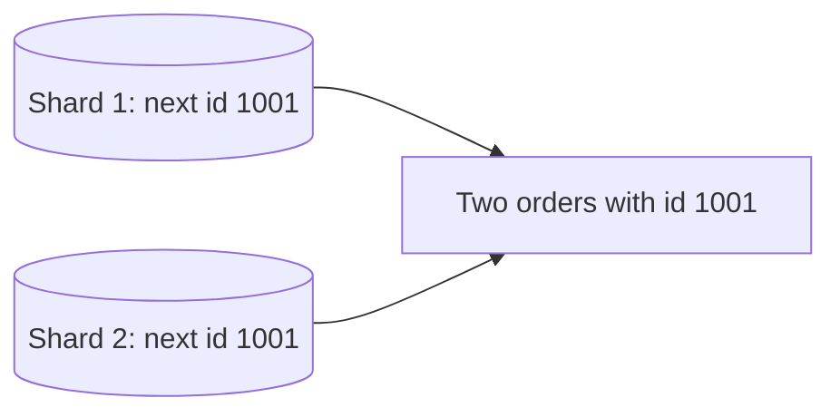

# Unique ID Generation

**System design · Step 14.13 · Intermediate** · Last updated 2026-10-22
**Prerequisites:** [Partitioning and sharding](09-partitioning-sharding.md) (14.9); helpful: [Choosing a database](07-choosing-a-database.md) (14.7), for how indexes are ordered

**Version note**

| Item | Version |
|---|---|
| Baseline | `java.util.UUID` since Java 1.5: `randomUUID()` (version 4) and `nameUUIDFromBytes()` (version 3) |
| Newer standard covered | UUID version 7: RFC 9562 (May 2024), which obsoletes RFC 4122 |
| Hands-on baseline | Java 21, tested with OpenJDK 21.0.8; Java 21 has no built-in factory for version 7, so the example builds one |

## 1. What it is and why it matters

**What is it?** Choosing how a system creates **identifiers** (ids) for orders, payments, events and files, so that no two are ever the same, even when many machines create them at the same moment without talking to each other.

**Why do we need it?** A single database's auto-increment column works until there is more than one place that creates rows. With shards ([14.9](09-partitioning-sharding.md)), several regions, or ids created before anything is saved (an idempotency key, an event id, an upload key), each creator needs ids that can't clash. And the choice has side effects: whether ids are **sortable by time**, how well they suit a **database index**, how **long** they are, and whether they **reveal** business information or can be **guessed**.

**When would I meet it?** When sharding a table; when events and messages need ids before they're stored ([14.11](11-asynchronous-processing.md)); when choosing primary keys for a new service; and when a security review asks why order ids in URLs are sequential.

> [!TIP]
> **Memory hook:** a good id is **unique without coordination**, **ordered by time** if it is a database key, and **meaningless** to outsiders.

## 2. Industry terms

| Term | Simple meaning | Why it matters | Example | Related terms |
|---|---|---|---|---|
| **Auto-increment** | The database hands out 1, 2, 3, ... | Simple, compact and ordered, but tied to one writer | MySQL `AUTO_INCREMENT` | Sequence |
| **UUID** | A 128-bit identifier in a standard format | Can be created anywhere without coordination | `ba419d35-0dfe-4af7-aee7-bbe10c45c028` | GUID |
| **UUID version 4** | 122 random bits | Practically never collides, but has no order | `UUID.randomUUID()` in Java | Random id |
| **UUID version 7** | Millisecond Unix time in the first 48 bits, then random bits (RFC 9562) | Unique **and** sorted by creation time, so friendlier to indexes | `01a2ce8b-d400-7ce4-...` | ULID (a similar, earlier format) |
| **Snowflake id** | A 64-bit id made of a timestamp, a worker number and a sequence | Compact, time-ordered, no coordination per id; each worker needs a unique number | 41 bits time, 10 bits worker, 12 bits sequence | Twitter Snowflake |
| **Collision** | Two different things getting the same id | Silent data corruption: one record overwrites or hides another | Two pods with the same worker number | Birthday problem |
| **Index locality** | New keys landing next to each other in an index | Time-ordered keys append at the end; random keys insert everywhere | A B-tree primary key | Page splits |
| **Guessable id (enumeration)** | Ids that let someone predict other valid ids | Leaks volumes and invites access to other people's data if checks are missing | `/orders/1001`, `/orders/1002` | IDOR (insecure direct object reference) |

## 3. In a real system (ShopFlow)

**The business problem.** ShopFlow's orders table uses MySQL `AUTO_INCREMENT`. Three things now need more: orders are being sharded by customer over 16 shards ([14.9](09-partitioning-sharding.md)), so each shard's counter would produce the same numbers; events in the outbox need ids before they reach Kafka; and a security review notes that `/orders/1001`, `/orders/1002` tells competitors how many orders ShopFlow takes per day.



**How the choice is made.**
- **Order primary keys** inside the database: time-ordered ids (Snowflake-style or UUID version 7), so inserts append to the index, created by the service itself without a central counter; the shard number is part of what the service stores with the order, or of the public id ([14.9](09-partitioning-sharding.md), worked example 1).
- **Event ids and idempotency keys:** UUID version 7 (or version 4), created where the event is created.
- **What customers see:** not the internal key, but an id that doesn't reveal volumes, for example a random-looking order number, and every request still checks that the order belongs to the customer.

**What it costs.** Larger keys than a 32-bit counter (64 or 128 bits), which take space in every index; worker numbers to assign and protect for Snowflake ids; and clocks that must be roughly right, because time-based ids depend on them.

**Elsewhere:** social networks use Snowflake-style ids so posts sort by time without a separate timestamp; payment providers expose random-looking ids with a type prefix (`pay_...`) so they are unguessable and self-describing; distributed databases often generate time-ordered UUIDs to keep their indexes efficient.

## 4. How it works

**What we want from an id**, and the trade-offs between them:

1. **Unique**, without asking a central service for every id.
2. **Ordered by time**, if it is a database key or something people sort by.
3. **Small**: 64 bits fits a `BIGINT`; 128 bits needs `BINARY(16)` or a 36-character string.
4. **Not guessable**, where it is shown to outsiders.
5. **Robust to failures**: clock jumps, restarts, two machines configured alike.

**The options:**

| Scheme | Unique how | Ordered | Size | Coordination |
|---|---|---|---|---|
| Auto-increment | One database counts | Yes | 32 or 64 bits | One writer (or MySQL's `auto_increment_increment` and `auto_increment_offset`, made for circular replication, to give each primary different numbers) |
| Block allocation ("hi/lo") | A central table hands out blocks of, say, 1,000 ids; each instance uses its block locally | Roughly | 64 bits | One call per block |
| UUID version 4 | 122 random bits | No | 128 bits | None |
| UUID version 7 | Time plus 74 random bits | By millisecond | 128 bits | None |
| Snowflake-style | Time, worker number and sequence | By millisecond | 64 bits | Unique worker numbers |

The programs below are exact; how to run them is in [the Java overview](../13-java/01-java-overview.md), section 5.

### Worked example 1: a Snowflake-style generator

**Concept.** A 64-bit id packs three parts: the **milliseconds** since a chosen epoch (41 bits), the **worker number** (10 bits) and a **sequence** within the millisecond (12 bits). Two workers can never produce the same id if their numbers differ, and one worker never repeats because its sequence or time always moves forward. The layout follows Twitter's Snowflake (2010), as described in secondary sources.

```java
// File: SnowflakeDemo.java (runnable, Java 21)
import java.util.ArrayList;
import java.util.List;
import java.util.function.LongSupplier;

public class SnowflakeDemo {

    // A Snowflake-style 64-bit id: 1 unused sign bit, 41 bits of milliseconds since a custom epoch,
    // 10 bits of worker id, 12 bits of sequence within the millisecond.
    static final long EPOCH = 1_767_225_600_000L;            // 2026-01-01T00:00:00Z
    static final int WORKER_BITS = 10, SEQUENCE_BITS = 12;
    static final long MAX_SEQUENCE = (1L << SEQUENCE_BITS) - 1;   // 4,095

    static class Generator {
        final long workerId;
        final LongSupplier clock;
        long lastMs = -1, sequence = 0;

        Generator(long workerId, LongSupplier clock) {
            this.workerId = workerId;
            this.clock = clock;
        }

        long next() {
            long now = clock.getAsLong();
            if (now < lastMs) {
                throw new IllegalStateException("clock moved backwards by " + (lastMs - now) + " ms");
            }
            if (now == lastMs) {
                sequence = (sequence + 1) & MAX_SEQUENCE;
                if (sequence == 0) {                           // 4,096 ids used in this millisecond
                    while (now <= lastMs) now = clock.getAsLong();
                }
            } else {
                sequence = 0;
            }
            lastMs = now;
            return ((now - EPOCH) << (WORKER_BITS + SEQUENCE_BITS)) | (workerId << SEQUENCE_BITS) | sequence;
        }
    }

    static String decode(long id) {
        long ms = (id >>> (WORKER_BITS + SEQUENCE_BITS)) + EPOCH;
        long worker = (id >>> SEQUENCE_BITS) & ((1L << WORKER_BITS) - 1);
        long seq = id & MAX_SEQUENCE;
        return "time " + (ms - EPOCH) + " ms after the epoch, worker " + worker + ", sequence " + seq;
    }

    public static void main(String[] args) {
        long t = EPOCH + 1_000;                                 // a fixed moment, for exact output
        Generator w1 = new Generator(1, () -> t);
        Generator w2 = new Generator(2, () -> t);

        System.out.println("Two workers, the same millisecond");
        List<Long> ids = new ArrayList<>(List.of(w1.next(), w1.next(), w2.next()));
        for (long id : ids) System.out.println("  " + id + "  " + decode(id));

        // Sequence exhausted: the 4,097th id in one millisecond waits for the next millisecond.
        long[] reads = {0};
        Generator busy = new Generator(3, () -> reads[0]++ < 4_096 ? t : t + 1);
        long last = 0;
        for (int i = 0; i < 4_097; i++) last = busy.next();
        System.out.println("4,097 ids in one millisecond on worker 3, the last one:");
        System.out.println("  " + last + "  " + decode(last));

        // The clock moves backwards (for example after an NTP correction).
        long[] times = {t + 5, t + 3};
        int[] call = {0};
        Generator jumpy = new Generator(4, () -> times[call[0]++]);
        jumpy.next();
        try {
            jumpy.next();
        } catch (IllegalStateException e) {
            System.out.println("Worker 4: " + e.getMessage() + ", no id issued");
        }
    }
}
```

**Expected output**:

```text
Two workers, the same millisecond
  4194308096  time 1000 ms after the epoch, worker 1, sequence 0
  4194308097  time 1000 ms after the epoch, worker 1, sequence 1
  4194312192  time 1000 ms after the epoch, worker 2, sequence 0
4,097 ids in one millisecond on worker 3, the last one:
  4198510592  time 1001 ms after the epoch, worker 3, sequence 0
Worker 4: clock moved backwards by 2 ms, no id issued
```

**Walkthrough.**

| Case | What happens | Why it stays unique |
|---|---|---|
| Worker 1, twice in one millisecond | Sequence 0, then 1 | The sequence separates ids within a millisecond |
| Worker 2, same millisecond | Different worker bits | Worker numbers separate machines |
| 4,097th id in one millisecond | Waits, then uses the next millisecond with sequence 0 | At most 4,096 ids per worker per millisecond |
| Clock moves backwards | Refuses to issue an id | Reusing an old millisecond could repeat an id |

The ids also **sort by time**: the time is in the highest bits, so a later id is a larger number (within the precision of each worker's clock).

**Experiment.** Predict first: give the second generator the **same** worker number as the first (`new Generator(1, ...)`). What do the first three ids look like? The result is in Answers.

### Worked example 2: UUID version 4 versus version 7

**Concept.** Both are 128-bit UUIDs that any machine can create. Version 4 is random; version 7 starts with the creation time in milliseconds, so ids created later sort later. Java 21's `UUID` creates version 4 (`randomUUID()`, using a cryptographically strong random generator) and version 3, but has no factory for version 7; the program builds both by hand from a **seeded** generator so the output is the same on every run.

```java
// File: UuidOrderDemo.java (runnable, Java 21)
import java.util.ArrayList;
import java.util.List;
import java.util.Random;
import java.util.UUID;

public class UuidOrderDemo {

    // A seeded generator so the output is the same on every run. Real UUIDs need a secure random
    // source: UUID.randomUUID() uses a cryptographically strong generator.
    static final Random random = new Random(42);

    // Version 4: 122 random bits, with the version (4) and variant bits set.
    static UUID v4() {
        long msb = (random.nextLong() & ~0xF000L) | 0x4000L;
        long lsb = (random.nextLong() & 0x3FFFFFFFFFFFFFFFL) | 0x8000000000000000L;
        return new UUID(msb, lsb);
    }

    // Version 7 (RFC 9562): 48-bit Unix time in milliseconds, then version 7, then random bits.
    static UUID v7(long unixMs) {
        long msb = (unixMs << 16) | 0x7000L | (random.nextInt() & 0x0FFF);
        long lsb = (random.nextLong() & 0x3FFFFFFFFFFFFFFFL) | 0x8000000000000000L;
        return new UUID(msb, lsb);
    }

    static boolean sortsInCreationOrder(List<UUID> created) {
        List<String> asText = new ArrayList<>(created.stream().map(UUID::toString).toList());
        List<String> sorted = new ArrayList<>(asText);
        sorted.sort(null);
        return asText.equals(sorted);
    }

    public static void main(String[] args) {
        long start = 1_798_761_600_000L;                    // 2027-01-01T00:00:00Z
        List<UUID> fours = new ArrayList<>(), sevens = new ArrayList<>();
        for (int i = 0; i < 4; i++) {
            fours.add(v4());
            sevens.add(v7(start + i));                      // created one millisecond apart
        }
        System.out.println("version 4, in creation order");
        fours.forEach(u -> System.out.println("  " + u + "  version " + u.version()));
        System.out.println("  sorts in creation order: " + sortsInCreationOrder(fours));
        System.out.println("version 7, in creation order");
        sevens.forEach(u -> System.out.println("  " + u + "  version " + u.version()));
        System.out.println("  sorts in creation order: " + sortsInCreationOrder(sevens));
    }
}
```

**Expected output**:

```text
version 4, in creation order
  ba419d35-0dfe-4af7-aee7-bbe10c45c028  version 4
  b52c856c-aa61-4abe-9761-0c99e74367bd  version 4
  46976cf7-b0bf-4e20-b6b2-0010c3185754  version 4
  26e6bc6f-6fbd-4f55-b096-b882bff9d9d6  version 4
  sorts in creation order: false
version 7, in creation order
  01a2ce8b-d400-7ce4-b12b-bb4b46ee9d83  version 7
  01a2ce8b-d401-77dc-9e68-8e9961b35c88  version 7
  01a2ce8b-d402-700f-bf88-a1e2eb5910f1  version 7
  01a2ce8b-d403-7852-a2f6-0bdbcc5c8305  version 7
  sorts in creation order: true
```

**Walkthrough.** The version-7 ids share their first characters (`01a2ce8b-d40`), which hold the time, and differ in the next digit, one millisecond apart; sorted as text they come out in creation order. The version-4 ids are in no order. In real code, the random part must come from a secure source, never a seeded `Random`; the seed here only makes the output reproducible.

### Worked example 3: how likely is a random collision?

**Concept.** Random ids can collide by chance. The **birthday problem** says the chance grows with the **square** of the number of ids: about n² ÷ (2 × 2^bits).

```java
// File: CollisionOdds.java (runnable, Java 21)
import java.util.Locale;

public class CollisionOdds {

    // Birthday approximation: the chance that n random ids drawn from 2^bits values contain a duplicate.
    static double chance(double n, int bits) {
        double x = n * (n - 1) / (2 * Math.pow(2, bits));
        return -Math.expm1(-x);                        // 1 - e^(-x), accurate for tiny x too
    }

    public static void main(String[] args) {
        System.out.println("ids generated    64 random bits    122 random bits (UUID version 4)");
        for (double n : new double[] {1e6, 1e9, 1e12}) {
            System.out.println(String.format(Locale.ROOT, "%10.0e        %10.2e        %10.2e",
                    n, chance(n, 64), chance(n, 122)));
        }
    }
}
```

**Expected output**:

```text
ids generated    64 random bits    122 random bits (UUID version 4)
     1e+06          2.71e-08          9.40e-26
     1e+09          2.67e-02          9.40e-20
     1e+12          1.00e+00          9.40e-14
```

**Walkthrough.** With **64 random bits**, a billion ids already have a **2.7%** chance of containing a duplicate, and a trillion make one almost certain. With the **122 random bits** of a version-4 UUID, a trillion ids still have a chance of about 1 in 10^13. That is why random ids need 122 bits, and why 64-bit ids use structure (time, worker, sequence) instead of randomness to stay unique.

### Worked example 4: why the order of keys matters to an index

**Concept.** A B-tree index keeps keys sorted. Keys that increase over time are always inserted at the **right-hand end**, so new entries go into the same few pages, which stay in memory. Random keys land **anywhere**, so inserts touch pages all over the index.

```java
// File: IndexLocality.java (runnable, Java 21)
import java.util.Locale;
import java.util.Random;
import java.util.TreeSet;

public class IndexLocality {

    // How many inserts land at the right-hand end of a sorted index (larger than every existing key)?
    static int appendsAtTheEnd(long[] keys) {
        TreeSet<Long> index = new TreeSet<>();
        int appends = 0;
        for (long k : keys) {
            if (index.isEmpty() || k > index.last()) appends++;
            index.add(k);
        }
        return appends;
    }

    public static void main(String[] args) {
        int n = 100_000;
        long[] timeOrdered = new long[n], random = new long[n];
        Random r = new Random(7);
        for (int i = 0; i < n; i++) {
            timeOrdered[i] = 1_000_000L + i;            // like Snowflake ids or UUID version 7
            random[i] = r.nextLong();                   // like UUID version 4
        }
        System.out.println(String.format(Locale.ROOT, "time-ordered keys: %,d of %,d inserts at the end of the index", appendsAtTheEnd(timeOrdered), n));
        System.out.println(String.format(Locale.ROOT, "random keys:       %,d of %,d inserts at the end of the index", appendsAtTheEnd(random), n));
    }
}
```

**Expected output**:

```text
time-ordered keys: 100,000 of 100,000 inserts at the end of the index
random keys:       17 of 100,000 inserts at the end of the index
```

**Walkthrough.** All 100,000 time-ordered keys were appended at the end; only 17 of the random keys were. MySQL's documentation quantifies one consequence for InnoDB: inserted "in a sequential order", index pages end up "about 15/16 full"; "in a random order, the pages are from 1/2 to 15/16 full", so the same data needs more pages, and a large table's random inserts read and write pages that aren't in memory. RFC 9562 gives this as a motivation for version 7: random UUIDs "have poor database-index locality", and the effects on B-trees "can be dramatic". InnoDB clusters the table by its primary key ([14.7](07-choosing-a-database.md)), so the primary key's order matters most.

## 5. Failure scenarios

### Two pods with the same worker number

1. **What happened?** A few orders overwrote each other: two different customers' orders had the same id.
2. **Why?** Two pods of `order-service` read their Snowflake worker number from the same configuration value, and both created ids in the same millisecond.
3. **What did the business see?** Lost orders, discovered only when customers complained.
4. **Solutions:** assign worker numbers so they are unique by construction: lease them from a shared table or a coordination service with an expiry, or derive them from something unique per pod (for example the ordinal of a Kubernetes StatefulSet); reject duplicate keys with a unique constraint so a clash fails loudly instead of overwriting.
5. **What they cost:** a lease mechanism to run, or a deployment type chosen for the id scheme; insert retries on rare conflicts.

### The clock went backwards

1. **What happened?** After an NTP correction moved a server's clock back by 200 ms, its id generator issued ids that another order already had.
2. **Why?** The generator trusted the wall clock and didn't check that time only moves forward.
3. **What did the business see?** Duplicate-key errors at checkout for a moment, or worse, overwritten data where no unique constraint existed.
4. **Solutions:** remember the last timestamp used and refuse, or wait, when the clock is behind it (worked example 1); keep clocks synchronised; keep the unique constraint as the last defence.
5. **What they cost:** a few failed or delayed requests during a clock jump.

### Guessable order ids

1. **What happened?** A customer changed `/orders/1001` to `/orders/1002` in the browser and saw someone else's order.
2. **Why?** Two problems together: the id was sequential and easy to guess, and the endpoint didn't check that the order belonged to the requester.
3. **What did the business see?** A data-protection incident, plus competitors estimating daily order volume from the numbers.
4. **Solutions:** first, the authorisation check on **every** request (the real fix; unguessable ids alone are not access control); then, expose ids that reveal nothing, such as random-looking public order numbers, while keeping time-ordered keys internally.
5. **What they cost:** two ids per order (internal and public) to map; a check in every endpoint.

## 6. Architectural decisions

| Use | When | Avoid when |
|---|---|---|
| **Auto-increment** | One primary database, internal keys, simplicity first | Several writers or shards; ids needed before the insert; ids shown to outsiders |
| **UUID version 7** | Ids created anywhere, used as database keys or sorted by time; 128 bits is acceptable | The timestamp must not be visible (it reveals creation time) |
| **UUID version 4** | Opaque tokens, public ids, idempotency keys where order doesn't matter | A clustered primary key of a large, write-heavy table |
| **Snowflake-style 64-bit** | Very high rates, compact `BIGINT` keys, time order | You can't guarantee unique worker numbers and reasonably correct clocks |
| **Block allocation** | 64-bit, mostly ordered ids with an existing database, and occasional gaps are fine | You need strict time order across instances |

**Rules that hold whatever the scheme:** keep a **unique constraint** on the key so a clash fails loudly; don't parse meaning out of ids in business logic (RFC 9562 recommends treating UUIDs "as opaquely as possible"); separate **internal keys** from **public ids** when volume or creation time is sensitive; and store UUIDs as 16 bytes (`BINARY(16)`), not 36-character strings, when space matters.

**Common mistakes:** random version-4 UUIDs as the clustered primary key of a big table; 64-bit random ids; Snowflake worker numbers from static configuration copied to every pod; trusting the clock; using unguessable ids instead of authorisation checks.

## 7. Try it yourself

Try each exercise first; the solutions are in the Answers section, the first as a runnable program.

1. **The limits of the layout.** With 41 bits of milliseconds, 10 bits of worker number and 12 bits of sequence, how many years does the id last from a 2026 epoch, how many workers can there be, and how many ids per second per worker and in total?
2. **Choose an id** for: (a) the primary key of the sharded orders table; (b) the order number printed on the customer's receipt; (c) `OrderPlaced` event ids; (d) gift-card codes; (e) the key of an uploaded product image ([14.12](12-object-storage-cdn.md)).
3. **Worker numbers on Kubernetes.** `order-service` runs as an autoscaled Deployment of 3 to 20 pods. Design how each pod gets a Snowflake worker number that is never shared.

## 8. Check your understanding

1. Why does `AUTO_INCREMENT` stop working as the only source of ids once orders are sharded?
2. Why is a version-4 UUID safe from collisions, while a random 64-bit id is not, at a billion ids?
3. Why can a random primary key make inserts into a large InnoDB table slower than a time-ordered one?
4. Order ids are made unguessable. Is the "change the number in the URL" problem solved?

Answers are at the end of this note.

## 9. Revision

**Remember**
- Ids must be **unique without coordination** once there are several writers or ids are needed before the insert.
- **UUID version 7**: time first, then random; sorted and index-friendly. **Version 4**: random, opaque, unordered.
- **Snowflake-style**: 41 bits time, 10 bits worker, 12 bits sequence; needs **unique worker numbers** and a clock that never goes back.
- Random ids need **about 122 bits**; 64 random bits collide at a billion ids with a few percent chance.
- Keep a **unique constraint**; separate **internal keys** from **public ids**; authorisation is not replaced by unguessable ids.

**Explain in 15 seconds:** "Once ids are created in many places, they must be unique without a central counter. I use time-ordered ids, UUID version 7 or Snowflake-style, for database keys, random ones for public tokens, and a unique constraint as the safety net."

**Explain in 60 seconds:**
> "Auto-increment is fine for one database, but with shards, regions, or ids needed before the insert, each creator needs ids that can't clash. Random version-4 UUIDs are the simplest, with 122 random bits, so collisions are practically impossible, but they are unordered, which hurts B-tree indexes: inserts land everywhere, pages split and fill less. UUID version 7 puts the millisecond timestamp first, so ids sort by time and append to the index, still with no coordination. When 64 bits matter, a Snowflake-style id packs time, a worker number and a sequence; it needs unique worker numbers, which I lease rather than configure, and a generator that refuses to issue ids when the clock moves backwards. Whatever the scheme, I keep a unique constraint so a clash fails loudly, and I don't expose sequential ids to customers, while authorisation checks remain the real protection."

**Likely follow-up questions:**
- **What is a ULID?** A 128-bit id with a 48-bit millisecond timestamp and 80 random bits, written in base 32; similar in spirit to UUID version 7, which now standardises the idea.
- **Can ids encode the shard?** Yes, as in [14.9](09-partitioning-sharding.md); then the id itself routes the query, at the cost of tying ids to the shard layout.
- **Why not a central id service?** It works (block allocation makes it cheap) but adds a dependency on the write path; local generation removes it.
- **How should UUIDs be stored in MySQL?** As `BINARY(16)` rather than `CHAR(36)`, to halve the index size or better; version 7 keeps inserts ordered.

**Architect's takeaway:** pick ids for the job they do: database keys need order and compactness, public ids need opacity, and every scheme needs a unique constraint behind it. Decide this before the first table is sharded, because changing primary keys later is a migration.

**Next topic:** [Multi-region design and disaster recovery](14-multi-region-disaster-recovery.md) (14.14)

## 10. Verification and sources

> [!NOTE]
> Checked 2026-10-22. All programs were run on OpenJDK 21.0.8, and the repository's example checker compares their output. Re-verify when you revisit this note.

- **Confirmed:** RFC 9562 (May 2024, obsoletes RFC 4122) defines UUID version 7 with a 48-bit big-endian Unix timestamp in milliseconds in the most significant bits and 74 further bits for randomness (optionally partly a sub-millisecond fraction or counter), recommends version 7 over versions 1 and 6, says random UUIDs "have poor database-index locality" with effects on B-trees that "can be dramatic", and recommends treating UUIDs "as opaquely as possible" (rfc-editor.org, read 2026-10-22). Java 21's `java.util.UUID` offers `randomUUID()` (version 4, "generated using a cryptographically strong pseudo random number generator") and `nameUUIDFromBytes()` (version 3), and no version-7 factory (Java SE 21 API documentation, read 2026-10-22). InnoDB index pages are "about 15/16 full" with sequential inserts and "from 1/2 to 15/16 full" with random inserts (MySQL 8.4 Reference Manual, "The Physical Structure of an InnoDB Index"); `auto_increment_increment` and `auto_increment_offset` "are intended for use with circular (source-to-source) replication" (MySQL 8.4, "Replication Source Options and Variables"). Both read 2026-10-22.
- **Assumptions and illustrations:** the Snowflake layout (41 bits time, 10 bits worker, 12 bits sequence, announced by Twitter in 2010) is taken from secondary sources; Twitter's original post wasn't read. The generators are simplified (no thread safety, a fake clock). The UUIDs are built from a seeded `java.util.Random` only to make the output reproducible. The collision chances use the standard birthday approximation.
- **To verify:** your database's native UUID functions and storage type; whether your Java libraries or ORM generate UUID version 7 (newer JDKs and libraries may add it); Twitter's original Snowflake description.
- **Decision rule:** time-ordered ids (UUID version 7, or Snowflake-style with leased worker numbers) for database keys; random UUIDs for opaque public tokens; a unique constraint always; authorisation on every request.

**Sources:** RFC 9562, "Universally Unique IDentifiers (UUIDs)" (2024); Java SE 21 API, `java.util.UUID`; MySQL 8.4 Reference Manual, "The Physical Structure of an InnoDB Index" and "Replication Source Options and Variables"; Wikipedia, "Snowflake ID" (secondary source for the bit layout).

## Answers

**Experiment**

- **The same worker number twice** (worked example 1): the third id is **4194308096**, identical to the first: both generators were at sequence 0 in the same millisecond with worker number 1. Nothing inside a generator can detect this, which is why worker numbers must be unique by construction and the database must reject duplicate keys.

**Check your understanding**

1. Because each shard has its own counter, so every shard produces 1, 2, 3, ...; the same id then exists on several shards, which breaks lookups by id, events and anything that assumes the id is global. You could give shards different offsets, but adding shards later makes that fragile; ids generated without coordination avoid it.
2. Because the chance of a collision grows with n² ÷ 2^bits. With 122 random bits, a billion ids give about 1 in 10^19; with 64 random bits, about **2.7%** (worked example 3). Uniqueness from randomness needs many bits; 64-bit schemes get uniqueness from structure (time, worker, sequence) instead.
3. InnoDB stores the table in primary-key order. Time-ordered keys always insert at the end, into pages already in memory, which fill to about 15/16. Random keys insert into pages all over the table, which must be read from disk when the table is larger than memory, split more often and are left between half and 15/16 full, so the same data needs more pages and more I/O.
4. **No.** Unguessable ids make guessing harder and hide volumes, but anyone who obtains a valid id (from a shared link, a log, a screenshot) can still use it. The fix is the **authorisation check**: every request verifies that the order belongs to the requester. Unguessable ids are an extra layer, not the protection.

**Practice exercises**

1. **The limits of the layout:**

```java
// File: SnowflakeLimits.java (runnable, Java 21)
import java.util.Locale;

public class SnowflakeLimits {

    public static void main(String[] args) {
        int timeBits = 41, workerBits = 10, sequenceBits = 12;
        double years = Math.pow(2, timeBits) / 1000 / 86_400 / 365.25;
        long workers = 1L << workerBits;
        long perWorkerPerSecond = (1L << sequenceBits) * 1000;

        System.out.println(String.format(Locale.ROOT, "time range        %.1f years from the epoch (2026 epoch: until about %d)", years, 2026 + (int) years));
        System.out.println(String.format(Locale.ROOT, "workers           %,d", workers));
        System.out.println(String.format(Locale.ROOT, "ids per worker    %,d a second", perWorkerPerSecond));
        System.out.println(String.format(Locale.ROOT, "ids in total      %,d a second", perWorkerPerSecond * workers));
    }
}
```

**Expected output**:

```text
time range        69.7 years from the epoch (2026 epoch: until about 2095)
workers           1,024
ids per worker    4,096,000 a second
ids in total      4,194,304,000 a second
```

About **70 years** from the epoch (choosing a recent epoch, not 1970, is what makes 41 bits enough), **1,024** workers, **4.096 million** ids per second per worker and about 4.2 billion in total, far beyond ShopFlow's needs. The tighter limit in practice is the number of worker numbers, if every pod needs its own.

2. **Choose an id:** (a) The sharded orders' primary key: time-ordered, generated by the service: Snowflake-style `BIGINT`, or UUID version 7 as `BINARY(16)`. (b) The receipt's order number: a public id that reveals nothing: random (for example 10 characters from an alphabet without look-alike letters), mapped to the internal key, unique by constraint. (c) Event ids: UUID version 7 (sortable, created anywhere), also usable for deduplication. (d) Gift-card codes: long random codes from a secure generator, because they are bearer secrets; never sequential. (e) Image keys: a content hash or a random UUID, so a new version gets a new name ([14.12](12-object-storage-cdn.md)).

3. **Worker numbers on Kubernetes:** each pod, at start-up, **leases** a free number from a small shared table (`worker_id`, `owner`, `expires_at`) with an atomic conditional update, renews the lease every few seconds, and stops issuing ids if it can't renew; a number is reused only after its lease has expired plus a margin longer than any clock difference. Alternatives: run the service as a StatefulSet and use the pod's ordinal (unique by construction, but it changes the deployment type), or switch to UUID version 7, which needs no worker numbers at all. In every case, keep the unique constraint on the key.

Back to [the System design overview](01-system-design-overview.md) · [the index](../README.md) · [Roadmap](../roadmap.md).
