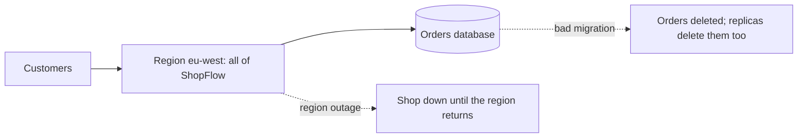

# Multi-Region Design and Disaster Recovery

**System design · Step 14.14 · Advanced** · Last updated 2026-10-22
**Prerequisites:** [Replication and read replicas](08-replication-read-replicas.md) (14.8) and [Consistency trade-offs](10-consistency-cap-pacelc-quorums.md) (14.10); helpful: [Kafka multi-cluster and disaster recovery](../02-messaging/02-kafka/18-multi-cluster-disaster-recovery.md) (2.2.18)

## 1. What it is and why it matters

**What is it?** **Disaster recovery (DR)** is how a system comes back after losing much more than one machine: a whole data centre, a whole cloud **region**, or its data (deleted or corrupted). **Multi-region design** runs parts of the system in more than one region, either to recover from a regional failure or to serve users closer to where they are.

**Why do we need it?** Everything so far protects against small failures: an instance ([14.4](04-scaling-out-stateless-services.md)), a database machine ([14.8](08-replication-read-replicas.md)), a zone. Larger events happen rarely but do happen: a regional outage, a bad deploy that deletes data, a compromised account. The business must decide in advance how long it can be down and how much data it can lose, and the architecture must deliver those numbers.

**When would I meet it?** When the business asks "what if AWS's region goes down during the sale?"; in regulatory reviews (banks and payment companies must show their DR); when expanding to another continent; and during the first DR test, which often reveals that the plan doesn't work.

> [!TIP]
> **Memory hook:** two numbers decide everything: **RTO**, how long you may be down, and **RPO**, how much data you may lose. Pay for the strategy that meets them, no more, and test it.

## 2. Industry terms

| Term | Simple meaning | Why it matters | Example | Related terms |
|---|---|---|---|---|
| **RTO (recovery time objective)** | "The maximum acceptable delay between the interruption of service and restoration of service" (AWS) | Decides how much must already be running elsewhere | Orders back within 30 minutes | Downtime |
| **RPO (recovery point objective)** | "The maximum acceptable amount of time since the last data recovery point" (AWS): how much recent data may be lost | Decides how data is copied (backups or continuous replication) | At most a few seconds of orders lost | Data loss |
| **Region and availability zone** | A region is a geographic area with several zones; zones are separate data centres in it | Multi-zone covers most failures; multi-region covers regional ones | eu-west and us-east, each with three zones | Blast radius |
| **Backup and restore** | Regular backups copied to another region; rebuild everything after a disaster | Cheapest; slowest; RPO is the time since the last backup | Nightly database snapshots | Point-in-time recovery |
| **Pilot light** | Data replicated continuously; the servers exist only as code, switched on when needed | Low cost, RTO of tens of minutes | A replica database in the second region, no app servers | Infrastructure as code |
| **Warm standby** | A scaled-down but working copy in the second region | Can take traffic at once, then scales up | Two instances instead of fifteen | Hot standby (full size, passive) |
| **Active/active (multi-site)** | Full capacity serving users in several regions | RTO near zero, but writes in two regions need a consistency design | Users served from the nearest region | Write global, write local, write partitioned |
| **Failover and failback** | Moving traffic to the recovery region; and moving it back afterwards | Both must be practised; failback is often forgotten | DNS records switched to us-east | Region evacuation |
| **Data plane and control plane** | Serving real traffic, and configuring resources | AWS advises using "only data plane operations" during failover, because control planes are less available | Flip a routing switch instead of creating resources | Static stability |

## 3. In a real system (ShopFlow)

**The business problem.** ShopFlow runs in one region, across three availability zones. Losing a zone is handled ([14.4](04-scaling-out-stateless-services.md) to [14.8](08-replication-read-replicas.md)). The board asks what happens if the whole region is unavailable for a day during the sale, and also what happens if a faulty migration deletes the orders table. A business impact analysis gives the targets: **orders and payments** back within 30 minutes with at most seconds of data lost; the **catalogue** readable throughout; **analytics** back within a day.



**How DR helps, per service.** Not one strategy for everything, but one per **business need**:

| Service | RTO and RPO | Strategy |
|---|---|---|
| Orders and payments | 30 minutes, seconds | **Warm standby** in us-east: database replicated continuously, a small running copy of the services, scaled up on failover |
| Catalogue and images | Near zero for reads | **Active/active reads**: CDN ([14.12](12-object-storage-cdn.md)) plus a read-only copy in both regions |
| Analytics | A day, a day | **Backup and restore** |
| Everything | Deleted or corrupted data | **Point-in-time backups** in another account and region, restored and tested regularly |

**What it costs.** A second region's infrastructure and data transfer; a deployment process that keeps both regions identical (infrastructure as code); replication lag that becomes the RPO; regular DR tests, which take engineering time; and, for anything active/active, a write-consistency design.

**Elsewhere:** banks run a second data centre and switch to it in regular, regulated tests; streaming services keep serving from several regions and move users away from a failing one; small SaaS products often accept backup and restore, because hours of downtime cost less than a second region.

## 4. How it works

**The four strategies**, from AWS's disaster recovery whitepaper, ordered from cheapest and slowest to most expensive and fastest:

1. **Backup and restore:** back up data (and infrastructure as code, images, configuration) into the recovery region; on disaster, restore and redeploy. RPO is the time since the last backup; RTO is hours.
2. **Pilot light:** replicate data continuously to live databases in the recovery region; keep application servers "switched off" (defined in code, not running); on disaster, deploy and scale them.
3. **Warm standby:** a scaled-down but fully functional copy runs all the time and can take traffic immediately; on disaster, scale it up. Running it full size is a **hot standby**.
4. **Multi-site active/active:** all regions serve users. "There is no such thing as failover" for the traffic, but the write design must handle two regions.

**A regional failover, step by step** (active/passive):

1. **Detect** that the region is unhealthy: health checks and alarms. AWS advises that automatic failover be "used with caution", because a false alarm costs real downtime and data; many teams decide manually and automate everything after the decision.
2. **Decide** and declare the failover.
3. **Promote the data:** make the replica in the recovery region writable. AWS's documentation gives promotion of an Aurora global database's secondary region at "less than one minute", and RDS read-replica promotion at "a few minutes".
4. **Scale the compute** to production size (not needed for hot standby or active/active).
5. **Move the traffic:** DNS failover with health checks (Route 53), anycast addresses (Global Accelerator) or CDN origin failover. Clients that cached old DNS answers keep using them until their TTL expires.
6. **Fence the old region** so it doesn't accept writes if it returns ([14.8](08-replication-read-replicas.md), split brain).
7. **Fail back** later, deliberately, after the data has been re-synchronised.

**Replication is not backup.** Continuous replication copies mistakes too: a deleting migration reaches the replica within seconds. AWS notes that replication "may not protect against disaster events such as data corruption or malicious attack ... as well as point-in-time backups". Every strategy needs backups, tested by restoring them.

The programs below are arithmetic and a small simulation with illustrative numbers; how to run them is in [the Java overview](../13-java/01-java-overview.md), section 5.

### Worked example 1: RTO and RPO per strategy

**Concept.** The RTO is the sum of the steps of recovery, and each strategy removes some steps by paying for resources in advance. The RPO depends on how the data gets there.

```java
// File: RecoveryEstimate.java (runnable, Java 21)
import java.util.List;
import java.util.Locale;

public class RecoveryEstimate {

    // Illustrative minutes for each step of recovering ShopFlow's orders in a second region.
    record Strategy(String name, int detectAndDecide, int data, int compute, int traffic, String rpo) {
        int rto() { return detectAndDecide + data + compute + traffic; }
    }

    public static void main(String[] args) {
        List<Strategy> strategies = List.of(
                // restore last night's backup, deploy everything from infrastructure as code
                new Strategy("Backup and restore", 15, 240, 60, 5, "up to 24 h (nightly backup)"),
                // data replicated continuously; servers deployed only when needed
                new Strategy("Pilot light", 15, 5, 30, 5, "seconds (replication lag)"),
                // a small copy already running; scale it up
                new Strategy("Warm standby", 15, 5, 10, 5, "seconds (replication lag)"),
                // full capacity already running in both regions
                new Strategy("Active/active", 1, 1, 0, 1, "seconds (replication lag)"));

        System.out.println("strategy             detect  data  compute  traffic   RTO        RPO");
        for (Strategy s : strategies) {
            System.out.println(String.format(Locale.ROOT, "%-20s %5d %5d %7d %8d   %4d min   %s",
                    s.name(), s.detectAndDecide(), s.data(), s.compute(), s.traffic(), s.rto(), s.rpo()));
        }
    }
}
```

**Expected output**:

```text
strategy             detect  data  compute  traffic   RTO        RPO
Backup and restore      15   240      60        5    320 min   up to 24 h (nightly backup)
Pilot light             15     5      30        5     55 min   seconds (replication lag)
Warm standby            15     5      10        5     35 min   seconds (replication lag)
Active/active            1     1       0        1      3 min   seconds (replication lag)
```

**Walkthrough.** All minute values are illustrative assumptions for ShopFlow, not measurements. The pattern is what matters: **restoring data** dominates backup and restore; **starting compute** dominates pilot light; with warm standby, **detection and decision** become a large share; active/active removes almost every step. The RPO is set by the data path, not the strategy's name: backups give "since the last backup", continuous replication gives "the replication lag". ShopFlow's 30-minute RTO for orders points to warm standby (35 minutes here, which is close: the scale-up step must be rehearsed and made faster, or more capacity kept running).

**Experiment.** Predict first: if detection and decision took 2 minutes instead of 15 (automatic failover), what would each RTO be, and what new risk does that add? The result is in Answers.

### Worked example 2: writing in two regions

**Concept.** In active/active, both regions accept requests. Reads can be served locally ("read local"); for writes, AWS's whitepaper names three options: **write global** (all writes to one region), **write local** (each region writes, conflicts resolved, for DynamoDB global tables by last writer wins), and **write partitioned** (each user's or key's writes go to its home region).

```java
// File: WriteStrategies.java (runnable, Java 21)
import java.util.ArrayList;
import java.util.List;

public class WriteStrategies {

    // Ana's cart is changed in two regions at almost the same time: she adds a MUG on her phone
    // (routed to eu-west) and a TEE on her laptop through a VPN (routed to us-east).
    record Write(String region, long timestampMs, String item) {}

    static final Write PHONE = new Write("eu-west", 1_000, "MUG");
    static final Write LAPTOP = new Write("us-east", 1_002, "TEE");
    static final int CROSS_REGION_MS = 80;              // illustrative round trip between the regions

    public static void main(String[] args) {
        // 1. Write local, last writer wins: each region stores its version; the later timestamp wins.
        Write winner = PHONE.timestampMs() > LAPTOP.timestampMs() ? PHONE : LAPTOP;
        System.out.println("Write local, last writer wins:  cart [" + winner.item() + "]   <- one add is lost");

        // 2. Write global: every write goes to the primary region (eu-west) and is applied in order.
        List<String> global = new ArrayList<>();
        global.add(PHONE.item());
        global.add(LAPTOP.item());
        System.out.println("Write global (eu-west primary): cart " + global
                + "   laptop write pays " + CROSS_REGION_MS + " ms extra");

        // 3. Write partitioned: Ana's home region is eu-west; all her writes go there.
        List<String> home = new ArrayList<>(List.of(PHONE.item(), LAPTOP.item()));
        System.out.println("Write partitioned (home eu-west): cart " + home
                + "   only writes from outside her home region pay the extra " + CROSS_REGION_MS + " ms");
    }
}
```

**Expected output**:

```text
Write local, last writer wins:  cart [TEE]   <- one add is lost
Write global (eu-west primary): cart [MUG, TEE]   laptop write pays 80 ms extra
Write partitioned (home eu-west): cart [MUG, TEE]   only writes from outside her home region pay the extra 80 ms
```

**Walkthrough.**

| Strategy | Result for Ana's two adds | Cost |
|---|---|---|
| Write local, last writer wins | One add lost: the cart has only the TEE | None in latency; silent data loss for concurrent writes ([14.10](10-consistency-cap-pacelc-quorums.md)) |
| Write global | Both adds, in order | Every write from the other region pays the cross-region round trip; the primary region is a single point for writes until another is promoted |
| Write partitioned (home region) | Both adds | Only writes made outside the user's home region pay the extra latency; a region failure needs a failover for its users |

For a shop, **write partitioned** (each customer has a home region) or **write global** for orders, with **read local** for the catalogue, is the usual combination; last-writer-wins is acceptable only for data where a lost concurrent update doesn't matter.

### Static stability

A regional outage often impairs the cloud's own **control plane** (creating instances, changing configuration) as well. A plan that must **create** or **scale** resources during the disaster depends on the part most likely to be struggling. AWS's whitepaper recommends using "only data plane operations" for failover and describes keeping enough capacity already provisioned (hot standby) as **statically stable**. The trade-off is cost: warm standby is cheaper but relies on scaling up at the worst moment.

## 5. Failure scenarios

### The DR plan that had never run

1. **What happened?** During a regional incident, the team tried to fail over for the first time. The infrastructure code for the recovery region was months out of date, the service quotas there were too low to scale up, and the restore runbook referred to a backup bucket that had been renamed.
2. **Why?** The plan was written, not exercised.
3. **What did the business see?** Hours of downtime against a 30-minute target.
4. **Solutions:** regular DR tests (game days, [1.10](../01-resilience/10-testing-resilience.md)): fail over a service for real, restore a backup and verify it; deploy both regions from the same pipeline; check quotas in the recovery region; treat a failed test as an incident.
5. **What they cost:** engineering time every quarter; some test failovers during quiet hours.

### A failover on a false alarm

1. **What happened?** An automatic failover triggered because the health checks themselves had a network problem. Traffic moved, the replica was promoted, the last seconds of orders were lost, and failback took hours.
2. **Why?** Automatic failover trusted one signal, and failover is never free: RTO and RPO are greater than zero.
3. **What did the business see?** An outage caused by the protection, not by a disaster.
4. **Solutions:** decide manually, but with every step after the decision automated "like the push of a button" (AWS's description of manually initiated failover); require several independent signals; use routing switches that are data-plane operations.
5. **What they cost:** a person on call must decide, which adds minutes to the RTO (worked example 1).

### Replication copied the mistake

1. **What happened?** A migration with a faulty `WHERE` clause deleted most of last year's orders. The replica in the recovery region deleted them too, seconds later.
2. **Why?** Replication protects against losing machines and regions, not against wrong writes.
3. **What did the business see?** Missing order history and refunds that couldn't be checked, until data was restored from backup.
4. **Solutions:** point-in-time backups kept in another account and region; delayed replicas where useful ([14.8](08-replication-read-replicas.md)); review and test migrations; practise restoring a single table.
5. **What they cost:** backup storage, and an RPO for this kind of disaster equal to the time since the last good recovery point.

## 6. Architectural decisions

| Strategy | Choose when | Avoid when |
|---|---|---|
| **Multi-zone only (no second region)** | A regional outage of hours is acceptable for the business, which is the case for many workloads; AWS notes that a multi-zone architecture "may already meet much of your risk mitigation needs" | Regulation or the cost of a regional outage demands more |
| **Backup and restore** | RTO of hours and RPO of the backup interval are acceptable | Customers can't wait hours |
| **Pilot light or warm standby** | RTO of minutes to an hour; cost must stay well below a second full region | The recovery path must not depend on scaling up during the disaster (use hot standby) |
| **Active/active** | Near-zero RTO, or users on several continents who need low latency anyway | The write path can't be designed for two regions (strong consistency everywhere, [14.10](10-consistency-cap-pacelc-quorums.md)) |

**Set targets per service, not per company.** The checkout and the analytics dashboard don't need the same RTO. And AWS's note applies: "If the cost of the recovery strategy is higher than the cost of the failure or loss, the recovery option should not be put in place" unless something else, such as regulation, requires it.

**Common mistakes:** one DR tier for everything; treating replication as backup; never testing; recovery that depends on creating resources during the disaster; forgetting failback, DNS caching, and the external systems (payment provider, email provider) that also need the new region's addresses.

## 7. Try it yourself

Try each exercise first; the solutions are in the Answers section, the first as a runnable program.

1. **Synchronous across regions.** Checkout commits three times. A local commit takes 2 ms, and a cross-region round trip 80 ms (both illustrative). What does checkout's commit time become with synchronous replication to the second region, and what can reduce it?
2. **Targets per service.** Give an RTO, an RPO and a strategy for: (a) payment authorisation; (b) product search; (c) the recommendation model; (d) customer accounts and passwords; (e) seller payouts, calculated nightly.
3. **The plan for a test.** Write the five most important checks for ShopFlow's first DR test of the order services.

## 8. Check your understanding

1. What is the difference between RTO and RPO, and which part of the design decides each?
2. Why doesn't continuous replication to a second region replace backups?
3. Why does AWS advise caution with automatic regional failover?
4. In active/active, why is "write local, last writer wins" a poor choice for a shopping cart, and what is better?

Answers are at the end of this note.

## 9. Revision

**Remember**
- **RTO** = how long down; **RPO** = how much data lost; set both **per service** from business impact.
- Strategies: **backup and restore**, **pilot light**, **warm standby**, **active/active**: each buys a lower RTO with resources paid in advance.
- RPO comes from the **data path**: backups (hours) or replication (the lag). **Replication is not backup.**
- Failover: detect, decide, promote, scale, move traffic, fence, later fail back; prefer **data-plane** operations and **static stability**.
- Active/active writes: **global**, **local** with conflict resolution, or **partitioned** by home region.

**Explain in 15 seconds:** "Disaster recovery is designed from two numbers per service: how long it may be down and how much data it may lose. Backup and restore, pilot light, warm standby and active/active meet tighter targets at higher cost, and only tested plans count."

**Explain in 60 seconds:**
> "I start with a business impact analysis: per service, the RTO, how long it may be down, and the RPO, how much recent data may be lost. Then I choose the cheapest strategy that meets them: backup and restore if hours are fine, pilot light or warm standby for minutes, active/active when near-zero downtime or global latency justify the cost. The RPO comes from the data path, the backup interval or the replication lag, and replication never replaces point-in-time backups, because it copies deletions and corruption too. Failover is a sequence, detect, decide, promote the data, scale, move traffic, fence the old region, so I automate everything after a human decision, rely on data-plane operations, and keep enough capacity running where scaling up during the disaster is too risky. For active/active, I decide how writes work: one write region, a home region per user, or local writes with a conflict strategy. And I test it regularly, because untested DR doesn't work."

**Likely follow-up questions:**
- **Is multi-region always better?** No: it costs money and complexity, and many workloads are well served by multiple zones in one region plus backups.
- **How does DNS caching affect failover?** Clients and resolvers keep the old answer until its TTL ends; use short TTLs for failover records, or anycast addresses that don't depend on DNS changes.
- **What about Kafka?** Topics are mirrored to the other region's cluster, with consumer offsets translated ([2.2.18](../02-messaging/02-kafka/18-multi-cluster-disaster-recovery.md)); events in flight become part of the RPO.
- **What is region evacuation?** Moving traffic away from a region that is still partly working, before it fails completely, which is easier when the system is already active/active.

**Architect's takeaway:** disaster recovery is a business decision expressed as two numbers per service, implemented as the cheapest strategy that meets them, and real only when it has been tested.

**Next topic:** [Case study: URL shortener](15-case-url-shortener.md) (14.15)

## 10. Verification and sources

> [!NOTE]
> Checked 2026-10-22 against AWS's disaster recovery whitepaper. All programs were run on OpenJDK 21.0.8, and the repository's example checker compares their output. Re-verify when you revisit this note.

- **Confirmed (AWS, "Disaster Recovery of Workloads on AWS: Recovery in the Cloud", read 2026-10-22):** the definitions of RTO and RPO quoted above; the four strategies (backup and restore, pilot light, warm standby, multi-site active/active) and hot standby; that pilot light "cannot process requests without additional action" while warm standby can handle traffic at reduced capacity; that automatic failover should be "used with caution" and manual initiation with automated steps is common; that "you should use only data plane operations as part of your failover operation"; static stability through hot standby; Aurora global database promotion in "less than one minute" and RDS replica promotion in "a few minutes"; the write global, write local (DynamoDB global tables with last writer wins) and write partitioned options; that continuous replication "may not protect against" corruption or malicious deletion as well as point-in-time backups; that a multi-AZ architecture "may already meet much of your risk mitigation needs"; and that a recovery option costing more than the loss should not be put in place without another driver. Route 53 health checks run every 30 seconds by default (10 seconds as the fast option), with a configurable failure threshold (AWS, "Values that you specify when you create or update health checks").
- **Assumptions and illustrations:** every minute value in worked example 1, the 80 ms cross-region round trip and the 2 ms commit are illustrative. The write-strategies program is a simplified model with fixed timestamps.
- **To verify:** your own measured failover times (detection, promotion, DNS), your provider's quotas in the recovery region, and the cross-region replication lag of your database under load.
- **Decision rule:** set RTO and RPO per service from business impact; choose the cheapest strategy that meets them; keep point-in-time backups in another account and region; test failover and restores on a schedule.

**Sources:** AWS whitepaper, "Disaster Recovery of Workloads on AWS: Recovery in the Cloud" (sections "Business Continuity Plan" and "Disaster recovery options in the cloud"); Amazon Route 53 Developer Guide, "Values that you specify when you create or update health checks"; Google, *Site Reliability Engineering*, chapter "Data Integrity" (for the replication-is-not-backup principle).

## Answers

**Experiment**

- **Detection in 2 minutes** (worked example 1): backup and restore **307**, pilot light **42**, warm standby **22** minutes; active/active is unchanged at 3. Warm standby now meets the 30-minute target, but every false alarm becomes an unnecessary failover with its own data loss and failback work, which is exactly why AWS advises caution: make the decision faster with better signals and a rehearsed procedure rather than removing the human entirely for the most critical services.

**Check your understanding**

1. **RTO** is how long the service may be unavailable; it is decided by what must happen before traffic flows again: detection, decision, promotion, compute start-up and traffic switching, so by how much is already running in advance. **RPO** is how much recent data may be lost; it is decided by the data path: the backup interval, or the lag of continuous replication.
2. Because replication copies every change, including mistakes: a deleting migration, corrupted data or an attacker's deletions reach the replica within seconds. Point-in-time backups, ideally in another account and region, are the only way back to a moment before the mistake.
3. Because failing over is never free (RTO and RPO are above zero), and the signals that trigger it can be wrong, for example when the health checkers themselves have a network problem. An unnecessary failover causes downtime, may lose data, and requires a failback. Manual initiation with fully automated steps keeps the decision with a person while keeping the execution fast.
4. Because a customer can add items from two devices that reach different regions; last writer wins keeps one version and silently drops the other add. Better: route each customer's writes to a home region (write partitioned), or merge carts with an add/remove set that keeps both adds and respects removals ([14.10](10-consistency-cap-pacelc-quorums.md)).

**Practice exercises**

1. **Synchronous across regions:**

```java
// File: SyncAcrossRegions.java (runnable, Java 21)
public class SyncAcrossRegions {

    public static void main(String[] args) {
        int commitsPerCheckout = 3;          // reserve stock, create order, write outbox (or one transaction each)
        int localCommitMs = 2;               // illustrative: commit acknowledged in the same region
        int crossRegionRoundTripMs = 80;     // illustrative: wait for a replica in another region

        int local = commitsPerCheckout * localCommitMs;
        int sync = commitsPerCheckout * (localCommitMs + crossRegionRoundTripMs);
        System.out.println("checkout commit time, asynchronous replication: " + local + " ms (RPO: the replication lag)");
        System.out.println("checkout commit time, synchronous replication:  " + sync + " ms (RPO: 0 for committed orders)");
        System.out.println("one transaction instead of three, synchronous:  " + (localCommitMs + crossRegionRoundTripMs) + " ms");
    }
}
```

**Expected output**:

```text
checkout commit time, asynchronous replication: 6 ms (RPO: the replication lag)
checkout commit time, synchronous replication:  246 ms (RPO: 0 for committed orders)
one transaction instead of three, synchronous:  82 ms
```

Three synchronous cross-region commits add about 240 ms to checkout. Doing the three writes in **one** transaction pays the round trip once (82 ms). Alternatives: synchronous replication only for the payment and order records that must never be lost, asynchronous for the rest; or asynchronous replication with reconciliation against the payment provider after a failover.

2. **Targets per service:** (a) Payment authorisation: RTO minutes, RPO near zero; warm or hot standby, with idempotency keys so retried payments aren't charged twice. (b) Product search: RTO minutes to an hour, RPO irrelevant (rebuildable from the catalogue); pilot light or rebuild the index from the database. (c) Recommendation model: RTO a day, RPO a day; backup and restore, with a fallback of "popular products" meanwhile ([1.9](../01-resilience/09-fallbacks-graceful-degradation.md)). (d) Accounts and passwords: RTO minutes (no login, no sales), RPO seconds; warm standby or active/active reads with one write region. (e) Seller payouts: RTO a day, RPO zero for the ledger; backups plus replication, and the nightly job made idempotent so it can be re-run.

3. **The first DR test of the order services:** (1) promote the replica in the recovery region and verify that the newest committed orders are there (measure the real RPO); (2) scale the warm standby to peak capacity and check quotas; (3) switch traffic and measure the real RTO from the decision to the first successful order; (4) confirm that external dependencies (payment provider callbacks, email provider, Kafka mirroring) work from the recovery region; (5) fail back and verify nothing was lost or duplicated; and record every surprise as a follow-up.

Back to [the System design overview](01-system-design-overview.md) · [the index](../README.md) · [Roadmap](../roadmap.md).
