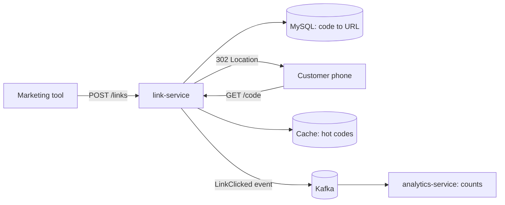

# Case Study: URL Shortener

**System design · Step 14.15 · Advanced (case study)** · Last updated 2026-10-22
**Prerequisites:** the method in [14.2](02-requirements-design-method.md) and the building blocks [14.4](04-scaling-out-stateless-services.md) to [14.13](13-unique-id-generation.md), especially [caching](06-caching.md) (14.6) and [unique ids](13-unique-id-generation.md) (14.13)

The case studies apply the six steps of [14.2](02-requirements-design-method.md) to one system from start to finish. This one is small enough to finish in an interview, which is why it is the classic first exercise, and it touches estimation, ids, caching, HTTP semantics and abuse.

## 1. What it is and why it matters

**What is it?** A service that turns a long URL into a short one (`shop.ex/Fj4vIg`) and redirects anyone who opens the short URL to the long one. Optionally it counts clicks, supports custom names and lets links expire.

**Why do we need it?** Long URLs with tracking parameters don't fit in an SMS, are hard to type from a printed card and look untrustworthy. A short link is easy to share and, because it passes through the service, lets the owner measure clicks and change the destination later.

**When would I meet it?** Marketing campaigns, QR codes on parcels and posters, links in SMS and push notifications, and as a first system design interview question.

> [!TIP]
> **Memory hook:** a URL shortener is a **huge, read-mostly key-value lookup**. The interesting decisions are how codes are made, which redirect status to return, and how to keep it from being abused.

## 2. Industry terms

| Term | Simple meaning | Why it matters | Example | Related terms |
|---|---|---|---|---|
| **Short code** | The part after the domain that identifies a link | Its length sets the capacity; its generation sets guessability | `Fj4vIg` | Slug, key |
| **Base62** | Writing a number with the 62 characters `0-9a-zA-Z` | Compact, URL-safe codes from numeric ids | 1,000,000 is `4c92` | Base64url |
| **301 and 308 (permanent redirect)** | "The target resource has been assigned a new permanent URI"; cacheable by default | Browsers may skip the service next time: faster, but clicks go uncounted and the target can't change | `301 Location: https://shop.example/sale?utm=sms` | 302 and 307 |
| **302 and 307 (temporary redirect)** | The resource "resides temporarily under a different URI"; not cached by default | Every click reaches the service: countable and changeable | `302 Location: ...` | `Cache-Control` |
| **Custom alias** | A code chosen by the creator | Needs uniqueness checks and reserved words | `shop.ex/blackfriday` | Vanity URL |
| **Open redirect abuse** | Using a trusted short domain to hide a malicious destination | The short domain gets blocked by email and browsers | A phishing link behind `shop.ex/...` | Safe browsing lists |

## 3. In a real system (ShopFlow)

**The business problem.** ShopFlow's marketing team sends SMS campaigns and prints QR codes on parcels. Long URLs with tracking parameters don't fit, and the team wants to know how many people clicked each campaign. Links must keep working for years (the QR codes are printed), and a campaign SMS sent to everyone at once must not slow the shop down.

**Without a design**, someone might generate random codes without checking for duplicates, return `301` so links are fast, and store links in the order database. Then two campaigns share a code, the click counts stay near zero because browsers cache the redirect, and a campaign burst competes with checkout for the same database.

**How the method helps.** The six steps below give the design; each step reuses a building block from this area.

**What it costs.** One more small service, with its own data store, cache and a shared rate limit; analytics through the event pipeline; and an abuse process, because any public link service will be misused.

## 4. How it works

### Step 1: Requirements

- **Functional:** create a short link for a long URL (marketing users only); redirect anyone who opens it; optional custom alias; optional expiry; click counts per link and per day.
- **Non-functional:** redirect p99 under 50 ms in the region (assumption); redirects available 99.99%, higher than creation (99.9%), because printed codes can't be retried later; links durable for years; counts may lag by minutes.
- **Constraints:** ShopFlow's stack and region; the short domain `shop.ex` (illustrative).
- **Out of scope:** public link creation by anyone, link previews, A/B testing of destinations.

### Step 2: Estimate

```java
// File: ShortenerEstimate.java (runnable, Java 21)
import java.util.Locale;

public class ShortenerEstimate {

    public static void main(String[] args) {
        // Illustrative assumptions for ShopFlow's link service (SMS campaigns, QR codes on parcels).
        long linksPerMonth = 5_000_000;
        long clicksPerLink = 20;                 // over a link's life, most in the first days
        long peakFactor = 20;                    // a campaign SMS goes out to everyone at once
        long bytesPerLink = 500;                 // code, long URL, owner, dates, index overhead
        long years = 5;

        double createsPerSecond = linksPerMonth / (30 * 86_400.0);
        double clicksPerSecond = linksPerMonth * clicksPerLink / (30 * 86_400.0);
        double peakClicks = clicksPerSecond * peakFactor;
        long links = linksPerMonth * 12 * years;
        double storageGb = links * bytesPerLink / 1e9;

        System.out.println(String.format(Locale.ROOT, "creates per second   %6.1f", createsPerSecond));
        System.out.println(String.format(Locale.ROOT, "clicks per second    %6.1f average, %,.0f at a campaign peak", clicksPerSecond, peakClicks));
        System.out.println(String.format(Locale.ROOT, "read:write ratio     %d:1", clicksPerLink));
        System.out.println(String.format(Locale.ROOT, "links in %d years     %,d", years, links));
        System.out.println(String.format(Locale.ROOT, "storage              %.0f GB, one copy", storageGb));
    }
}
```

**Expected output**:

```text
creates per second      1.9
clicks per second      38.6 average, 772 at a campaign peak
read:write ratio     20:1
links in 5 years     300,000,000
storage              150 GB, one copy
```

The numbers are small: about 2 creates and 40 clicks a second on average, a few hundred at a campaign peak, and 150 GB over five years. One database with replicas and a cache is plenty ([14.3](03-back-of-the-envelope-estimation.md)). The design pressure is not scale but **correctness** (unique codes, countable clicks) and **availability** of redirects.

### Step 3: API and data model

```text
POST /links            {"url": "...", "alias": "blackfriday"?, "expiresAt": "..."?}   -> 201 {"code": "Fj4vIg", "shortUrl": "https://shop.ex/Fj4vIg"}
GET  /{code}           -> 302 Location: <long url>     (404 if unknown, 410 Gone if expired)
GET  /links/{code}/stats                                -> clicks per day
```

Data model, keyed by the one access pattern that matters, "find the link by its code" ([14.7](07-choosing-a-database.md)): `link(code PK, long_url, owner, created_at, expires_at)`. A key-value store or a relational table both work; ShopFlow uses its existing MySQL with replicas, because the volume is small and it already runs it.

### Step 4: High-level design



1. **Create:** validate the URL (scheme `https`, allowed domains for marketing), generate a code (step 5), insert it with a unique constraint, return it.
2. **Redirect:** look up the code in the cache, then the database ([14.6](06-caching.md), cache-aside with a long TTL; links rarely change); return `302` with the long URL; publish a `LinkClicked` event without waiting ([14.11](11-asynchronous-processing.md)).
3. **Count:** the analytics service aggregates events per link and day.

### Step 5: Deep dives

**Deep dive 1: how codes are made.** Three options:

1. **A counter in base62:** take a unique id ([14.13](13-unique-id-generation.md)) and write it in base62. Never collides, but sequential ids give sequential codes.
2. **A scrambled counter:** multiply the id by a constant modulo the code space before encoding. Still unique (the multiplication is reversible), and neighbours no longer look consecutive.
3. **Random codes:** pick random characters and insert with a unique constraint, retrying on a clash.

```java
// File: Base62Codes.java (runnable, Java 21)
import java.math.BigInteger;
import java.util.Locale;

public class Base62Codes {

    static final String ALPHABET = "0123456789abcdefghijklmnopqrstuvwxyzABCDEFGHIJKLMNOPQRSTUVWXYZ";
    static final long SPACE = pow(62, 7);                 // all 7-character codes
    // Multiplying by a number with no common factor with 62^7 (here: odd, and not a multiple of 31)
    // is a bijection on 0..62^7-1: every id gets a different code, but neighbours look unrelated.
    static final long SCRAMBLE = 1_580_030_173L;
    static final long UNSCRAMBLE = BigInteger.valueOf(SCRAMBLE).modInverse(BigInteger.valueOf(SPACE)).longValue();

    static long pow(long b, int e) {
        long r = 1;
        for (int i = 0; i < e; i++) r *= b;
        return r;
    }

    static String encode(long n, int length) {
        char[] out = new char[length];
        for (int i = length - 1; i >= 0; i--) {
            out[i] = ALPHABET.charAt((int) (n % 62));
            n /= 62;
        }
        return new String(out);
    }

    static long decode(String code) {
        long n = 0;
        for (char c : code.toCharArray()) n = n * 62 + ALPHABET.indexOf(c);
        return n;
    }

    static long scramble(long id) {
        return BigInteger.valueOf(id).multiply(BigInteger.valueOf(SCRAMBLE)).mod(BigInteger.valueOf(SPACE)).longValue();
    }

    static long unscramble(long code) {
        return BigInteger.valueOf(code).multiply(BigInteger.valueOf(UNSCRAMBLE)).mod(BigInteger.valueOf(SPACE)).longValue();
    }

    public static void main(String[] args) {
        for (int len = 6; len <= 8; len++) {
            System.out.println(String.format(Locale.ROOT, "%d characters: %,d codes", len, pow(62, len)));
        }
        System.out.println("id         plain code   scrambled code   back to id");
        for (long id = 1_000_000; id <= 1_000_003; id++) {
            String scrambled = encode(scramble(id), 7);
            System.out.println(String.format(Locale.ROOT, "%,9d   %s      %s          %,d",
                    id, encode(id, 7), scrambled, unscramble(decode(scrambled))));
        }
    }
}
```

**Expected output**:

```text
6 characters: 56,800,235,584 codes
7 characters: 3,521,614,606,208 codes
8 characters: 218,340,105,584,896 codes
id         plain code   scrambled code   back to id
1,000,000   0004c92      FjFv4Ig          1,000,000
1,000,001   0004c93      FloqIJT          1,000,001
1,000,002   0004c94      Fn7mmLw          1,000,002
1,000,003   0004c95      FoQi0N9          1,000,003
```

Seven characters give 3.5 trillion codes, far beyond ShopFlow's 300 million in five years. The plain codes for ids 1,000,000 to 1,000,003 differ only in the last character, so anyone can enumerate campaign links. The scrambled codes look unrelated and decode back to the id, but they still share a prefix, so scrambling **hides** the order from a casual reader, not from someone collecting many codes. If codes must be unguessable, they must be random.

**Random codes and the space filling up:**

```java
// File: RandomCodeCollisions.java (runnable, Java 21)
import java.util.HashSet;
import java.util.Locale;
import java.util.Random;
import java.util.Set;

public class RandomCodeCollisions {

    public static void main(String[] args) {
        // A small code space (4 characters, 62^4 = 14,776,336 codes) so the effect shows quickly.
        long space = 62L * 62 * 62 * 62;
        Random random = new Random(11);                   // seeded only for a reproducible output
        Set<Long> used = new HashSet<>();
        long attempts = 0;
        System.out.println("codes in use   chance a new code is taken   retries so far");
        for (int target : new int[] {1_000_000, 3_000_000, 6_000_000}) {
            while (used.size() < target) {
                attempts++;
                used.add((long) (random.nextDouble() * space));    // a taken code means one more try
            }
            System.out.println(String.format(Locale.ROOT, "%,12d   %25.1f%%   %,13d",
                    used.size(), 100.0 * used.size() / space, attempts - used.size()));
        }
    }
}
```

**Expected output**:

```text
codes in use   chance a new code is taken   retries so far
   1,000,000                         6.8%          35,701
   3,000,000                        20.3%         353,857
   6,000,000                        40.6%       1,698,650
```

In a small, 4-character space, the chance that a new random code is already taken equals the share of codes in use, and retries grow quickly. With 7 characters and ShopFlow's volume, the chance stays below 0.01% (300 million of 3.5 trillion), so one retry is rare. The unique constraint makes a clash fail safely instead of overwriting a link.

**Experiment.** Predict first: with five-character codes (`long space = 62L * 62 * 62 * 62 * 62;`), what is the chance a new code is taken when 6 million are in use? The result is in Answers.

**Deep dive 2: which redirect status.** RFC 9110 defines `301` and `308` as heuristically cacheable and `302` and `307` as not. A cached permanent redirect is served by the browser without asking the service, which makes later clicks faster, but uncounted, and makes changing the destination impossible for those users. ShopFlow needs counts and the ability to fix a wrong destination, so it returns **`302`** (or `307`, which forbids changing the method). For speed, the redirect can still be cached briefly at the CDN with an explicit `Cache-Control`, counting clicks from CDN logs instead.

**Deep dive 3: the campaign burst.** A few hundred redirects a second for a handful of hot codes is exactly what a cache absorbs (hit ratio near 100% for the campaign's codes). The click events go to Kafka, so analytics never slows the redirect. The link service has its own database, so a campaign never competes with checkout.

### Step 6: Failures and trade-offs

| What fails | What happens | Mitigation |
|---|---|---|
| The database | Hot codes still redirect from the cache; new links can't be created | Long cache TTLs for links; replicas; creation is less critical than redirects |
| Kafka | Redirects still work; click events are lost unless buffered | Buffer events locally with a bound, or accept a small gap in counts |
| A wrong destination was published | Every click goes to the wrong page | `302` lets the destination be corrected for every click |
| A region outage | Printed QR codes stop working | Redirect data is small and read-only: replicate it to a second region and serve redirects from both ([14.14](14-multi-region-disaster-recovery.md)) |

## 5. Failure scenarios

### Clicks that never showed up

1. **What happened?** A campaign's dashboard showed a fraction of the expected clicks, while the shop's traffic clearly rose.
2. **Why?** The service returned `301`; browsers cached the redirect and repeated clicks never reached it, and some intermediaries cached it too.
3. **What did the business see?** Misleading campaign results, and a destination that couldn't be fixed for users who had already clicked.
4. **Solutions:** `302` or `307`; explicit `Cache-Control` for any caching you do want; count at the CDN if redirects are cached there.
5. **What they cost:** every click reaches the service (or the CDN); slightly higher redirect latency on repeated clicks.

### The short domain on a blocklist

1. **What happened?** Email providers started blocking messages containing `shop.ex` links.
2. **Why?** An integration let partners create links to any URL, and some created links to phishing pages.
3. **What did the business see?** Order confirmation emails with tracking links landing in spam.
4. **Solutions:** allow only trusted creators; restrict destinations to allowed domains; check destinations against safe-browsing lists; rate-limit creation ([1.7](../01-resilience/07-rate-limiting.md)); a fast way to disable a link.
5. **What they cost:** a review process for new destination domains; an abuse contact to staff.

### Two campaigns, one code

1. **What happened?** A new campaign's short link opened the previous campaign's page.
2. **Why?** Codes were random, inserted with "insert or update", so a clash overwrote the older link.
3. **What did the business see?** Printed material pointing to the wrong offer.
4. **Solutions:** a unique constraint and plain insert, retrying with a new code on conflict; never overwrite on create.
5. **What they cost:** a retry path, rarely used.

## 6. Architectural decisions

| Decision | Choose | Because |
|---|---|---|
| Code generation | Random 7-character codes (unguessable), or a counter if enumeration doesn't matter | Random needs a uniqueness check; counters need an id source ([14.13](13-unique-id-generation.md)) |
| Redirect status | `302`/`307` when counting or changing destinations; `301`/`308` only for truly permanent moves | Permanent redirects are cacheable by default |
| Storage | The existing relational database or a key-value store, keyed by code | One access pattern, modest size |
| Read path | Cache-aside with long TTLs; CDN for very hot codes | Links rarely change; campaigns create hot keys |
| Analytics | Events after the redirect | The redirect must not wait for counting |
| Custom aliases | Same table and constraint; reserved words (`admin`, `api`) blocked | Aliases and generated codes share one namespace |

## 7. Try it yourself

Try each exercise first; the solutions are in the Answers section, the first as a runnable program.

1. **301 or 302, measured.** A customer opens the same short link three times. How many requests does the service see with each status? (A tiny simulation is in the Answers.)
2. **Custom aliases.** Design how marketing users choose aliases like `blackfriday`: validation, uniqueness, reserved words, and what happens when two users ask for the same alias at once.
3. **Expiry and deletion.** Links for a one-week campaign should stop working after 30 days, but printed QR codes must keep working for years. Design expiry, what the redirect returns, and how storage is cleaned up.

## 8. Check your understanding

1. Why is the redirect path designed for higher availability than link creation?
2. Why does ShopFlow return `302` rather than `301`, and what does it give up?
3. When are sequential base62 codes a problem, and does scrambling them solve it?
4. Where does the campaign burst go, and why doesn't it slow down checkout?

Answers are at the end of this note.

## 9. Revision

**Remember**
- A shortener is a **read-mostly key-value lookup**: small data, many reads, hot keys during campaigns.
- Codes: **base62**; 7 characters give 3.5 trillion; **random** for unguessable, **counter** for simple; always a **unique constraint**.
- **`302`/`307`** to count clicks and change destinations; **`301`/`308`** are cacheable by default.
- Redirect: cache first, then the store; clicks as **events** after the response.
- Plan for **abuse**: trusted creators, allowed destinations, rate limits, a kill switch.

**Explain in 15 seconds:** "A URL shortener maps a short code to a long URL: create with a unique code, redirect with a cached lookup, and count clicks asynchronously. The key decisions are code generation, the redirect status code and abuse prevention."

**Explain in 60 seconds:**
> "Requirements first: create links, redirect fast and very reliably, count clicks, sometimes expire links. The estimate for ShopFlow is small, a few clicks a second on average and a few hundred at campaign peaks, about 150 GB over five years, so one database with a cache is enough and the design is about correctness. Codes are base62; seven characters give 3.5 trillion. Random codes are unguessable and need a unique constraint with a retry; counter-based codes never collide but are enumerable. Redirects return 302, because 301 is cacheable by default and would hide clicks and freeze destinations. The redirect path reads a cache, then the store, and publishes a click event without waiting. Redirects matter more than creation, so they keep working from the cache if the database is down. And because short links hide destinations, creation is restricted, destinations checked and rate-limited, with a way to disable a link."

**Likely follow-up questions:**
- **How would you scale to billions of links?** Partition the code-to-URL table by code ([14.9](09-partitioning-sharding.md)), keep the cache in front, and serve redirects from several regions.
- **Same long URL twice: same code?** Only if you want deduplication; usually each campaign needs its own code for its own counts.
- **How do you count unique visitors?** From the click events, with an approximate distinct count per link and day.
- **Why not hash the long URL?** A truncated hash can collide and must be checked anyway, and it gives every creator of the same URL the same code, which mixes their counts.

**Architect's takeaway:** even the simplest system has a few decisions that matter more than its size: here, the id scheme, one HTTP status code and abuse controls. Find those first; the boxes are easy.

**Next topic:** [Case study: distributed rate limiter](16-case-distributed-rate-limiter.md) (14.16)

## 10. Verification and sources

> [!NOTE]
> Checked 2026-10-22 against RFC 9110. All programs were run on OpenJDK 21.0.8, and the repository's example checker compares their output. Re-verify when you revisit this note.

- **Confirmed (RFC 9110, section 15.4, read 2026-10-22):** `301` means the resource "has been assigned a new permanent URI" and is "heuristically cacheable"; `302` means it "resides temporarily under a different URI"; `307` forbids changing the request method; `308` is the permanent equivalent that keeps the method and is heuristically cacheable; the list of heuristically cacheable status codes includes 301 and 308 but not 302 or 307.
- **Assumptions and illustrations:** all volumes, the 50 ms target and the short domain are illustrative. The random-code program uses a small code space and a seeded generator so the effect is visible and reproducible; real codes need a secure random source. The scrambling constant is one valid choice (it shares no factor with 62^7) and provides obfuscation only.
- **To verify:** how your CDN caches 3xx responses and whether it can log clicks; the safe-browsing service you would use for destination checks.
- **Decision rule:** unique codes enforced by a constraint; `302`/`307` when counting or changing destinations; redirects served from cache; clicks counted asynchronously; creation restricted and rate-limited.

**Sources:** RFC 9110, "HTTP Semantics", section 15.4 (redirection status codes); this area's notes on [caching](06-caching.md), [unique ids](13-unique-id-generation.md) and [asynchronous processing](11-asynchronous-processing.md).

## Answers

**Experiment**

- **Five characters instead of four** (random-code program, change the space to `62L * 62 * 62 * 62 * 62`): with 6 million codes in use, the chance a new code is taken drops from 40.6% to **0.7%**, and total retries from about 1.7 million to **19,687**. Each extra character multiplies the space by 62, which is why 7 characters make clashes negligible at ShopFlow's volume.

**Check your understanding**

1. Because links are printed and sent once: a customer who scans a QR code and gets an error rarely tries again, and the link can't be re-sent. Creation is done by a few marketing users who can retry a minute later. So the redirect path is served from a cache and replicated widely, while creation may depend on the database being available.
2. `301` is cacheable by default, so browsers and intermediaries can reuse it without contacting the service: repeated clicks go uncounted and a wrong destination can't be corrected for those users. `302` reaches the service every time. ShopFlow gives up a little latency on repeated clicks, which it can win back with short, explicit CDN caching.
3. When outsiders shouldn't be able to list links: unpublished campaigns, personal links, or volumes the business wants to keep private. Scrambling makes neighbouring codes look unrelated, but the codes still follow a pattern (shared prefixes in the example), so it hides order from casual readers, not from someone who collects many codes. Unguessable codes must be random.
4. Into the link service's cache, which holds the campaign's few hot codes (nearly every redirect is a hit), and into Kafka, as click events processed later. The link service has its own store, so nothing in the redirect path touches the order database or checkout's resources.

**Practice exercises**

1. **301 or 302, measured:**

```java
// File: RedirectCaching.java (runnable, Java 21)
public class RedirectCaching {

    // A browser follows the same short link three times. A 301 is cacheable by default (RFC 9110),
    // so the browser may reuse it without asking again; a 302 is not, so every click reaches the service.
    static int requestsSeen(boolean permanent) {
        boolean cached = false;
        int seen = 0;
        for (int click = 0; click < 3; click++) {
            if (permanent && cached) {
                continue;                 // served from the browser cache: the service never sees it
            }
            seen++;
            cached = true;
        }
        return seen;
    }

    public static void main(String[] args) {
        System.out.println("301 Moved Permanently: the service sees " + requestsSeen(true) + " of 3 clicks");
        System.out.println("302 Found:             the service sees " + requestsSeen(false) + " of 3 clicks");
    }
}
```

**Expected output**:

```text
301 Moved Permanently: the service sees 1 of 3 clicks
302 Found:             the service sees 3 of 3 clicks
```

With `301` the browser may reuse the cached redirect, so the service sees only the first click; with `302` it sees all three. That is the difference between a dashboard that undercounts and one that is right.

2. **Custom aliases:** validate the alias (allowed characters, length, no confusable look-alikes), check it against a reserved list (`admin`, `api`, `login`, existing paths) and a list of offensive words, then **insert** it into the same table with the same unique constraint as generated codes; if two users ask at once, one insert succeeds and the other gets "alias taken". Make generated codes and aliases distinguishable (for example aliases at least 8 characters, or generated codes always mixed-case), so a future generated code can't clash with a popular alias.

3. **Expiry and deletion:** store `expires_at` per link; campaign links get 30 days, QR-code links none. On redirect, an expired link returns **410 Gone** (or redirects to a friendly "this offer has ended" page), so the decision happens at read time and nothing has to delete links exactly on time. A nightly job archives links expired more than a year ago to cheaper storage; codes are never reused, so an old printed code can never lead to a new, unrelated page.

Back to [the System design overview](01-system-design-overview.md) · [the index](../README.md) · [Roadmap](../roadmap.md).
