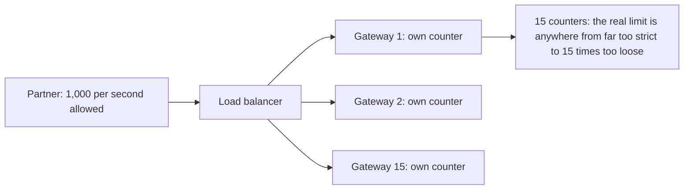
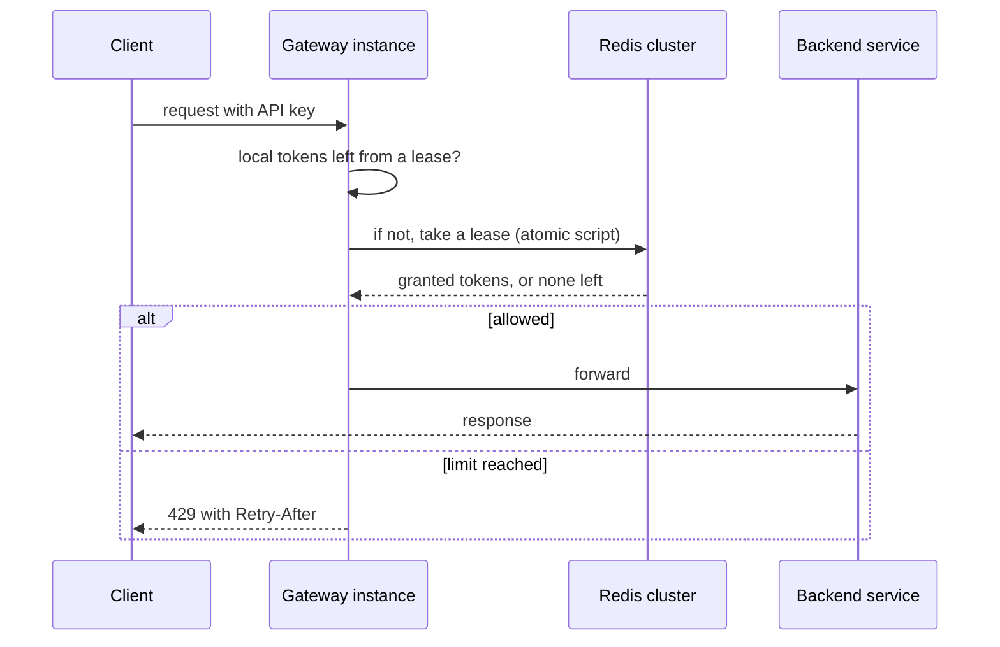

# Case Study: Distributed Rate Limiter

**System design · Step 14.16 · Advanced (case study)** · Last updated 2026-10-22
**Prerequisites:** [Rate limiting and throttling](../01-resilience/07-rate-limiting.md) (1.7), which explains the algorithms and 429 responses; [Scaling out](04-scaling-out-stateless-services.md) (14.4) and [Caching](06-caching.md) (14.6)

[1.7](../01-resilience/07-rate-limiting.md) explains **what** rate limiting is and the token-bucket idea. This case study designs a rate limiter for **many instances** sharing one limit: where the counters live, how they stay correct under concurrency, how much they cost, and what happens when the counter store fails.

## 1. What it is and why it matters

**What is it?** A service, or a library backed by a shared store, that counts each client's requests across **all** instances of an API and rejects those above the client's limit with `429 Too Many Requests`.

**Why do we need it?** With 15 gateway instances ([14.4](04-scaling-out-stateless-services.md)), a limit counted inside each instance is really 15 limits: a partner allowed 1,000 requests a second gets 15,000, or, if the limit is split per instance, gets refused while capacity is free (worked example 3). Partner contracts, abuse protection and fair sharing all need one limit enforced across the fleet.

**When would I meet it?** On public and partner APIs, login and password-reset endpoints, expensive endpoints (search, exports), and on outgoing calls that must stay under a provider's limit, like the email provider in [14.2](02-requirements-design-method.md) and [14.11](11-asynchronous-processing.md).

> [!TIP]
> **Memory hook:** a distributed rate limiter is **a counter that many machines change at once**. Make the change atomic, keep the calls cheap, and decide what to do when the counter can't be reached.

## 2. Industry terms

| Term | Simple meaning | Why it matters | Example | Related terms |
|---|---|---|---|---|
| **Fixed window** | One counter per client per calendar interval | Cheap; lets through twice the limit around a boundary | `partner-7:2026-10-22T09:15` | Window boundary burst |
| **Sliding window counter** | The current window's count plus a weighted share of the previous one | Smooths the boundary at the cost of an approximation | 50% of last minute still counts at 1:30 | Sliding log (exact, costly) |
| **Token bucket** | Tokens refill at the rate; each request takes one; bursts up to the bucket size | Allows short bursts with a steady rate ([1.7](../01-resilience/07-rate-limiting.md)) | 1,000 a second, bucket 2,000 | Leaky bucket |
| **Atomic increment** | The store adds one and returns the new value in a single step | Prevents two instances from both reading 9 and writing 10 | Redis `INCR` | Read-modify-write race |
| **Server-side script** | Logic that runs inside the store as one atomic step | Combines "increment, set expiry, check" without races | A Redis Lua script ("Redis guarantees the script's atomic execution") | Redis Functions |
| **Lease (local batch)** | An instance takes a batch of tokens from the shared store and spends them locally | Cuts store calls by the batch size, slightly less exact | Take 50 tokens at a time | Token allocation |
| **Fail open / fail closed** | When the counter store is unreachable, allow requests, or reject them | Decides whether a store outage becomes an API outage or an unprotected API | Fail open for search, closed for login | Graceful degradation |
| **429 and `Retry-After`** | "The user has sent too many requests in a given amount of time" (RFC 6585), with an optional wait hint | Tells well-behaved clients when to come back | `Retry-After: 2` | Backoff |

## 3. In a real system (ShopFlow)

**The business problem.** ShopFlow sells API access to partners (price comparison sites, marketplaces) with limits per plan: 100, 1,000 or 5,000 requests a second. The API gateway runs as 15 instances. Partners pay for their limits and complain if they are refused below them; ShopFlow must also be protected from partners that exceed them, and from bots on the login endpoint.



**How the design helps.** One shared counter per partner and second, held in a Redis cluster close to the gateways, changed atomically, with local leases to keep the number of calls small. Each plan's limit, burst size and fail mode are configuration.

**What it costs.** A shared store on the request path, with its own latency, capacity and failure modes; a small loss of exactness with leases; and a decision, per endpoint, about failing open or closed.

**Elsewhere:** cloud providers throttle their own APIs per account and region; payment gateways limit card attempts per card and per merchant to slow down fraud; messaging platforms limit sends per sender to protect their reputation with carriers.

## 4. How it works

### Step 1: Requirements

- **Functional:** limit requests per **key** (partner, user, IP address, endpoint) according to a policy (rate and burst); answer 429 with `Retry-After`; expose the remaining quota in headers; allow policy changes without deploys.
- **Non-functional:** add under 2 ms at p99 to each request (assumption); accurate within a few percent of the limit; available enough that it never becomes the reason the API is down; works across zones.
- **Out of scope:** billing for usage (a separate, exact count from logs or events).

### Step 2: Estimate

At ShopFlow's peak of about 2,300 requests a second ([14.3](03-back-of-the-envelope-estimation.md)), one store call per request is 2,300 calls a second, easily handled by one Redis node; one million active keys at about 100 bytes each is about 100 MB (practice exercise 1). Leases cut the calls by their batch size. The design is limited by **correctness and failure behaviour**, not by size.

### Step 3: Interface and data

```text
Gateway filter:   allow(key, policy) -> {allowed, remaining, retryAfterSeconds}
Response headers: 429 Too Many Requests; Retry-After: <seconds>
Store keys:       rl:{partner-7}:{epoch-second}  -> count, with an expiry of a few seconds
Policy table:     partner-7 -> 1,000 per second, burst 2,000, fail mode OPEN
```

### Step 4: High-level design



1. The gateway identifies the key (API key, user, IP) and looks up its policy (cached).
2. It spends a token from its **local lease** if it has one; otherwise it asks Redis for a new lease, in **one atomic script** that increments the counter, sets its expiry and returns how many tokens were granted.
3. Allowed requests go on; refused ones get 429 and `Retry-After`.
4. If Redis can't be reached within a short timeout, the gateway applies the policy's **fail mode**.

### Step 5: Deep dives

The programs below are exact simulations; how to run them is in [the Java overview](../13-java/01-java-overview.md), section 5.

**Deep dive 1: fixed window versus sliding window.**

```java
// File: WindowBoundary.java (runnable, Java 21)
public class WindowBoundary {

    static final int LIMIT = 100;            // requests per minute per client
    static final long WINDOW_MS = 60_000;

    // Fixed window: one counter per calendar minute.
    static int fixedWindow(long[] requestTimes) {
        long currentWindow = -1;
        int count = 0, accepted = 0;
        for (long t : requestTimes) {
            long window = t / WINDOW_MS;
            if (window != currentWindow) { currentWindow = window; count = 0; }
            if (count < LIMIT) { count++; accepted++; }
        }
        return accepted;
    }

    // Sliding window counter: this minute's count plus last minute's count, weighted by how much
    // of last minute still overlaps the sliding 60 seconds.
    static int slidingWindow(long[] requestTimes) {
        long currentWindow = -1;
        int current = 0, previous = 0, accepted = 0;
        for (long t : requestTimes) {
            long window = t / WINDOW_MS;
            if (window != currentWindow) {
                previous = window == currentWindow + 1 ? current : 0;
                current = 0;
                currentWindow = window;
            }
            double overlap = (double) (WINDOW_MS - t % WINDOW_MS) / WINDOW_MS;
            double estimate = current + previous * overlap;
            if (estimate < LIMIT) { current++; accepted++; }
        }
        return accepted;
    }

    static long[] burst(long startMs, int n) {
        long[] times = new long[n];
        for (int i = 0; i < n; i++) times[i] = startMs + i;     // n requests, one millisecond apart
        return times;
    }

    static long[] concat(long[] a, long[] b) {
        long[] r = new long[a.length + b.length];
        System.arraycopy(a, 0, r, 0, a.length);
        System.arraycopy(b, 0, r, a.length, b.length);
        return r;
    }

    public static void main(String[] args) {
        // 100 requests just before the minute changes, 100 just after: 200 within half a second.
        long[] edge = concat(burst(59_800, 100), burst(60_000, 100));
        System.out.println("200 requests around a minute boundary, limit " + LIMIT + " per minute");
        System.out.println("  fixed window accepts:   " + fixedWindow(edge));
        System.out.println("  sliding window accepts: " + slidingWindow(edge));
        // Half a minute later, half of the previous minute still counts.
        long[] later = concat(edge, burst(90_000, 100));
        System.out.println("plus 100 more at 1:30");
        System.out.println("  fixed window accepts:   " + (fixedWindow(later) - fixedWindow(edge)) + " of them");
        System.out.println("  sliding window accepts: " + (slidingWindow(later) - slidingWindow(edge)) + " of them");
    }
}
```

**Expected output**:

```text
200 requests around a minute boundary, limit 100 per minute
  fixed window accepts:   200
  sliding window accepts: 101
plus 100 more at 1:30
  fixed window accepts:   0 of them
  sliding window accepts: 50 of them
```

The fixed window accepts all 200 requests within half a second, because 100 fall in each minute: twice the intended rate at every boundary. The sliding window counter weights the previous minute by how much of it still lies within the last 60 seconds, so just after the boundary the previous 100 still count almost fully; it accepted 101 instead of 100, which shows it is an approximation, and at 1:30, when half of the previous minute still counts, it accepts about half of the next burst. A token bucket ([1.7](../01-resilience/07-rate-limiting.md)) avoids boundaries altogether and allows a defined burst.

**Deep dive 2: concurrency.**

```java
// File: CounterRace.java (runnable, Java 21)
public class CounterRace {

    static final int LIMIT = 10;

    public static void main(String[] args) {
        // Two gateway instances, A and B, share a counter that is already at 9 this second.
        System.out.println("Read, then write (GET, check, SET)");
        int counter = 9;
        int seenByA = counter;                 // A: GET -> 9
        int seenByB = counter;                 // B: GET -> 9, before A has written
        boolean allowA = seenByA < LIMIT;
        boolean allowB = seenByB < LIMIT;
        counter = seenByA + 1;                 // A: SET 10
        counter = seenByB + 1;                 // B: SET 10, overwriting A's write
        System.out.println("  A allowed " + allowA + ", B allowed " + allowB + ", counter " + counter
                + "   <- 11 requests passed, and the counter says 10");

        System.out.println("Atomic increment (INCR, then check the returned value)");
        counter = 9;
        int afterA = ++counter;                // A: INCR -> 10, done by the store in one step
        int afterB = ++counter;                // B: INCR -> 11
        System.out.println("  A allowed " + (afterA <= LIMIT) + ", B allowed " + (afterB <= LIMIT) + ", counter " + counter);
    }
}
```

**Expected output**:

```text
Read, then write (GET, check, SET)
  A allowed true, B allowed true, counter 10   <- 11 requests passed, and the counter says 10
Atomic increment (INCR, then check the returned value)
  A allowed true, B allowed false, counter 11
```

Reading the counter, checking it, then writing it back is the same race as the oversold hoodie in [14.4](04-scaling-out-stateless-services.md): two instances act on the same old value, so 11 requests pass a limit of 10 and the counter even loses a count. Redis's `INCR` does the increment in the store and returns the new value, so each instance decides on a different number. Redis's own documentation warns that `INCR` followed by a separate `EXPIRE` has a race too (the expiry may never be set, leaking the key) and fixes it with a Lua script, because "Redis guarantees the script's atomic execution".

**Deep dive 3: cost and exactness with leases.**

```java
// File: LeaseDemo.java (runnable, Java 21)
public class LeaseDemo {

    public static void main(String[] args) {
        int globalLimit = 1_000;                      // requests per second for one partner, across all instances
        int[] demand = {500, 50, 50, 50, 50, 50, 50, 50, 50, 50};   // the load balancer is uneven this second
        int instances = demand.length;

        // 1. Static split: each instance may accept globalLimit / instances on its own.
        int share = globalLimit / instances, accepted = 0;
        for (int d : demand) accepted += Math.min(d, share);
        System.out.println("Static split (" + share + " each):     accepted " + accepted + ", store calls 0");

        // 2. Shared counter: every request asks the store.
        int total = 0;
        for (int d : demand) total += d;
        System.out.println("Shared counter per request:  accepted " + Math.min(total, globalLimit) + ", store calls " + total);

        // 3. Leases: an instance takes 50 tokens at a time from the shared store, and spends them locally.
        int lease = 50, remaining = globalLimit, calls = 0;
        accepted = 0;
        for (int d : demand) {
            int local = 0;
            for (int r = 0; r < d; r++) {
                if (local == 0 && remaining > 0) {
                    int granted = Math.min(lease, remaining);
                    remaining -= granted;
                    local += granted;
                    calls++;
                }
                if (local > 0) { local--; accepted++; }
            }
        }
        System.out.println("Leases of " + lease + " tokens:          accepted " + accepted + ", store calls " + calls);
    }
}
```

**Expected output**:

```text
Static split (100 each):     accepted 550, store calls 0
Shared counter per request:  accepted 950, store calls 950
Leases of 50 tokens:          accepted 950, store calls 19
```

| Approach | Accepted (950 wanted, limit 1,000) | Store calls | Weakness |
|---|---|---|---|
| Static split per instance | 550 | 0 | Uneven load balancing refuses requests the partner paid for |
| Shared counter per request | 950 | 950 | A store call on every request |
| Leases of 50 | 950 | 19 | Tokens leased but not used are wasted until they expire; a crashed instance takes its unused tokens with it |

Leases are the usual compromise. The batch size must be small compared with the limit divided by the number of instances, or a few busy instances lease everything (the experiment shows it).

**Experiment.** Predict first: what happens with leases of 200 tokens instead of 50 (`int lease = 200`)? The result is in Answers.

**Deep dive 4: failure of the counter store.** The rate limiter must never be the reason the API is down, and must not leave critical endpoints unprotected. Decide per endpoint:

| Endpoint | Fail mode | Why |
|---|---|---|
| Product search, catalogue | **Open**, with a local per-instance limit as a backstop | A short period without exact limits is acceptable; refusing everyone is not |
| Login, password reset | **Closed**, or a strict local limit | Unlimited attempts would invite credential stuffing |
| Outgoing calls to a provider | A **local** limit at the provider limit ÷ instances | The provider enforces its own limit anyway |

Every Redis call has a timeout of a few milliseconds ([1.2](../01-resilience/02-timeouts.md)), and a circuit breaker ([1.5](../01-resilience/05-circuit-breaker.md)) stops calling a failing store.

### Step 6: Failures and trade-offs

- **Hot keys:** one big partner's counter is one Redis key on one node; leases reduce its traffic, and very large partners can have their limit split into sub-keys ([14.9](09-partitioning-sharding.md), worked example 3).
- **Several regions:** a single global counter would add a cross-region round trip to every request; instead, give each region a share of the limit, and rebalance shares periodically ([14.14](14-multi-region-disaster-recovery.md)).
- **Accuracy:** the limit is approximate by design (leases, sliding window). Billing and contracts that need exact counts use request logs or events, not the limiter.

## 5. Failure scenarios

### A Redis outage became an API outage

1. **What happened?** The Redis cluster was briefly unreachable. Every gateway instance waited on it and then returned errors; the whole partner API was down for minutes.
2. **Why?** No timeout on the limiter's calls, and failures treated as "deny".
3. **What did the business see?** An outage caused by a protection mechanism, and partners invoking their service credits.
4. **Solutions:** a short timeout, a circuit breaker, a fail mode per endpoint, and a local fallback limit.
5. **What they cost:** during a store outage, limits are approximate; login stays strict and may refuse some genuine users.

### Partners refused below their limit

1. **What happened?** A partner with a 1,000-a-second plan received 429s at 600 a second.
2. **Why?** The limit was split evenly over 10 instances, and the load balancer sent half of the partner's traffic to one of them (worked example 3).
3. **What did the business see?** Complaints and a support escalation from a paying customer.
4. **Solutions:** a shared counter with leases; monitoring of accepted versus allowed rates per partner.
5. **What they cost:** a shared store and its operation.

### Every client retried at the same second

1. **What happened?** After a burst of 429s, the refused clients all retried exactly when `Retry-After` said, causing another burst and another round of 429s.
2. **Why?** Fixed `Retry-After` values and clients without jitter.
3. **What did users see?** Waves of refusals long after the original burst.
4. **Solutions:** `Retry-After` values with some spread; client libraries that add jitter and back off exponentially ([1.3](../01-resilience/03-retries-backoff-jitter.md)); a token bucket instead of a fixed window.
5. **What they cost:** clients wait a little longer on average.

## 6. Architectural decisions

| Decision | Choose | When |
|---|---|---|
| Where to enforce | At the API gateway | Per partner, plan, IP or route; the first line |
| | In the service | Per tenant or business action (for example "5 exports an hour") |
| | Around outgoing calls | To stay under a provider's limit |
| Algorithm | Token bucket | Steady rate with defined bursts: the usual default |
| | Sliding window counter | Smooth limits per window without bucket parameters |
| | Fixed window | Very cheap, when twice the burst at boundaries is acceptable |
| Counting | Local only | Approximate limits are fine, or as a fallback |
| | Shared counter with leases | Limits per client across many instances, as for paid plans |
| Store failure | Open | Availability matters more than exact limits |
| | Closed | Unlimited access is dangerous (login, payments) |

**Common mistakes:** read-modify-write counters; no timeout on the limiter; one fail mode for everything; per-instance limits sold as global ones; exact billing from an approximate limiter; `Retry-After` that synchronises retries.

## 7. Try it yourself

Try each exercise first; the solutions are in the Answers section, the first as a runnable program.

1. **Store load and memory.** At 2,315 requests a second, how many calls a second reach the counter store with one call per request, with leases of 10 and of 50? About how much memory do one million active keys need at 100 bytes each?
2. **Choose the fail mode** for: (a) the public product search API; (b) the login endpoint; (c) the partner order API used by marketplaces; (d) calls from ShopFlow to the SMS provider.
3. **Two regions.** A partner's limit of 1,000 a second must hold across eu-west and us-east. Design it without a cross-region call on every request.

## 8. Check your understanding

1. Why does a fixed-window limit of 100 a minute let 200 requests through in a second?
2. Two gateway instances read a counter of 9 at the same moment. What goes wrong with read-then-write, and what fixes it?
3. Why do leases reduce store calls, and what limits how big a lease should be?
4. The counter store is down. Why is "deny everything" a poor default for most endpoints, and where is it right?

Answers are at the end of this note.

## 9. Revision

**Remember**
- Per-instance limits are **15 limits**, too strict or too loose; a shared limit needs a **shared counter**.
- Change the counter **atomically** (`INCR`, or a Lua script that increments, expires and checks).
- **Leases** cut store calls by the batch size; keep batches small relative to limit ÷ instances.
- Fixed windows burst **twice** at boundaries; sliding windows and token buckets smooth it.
- Decide **fail open or closed** per endpoint; always a short timeout and a local fallback.

**Explain in 15 seconds:** "A distributed rate limiter keeps one shared, atomically updated counter per client, usually in Redis, with local leases to keep calls cheap, returns 429 with Retry-After, and has an explicit behaviour for when the store is unreachable."

**Explain in 60 seconds:**
> "With many gateway instances, local counters don't give one limit: an even split refuses traffic when load balancing is uneven, and independent counters multiply the limit. So I keep a shared counter per client and window in Redis, changed atomically, either with INCR or with a Lua script that increments, sets the expiry and checks in one step, because read-then-write lets two instances pass on the same count. To keep it cheap, each instance leases a small batch of tokens and spends them locally, which cuts store calls by the batch size at a small cost in exactness. I use a token bucket or a sliding window to avoid the double burst of fixed windows, return 429 with a Retry-After that clients spread with jitter, and decide per endpoint what happens when Redis is unreachable: fail open with a local limit for search, fail closed for login. Across regions, each region gets a share of the limit."

**Likely follow-up questions:**
- **Why not do it in the database?** Possible at low rates, but a counter update per request on the primary database adds load and latency where it hurts most; an in-memory store is built for it.
- **How do you rate-limit by user and by IP at once?** Check several keys in one script and refuse if any is over its limit.
- **How exact does it need to be?** Within a few percent for protection; exact only for billing, which comes from logs.
- **What headers should a client get?** 429 with `Retry-After`; many APIs also send the limit and remaining quota (an IETF draft standardises such headers; check its status before relying on it).

**Architect's takeaway:** the hard part of a distributed rate limiter isn't the algorithm; it's the shared counter: atomic updates, few calls, and a deliberate answer for when it fails.

**Next topic:** [Case study: notification system](17-case-notification-system.md) (14.17)

## 10. Verification and sources

> [!NOTE]
> Checked 2026-10-22. All programs were run on OpenJDK 21.0.8, and the repository's example checker compares their output. Re-verify when you revisit this note.

- **Confirmed:** RFC 6585, section 4: "The 429 status code indicates that the user has sent too many requests in a given amount of time", the response "MAY include a Retry-After header", and the specification "does not define how the origin server identifies the user, nor how it counts requests" (rfc-editor.org, read 2026-10-22). Redis's `INCR` documentation describes two rate-limiter patterns, one with `MULTI`/`EXEC` around `INCR` and `EXPIRE`, and one whose separate `INCR` and `EXPIRE` has "a race condition" fixed with a Lua script (redis.io, "INCR", read 2026-10-22). "Redis guarantees the script's atomic execution. While executing the script, all server activities are blocked during its entire runtime" (redis.io, "Scripting with Lua", read 2026-10-22).
- **Assumptions and illustrations:** the programs are deterministic simulations; the 2 ms target, 100 bytes per key, partner limits and traffic splits are illustrative. The sliding window counter shown is one common approximation; libraries differ.
- **To verify:** the rate limiter of your gateway (for example Spring Cloud Gateway's Redis rate limiter, described in [1.7](../01-resilience/07-rate-limiting.md)) and its behaviour when Redis is unavailable; the status of the IETF draft on rate-limit headers.
- **Decision rule:** one shared, atomically updated counter per key, with leases for cost; token bucket or sliding window; a timeout, a local fallback and a fail mode chosen per endpoint.

**Sources:** RFC 6585, "Additional HTTP Status Codes", section 4; redis.io, "INCR" (rate limiter patterns) and "Scripting with Lua"; [Rate limiting and throttling](../01-resilience/07-rate-limiting.md) (1.7) in this repository.

## Answers

**Experiment**

- **Leases of 200 tokens** (deep dive 3): only **600** of the 950 requests are accepted, with 5 store calls. The busy instance leases 600 tokens to serve its 500 requests (100 sit unused), the next two instances take 200 each, and the global 1,000 is gone before the other seven instances get any. Big leases save calls but let a few instances hoard the limit; keep them small relative to the limit divided by the number of instances, and give unused tokens a short expiry.

**Check your understanding**

1. Because the counter resets at the start of each calendar minute: 100 requests in the last half-second of one minute and 100 in the first half-second of the next are both within their own window's limit. A sliding window or a token bucket counts the last 60 seconds or limits bursts, so it refuses most of the second hundred.
2. Both see 9, both decide "allowed", and both write 10: 11 requests have passed a limit of 10, and the counter has lost one count, so later decisions are wrong too. An atomic increment in the store (`INCR`, which returns the new value) or a server-side script means each instance decides on a different, correct number.
3. Because an instance asks the store once per batch instead of once per request, so calls fall by the batch size (2,315 a second becomes 46 with batches of 50). The size is limited by fairness and exactness: tokens leased by one instance can't be used by others, so large batches let a few busy instances take the whole limit, and leased tokens are lost if an instance crashes.
4. Because the rate limiter would then turn a short store outage into a full API outage for everyone, including well-behaved clients. Denying is right where unlimited access is dangerous: login and password reset (credential stuffing), or payment attempts; elsewhere, fail open with a local per-instance limit as a backstop.

**Practice exercises**

1. **Store load and memory:**

```java
// File: StoreLoad.java (runnable, Java 21)
import java.util.Locale;

public class StoreLoad {

    public static void main(String[] args) {
        double requestsPerSecond = 2_315;          // ShopFlow's peak, from 14.3
        long clients = 1_000_000;                  // distinct keys with a counter at the same time
        long bytesPerKey = 100;                    // illustrative: key, value, expiry, overhead

        System.out.println(String.format(Locale.ROOT, "store calls, one per request:  %,6.0f a second", requestsPerSecond));
        for (int lease : new int[] {10, 50}) {
            System.out.println(String.format(Locale.ROOT, "store calls, leases of %2d:     %,6.0f a second", lease, requestsPerSecond / lease));
        }
        System.out.println(String.format(Locale.ROOT, "memory for %,d keys:     about %d MB", clients, clients * bytesPerKey / 1_000_000));
    }
}
```

**Expected output**:

```text
store calls, one per request:   2,315 a second
store calls, leases of 10:        232 a second
store calls, leases of 50:         46 a second
memory for 1,000,000 keys:     about 100 MB
```

One call per request is about 2,300 a second, which a single Redis node handles; leases of 50 bring it to under 50. A million active keys need roughly 100 MB with these assumptions. Neither is a reason for a complex design; correctness and failure behaviour are.

2. **Fail modes:** (a) Product search: **open**, with a local limit per instance (for example the plan limit ÷ instances × 2) as a backstop. (b) Login: **closed**, or a strict local limit per IP and per account, because unlimited attempts invite credential stuffing. (c) Partner order API: **open** with a local backstop, because orders are revenue and partners are known; alert immediately. (d) SMS provider calls: a **local** limit per instance (the provider limit ÷ instances), independent of the shared store, because the provider enforces its own limit and errors there are costly.

3. **Two regions:** give each region a share of the limit (for example 600 for eu-west and 400 for us-east, based on where the partner's traffic usually comes from), enforced by each region's own shared counter. A background job compares actual usage every few seconds and moves unused share between regions through an asynchronous update. During a regional failover, the surviving region takes the full limit. The limit is slightly inexact at the edges, which is acceptable for protection; exact usage for billing comes from logs.

Back to [the System design overview](01-system-design-overview.md) · [the index](../README.md) · [Roadmap](../roadmap.md).
