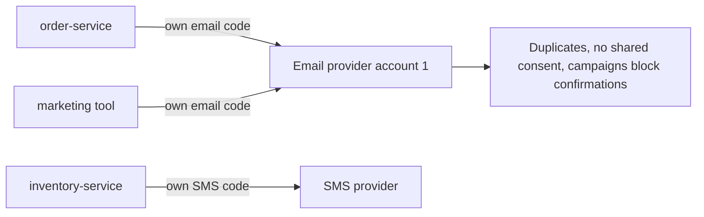
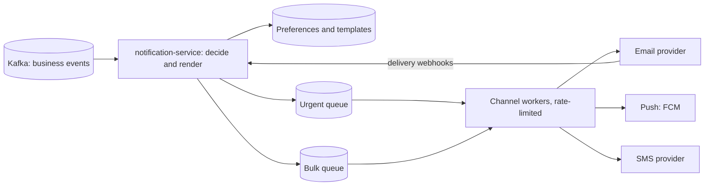

# Case Study: Notification System

**System design · Step 14.17 · Advanced (case study)** · Last updated 2026-10-22
**Prerequisites:** [Asynchronous processing](11-asynchronous-processing.md) (14.11) and [Distributed rate limiter](16-case-distributed-rate-limiter.md) (14.16); helpful: [Idempotency](../01-resilience/04-idempotency.md) (1.4)

## 1. What it is and why it matters

**What is it?** One service that every other service asks to "tell this customer about this", and that decides **whether**, **how** (email, push, SMS), **when** and **in which words** to do it, sends it through external providers, and records what happened.

**Why do we need it?** Without it, every service sends its own emails with its own provider account, templates and retry logic. Customers get duplicates, messages at 3 a.m., marketing to people who unsubscribed (which is unlawful in many places and hurts email deliverability), and order confirmations stuck behind campaigns. A shared notification system puts those rules in one place.

**When would I meet it?** In every product that has customers; when a provider changes its rules or limits; when a campaign delays transactional messages; and as a standard system design interview question.

> [!TIP]
> **Memory hook:** a notification system is a **funnel of decisions** (should we, which channel, which words, when) followed by **careful sending** (one at a time per event, within provider limits, urgent before bulk).

## 2. Industry terms

| Term | Simple meaning | Why it matters | Example | Related terms |
|---|---|---|---|---|
| **Transactional message** | Triggered by the customer's own action, expected promptly | Must not wait behind marketing; usually not subject to marketing opt-out | Order confirmation, password reset | Operational message |
| **Marketing (bulk) message** | Sent to many customers on the business's initiative | Needs consent and unsubscribe; volume bursts | A sale campaign | Promotional |
| **Channel and provider** | The medium (email, push, SMS) and the external company that delivers it | Each provider has limits, costs and failure modes | Email provider, Firebase Cloud Messaging (FCM) for push | Gateway |
| **Preferences and consent** | What each customer agreed to receive, on which channel | Sending without consent is unlawful in many places and harms deliverability | "Offers by email: yes; SMS: no" | Opt-in, opt-out |
| **One-click unsubscribe** | An unsubscribe link that works with a single click, without a confirmation page (RFC 8058) | Required by large mailbox providers for bulk senders | `List-Unsubscribe-Post: List-Unsubscribe=One-Click` | `List-Unsubscribe` |
| **Device token** | The address of one app installation for push messages | Tokens go stale; invalid ones must be removed | An FCM registration token | Push |
| **Deduplication key** | An id per intended message, so a repeat is recognised | Delivery from the queue is at least once | `ev-501:EMAIL` | Idempotency key |
| **Delivery status** | What happened after sending: delivered, bounced, failed, opened | Support, retries and list hygiene depend on it | A bounce callback from the email provider | Webhook |

## 3. In a real system (ShopFlow)

**The business problem.** ShopFlow sends order confirmations, shipping updates, password resets, back-in-stock alerts ([14.2](02-requirements-design-method.md)) and marketing campaigns, by email, push and SMS. Customers complain about duplicate emails and marketing they didn't ask for; confirmations sometimes arrive ten minutes late during campaigns; and since February 2024, large mailbox providers require bulk senders to authenticate their mail and offer one-click unsubscribe.



**How a notification system helps.** Services publish **events** (`OrderPlaced`, `OrderShipped`, `PasswordResetRequested`, `CampaignStarted`); the Notification Service applies preferences, picks channels, renders templates in the customer's language, deduplicates, queues by priority, and sends within each provider's limit.

**What it costs.** One more critical service, with a database of preferences and delivery history; a template system to maintain; provider accounts and webhooks; and responsibility for consent and deliverability, which is partly a legal and reputational matter, not only a technical one.

**Elsewhere:** banks send one-time passwords by SMS with a short validity and a fallback voice call; ride-hailing apps send push messages that must arrive within seconds and are useless a minute later; airlines send disruption alerts to whole flights at once, which is a fan-out burst.

## 4. How it works

### Step 1: Requirements

- **Functional:** accept notification requests as events; respect preferences, consent and quiet hours; choose channels; render localised templates; send via providers; record delivery status; let customers unsubscribe in one click.
- **Non-functional:** transactional messages leave within 30 seconds of the event (assumption), marketing within hours; **no duplicates** for one intended message; no message to someone who opted out; survive a provider outage.
- **Constraints:** provider limits (email 100 a second, as in [14.2](02-requirements-design-method.md)); mailbox provider rules for bulk senders.

### Step 2: Estimate

About 150,000 transactional messages a day ([14.3](03-back-of-the-envelope-estimation.md)), roughly 2 a second on average and 20 at peak, plus campaigns to up to 2 million customers. Campaign size against provider limits is the real constraint:

```java
// File: CampaignFanout.java (runnable, Java 21)
import java.util.Locale;

public class CampaignFanout {

    record Channel(String name, double share, int providerLimitPerSecond) {}

    public static void main(String[] args) {
        long customers = 2_000_000;
        // Illustrative: the share of customers who chose each channel for offers, and each provider's limit.
        Channel[] channels = {
                new Channel("email", 0.60, 100),
                new Channel("push", 0.30, 2_000),
                new Channel("SMS", 0.10, 50)};
        System.out.println("channel   messages    provider limit   time to send all");
        for (Channel c : channels) {
            long messages = Math.round(customers * c.share());
            double hours = messages / (double) c.providerLimitPerSecond() / 3_600;
            System.out.println(String.format(Locale.ROOT, "%-7s  %,9d   %,6d/s         %5.1f hours", c.name(), messages, c.providerLimitPerSecond(), hours));
        }
    }
}
```

**Expected output**:

```text
channel   messages    provider limit   time to send all
email    1,200,000      100/s           3.3 hours
push       600,000    2,000/s           0.1 hours
SMS        200,000       50/s           1.1 hours
```

A campaign by email takes over three hours at 100 a second, so campaigns are **scheduled and paced**, never "send now to everyone", and they must never use the capacity that confirmations need.

### Step 3: Interface and data

```text
Event in:    NotificationRequested {eventId, type: ORDER_SHIPPED, customerId, data: {...}, priority: TRANSACTIONAL}
Preferences: customer_id, channel, category (transactional | offers), allowed, quiet_hours, locale
Delivery:    dedup_key (eventId:channel), customer_id, channel, provider, status, provider_message_id, timestamps
Devices:     customer_id, push_token, platform, last_seen
```

### Step 4: High-level design



1. **Decide:** for each event, look up the customer's preferences and consent; drop marketing for customers who opted out; hold non-urgent messages during quiet hours.
2. **Render:** pick the template for the type, channel and locale, and fill it.
3. **Deduplicate:** compute the key `eventId:channel` and skip it if already recorded.
4. **Queue by priority:** transactional to the urgent queue, marketing to the bulk queue.
5. **Send:** channel workers take urgent messages first, keep within each provider's limit (a local limiter per worker, [14.16](16-case-distributed-rate-limiter.md)), and retry failures with backoff, then dead-letter them ([14.11](11-asynchronous-processing.md)).
6. **Track:** provider webhooks report delivery, bounces and complaints; bounced addresses and invalid push tokens are removed.

### Step 5: Deep dives

The programs below are deterministic simulations; how to run them is in [the Java overview](../13-java/01-java-overview.md), section 5.

**Deep dive 1: urgent work must not wait behind bulk work.**

```java
// File: PriorityDispatch.java (runnable, Java 21)
import java.util.ArrayDeque;
import java.util.Deque;

public class PriorityDispatch {

    static final int PROVIDER_LIMIT = 100;        // emails a second the provider accepts
    static final int SECONDS = 1_200;

    record Message(boolean transactional, int arrivedAt) {}

    // Order confirmations arrive at 20 a second all the time; a campaign adds 200 a second for 10 minutes.
    static int arrivingTransactional(int second) { return 20; }
    static int arrivingCampaign(int second) { return second < 600 ? 200 : 0; }

    static int longestConfirmationWait(boolean separateQueues, int reservedForTransactional) {
        Deque<Message> shared = new ArrayDeque<>(), urgent = new ArrayDeque<>(), bulk = new ArrayDeque<>();
        int longest = 0;
        for (int s = 0; s < SECONDS; s++) {
            for (int i = 0; i < arrivingTransactional(s); i++) (separateQueues ? urgent : shared).add(new Message(true, s));
            for (int i = 0; i < arrivingCampaign(s); i++) (separateQueues ? bulk : shared).add(new Message(false, s));
            int budget = PROVIDER_LIMIT;
            if (separateQueues) {
                // Urgent first, up to its reserved share and beyond if bulk has nothing; bulk gets the rest.
                int forUrgent = Math.min(urgent.size(), Math.max(reservedForTransactional, budget - bulk.size()));
                for (int i = 0; i < forUrgent && budget > 0; i++, budget--) longest = Math.max(longest, s - urgent.poll().arrivedAt());
                while (budget-- > 0 && !bulk.isEmpty()) bulk.poll();
            } else {
                while (budget-- > 0 && !shared.isEmpty()) {
                    Message m = shared.poll();
                    if (m.transactional()) longest = Math.max(longest, s - m.arrivedAt());
                }
            }
        }
        return longest;
    }

    public static void main(String[] args) {
        System.out.println("One queue for everything:          a confirmation waits up to " + longestConfirmationWait(false, 0) + " s");
        System.out.println("Separate queues, 30/s reserved:    a confirmation waits up to " + longestConfirmationWait(true, 30) + " s");
    }
}
```

**Expected output**:

```text
One queue for everything:          a confirmation waits up to 654 s
Separate queues, 30/s reserved:    a confirmation waits up to 0 s
```

With one queue, confirmations sit behind the campaign's backlog and wait up to about 11 minutes. With separate queues and a reserved share of the provider limit for transactional messages, they go out in the same second, while the campaign uses whatever capacity is left. This is a [bulkhead](../01-resilience/06-bulkhead.md) applied to a shared external limit. The reserved share must be at least the transactional **peak**, which is what the experiment shows.

**Experiment.** Predict first: what if only 10 a second were reserved for transactional messages, which arrive at 20 a second? The result is in Answers.

**Deep dive 2: exactly one message per intended message.**

```java
// File: DedupDemo.java (runnable, Java 21)
import java.util.ArrayList;
import java.util.HashSet;
import java.util.List;
import java.util.Set;

public class DedupDemo {

    record Event(String eventId, String type, String customer, String detail) {}

    static List<String> send(List<Event> delivered, boolean dedup) {
        Set<String> sentKeys = new HashSet<>();       // in production: a table or Redis keys with an expiry
        List<String> sent = new ArrayList<>();
        for (Event e : delivered) {
            String key = e.eventId() + ":EMAIL";      // one email per event and channel
            if (dedup && !sentKeys.add(key)) continue;
            sent.add(e.type() + " email to " + e.customer() + " (" + e.detail() + ")");
        }
        return sent;
    }

    public static void main(String[] args) {
        Event parcel1 = new Event("ev-501", "OrderShipped", "ana", "parcel 1 of 2");
        Event parcel2 = new Event("ev-502", "OrderShipped", "ana", "parcel 2 of 2");
        // The consumer restarted after sending parcel 1's email but before committing its offset,
        // so ev-501 is delivered again (at-least-once delivery).
        List<Event> delivered = List.of(parcel1, parcel1, parcel2);

        System.out.println("Without deduplication:");
        send(delivered, false).forEach(s -> System.out.println("  " + s));
        System.out.println("With deduplication by event id and channel:");
        send(delivered, true).forEach(s -> System.out.println("  " + s));
    }
}
```

**Expected output**:

```text
Without deduplication:
  OrderShipped email to ana (parcel 1 of 2)
  OrderShipped email to ana (parcel 1 of 2)
  OrderShipped email to ana (parcel 2 of 2)
With deduplication by event id and channel:
  OrderShipped email to ana (parcel 1 of 2)
  OrderShipped email to ana (parcel 2 of 2)
```

Events are delivered at least once ([14.11](11-asynchronous-processing.md)), so a consumer restart repeats an event. The deduplication key is the **event id plus channel**, not the content: Ana's two parcels are two real events with identical-looking emails, and both must be sent. The key is stored when the message is handed to the provider, with an expiry longer than any realistic redelivery. Providers that accept an idempotency key on their API close the remaining gap, a crash between sending and recording.

**Deep dive 3: provider failures.** A provider can be slow, down, or reject messages. Calls have short timeouts ([1.2](../01-resilience/02-timeouts.md)) and a circuit breaker ([1.5](../01-resilience/05-circuit-breaker.md)); urgent channels can fail over to a second provider. A **timeout is ambiguous**: the first provider may still deliver the message, so failing over can produce a duplicate. That is acceptable for a password reset (two codes are harmless), not for a campaign (send later instead). Delivery webhooks are themselves at least once, so their handler is idempotent too.

**Deep dive 4: consent, unsubscribe and deliverability.** Google requires all senders to Gmail to authenticate their mail with SPF or DKIM and keep reported spam rates below 0.3%, and bulk senders (more than 5,000 messages a day) to use SPF, DKIM and DMARC and to support one-click unsubscribe for marketing messages. One-click unsubscribe (RFC 8058) uses a `List-Unsubscribe` header with an HTTPS address and a `List-Unsubscribe-Post` header, so a mail client can unsubscribe with a single `POST`, without a confirmation page. The unsubscribe endpoint updates preferences immediately, and the decide step reads them for every message.

### Step 6: Failures and trade-offs

| What fails | What happens | Mitigation |
|---|---|---|
| The email provider | Urgent emails are retried, then fail over; bulk waits | Breaker, second provider for urgent mail, DLQ |
| The preferences store | The service can't decide whether marketing is allowed | Send transactional messages; hold marketing (never send without knowing consent) |
| A template bug | Broken or wrong content to many customers | Preview and test sends; roll out new templates to a small share first |
| Kafka | New events wait; nothing is lost | Events are durable; the backlog drains later |

## 5. Failure scenarios

### Confirmations behind a campaign

1. **What happened?** During a campaign, order confirmations took up to 11 minutes (deep dive 1).
2. **Why?** One queue and one provider limit for all messages.
3. **What did users see?** "Did my order go through?" support tickets, and duplicate orders.
4. **Solutions:** separate queues by priority with a reserved share of each provider limit; paced campaigns.
5. **What they cost:** campaigns take longer; more queue configuration.

### Marketing to people who unsubscribed

1. **What happened?** Customers who had unsubscribed kept receiving offers for days, and complaints rose.
2. **Why?** The campaign tool exported its audience once at the start of a multi-day campaign, and unsubscribes in between weren't applied.
3. **What did the business see?** Complaints, spam reports and, with spam rates near the mailbox providers' threshold, worse delivery for all ShopFlow mail, including confirmations.
4. **Solutions:** check consent at send time for every message, not only when the audience is built; one-click unsubscribe applied immediately; keep transactional and marketing mail on separate sending domains or streams, so marketing complaints don't hurt confirmations.
5. **What they cost:** a preference lookup per message (cached, [14.6](06-caching.md), with short TTLs for opt-outs).

### Pushing to phones that no longer exist

1. **What happened?** Push sending slowed down and costs rose; most failures were for tokens of uninstalled apps.
2. **Why?** Invalid tokens were never removed.
3. **What did users see?** Nothing directly, but real push messages were delayed behind failing ones.
4. **Solutions:** delete tokens that FCM reports as invalid (its documentation: "it is safe to delete your record of this registration, since it will never again be valid"); expire tokens not refreshed recently; refresh tokens from the app periodically.
5. **What they cost:** a small clean-up job and token timestamps.

## 6. Architectural decisions

| Decision | Choose | Because |
|---|---|---|
| How services ask | Publish events; the notification service decides | Senders don't need to know preferences, channels or templates |
| Priority | Separate queues and reserved provider capacity for transactional messages | A shared limit is the usual cause of late confirmations |
| Duplicates | Deduplicate by event id and channel; idempotency keys at providers where offered | At-least-once delivery everywhere |
| Consent | Checked per message at send time; opt-outs applied immediately | Audiences built in advance go stale |
| Provider failover | For urgent channels, accepting rare duplicates; not for bulk | A timeout doesn't prove the message wasn't sent |
| Build or buy | Buy providers (email, push, SMS); build the decision and priority logic, or buy a notification platform if it covers your rules | Delivery is a specialised business; your rules are yours |

**Common mistakes:** each service with its own provider account; dedup by content (drops genuine repeats) or not at all; marketing on the same queue, limit and domain as transactional mail; consent checked only when the audience is built; ignoring bounce, complaint and invalid-token feedback.

## 7. Try it yourself

Try each exercise first; the solutions are in the Answers section.

1. **Quiet hours.** A shipping update is created at 02:00 local time for a customer with quiet hours from 22:00 to 08:00. Which channels and when? What about a password reset at the same time?
2. **A preference model.** Design the preference table so a customer can say "order updates by push and email, offers by email only, nothing by SMS", and explain how it is checked.
3. **Delivery status.** The email provider calls a webhook for each delivery, bounce and complaint, at least once and in any order. Design the handler and what it updates.

## 8. Check your understanding

1. Why should order confirmations and marketing campaigns use separate queues, even if one provider sends both?
2. Why is the deduplication key "event id plus channel" rather than "customer plus message content"?
3. A provider call times out and the system fails over to a second provider. What can go wrong, and when is that acceptable?
4. Why is consent checked when each message is sent, not only when a campaign's audience is chosen?

Answers are at the end of this note.

## 9. Revision

**Remember**
- Services publish **events**; the notification service **decides** (consent, channel, quiet hours), **renders**, **deduplicates**, **queues by priority**, **sends** within limits, and **tracks** delivery.
- **Urgent before bulk:** separate queues and a reserved share of each provider limit, at least the transactional peak.
- **Dedup by event id and channel**; providers' idempotency keys where offered; webhooks handled idempotently.
- **Consent per message**; one-click unsubscribe (RFC 8058); bulk email needs SPF, DKIM, DMARC.
- Clean up: bounced addresses, complaints, invalid push tokens.

**Explain in 15 seconds:** "A notification system receives events, decides from preferences and consent whether and how to notify, renders templates, deduplicates, and sends through providers from priority queues, so transactional messages never wait behind campaigns."

**Explain in 60 seconds:**
> "Services publish events like OrderShipped; they don't send emails themselves. The notification service looks up the customer's preferences, consent and quiet hours, picks channels, renders the template in their language, and computes a deduplication key from the event id and channel, because events arrive at least once. Messages go to an urgent or a bulk queue. Channel workers send urgent messages first, within each provider's limit, with a reserved share so a campaign can't delay confirmations; campaigns are scheduled and paced because at 100 emails a second two million customers take hours. Failures are retried with backoff and dead-lettered; urgent channels can fail over to a second provider, accepting that a timeout may cause a rare duplicate. Delivery webhooks update status and remove bounced addresses and invalid push tokens. Consent is checked at send time, and marketing mail supports one-click unsubscribe, which large mailbox providers now require for bulk senders."

**Likely follow-up questions:**
- **How do you send to a million customers at once?** You don't: you schedule the campaign and pace it within provider limits, prioritising by segment or time zone.
- **How do you guarantee delivery?** You can't control the last step; you retry until the provider accepts, record its status callbacks, and fall back to another channel for critical messages.
- **How are templates managed?** Versioned, previewed and tested before use; each sent message records which template version it used.
- **Where do in-app notifications fit?** As one more channel: stored per customer and shown when the app opens, often alongside a push message.

**Architect's takeaway:** most notification problems are prioritisation and policy problems, not sending problems: separate urgent from bulk, deduplicate per intended message, and treat consent and deliverability as requirements, not afterthoughts.

**Next topic:** [Case study: news feed](18-case-news-feed.md) (14.18)

## 10. Verification and sources

> [!NOTE]
> Checked 2026-10-22. All programs were run on OpenJDK 21.0.8, and the repository's example checker compares their output. Re-verify when you revisit this note.

- **Confirmed:** RFC 8058 defines one-click unsubscribe, explaining that anti-spam software fetches links automatically, so senders used confirmation pages, and that a POST-based mechanism makes single-click unsubscription safe (rfc-editor.org, read 2026-10-22). Google's sender guidelines require all senders to Gmail to set up SPF or DKIM and keep spam rates in Postmaster Tools below 0.3%, and senders of more than 5,000 messages a day to set up SPF, DKIM and DMARC and support one-click unsubscribe for marketing and subscribed messages, from February 1, 2024 (Google Workspace Admin Help, "Email sender guidelines", read 2026-10-22). FCM's documentation says to delete registrations that are invalid or expired, that it "is safe to delete your record of this registration, since it will never again be valid" when the payload is valid, and treats registrations as stale after about a month of inactivity by default (Firebase, "Best practices for FCM registration token management", read 2026-10-22).
- **Assumptions and illustrations:** all volumes, provider limits, channel shares and the 30-second target are illustrative. The dispatch simulation uses whole seconds and a strict priority rule; real schedulers are more refined.
- **To verify:** the legal rules for consent and marketing messages in your markets (they differ by country); your providers' rate limits, idempotency support and webhook semantics; Apple's push (APNs) token handling if you send to iOS directly.
- **Decision rule:** events in, decisions centralised; urgent and bulk separated with reserved capacity; one message per event and channel; consent checked at send time.

**Sources:** RFC 8058, "Signaling One-Click Functionality for List Email Headers"; Google Workspace Admin Help, "Email sender guidelines"; Firebase documentation, "Best practices for FCM registration token management"; this area's notes on [asynchronous processing](11-asynchronous-processing.md) and [rate limiting](16-case-distributed-rate-limiter.md).

## Answers

**Experiment**

- **Only 10 a second reserved** (deep dive 1): a confirmation waits up to **600 seconds**, almost as long as with one queue. Confirmations arrive at 20 a second, so a reserve of 10 lets their own queue grow by 10 a second during the campaign. The reserved share must cover the transactional **peak**, with headroom.

**Check your understanding**

1. Because the provider limit is shared, and with one first-in, first-out queue a campaign's tens of thousands of messages are ahead of any confirmation created during it. Separate queues, with urgent messages served first and a reserved share of the limit, let confirmations go out at once while the campaign uses the rest.
2. Because the goal is "one message per intended message". A redelivered event has the same event id, so it is caught; two genuinely different events can produce identical-looking messages (two parcels, two password resets), and deduplicating by content would wrongly drop the second. The channel is part of the key because one event may intentionally produce an email and a push.
3. The first provider may have delivered the message even though the call timed out, so the second provider sends it again and the customer gets two. That is acceptable for urgent, harmless repeats (a password reset or a shipping update), and not for campaigns or anything where a duplicate causes harm; those wait and retry the first provider later.
4. Because campaigns run for hours or days and audiences are built in advance; customers unsubscribe in between. Checking at send time is the only way to honour an opt-out immediately, which the law in many markets and the mailbox providers' rules expect, and which protects deliverability for all of ShopFlow's mail.

**Practice exercises**

1. **Quiet hours:** the shipping update is not urgent at night: hold push and SMS until 08:00 local time; an email may be sent immediately, because it doesn't wake anyone (if the customer allows email for order updates). A password reset is requested by the customer at that moment, so it is sent immediately on the channel they asked for; quiet hours apply only to messages the customer didn't just request.

2. **Preference model:** a row per customer, category and channel: `(customer_id, category, channel, allowed, updated_at)`, with categories such as `ORDER_UPDATES`, `SECURITY` and `OFFERS`, plus `quiet_hours` and `locale` per customer. Defaults by category (security always on, offers off until consent). The decide step reads the rows for the message's category, keeps the allowed channels, and applies quiet hours; an unsubscribe sets `allowed = false` for `OFFERS` on that channel immediately. Changes are recorded with time and source, as proof of consent.

3. **Delivery status:** the handler verifies the webhook's signature, then records the event with the provider's event id as an idempotency key, so repeats are ignored. Status moves only forward (for example a late "delivered" doesn't overwrite "bounced"), using the event's timestamp. Hard bounces mark the address as undeliverable; complaints unsubscribe the customer from marketing; both feed the deliverability dashboard. The handler answers quickly and does heavier work asynchronously.

Back to [the System design overview](01-system-design-overview.md) · [the index](../README.md) · [Roadmap](../roadmap.md).
