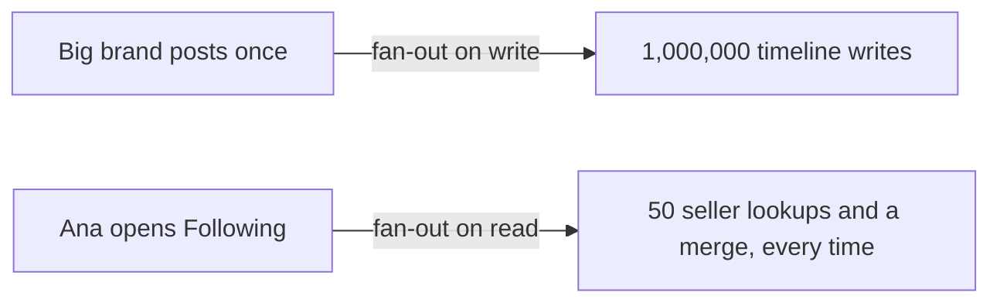
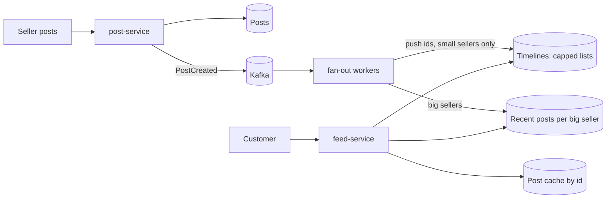

# Case Study: News Feed

**System design · Step 14.18 · Advanced (case study)** · Last updated 2026-10-22
**Prerequisites:** [Caching](06-caching.md) (14.6) and [Asynchronous processing](11-asynchronous-processing.md) (14.11); helpful: [Partitioning and sharding](09-partitioning-sharding.md) (14.9), for hot keys

## 1. What it is and why it matters

**What is it?** A personal, time-ordered list of recent items from the people or sources a user follows, built for every user and read every time they open the app. The core design question is **when** each user's list is assembled: when something is posted (**fan-out on write**), when the user reads (**fan-out on read**), or a mix of both.

**Why do we need it?** A feed turns a many-to-many relationship (many users follow many sources) into a fast, personal read. Done naively, either every post becomes millions of writes, or every feed read becomes hundreds of lookups. The right mix keeps both bounded.

**When would I meet it?** Social networks and activity streams, "following" pages in marketplaces, notification centres, dashboards of recent events, and in interviews, where it is the standard question about fan-out.

> [!TIP]
> **Memory hook:** **push** for the many small sources, **pull** for the few huge ones, and **page with a cursor**, never an offset.

## 2. Industry terms

| Term | Simple meaning | Why it matters | Example | Related terms |
|---|---|---|---|---|
| **Fan-out on write (push)** | When a source posts, its post id is written into every follower's timeline | Reads are one lookup; writes grow with the number of followers | A seller with 200 followers: 200 timeline writes | Precomputed timeline |
| **Fan-out on read (pull)** | When a user reads, the recent posts of every followed source are fetched and merged | No write amplification; reads grow with the number of followed sources | 50 lookups per feed read | Merge on read |
| **Hybrid fan-out** | Push for ordinary sources, pull for sources with very many followers | Bounds both the writes and the reads | Big brands pulled, small shops pushed | Celebrity problem |
| **Timeline** | A user's capped list of post ids, newest first | Small, fast to read; the posts themselves are fetched by id | Redis list capped at 500 ids | Inbox |
| **Hydration** | Turning a list of ids into full items for display | Done from a cache of posts by id | Fetch `p-95`, `p-91`, ... in one multi-get | Multi-get |
| **Cursor pagination** | "Give me items older than this one" | Stable pages while new items arrive | `?before=108` | Keyset pagination, offset pagination |
| **Celebrity (hot source)** | A source with a huge number of followers | One post would cause millions of writes | A brand with 1 million followers | Hot key ([14.9](09-partitioning-sharding.md)) |

## 3. In a real system (ShopFlow)

**The business problem.** ShopFlow's marketplace lets customers follow sellers and brands. A "Following" tab should show their new products and posts, newest first, within seconds of posting. Most sellers have a few hundred followers; a handful of big brands have a million each. Customers open the tab several times a day, and it must load quickly.



**How the design helps.** Small sellers' posts are **pushed** into followers' timelines by background workers; big brands' posts are **pulled** at read time from a small cache of their recent posts; the two are merged, hydrated from a post cache, and paged with a cursor.

**What it costs.** Two code paths (push and pull) and a threshold to tune; timelines to store for active users; feeds that are eventually consistent (a post appears in followers' feeds a few seconds later); and clean-up when posts are deleted or users unfollow.

**Elsewhere:** social networks combine precomputed timelines for most accounts with on-demand merging for very popular ones; activity feeds in collaboration tools are often pull-only, because each user follows few sources; notification centres are push-only, because each event targets known recipients.

## 4. How it works

### Step 1: Requirements

- **Functional:** follow and unfollow sellers; sellers post (new products, announcements); a customer sees posts from followed sellers, newest first, 20 at a time, with infinite scroll.
- **Non-functional:** feed loads with p99 under 300 ms (assumption); new posts appear within about 10 seconds; a missing or slightly late post is acceptable (eventual consistency, [14.10](10-consistency-cap-pacelc-quorums.md)); deleted posts disappear on the next read.
- **Out of scope:** ranking by relevance (time order only), comments, likes.

### Step 2: Estimate the two strategies

The programs below are arithmetic and simulations; how to run them is in [the Java overview](../13-java/01-java-overview.md), section 5.

```java
// File: FanoutCost.java (runnable, Java 21)
import java.util.Locale;

public class FanoutCost {

    public static void main(String[] args) {
        // Illustrative marketplace: most sellers are small, a few are huge.
        long smallSellers = 9_990, smallFollowers = 200;
        long bigSellers = 10, bigFollowers = 1_000_000;
        long postsPerSellerPerDay = 2;
        long customers = 2_000_000, feedReadsPerCustomerPerDay = 5;
        long followedSmall = 48, followedBig = 2;            // an average customer follows 50 sellers
        long pushThreshold = 10_000;                          // hybrid: push only for sellers below this

        long writesPush = postsPerSellerPerDay * (smallSellers * smallFollowers + bigSellers * bigFollowers);
        long reads = customers * feedReadsPerCustomerPerDay;
        long pullFetches = reads * (followedSmall + followedBig);  // each read asks every followed seller
        long hybridWrites = postsPerSellerPerDay * smallSellers * smallFollowers;
        long hybridFetches = reads * followedBig;                  // each read still pulls the big sellers

        System.out.println("approach          timeline writes a day   lookups a day at read time");
        print("fan-out on write", writesPush, reads);               // one timeline read per feed read
        print("fan-out on read", 0, pullFetches);
        print("hybrid", hybridWrites, reads + hybridFetches);
        System.out.println(String.format(Locale.ROOT, "one post by a big seller: %,d timeline writes with fan-out on write", bigFollowers));
        System.out.println("(hybrid: push for sellers under " + pushThreshold + " followers, pull for the rest)");
    }

    static void print(String name, long writes, long readWork) {
        System.out.println(String.format(Locale.ROOT, "%-17s %,20d   %,20d", name, writes, readWork));
    }
}
```

**Expected output**:

```text
approach          timeline writes a day   lookups a day at read time
fan-out on write            23,996,000             10,000,000
fan-out on read                      0            500,000,000
hybrid                       3,996,000             30,000,000
one post by a big seller: 1,000,000 timeline writes with fan-out on write
(hybrid: push for sellers under 10000 followers, pull for the rest)
```

**Walkthrough.** With fan-out on write, the 10 big brands cause 20 million of the 24 million daily timeline writes, and one of their posts is a burst of a million writes. With fan-out on read, every feed read costs 50 lookups: 500 million a day. The hybrid pushes only the small sellers (4 million writes) and pulls only the big brands at read time (2 lookups per read plus the timeline itself), bounding both. All numbers are illustrative.

**Experiment.** Predict first: if the big brands had 5 million followers each (`bigFollowers = 5_000_000`), which approach changes, and by how much? The result is in Answers.

### Step 3: Interface and data

```text
POST /sellers/{id}/posts                     -> 201
POST /customers/me/following/{sellerId}      -> 204
GET  /customers/me/feed?before=<postId>&limit=20
Posts:      post_id (time-ordered, 14.13), seller_id, content, created_at     (database, cached by id)
Follows:    follower_id, seller_id                                              (both directions indexed)
Timelines:  feed:{customerId} -> capped list of post ids, newest first          (Redis, active customers only)
Recent:     recent:{bigSellerId} -> last 100 post ids                           (Redis)
```

Time-ordered post ids ([14.13](13-unique-id-generation.md)) make "newer" and "older" a comparison of ids, which keeps merging and paging simple.

### Step 4: High-level design



1. **Post:** the post is stored, and `PostCreated` is published through the outbox ([14.11](11-asynchronous-processing.md)).
2. **Fan-out:** a worker looks up the seller's follower count. Below the threshold, it pages through the followers and pushes the post id into each **active** follower's timeline (`LPUSH`, then `LTRIM` to cap it; Redis documents this pair as a way to keep a list from growing beyond a fixed size). Above the threshold, it only adds the id to that seller's recent-posts list.
3. **Read:** the feed service reads the customer's timeline, the recent lists of the big sellers they follow, merges by id, hydrates the page from the post cache, filters deleted or hidden posts, and returns it with a cursor.

### Step 5: Deep dives

**Deep dive 1: merging pushed and pulled posts.**

```java
// File: HybridFeed.java (runnable, Java 21)
import java.util.ArrayList;
import java.util.Comparator;
import java.util.List;
import java.util.Map;

public class HybridFeed {

    record Post(String id, String seller, int minute) {}

    public static void main(String[] args) {
        // Ana's pushed timeline: posts from the small sellers she follows, written there at post time.
        List<Post> pushed = List.of(
                new Post("p-91", "knit-shop", 58), new Post("p-87", "mug-maker", 41), new Post("p-80", "knit-shop", 12));
        // Big sellers are not pushed; their recent posts are read at request time (and cached).
        Map<String, List<Post>> bigSellerPosts = Map.of(
                "mega-brand", List.of(new Post("p-95", "mega-brand", 59), new Post("p-70", "mega-brand", 3)),
                "sport-giant", List.of(new Post("p-88", "sport-giant", 44)));

        List<Post> feed = new ArrayList<>(pushed);
        for (String seller : List.of("mega-brand", "sport-giant")) {    // the big sellers Ana follows
            feed.addAll(bigSellerPosts.get(seller));
        }
        feed.sort(Comparator.comparingInt(Post::minute).reversed());   // newest first
        System.out.println("Ana's feed, newest first:");
        feed.stream().limit(5).forEach(p -> System.out.println("  minute " + p.minute() + "  " + p.id() + "  " + p.seller()));
    }
}
```

**Expected output**:

```text
Ana's feed, newest first:
  minute 59  p-95  mega-brand
  minute 58  p-91  knit-shop
  minute 44  p-88  sport-giant
  minute 41  p-87  mug-maker
  minute 12  p-80  knit-shop
```

Ana's timeline holds the small sellers' posts; the big brands' recent posts are read at request time. Sorting the combined list newest first gives one feed in which the source of each item is invisible to her. Because only a page is needed, the merge reads only the first entries of each list.

**Deep dive 2: pages that stay stable while posts arrive.**

```java
// File: CursorPaging.java (runnable, Java 21)
import java.util.ArrayList;
import java.util.List;

public class CursorPaging {

    public static void main(String[] args) {
        // A feed, newest first; ids increase with time, as in note 14.13, so a higher id is newer.
        List<Integer> feed = new ArrayList<>(List.of(110, 109, 108, 107, 106, 105, 104));
        int pageSize = 3;

        List<Integer> page1 = feed.subList(0, pageSize);
        System.out.println("page 1:                  " + page1);
        int lastSeen = page1.get(page1.size() - 1);

        feed.add(0, 111);                  // two new posts arrive before Ana scrolls
        feed.add(0, 112);

        List<Integer> page2ByOffset = feed.subList(pageSize, 2 * pageSize);
        System.out.println("page 2 by offset 3:      " + page2ByOffset + "   <- 109 and 108 again");

        List<Integer> page2ByCursor = new ArrayList<>();
        for (int id : feed) {
            if (id < lastSeen && page2ByCursor.size() < pageSize) page2ByCursor.add(id);   // "older than 108"
        }
        System.out.println("page 2 after cursor 108: " + page2ByCursor);
    }
}
```

**Expected output**:

```text
page 1:                  [110, 109, 108]
page 2 by offset 3:      [109, 108, 107]   <- 109 and 108 again
page 2 after cursor 108: [107, 106, 105]
```

Two new posts arrive while Ana reads page 1. "Skip 3, take 3" now starts two items earlier, so page 2 repeats posts she has seen. A cursor, "older than 108", depends only on the last item she saw, so page 2 continues exactly where page 1 ended, however many posts arrive. This is keyset pagination, the same idea as for order history in [14.2](02-requirements-design-method.md).

**Deep dive 3: storage and who gets a timeline.**

Timelines for every customer would hold 8 GB of ids, for active customers only 2.4 GB (practice exercise 1). Inactive customers get no pushed timeline; when they come back, their feed is built once by pulling, and they are then treated as active again. This keeps fan-out work and memory proportional to customers who actually read.

**Deep dive 4: deletes and unfollows.** Removing a post id from millions of timelines is expensive, so the read path **filters**: hydration finds the post deleted (or the seller unfollowed) and drops it. Timelines are caches of ids, not the source of truth, so they can be trimmed or rebuilt at any time.

### Step 6: Failures and trade-offs

| What fails | What happens | Mitigation |
|---|---|---|
| Fan-out workers fall behind | Posts appear late in feeds | Scale workers on queue age; big-seller posts don't depend on fan-out |
| The timeline store | Feeds can't be read from timelines | Fall back to pulling from followed sellers for a while (slower, still correct); rebuild timelines |
| A small seller suddenly becomes huge | Push cost per post jumps | Re-evaluate the threshold per seller periodically; switch the seller to pull |
| A deleted post | Still listed in timelines | Filtered out during hydration |

## 5. Failure scenarios

### One post, a million writes

1. **What happened?** A big brand posted a promotion. Fan-out workers spent minutes writing to a million timelines, and every other seller's posts were delayed behind it.
2. **Why?** Pure fan-out on write: the work per post grows with the followers.
3. **What did users see?** Late posts from small sellers during the brand's campaign.
4. **Solutions:** hybrid fan-out (pull for sellers above a threshold); separate fan-out queues so a huge job can't delay small ones ([14.11](11-asynchronous-processing.md)).
5. **What they cost:** a second read path and a threshold to manage.

### The feed that repeated itself

1. **What happened?** Customers scrolling the feed saw the same posts twice, and sometimes skipped some.
2. **Why?** Offset pagination over a list that changes while being read (deep dive 2).
3. **What did users see?** A feed that looked broken.
4. **Solutions:** cursor pagination by post id (or by time plus id).
5. **What they cost:** clients pass the cursor instead of a page number; jumping to "page 7" is not possible, which a feed doesn't need.

### Feeds for people who never read them

1. **What happened?** Timeline memory grew every month, and fan-out work grew with it, although most customers rarely opened the app.
2. **Why?** Every follower got pushed timelines, active or not.
3. **What did the business see?** Rising infrastructure cost without more usage.
4. **Solutions:** push only to recently active customers; build a returning customer's feed by pulling once; cap timelines.
5. **What they cost:** the first feed load after a long absence is slower.

## 6. Architectural decisions

| Strategy | Use when | Avoid when |
|---|---|---|
| **Fan-out on write** | Sources have modest audiences; reads are much more frequent than posts; feed reads must be very fast | Some sources have huge audiences |
| **Fan-out on read** | Users follow few sources; posts are frequent; freshness matters more than read cost | Users follow many sources and read often |
| **Hybrid** | Audiences are very uneven (the usual case in practice) | The simpler strategies already fit both bounds |

**Common mistakes:** pushing to every follower including inactive ones; offset pagination; storing full posts in every timeline instead of ids; deleting from millions of timelines instead of filtering on read; treating timelines as the source of truth.

## 7. Try it yourself

Try each exercise first; the solutions are in the Answers section, the first as a runnable program.

1. **Timeline memory.** 2 million customers, timelines capped at 500 post ids of 8 bytes each. How much memory for everyone, and for the 30% who are active?
2. **Choose the threshold.** Fan-out workers can do 20,000 timeline writes a second. Posts must reach pushed timelines within 10 seconds. Above how many followers should a seller be pulled instead of pushed?
3. **Unfollow.** Ana unfollows `knit-shop`. What changes immediately, what changes later, and what does her next feed read show?

## 8. Check your understanding

1. Why does pure fan-out on write break down for a seller with a million followers, and why does pure fan-out on read break down for a customer who follows 500 sellers?
2. In the hybrid design, where does a big brand's new post come from when Ana opens her feed?
3. Why does the feed use a cursor rather than a page number?
4. Why are deleted posts filtered at read time instead of being removed from every timeline?

Answers are at the end of this note.

## 9. Revision

**Remember**
- **Push** writes a post into followers' timelines; **pull** merges followed sources at read time; **hybrid** pushes small sources and pulls huge ones.
- Timelines hold **ids**, capped (`LPUSH` + `LTRIM`), for **active** users only; posts are hydrated from a cache.
- **Time-ordered ids** make merging and paging simple; page with a **cursor**.
- **Filter** deletes and unfollows on read; timelines are rebuildable caches.

**Explain in 15 seconds:** "A news feed is a per-user, time-ordered list of posts from followed sources. Small sources push post ids into followers' timelines, big ones are pulled at read time, the two are merged, hydrated from a post cache and paged with a cursor."

**Explain in 60 seconds:**
> "The key decision is when to assemble each feed. Fan-out on write pushes a post's id into every follower's timeline, which makes reads a single lookup but turns a post by an account with a million followers into a million writes. Fan-out on read merges the followed sources at read time, which avoids write amplification but makes every read cost as many lookups as sources followed. So I use a hybrid: push for sources under a follower threshold, pull for the few above it, and merge at read time. Timelines are capped lists of time-ordered ids, kept only for active users, and posts are hydrated from a cache by id. Pages use a cursor, 'older than this id', so new posts don't shift them. Deletes and unfollows are filtered during hydration, because timelines are caches that can be rebuilt. Fan-out runs asynchronously from post events, so feeds are eventually consistent within seconds."

**Likely follow-up questions:**
- **How would ranking change the design?** Candidates still come from push and pull; a ranking step scores them before paging, and the cursor becomes a position in the ranked list or a snapshot.
- **How do you handle a user who follows many big sources?** Cache each big source's recent posts once for everyone; the per-read cost is a few cached reads, and the follow count can be limited.
- **Where are timelines partitioned?** By user id ([14.9](09-partitioning-sharding.md)); a big source's recent list is a hot key, served from a replicated cache.
- **How fresh is the feed?** Seconds for pushed posts (the fan-out queue's delay) and immediate for pulled ones.

**Architect's takeaway:** when work can be done at write time or read time, measure both against the real, uneven distribution of your data. The answer is usually "both", split by a threshold.

**Next topic:** [Case study: chat system](19-case-chat-system.md) (14.19)

## 10. Verification and sources

> [!NOTE]
> Checked 2026-10-22. All programs were run on OpenJDK 21.0.8, and the repository's example checker compares their output. Re-verify when you revisit this note.

- **Confirmed:** Redis documents `LPUSH` followed by `LTRIM mylist 0 99` as a way to "push a new element on the list, while making sure that the list will not grow larger than 100 elements", and notes that `LTRIM` is then O(1) on average (redis.io, "LTRIM", read 2026-10-22).
- **Assumptions and illustrations:** the marketplace numbers (sellers, followers, posts, reads), the 300 ms and 10-second targets and the worker throughput are illustrative. The programs are deterministic simulations. The "Elsewhere" cases describe common patterns, not specific companies.
- **To verify:** how your chosen store handles very large lists and multi-key reads; the follower distribution of your own data before choosing a threshold.
- **Decision rule:** push for sources under a follower threshold, pull above it, timelines of ids for active users only, cursor pagination, filtering on read.

**Sources:** redis.io, "LTRIM"; this area's notes on [caching](06-caching.md), [asynchronous processing](11-asynchronous-processing.md), [partitioning](09-partitioning-sharding.md) and [unique ids](13-unique-id-generation.md); Martin Kleppmann, *Designing Data-Intensive Applications*, chapter 1 (the home-timeline example of fan-out).

## Answers

**Experiment**

- **5 million followers per big brand** (step 2): fan-out on write rises from 24 million to **104 million** timeline writes a day, and one post becomes 5 million writes. Fan-out on read and the hybrid are **unchanged** (500 million and 4 million writes plus 30 million lookups): their cost doesn't depend on how many followers the big brands have, which is exactly why big sources are pulled.

**Check your understanding**

1. Fan-out on write does work proportional to **followers** at every post: a million writes per post, arriving in bursts, delaying everyone else's posts. Fan-out on read does work proportional to **followed sources** at every read: 500 lookups and a merge each time the customer opens the feed, several times a day, which makes reads slow and expensive.
2. From the big brand's **recent-posts list**, read at request time (from a cache shared by all its followers) and merged with Ana's pushed timeline. The post was never written into her timeline.
3. Because the feed changes while the customer reads it. With page numbers (offsets), new posts at the top shift every page, so items repeat or are skipped. A cursor, "older than the last id I saw", always continues from the same item.
4. Because removal would mean finding and editing up to millions of timelines for one delete, and timelines are only caches of ids. Checking each post during hydration (deleted, hidden, unfollowed) costs little, takes effect on the next read, and keeps timelines simple and rebuildable.

**Practice exercises**

1. **Timeline memory:**

```java
// File: TimelineMemory.java (runnable, Java 21)
import java.util.Locale;

public class TimelineMemory {

    public static void main(String[] args) {
        long customers = 2_000_000;
        double activeShare = 0.3;            // customers who opened the app in the last month
        int idsPerTimeline = 500;            // capped list: newest 500 post ids
        int bytesPerId = 8;                  // a 64-bit id; real lists add per-element overhead

        double all = customers * (double) idsPerTimeline * bytesPerId / 1e9;
        double active = all * activeShare;
        System.out.println(String.format(Locale.ROOT, "timelines for every customer:      %.1f GB of ids", all));
        System.out.println(String.format(Locale.ROOT, "timelines for active customers:    %.1f GB of ids", active));
    }
}
```

**Expected output**:

```text
timelines for every customer:      8.0 GB of ids
timelines for active customers:    2.4 GB of ids
```

About 8 GB of ids for everyone, 2.4 GB for active customers only, plus the store's per-element overhead, which can be larger than the ids themselves, so measure with a sample. Pushing only to active customers cuts both memory and fan-out work by more than two thirds here.

2. **The threshold:** within 10 seconds at 20,000 writes a second, one post can be pushed to at most **200,000** followers, if nothing else is being fanned out. Leave headroom for several posts at once: a threshold around 10,000 to 50,000 followers keeps any single post at a few seconds of worker time, and sellers above it are pulled.

3. **Unfollow:** immediately, the follow relationship is removed, so the next read no longer pulls her from that seller's recent list and **filters** that seller's posts out of her pushed timeline during hydration; her next feed read shows no `knit-shop` posts. Later, a background task (or the timeline's natural trimming) removes the old ids. If she follows again, new posts are pushed from then on, and her feed can be rebuilt by pulling recent posts once.

Back to [the System design overview](01-system-design-overview.md) · [the index](../README.md) · [Roadmap](../roadmap.md).
