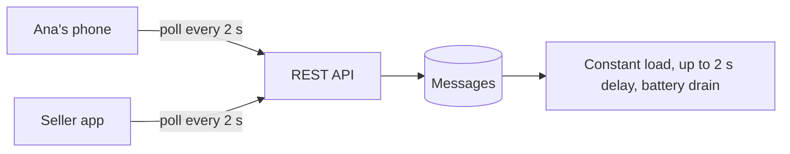
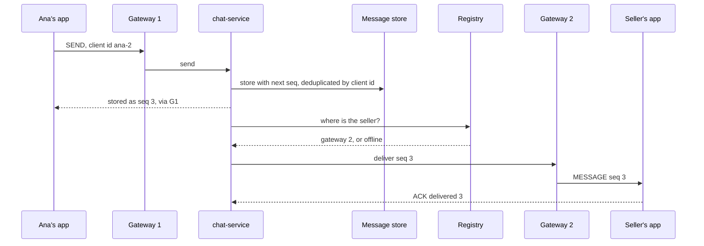

# Case Study: Chat System

**System design · Step 14.19 · Advanced (case study)** · Last updated 2026-10-22
**Prerequisites:** [Load balancing](05-load-balancing.md) (14.5), [Asynchronous processing](11-asynchronous-processing.md) (14.11) and [Unique ID generation](13-unique-id-generation.md) (14.13); helpful: [Notification system](17-case-notification-system.md) (14.17)

## 1. What it is and why it matters

**What is it?** A service that lets people exchange messages in real time: one-to-one and in groups, with delivery while they are online, catch-up when they come back, and an indication of who is online (**presence**). Unlike the request/response systems so far, it keeps a **long-lived connection** to every active client.

**Why do we need it?** Real-time conversations need the server to **push** messages to clients the moment they arrive, which plain request/response HTTP can't do efficiently. And messages must not be lost, duplicated or shown out of order, even though phones lose their connection all the time.

**When would I meet it?** Customer support and buyer-seller chat in commerce, collaboration tools, games, live trading desks; in interviews as the question about stateful connections, ordering and offline delivery.

> [!TIP]
> **Memory hook:** **connections** are stateful and sticky; **messages** are stored first, numbered per conversation, then pushed; **clients** catch up by asking for "everything after my last number".

## 2. Industry terms

| Term | Simple meaning | Why it matters | Example | Related terms |
|---|---|---|---|---|
| **WebSocket** | A protocol for "two-way communication" over one long-lived TCP connection, started by an HTTP upgrade (RFC 6455) | Lets the server push messages without polling | `101 Switching Protocols` on connect | Server-sent events, long polling |
| **Connection gateway** | The servers that hold the open connections | Stateful: each connection lives on one gateway ([14.4](04-scaling-out-stateless-services.md)) | 6 gateway instances, 50,000 connections each | Edge service |
| **Connection registry** | Which gateway currently holds each user's connection | Needed to route a message to the right gateway | `ben -> gateway-3`, expiring | Session directory |
| **Per-conversation sequence** | A number the server gives each message in a conversation | Defines the order everyone sees, and lets clients detect gaps | Message 3 of conversation `c-77` | Offset, log position |
| **Client message id** | An id the sending app creates for each message | Makes retried sends idempotent | `ana-2` | Idempotency key ([1.4](../01-resilience/04-idempotency.md)) |
| **Sync (catch-up)** | The client asks for messages after its last known sequence | Recovers from dropped connections without losing messages | `GET /conversations/c-77/messages?after=2` | Delta sync |
| **Presence** | Whether a user is online, kept alive by heartbeats and expiring otherwise | Shown to others; also decides push versus direct delivery | Online until 90 s without a heartbeat | Last seen |
| **Ping and pong** | WebSocket control frames; an endpoint "MUST send a Pong frame in response" to a Ping | Detects dead connections, keeps proxies from closing idle ones | Ping every 30 s | Keep-alive |

## 3. In a real system (ShopFlow)

**The business problem.** Marketplace customers want to ask sellers questions before buying ("is the hoodie in stock in M?"), and ShopFlow's support agents chat with customers about orders. Conversations must arrive within a second when both are online, and must still reach the other side when they are not; agents handle several conversations at once and must never miss a message.



Polling for new messages every few seconds wastes requests (almost all return nothing), drains phone batteries, and still adds seconds of delay.

**How the design helps.** Clients keep a WebSocket to a connection gateway. A sent message is **stored first** with a per-conversation sequence number, then pushed to the recipient's gateway through the registry, or, if the recipient is offline, announced with a push notification ([14.17](17-case-notification-system.md)). Clients that reconnect ask for everything after their last sequence.

**What it costs.** A stateful tier to run (gateways that can't be restarted without reconnecting their clients), a registry and presence store, careful load balancing ([14.5](05-load-balancing.md): WebSockets stick to one target), and client logic for retries and catch-up.

**Elsewhere:** support platforms route customer chats to available agents and keep a full history for audits; collaboration tools sync messages across a user's desktop and phone using the same "after my last number" idea; multiplayer games keep players of one match on one server because their state changes many times a second.

## 4. How it works

### Step 1: Requirements

- **Functional:** one-to-one conversations (customer and seller, customer and agent), small groups (a support team), history, delivery to all of a user's devices, read receipts, presence for agents.
- **Non-functional:** delivery under 1 second when both are online (assumption); no message lost once the sender's app shows it as sent; no duplicates and the same order on every device; history kept for years for support conversations.
- **Out of scope:** voice and video, end-to-end encryption (a different design), very large public channels.

### Step 2: Estimate

The programs below are arithmetic and simulations with illustrative numbers; how to run them is in [the Java overview](../13-java/01-java-overview.md), section 5.

```java
// File: ConnectionCapacity.java (runnable, Java 21)
import java.util.Locale;

public class ConnectionCapacity {

    public static void main(String[] args) {
        long concurrentUsers = 300_000;            // illustrative peak of open chat connections
        long connectionsPerGateway = 50_000;       // illustrative, from a load test of one gateway instance
        long kbPerConnection = 30;                 // illustrative: buffers, TLS state, session data
        int heartbeatSeconds = 30;

        long gateways = (concurrentUsers + connectionsPerGateway - 1) / connectionsPerGateway;
        double memoryGb = concurrentUsers * kbPerConnection / 1e6;
        double heartbeatsPerSecond = (double) concurrentUsers / heartbeatSeconds;

        System.out.println(String.format(Locale.ROOT, "gateways at peak       %d, plus spares to survive losing a zone", gateways));
        System.out.println(String.format(Locale.ROOT, "connection memory      %.1f GB across all gateways", memoryGb));
        System.out.println(String.format(Locale.ROOT, "heartbeats             %,.0f a second", heartbeatsPerSecond));
        System.out.println(String.format(Locale.ROOT, "if one gateway dies    %,d clients reconnect at once", connectionsPerGateway));
    }
}
```

**Expected output**:

```text
gateways at peak       6, plus spares to survive losing a zone
connection memory      9.0 GB across all gateways
heartbeats             10,000 a second
if one gateway dies    50,000 clients reconnect at once
```

The connection tier is sized by **open connections**, not requests: 300,000 at peak need about 6 gateways (from a load-tested 50,000 each), plus spares for a zone, and roughly 9 GB of connection state in total. Heartbeats are a steady 10,000 small messages a second. And losing one gateway means 50,000 clients reconnecting at the same moment, a burst the design must absorb (backoff with jitter on the client, [1.3](../01-resilience/03-retries-backoff-jitter.md)).

### Step 3: Interface and data

```text
WebSocket frames (client -> server):  {type: SEND, conversationId, clientMessageId, text}
                                      {type: ACK, conversationId, seq}            (delivered or read)
WebSocket frames (server -> client):  {type: MESSAGE, conversationId, seq, senderId, text, sentAt}
REST for catch-up and history:        GET /conversations/{id}/messages?after={seq}&limit=50
Messages:   (conversation_id, seq) primary key, sender_id, client_message_id, text, created_at
Members:    conversation_id, user_id, last_read_seq
Registry:   user_id -> gateway id, per device, expiring
```

Messages are partitioned by **conversation id** and ordered by **sequence** within it ([14.9](09-partitioning-sharding.md)): reading a conversation's recent history is one range read on one partition.

### Step 4: High-level design



1. **Send:** the gateway passes the message to the chat service, which assigns the next sequence for the conversation and **stores** it, deduplicating by the client message id; only then does Ana's app show it as sent.
2. **Route:** the chat service looks up each recipient device in the registry and forwards the message to its gateway (through a pub/sub channel or a direct call); offline devices get a push notification.
3. **Deliver and acknowledge:** the gateway writes the frame to the connection; the app acknowledges, which updates delivery and read state.
4. **Catch up:** on reconnect, or when it detects a gap, the app asks for messages after its last contiguous sequence.

### Step 5: Deep dives

**Deep dive 1: order, gaps and retries.**

```java
// File: SequenceSync.java (runnable, Java 21)
import java.util.ArrayList;
import java.util.HashMap;
import java.util.List;
import java.util.Map;
import java.util.TreeMap;

public class SequenceSync {

    // The chat service: messages of one conversation, numbered by the server in arrival order.
    static final TreeMap<Integer, String> stored = new TreeMap<>();
    static final Map<String, Integer> seqByClientId = new HashMap<>();   // makes sending idempotent

    static int send(String clientMessageId, String text) {
        Integer existing = seqByClientId.get(clientMessageId);
        if (existing != null) return existing;            // a retried send gets the same number, no copy
        int seq = stored.isEmpty() ? 1 : stored.lastKey() + 1;
        stored.put(seq, text);
        seqByClientId.put(clientMessageId, seq);
        return seq;
    }

    static List<Integer> after(int seq) {
        return new ArrayList<>(stored.tailMap(seq, false).keySet());
    }

    public static void main(String[] args) {
        send("ana-1", "Hi, is the hoodie in stock?");
        send("seller-1", "Yes, in M and L.");
        send("ana-2", "Great, M please.");
        int retried = send("ana-2", "Great, M please.");   // Ana's phone retried after a timeout
        send("seller-2", "Reserved for you.");
        System.out.println("stored: " + stored.keySet() + " (Ana's retry got seq " + retried + " again)");

        // Ben's device receives pushes 1, 2 and 4; push 3 was lost while his connection dropped.
        List<Integer> received = new ArrayList<>(List.of(1, 2, 4));
        int lastContiguous = 0;
        for (int s : received) {
            if (s == lastContiguous + 1) lastContiguous = s;
            else break;                                   // a gap: 3 is missing
        }
        System.out.println("device has " + received + ", contiguous up to " + lastContiguous);
        List<Integer> fetched = after(lastContiguous);   // "give me everything after 2"
        System.out.println("fetches after " + lastContiguous + ": " + fetched);
        TreeMap<Integer, String> local = new TreeMap<>();
        for (int s : received) local.put(s, stored.get(s));
        for (int s : fetched) local.put(s, stored.get(s));   // 4 arrives twice; the map keeps one copy
        local.forEach((s, text) -> System.out.println("  " + s + "  " + text));
    }
}
```

**Expected output**:

```text
stored: [1, 2, 3, 4] (Ana's retry got seq 3 again)
device has [1, 2, 4], contiguous up to 2
fetches after 2: [3, 4]
  1  Hi, is the hoodie in stock?
  2  Yes, in M and L.
  3  Great, M please.
  4  Reserved for you.
```

**Walkthrough.** Ana's phone sent message `ana-2`, timed out waiting for the reply, and sent it again; because the server remembers client message ids, the retry returns the same sequence 3 and nothing is stored twice. On the seller's device, push 3 was lost during a reconnect, so it holds 1, 2 and 4; it sees the gap after 2, asks for everything after 2, and merges by sequence, so 4 isn't duplicated and the order is the server's. This is the same pattern as a Kafka consumer's offset ([2.2.5](../02-messaging/02-kafka/05-offset-commits-delivery-guarantees.md)): pushed messages are a fast path, and the stored, numbered conversation is the truth.

**Experiment.** Predict first: what happens if Ana's app creates a **new** client message id for its retry (`ana-3` instead of `ana-2`)? The result is in Answers.

**Deep dive 2: routing to the right connection.**

```java
// File: ConnectionRouting.java (runnable, Java 21)
import java.util.HashMap;
import java.util.Map;

public class ConnectionRouting {

    // Which gateway holds each user's open WebSocket. In production: a shared store with expiring entries.
    static final Map<String, String> registry = new HashMap<>();

    static String deliver(String to, String text) {
        String gateway = registry.get(to);
        if (gateway == null) {
            return to + " is offline: message stored, push notification sent";
        }
        return "routed to " + gateway + ", which writes it to " + to + "'s connection";
    }

    public static void main(String[] args) {
        registry.put("ana", "gateway-1");
        registry.put("ben", "gateway-2");
        System.out.println("ana -> ben: " + deliver("ben", "Hi"));

        registry.put("ben", "gateway-3");               // Ben's phone reconnected to another gateway
        System.out.println("ana -> ben: " + deliver("ben", "Still there?"));

        registry.remove("ben");                         // Ben closed the app; his entry expired
        System.out.println("ana -> ben: " + deliver("ben", "Order placed!"));
    }
}
```

**Expected output**:

```text
ana -> ben: routed to gateway-2, which writes it to ben's connection
ana -> ben: routed to gateway-3, which writes it to ben's connection
ana -> ben: ben is offline: message stored, push notification sent
```

The registry maps each user's devices to the gateways that hold their connections; it changes whenever a phone reconnects, so entries are short-lived (they expire unless refreshed by heartbeats) and lookups happen per message. If the registry says "offline", the message is still stored and a push notification is sent, so nothing depends on the user being connected.

**Deep dive 3: presence.** Apps send a heartbeat (a WebSocket ping, or an application message) every 30 seconds; presence expires after 90 seconds without one. A clean close is shown at once; a lost network is noticed only when the entry expires (practice exercise 1). Presence is approximate and best effort: it changes very often, is shown only to people who look, and should never decide whether a message is delivered (the store and catch-up do).

**Deep dive 4: groups.** For small groups (a support team), the chat service routes each message to every member's devices. For large groups, pushing to every member costs as much as fan-out on write in a feed ([14.18](18-case-news-feed.md)); members who aren't looking get only a counter or a push, and read the conversation on demand.

### Step 6: Failures and trade-offs

| What fails | What happens | Mitigation |
|---|---|---|
| A gateway | Its clients reconnect (to other gateways) and catch up from their last sequence | Clients reconnect with backoff and jitter; spare capacity |
| The registry | Messages can't be routed directly | They are stored anyway; clients catch up, push notifications still go out |
| The message store | Sends fail; the app shows "not sent" and retries | Replicated store; the app keeps unsent messages locally |
| A slow recipient device | Its gateway buffers frames | Bounded buffers; drop the connection and let the client catch up ([1.8](../01-resilience/08-load-shedding-backpressure.md)) |

## 5. Failure scenarios

### Messages in different orders on different devices

1. **What happened?** A customer and an agent saw their conversation in different orders on their screens.
2. **Why?** Each device sorted messages by its own receive time, or by the sender's clock.
3. **What did users see?** Answers appearing above the questions they answered.
4. **Solutions:** order by the server's per-conversation sequence; show messages in that order everywhere; use client time only for display.
5. **What they cost:** one place per conversation that assigns sequence numbers, which must be the conversation's partition.

### Lost messages after reconnecting

1. **What happened?** After a train went through a tunnel, a customer's app never showed two messages the seller had sent meanwhile.
2. **Why?** The app relied on pushed messages only; those sent while it was offline were dropped by the gateway.
3. **What did users see?** A conversation with holes, and an angry seller.
4. **Solutions:** store first, push second; on every reconnect, and on any gap in sequence, fetch "after my last contiguous sequence".
5. **What they cost:** a catch-up request per reconnect, cheap because it's one range read.

### A deploy that reconnected everyone at once

1. **What happened?** Restarting all gateways for a release disconnected 300,000 clients, which reconnected within the same few seconds and overloaded authentication and the message store with catch-up requests.
2. **Why?** Gateways were restarted together, and clients retried immediately.
3. **What did users see?** Minutes of failed connections after a routine release.
4. **Solutions:** drain gateways one at a time with a delay ([14.5](05-load-balancing.md)); clients reconnect with exponential backoff and jitter; catch-up requests rate-limited per user ([14.16](16-case-distributed-rate-limiter.md)).
5. **What they cost:** slower releases for the gateway tier.

## 6. Architectural decisions

| Decision | Choose | Because |
|---|---|---|
| Transport | WebSocket, with REST for history and catch-up | Server push without polling; REST for large reads |
| Source of truth | The stored, numbered conversation | Pushes can be lost; storage and catch-up can't be skipped |
| Ordering | Server-assigned sequence per conversation | One order for every device |
| Idempotency | Client message ids | Phones retry on timeouts |
| Partitioning | By conversation id | A conversation's history and its numbering stay on one partition |
| Gateways | Separate, stateful tier; drain slowly on deploy | Connections are long-lived and sticky by nature |
| Offline users | Push notification plus catch-up | Delivery never depends on presence |

**Common mistakes:** pushing before storing; ordering by device clocks; no client message id; reconnect storms without backoff; presence used as delivery truth; one gateway restart for all clients at once.

## 7. Try it yourself

Try each exercise first; the solutions are in the Answers section, the first as a runnable program.

1. **Presence timing.** Heartbeats every 30 seconds, presence expiring after 90 seconds. How quickly is a user shown offline after closing the app properly, after losing the network, and how many missed heartbeats are tolerated?
2. **Read receipts.** Design how the seller sees "read" for messages the customer has read on any of their devices.
3. **A support queue.** New customer chats must be assigned to an available agent within 30 seconds, and an agent handles at most 4 chats at a time. Design the assignment.

## 8. Check your understanding

1. Why can't the connection gateways be stateless like `order-service`, and what follows from that for deploys and load balancing?
2. Why is the message stored before it is pushed, and what does the client do when it reconnects?
3. Why does the server assign sequence numbers per conversation rather than using timestamps from the devices?
4. A user is shown as online but doesn't receive messages. Why is presence the wrong thing to trust for delivery?

Answers are at the end of this note.

## 9. Revision

**Remember**
- **WebSocket** connections live on a stateful **gateway** tier; a **registry** says which gateway holds each device.
- **Store first, then push**; numbered **per conversation** by the server; clients **catch up** "after my last sequence".
- **Client message ids** make retries idempotent; the sequence makes order identical everywhere.
- **Presence** is approximate (heartbeats and expiry), never the basis for delivery.
- Deploys: **drain slowly**; clients reconnect with **backoff and jitter**.

**Explain in 15 seconds:** "Clients keep WebSockets to a gateway tier. A sent message is stored with a per-conversation sequence number, then routed through a connection registry to the recipient's gateway or announced by push; reconnecting clients fetch everything after their last sequence."

**Explain in 60 seconds:**
> "Real-time chat needs server push, so clients keep a WebSocket to a stateful gateway tier, sized by open connections, behind load balancers that keep each connection on one target. When a user sends, the chat service stores the message first, giving it the next sequence number in its conversation and deduplicating by the client's message id, because phones retry. Then it looks up each recipient device in a registry of which gateway holds which connection and forwards the message there; offline devices get a push notification. Pushes are only the fast path: on every reconnect, or when it sees a gap in the numbers, the client asks for messages after its last contiguous sequence, so nothing is lost and every device shows the same order. Messages are partitioned by conversation. Presence comes from heartbeats with an expiry and is shown, not trusted. Gateway deploys drain slowly, and clients reconnect with backoff and jitter."

**Likely follow-up questions:**
- **How do you scale to millions of connections?** More gateway instances (connections spread by the load balancer), a partitioned registry, and pub/sub between the chat service and gateways; the message store is partitioned by conversation.
- **How do multiple devices of one user stay in sync?** Each device registers separately and keeps its own last sequence per conversation; read state is per user, the highest sequence read on any device.
- **What about end-to-end encryption?** The server then stores ciphertext it can't read, and features like server-side search change; keys are managed per device. It is a different design.
- **WebSocket or server-sent events?** Server-sent events push one way over HTTP; WebSockets carry both directions, which chat needs.

**Architect's takeaway:** in real-time systems, treat the live connection as a best-effort fast path and the stored, numbered history as the truth. Everything that must not be lost or reordered goes through the second.

**Next topic:** [Case study: ShopFlow flash sale](20-case-shopflow-flash-sale.md) (14.20)

## 10. Verification and sources

> [!NOTE]
> Checked 2026-10-22 against RFC 6455. All programs were run on OpenJDK 21.0.8, and the repository's example checker compares their output. Re-verify when you revisit this note.

- **Confirmed (RFC 6455, read 2026-10-22):** "The WebSocket Protocol enables two-way communication between a client ... and a remote host"; it "consists of an opening handshake followed by basic message framing, layered over TCP", aiming to avoid relying on "multiple HTTP connections" and long polling; the server answers the handshake with `101 Switching Protocols`; "Upon receipt of a Ping frame, an endpoint MUST send a Pong frame in response". AWS's load balancer documentation (read for [14.5](05-load-balancing.md)) states that WebSocket connections are "inherently sticky".
- **Assumptions and illustrations:** the connection counts, 50,000 connections per gateway, 30 KB per connection, heartbeat and expiry times are illustrative; load-test your own gateways. The programs are deterministic simulations.
- **To verify:** your gateway framework's limits (for example Spring's WebSocket support or a dedicated gateway product), idle timeouts of every proxy between client and gateway, and mobile platform limits on background connections.
- **Decision rule:** store with a per-conversation sequence before pushing; idempotent sends; catch-up after the last contiguous sequence; presence for display only.

**Sources:** RFC 6455, "The WebSocket Protocol"; this area's notes on [load balancing](05-load-balancing.md), [asynchronous processing](11-asynchronous-processing.md), [unique ids](13-unique-id-generation.md) and the [notification system](17-case-notification-system.md).

## Answers

**Experiment**

- **A new client id for the retry** (deep dive 1): the server can't tell the retry from a new message, so it stores **"Great, M please." twice**, as sequences 3 and 4, and the seller's reply becomes 5; every device shows the duplicate. Idempotent sending works only if the app keeps the **same** client message id for every retry of the same message, for example by creating it when the user presses send and storing it with the unsent message.

**Check your understanding**

1. Because each gateway holds open connections, which can't move to another instance; restarting a gateway disconnects its clients. So deploys must drain gateways one at a time (and clients reconnect with backoff), the load balancer keeps each connection on its target (WebSockets are sticky by nature), and routing needs a registry of which gateway holds which user.
2. Because the push can be lost (a dropped connection, a dead gateway, an offline device), while a stored message can always be fetched again; storing first also gives it its sequence number, which defines its order. On reconnect, the client asks for every message after its last contiguous sequence and merges them by sequence, removing duplicates.
3. Because device clocks differ and can be wrong, and receive times differ by device; ordering by either would show different orders on different screens. A sequence assigned by the server, in one place per conversation, gives one order that every device can follow, and gaps in it reveal missing messages.
4. Because presence is a delayed, best-effort guess: a phone that lost its network still looks online until its entry expires, and a device can be online but have a broken connection. Delivery must rely on the stored conversation and catch-up (and a push notification), which work whatever presence says.

**Practice exercises**

1. **Presence timing:**

```java
// File: PresenceTiming.java (runnable, Java 21)
public class PresenceTiming {

    public static void main(String[] args) {
        int heartbeatSeconds = 30;      // the app sends "I'm here" every 30 s while open
        int ttlSeconds = 90;            // presence expires if no heartbeat for 90 s (three missed beats)

        // A phone loses its network just after a heartbeat: nobody knows until the entry expires.
        System.out.println("app closed cleanly:    shown offline at once (explicit 'offline' message)");
        System.out.println("network lost:          shown online for up to " + ttlSeconds + " s");
        System.out.println("one heartbeat delayed: still online, because " + ttlSeconds / heartbeatSeconds + " beats fit in the TTL");
    }
}
```

**Expected output**:

```text
app closed cleanly:    shown offline at once (explicit 'offline' message)
network lost:          shown online for up to 90 s
one heartbeat delayed: still online, because 3 beats fit in the TTL
```

A clean close is shown immediately; a lost network takes up to 90 seconds; two missed heartbeats are tolerated, because three fit in the expiry. Shorter intervals make presence more current but cost battery and server traffic; that trade-off is why presence is approximate.

2. **Read receipts:** each member has `last_read_seq` per conversation, updated when any of the user's devices sends `ACK read n` (only moving forward: the maximum of the old and new value). The update is sent to the other members as a small event ("Ana read up to 7"), and their apps show "read" on messages up to 7. Receipts are stored, so a seller who reconnects later still sees them; very large groups can show counts instead of names.

3. **A support queue:** new chats go into a waiting queue (ordered by arrival, with priority for some customers); agents' presence and current load (open chats out of 4) are kept in a shared store; an assigner takes the oldest waiting chat and assigns it with an atomic update that increments the chosen agent's load only if it is below 4 ([14.4](04-scaling-out-stateless-services.md), conditional update). If no agent is free for 30 seconds, the customer is told the wait time and offered a callback or email; assignments that an agent doesn't accept within a short time return to the queue.

Back to [the System design overview](01-system-design-overview.md) · [the index](../README.md) · [Roadmap](../roadmap.md).
