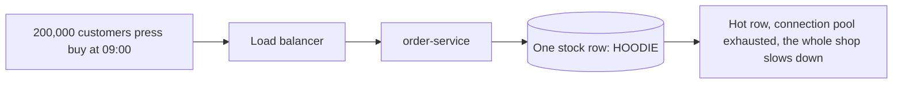
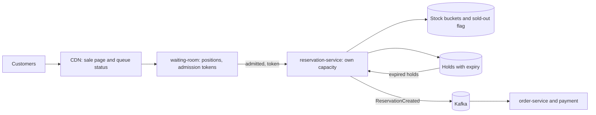

# Case Study: ShopFlow Flash Sale

**System design · Step 14.20 · Advanced (case study, capstone)** · Last updated 2026-10-22
**Prerequisites:** the whole area, from [14.2](02-requirements-design-method.md) to [14.19](19-case-chat-system.md), and the resilience track, especially [rate limiting](../01-resilience/07-rate-limiting.md) (1.7), [load shedding](../01-resilience/08-load-shedding-backpressure.md) (1.8) and [idempotency](../01-resilience/04-idempotency.md) (1.4)

This capstone uses almost every building block of the area on one hard problem: selling a small, fixed number of items to far more people than there are items, in a few seconds, without overselling and without taking the rest of the shop down.

## 1. What it is and why it matters

**What is it?** A **flash sale** (a "drop") releases a limited stock at an announced time: 1,000 limited-edition hoodies at 09:00. Demand arrives as a wall: tens of thousands of customers press "buy" in the same second, and almost all of them will be disappointed.

**Why do we need it?** It is the extreme case of the problems this area has taught. The read load is enormous and simultaneous; the write that matters, decrementing one stock counter, is a single **hot key**; correctness is strict (never sell an item twice); fairness and honesty matter to customers; and the normal shop must keep working beside it.

**When would I meet it?** Limited product drops, concert and event ticketing, vaccine or appointment booking, game releases, and any "first come, first served" offer. It is also the question architects get when they say a system "scales".

> [!TIP]
> **Memory hook:** **absorb** the crowd at the edge, **admit** buyers at the rate checkout can take, **reserve** stock atomically and briefly, **process** the rest asynchronously, and **tell** everyone else the truth quickly.

## 2. Industry terms

| Term | Simple meaning | Why it matters | Example | Related terms |
|---|---|---|---|---|
| **Virtual waiting room** | A queue in front of the sale that hands out positions and lets people in at a controlled rate | Turns a spike into a steady flow the backend can take | Position 1,234, admitted in about 6 s | Admission control |
| **Admission token** | A short-lived, signed permission to enter checkout | Checkout rejects anyone who skipped the queue | A signed token valid for 10 minutes ([14.12](12-object-storage-cdn.md), signed URLs) | Ticket |
| **Reservation (hold)** | Stock set aside for one customer for a short time, until payment | Prevents overselling while payment happens; unpaid holds return | A 10-minute hold on one hoodie | Soft allocation |
| **Stock buckets** | The stock split into several counters on different keys | Spreads a hot key's load ([14.9](09-partitioning-sharding.md)) | 10 buckets of 100 | Sharded counter |
| **Sold-out flag** | A cached marker set when stock is gone | Lets the edge answer "sold out" without touching counters | `sale:hoodie:soldout = true` | Circuit breaker for demand |
| **Purchase limit** | A maximum per customer, account or payment card | Fairness and protection against resellers' bots | One hoodie per account | Anti-bot measures |
| **Pre-scaling** | Adding capacity before a known peak instead of waiting for autoscaling | Autoscalers react too late for a wall of traffic ([14.4](04-scaling-out-stateless-services.md)) | Minimum pods raised at 08:30 | Warm-up |

## 3. In a real system (ShopFlow)

**The business problem.** ShopFlow and a famous designer release 1,000 hoodies at 09:00. Marketing expects about 200,000 customers on the page at that moment. The business wants: no hoodie sold twice; a fair chance for real customers (not resellers' bots); a clear answer within seconds, including "sold out"; and no impact on the rest of the shop, where normal orders continue.



With the normal design, every click goes to the order service and the same stock row: the row becomes the bottleneck, the database's connections run out, and normal checkouts fail too.

**How the design helps.** A waiting room absorbs the crowd and admits buyers at the rate checkout can take; stock is reserved with atomic decrements on several bucket counters; orders and payment are processed with idempotency keys; holds expire and return; the sale runs on its own capacity, separated from the normal shop; and everyone not admitted is told "sold out" immediately, with an offer to be notified if units return.

**What it costs.** A waiting room and admission tokens to build or buy; a separate stock-reservation path for the sale; pre-scaled capacity paid for an hour; a rehearsal (game day) before the event; and a product decision that most customers will see a queue and then "sold out", honestly.

**Elsewhere:** ticket sellers queue fans and hold seats for a few minutes during payment; vaccine booking systems admitted people in batches by queue position; sneaker drops limit purchases per account and payment card and filter automated traffic.

## 4. How it works

### Step 1: Requirements

- **Functional:** show the product before and during the sale; queue customers from 08:55; admit them in order; let an admitted customer reserve one hoodie, pay within 10 minutes, and get a confirmation; release unpaid holds; tell everyone else "sold out" and offer a back-in-stock alert ([14.2](02-requirements-design-method.md)).
- **Non-functional:** **zero overselling**; a response within 2 seconds for everyone, including "you're in the queue" and "sold out"; the normal shop's checkout unaffected; fair, roughly first-come-first-served order; one hoodie per account.
- **Constraints:** payment through the existing provider (with its own rate limit); existing order and inventory services.

### Step 2: Estimate

The programs below are arithmetic and simulations with illustrative numbers; how to run them is in [the Java overview](../13-java/01-java-overview.md), section 5.

```java
// File: FlashSaleEstimate.java (runnable, Java 21)
import java.util.Locale;

public class FlashSaleEstimate {

    public static void main(String[] args) {
        // Illustrative: a limited-edition hoodie drop at 09:00.
        long waitingCustomers = 200_000;
        double refreshEverySeconds = 2;          // without a waiting room, people refresh the page
        double pollEverySeconds = 10;            // in a waiting room, the page polls its position
        long stock = 1_000;
        double checkoutsPerSecond = 200;         // what checkout, payment and stock can safely take (load-tested)

        double withoutRoom = waitingCustomers / refreshEverySeconds;
        double withRoom = waitingCustomers / pollEverySeconds;
        double secondsToServeStock = stock / checkoutsPerSecond;

        System.out.println(String.format(Locale.ROOT, "requests a second at 09:00 without a waiting room   %,8.0f", withoutRoom));
        System.out.println(String.format(Locale.ROOT, "waiting-room polls a second (cheap, cacheable)      %,8.0f", withRoom));
        System.out.println(String.format(Locale.ROOT, "customers who can actually buy                      %,8d", stock));
        System.out.println(String.format(Locale.ROOT, "time to admit enough buyers at %.0f a second         %8.0f s", checkoutsPerSecond, secondsToServeStock));
        System.out.println(String.format(Locale.ROOT, "customers to tell 'sold out' quickly                %,8d", waitingCustomers - stock));
    }
}
```

**Expected output**:

```text
requests a second at 09:00 without a waiting room    100,000
waiting-room polls a second (cheap, cacheable)        20,000
customers who can actually buy                         1,000
time to admit enough buyers at 200 a second                5 s
customers to tell 'sold out' quickly                 199,000
```

**What the numbers say.** Without a waiting room, refreshing customers send about 100,000 requests a second. In a waiting room, they poll a cheap, cacheable status endpoint every 10 seconds: 20,000 a second, absorbed at the edge. Only 1,000 customers can buy, and at the safe checkout rate of 200 a second (a load-tested figure, illustrative here) enough buyers are admitted within seconds. The real task is telling the other 199,000 the truth quickly, without letting them reach checkout.

### Step 3: Interface and data

```text
GET  /sales/hoodie-drop                    -> static page from the CDN (note 14.12), no personal data
POST /sales/hoodie-drop/queue              -> {position, pollAfterSeconds}         (rate-limited per account and IP)
GET  /sales/hoodie-drop/queue/{position}   -> {status: WAITING | ADMITTED | SOLD_OUT, token?}
POST /sales/hoodie-drop/reservations       (admission token, Idempotency-Key)  -> {reservationId, expiresAt}
POST /orders                               (reservationId, Idempotency-Key)    -> 202, then payment flow
Stock:  sale:hoodie:bucket:0..9 -> remaining units; sale:hoodie:soldout -> flag
Holds:  reservation_id, customer_id, bucket, expires_at, status (HELD | PAID | RELEASED)
```

### Step 4: High-level design



1. **Absorb:** the sale page and queue status come from the CDN and a small waiting-room service; nothing personal is cached ([14.12](12-object-storage-cdn.md)).
2. **Queue:** joining the queue is rate-limited per account and IP ([14.16](16-case-distributed-rate-limiter.md)) and hands out an increasing position (an atomic counter).
3. **Admit:** the waiting room moves a "now serving" number forward at the safe checkout rate and gives admitted customers a signed, short-lived **admission token**.
4. **Reserve:** the reservation service accepts only valid tokens, checks the per-account limit, and decrements one **stock bucket** atomically ([14.4](04-scaling-out-stateless-services.md), conditional decrement), creating a **hold** with a 10-minute expiry. When all buckets are empty, it sets the **sold-out flag**, which the waiting room and CDN read to answer everyone else.
5. **Order and pay:** the reservation publishes an event through the outbox; the order is created and the payment taken with **idempotency keys**, so retries never charge twice ([1.4](../01-resilience/04-idempotency.md), [14.11](11-asynchronous-processing.md)).
6. **Release:** a job returns expired, unpaid holds to their buckets and lets the waiting room admit a few more people.

### Step 5: Deep dives

**Deep dive 1: the hot stock counter.**

```java
// File: StockBuckets.java (runnable, Java 21)
import java.util.Random;

public class StockBuckets {

    static final int STOCK = 1_000, ATTEMPTS = 200_000;

    public static void main(String[] args) {
        // 1. One counter: every attempt is an atomic decrement of the same key.
        int counter = STOCK, sold = 0, opsOnHotKey = 0;
        for (int i = 0; i < ATTEMPTS; i++) {
            opsOnHotKey++;
            if (counter > 0) { counter--; sold++; }
        }
        System.out.println("One counter:      sold " + sold + ", oversold " + Math.max(0, sold - STOCK)
                + ", operations on the busiest key " + opsOnHotKey);

        // 2. Ten buckets of 100, each its own key (on different nodes); a sold-out flag stops the rest early.
        int[] buckets = new int[10];
        java.util.Arrays.fill(buckets, STOCK / 10);
        int[] ops = new int[10];
        boolean soldOut = false;
        int rejectedAtEdge = 0;
        sold = 0;
        Random random = new Random(3);                  // seeded: which bucket each attempt tries first
        for (int i = 0; i < ATTEMPTS; i++) {
            if (soldOut) { rejectedAtEdge++; continue; }   // answered from the flag, no counter touched
            int first = random.nextInt(10);
            boolean got = false;
            for (int k = 0; k < 10 && !got; k++) {      // try other buckets if the first is empty
                int b = (first + k) % 10;
                ops[b]++;
                if (buckets[b] > 0) { buckets[b]--; sold++; got = true; }
            }
            if (!got) soldOut = true;                   // every bucket was empty: set the flag
        }
        int busiest = 0;
        for (int o : ops) busiest = Math.max(busiest, o);
        System.out.println("Ten buckets:      sold " + sold + ", oversold " + Math.max(0, sold - STOCK)
                + ", operations on the busiest key " + busiest + ", rejected by the sold-out flag " + rejectedAtEdge);
    }
}
```

**Expected output**:

```text
One counter:      sold 1000, oversold 0, operations on the busiest key 200000
Ten buckets:      sold 1000, oversold 0, operations on the busiest key 132, rejected by the sold-out flag 198999
```

**Walkthrough.** An atomic single counter already **never oversells**: 1,000 sold, 0 oversold. Its problem is load: all 200,000 attempts hit one key, on one node, in the same second. Splitting the stock into ten buckets on different keys spreads the decrements (each attempt tries a random bucket and moves on if it's empty), and once every bucket is empty, a **sold-out flag** answers the remaining 198,999 attempts without touching any counter, so the busiest key handles 132 operations. In ShopFlow, the waiting room already limits attempts to the admitted few, and the flag stops the rest even earlier; the buckets protect the counters if admissions run faster than planned.

**Experiment.** Predict first: what happens to the busiest key if there is no sold-out flag (remove the line that checks it)? The result is in Answers.

**Deep dive 2: holds that expire.**

```java
// File: ReservationRounds.java (runnable, Java 21)
import java.util.Locale;

public class ReservationRounds {

    public static void main(String[] args) {
        int stock = 1_000;
        int holdMinutes = 10;
        double payShare = 0.85;                 // illustrative: 85% of holders complete payment in time

        int sold = 0, available = stock, round = 0, minute = 0;
        while (available > 0 && round < 4) {
            round++;
            int held = available;               // the next customers in the waiting room get these units
            int paid = (int) Math.round(held * payShare);
            sold += paid;
            available = held - paid;            // unpaid holds expire and go back to stock
            System.out.println(String.format(Locale.ROOT, "minute %2d  round %d: %4d held, %4d paid, %3d released at minute %d",
                    minute, round, held, paid, available, minute + holdMinutes));
            minute += holdMinutes;
        }
        System.out.println("sold " + sold + " of " + stock + " after " + round + " rounds; oversold 0");
    }
}
```

**Expected output**:

```text
minute  0  round 1: 1000 held,  850 paid, 150 released at minute 10
minute 10  round 2:  150 held,  128 paid,  22 released at minute 20
minute 20  round 3:   22 held,   19 paid,   3 released at minute 30
minute 30  round 4:    3 held,    3 paid,   0 released at minute 40
sold 1000 of 1000 after 4 rounds; oversold 0
```

**Walkthrough.** If 15% of holders don't pay within 10 minutes (an illustrative share), 150 hoodies return at minute 10 and go to the next people in the queue, then 22, then 3: all 1,000 are sold within four rounds, and never more. The hold is what makes this safe: stock is set aside during payment, so two customers can't pay for the same unit, and unpaid units come back without anyone's manual work. The cost is that some people see "sold out" and later get an "units are back" notification, which the product must word honestly.

**Deep dive 3: the waiting room.**

```java
// File: WaitingRoom.java (runnable, Java 21)
public class WaitingRoom {

    public static void main(String[] args) {
        int inQueue = 200_000;                 // positions handed out in arrival order
        int admitPerSecond = 200;              // the safe checkout rate
        int stock = 1_000;
        double overAdmit = 1.5;                // admit a few more than the stock: some admitted people won't buy

        int toAdmit = (int) (stock * overAdmit);
        int secondsAdmitting = toAdmit / admitPerSecond;
        System.out.println("admitted to checkout: positions 1 to " + toAdmit + ", over " + secondsAdmitting + " s");
        System.out.println("position 1,500 waits about " + 1_500 / admitPerSecond + " s");
        System.out.println("positions " + (toAdmit + 1) + " to " + inQueue + ": told 'sold out, we'll notify you if units return'"
                + " after " + secondsAdmitting + " s, without reaching checkout");
    }
}
```

**Expected output**:

```text
admitted to checkout: positions 1 to 1500, over 7 s
position 1,500 waits about 7 s
positions 1501 to 200000: told 'sold out, we'll notify you if units return' after 7 s, without reaching checkout
```

**Walkthrough.** Admitting about 1.5 times the stock (some admitted people won't buy) takes a few seconds at 200 a second. Everyone behind position 1,500 learns within seconds that the drop is sold out, instead of waiting at a spinner, and can sign up for a back-in-stock alert; if holds expire, the waiting room admits a few more positions. The waiting room is also where fairness lives: positions are handed out in arrival order, and joining is rate-limited per account and IP and protected against bots. AWS, for example, publishes a "Virtual Waiting Room on AWS" solution built on queue positions, a serving counter and tokens (described from search summaries of its documentation).

**Deep dive 4: the rest of the shop.** The sale gets its own reservation service, its own stock keys and its own database connection pool, separate from normal checkout: a [bulkhead](../01-resilience/06-bulkhead.md). The sale's pods are pre-scaled before 08:55 ([14.4](04-scaling-out-stateless-services.md)); [load shedding](../01-resilience/08-load-shedding-backpressure.md) protects every service from traffic beyond what was planned; and the payment provider's limit is shared through a reserved quota, like the email provider in [14.17](17-case-notification-system.md).

### Step 6: Failures and trade-offs

| What fails | What happens | Mitigation |
|---|---|---|
| The waiting room | Nobody is admitted | Make it simple, cacheable and pre-scaled; a static "we're experiencing high demand" page with automatic retry |
| A stock bucket's node | That bucket's units are temporarily unavailable | Other buckets keep selling; the node's replica takes over ([14.8](08-replication-read-replicas.md)) |
| The payment provider slows down | Holds expire before payment completes | Extend holds while payment is in progress; queue payments; never release a hold whose payment is pending |
| Bots grab queue positions | Real customers lose out | Account requirement, rate limits, purchase limits per account and card, bot detection |
| A retried "buy" | Could create two reservations | Idempotency key per attempt; one hold per account |

## 5. Failure scenarios

### The sale that took the shop down

1. **What happened?** At 09:00, the drop's traffic exhausted the shared database's connections; normal orders failed for 20 minutes.
2. **Why?** The sale used the same services, pool and stock table as everything else, without a waiting room.
3. **What did the business see?** Lost revenue from every product, not only the hoodie, and bad press.
4. **Solutions:** a waiting room; a separate reservation path and capacity for the sale (bulkhead); load shedding; pre-scaling.
5. **What they cost:** dedicated components for a few events a year, which is why many shops buy a waiting room rather than build one.

### Oversold by 40

1. **What happened?** 1,040 orders were confirmed for 1,000 hoodies.
2. **Why?** Stock was checked with a read and then decremented in a separate step, and two paths (the app and the website) used different checks.
3. **What did the business see?** 40 apologies and refunds, and a social-media storm.
4. **Solutions:** one atomic conditional decrement as the only way to take stock; holds; reconciliation of holds against orders before confirming.
5. **What they cost:** one service that owns the sale's stock; all channels go through it.

### Bots bought everything

1. **What happened?** Most hoodies were bought within a second by a few hundred accounts, then resold at triple the price.
2. **Why?** No purchase limits, unlimited queue joins per IP, and checkout reachable without the waiting room.
3. **What did the business see?** Angry real customers and a damaged relationship with the designer.
4. **Solutions:** admission tokens checked at checkout; one per account and card; rate limits and bot detection on queue joins; verified accounts created before the sale.
5. **What they cost:** some friction for real customers, and a fraud review after the sale.

## 6. Architectural decisions

| Decision | Choose | Because |
|---|---|---|
| Absorbing the crowd | CDN plus a waiting room with admission tokens | Converts a wall of traffic into a rate checkout can take |
| Stock correctness | Atomic conditional decrements; holds with expiry | Zero overselling, even under retries and concurrency |
| Hot key | Stock buckets and a sold-out flag | Spreads decrements; answers the crowd without counters |
| Isolation | Separate reservation service, keys and pools; pre-scaling | The normal shop keeps working |
| Order and payment | Asynchronous after the hold, with idempotency keys | Fast answers; no double charges |
| Fairness | Ordered positions, limits per account and card, bot defences | The business promise is a fair chance |
| Build or buy | Buy a waiting room if events are rare; build the stock and hold logic | The waiting room is generic; stock rules are yours |

**Common mistakes:** no waiting room ("we'll autoscale"); read-then-write stock checks; reservations without expiry; checkout reachable without a token; the sale sharing pools with normal checkout; no rehearsal before the event.

## 7. Try it yourself

Try each exercise first; the solutions are in the Answers section.

1. **A game day plan.** List what to test in a rehearsal a week before the drop, and how.
2. **Anti-bot measures.** Propose five measures, in order of how much they help, and what each costs real customers.
3. **Two hoodie sizes.** The drop now has 600 in M and 400 in L. What changes in the design?

## 8. Check your understanding

1. Why doesn't autoscaling alone handle a flash sale?
2. A single atomic counter never oversells. Why split the stock into buckets anyway, and what does the sold-out flag add?
3. Why does a reservation have an expiry, and what must never happen when it expires?
4. How does the design keep the normal shop working during the drop?

Answers are at the end of this note.

## 9. Revision

**Remember**
- **Absorb** at the edge (CDN, waiting room), **admit** at the checkout's safe rate with signed **tokens**.
- **Reserve** with an atomic conditional decrement; **holds** expire and return; **never oversell**.
- Hot stock key: **buckets** and a **sold-out flag**.
- **Isolate** the sale (bulkhead), **pre-scale**, **shed** excess load; process orders and payment **asynchronously** with **idempotency keys**.
- **Fairness and honesty:** ordered positions, purchase limits, bot defences, a fast "sold out".

**Explain in 15 seconds:** "A flash sale is absorbed at the edge by a CDN and a waiting room, buyers are admitted at checkout's safe rate with signed tokens, stock is reserved with atomic decrements and expiring holds, and everyone else is told 'sold out' quickly, while the sale runs isolated from the normal shop."

**Explain in 60 seconds:**
> "I start from the numbers: 200,000 people for 1,000 items in one second. So the goal is not to serve everyone, but to sell exactly 1,000 fairly and tell the rest quickly. The page and queue status come from the CDN; a waiting room hands out positions in arrival order and admits buyers at the rate checkout can take, giving them short-lived signed tokens that checkout requires. Admitted buyers reserve stock with an atomic conditional decrement on one of several bucket counters, which spreads the hot key, and get a hold that expires in 10 minutes; unpaid holds return to stock and the next positions are admitted. When the buckets are empty, a sold-out flag lets the edge answer everyone else. Orders and payments follow asynchronously with idempotency keys. The sale has its own services, keys and pools, pre-scaled, with load shedding, so normal shopping continues. Purchase limits and bot defences keep it fair, and a game day before the event proves it works."

**Likely follow-up questions:**
- **Why not just a queue of orders and process them in order?** That is part of it, but customers need an answer in seconds; the waiting room and holds give each admitted customer a definite result quickly.
- **How do you pick the admission rate?** From a load test of the reservation and payment path, with headroom, and adjust it live from metrics.
- **What if the counter store fails mid-sale?** Pause admissions (the waiting room holds everyone), fail over to the replica, reconcile holds against the counters, then resume.
- **How do you prove fairness?** Log positions, admissions and purchases; check purchases against positions and limits afterwards.

**Architect's takeaway:** extreme events are designed backwards from the scarce resource. Protect it with admission control, make every change to it atomic and reversible, isolate it from everything else, and rehearse.

**Next topic:** this case study completes the system design area. Revise with the [system design cheat sheet](99-system-design-cheat-sheet.md), and practise the method of [14.2](02-requirements-design-method.md) on new problems (track 12.6, planned).

## 10. Verification and sources

> [!NOTE]
> Checked 2026-10-22. All programs were run on OpenJDK 21.0.8, and the repository's example checker compares their output. Re-verify when you revisit this note.

- **Confirmed:** the building blocks used here were verified in their own notes: atomic conditional updates ([14.4](04-scaling-out-stateless-services.md)), CDNs and signed URLs ([14.12](12-object-storage-cdn.md)), rate limiting with atomic counters ([14.16](16-case-distributed-rate-limiter.md)), asynchronous processing and the outbox ([14.11](11-asynchronous-processing.md)), and the resilience patterns of track 1.
- **Assumptions and illustrations:** every number (200,000 customers, 1,000 hoodies, 200 checkouts a second, 85% payment rate, polling intervals) is illustrative. The programs are deterministic simulations. AWS's "Virtual Waiting Room on AWS" solution is described from search summaries of its documentation (queue positions, a serving counter and tokens); its pages were not read directly because the addresses tried returned errors.
- **To verify:** the waiting-room product you would use (buy or build) and its token model; your payment provider's limits and behaviour under a burst; your counter store's behaviour under a hot key at the planned rate.
- **Decision rule:** admit at the scarce resource's safe rate; change stock only through atomic, expiring holds; isolate the sale; answer the crowd at the edge; rehearse before the event.

**Sources:** this area's notes from [14.2](02-requirements-design-method.md) to [14.19](19-case-chat-system.md); the resilience notes [1.4](../01-resilience/04-idempotency.md), [1.6](../01-resilience/06-bulkhead.md), [1.7](../01-resilience/07-rate-limiting.md), [1.8](../01-resilience/08-load-shedding-backpressure.md) and [1.10](../01-resilience/10-testing-resilience.md); AWS Solutions Library, "Virtual Waiting Room on AWS" (search summaries).

## Answers

**Experiment**

- **No sold-out flag** (deep dive 1): the busiest bucket handles about **199,131** operations instead of 132. After the stock is gone, every attempt probes all ten empty buckets, so the buckets become ten hot keys instead of one. The flag is what turns "sold out" into a cheap answer at the edge.

**Check your understanding**

1. Because the traffic arrives as a wall in one second, and autoscaling reacts in minutes, after the peak has done its damage; and because the scarce part (one stock counter, the payment provider) doesn't scale with more pods anyway. The design must control admission to the scarce resource, pre-scale what can scale, and shed the rest.
2. Because correctness isn't the problem, load is: one atomic counter serialises every attempt on one key and one node. Buckets spread the decrements over several keys. The sold-out flag lets the waiting room, the CDN and the reservation service answer "sold out" without touching any counter once stock is gone, which is where most of the traffic would otherwise go.
3. So that units held by customers who never pay return to stock and can be sold to the next people in the queue, without manual work. What must never happen: releasing a hold whose payment is still being processed (that could sell the unit twice), or releasing it twice. Holds move through clear states (held, paid, released) with conditional updates.
4. By isolation and admission: a waiting room in front of the sale, a separate reservation service with its own keys, pools and pre-scaled pods (a bulkhead), load shedding beyond the planned rate, and reserved quotas on shared external limits such as the payment provider. Normal checkout never shares the sale's hot keys or connection pools.

**Practice exercises**

1. **Game day plan:** (1) replay the expected traffic shape (a wall at 09:00) against a production-like environment, including the CDN and waiting room; (2) verify the admission rate holds and that "sold out" reaches everyone within seconds; (3) count sales against stock after the test: zero overselling, holds reconciled with orders; (4) fail a stock bucket's node, the payment provider (slow responses) and a reservation pod during the test, and check recovery ([1.10](../01-resilience/10-testing-resilience.md)); (5) check that normal checkout's latency stays within its SLO throughout; and agree on the "pause admissions" switch and who presses it.

2. **Anti-bot measures:** (1) require an account verified before the sale (stops instant mass accounts; small friction for real customers); (2) one per account and per payment card (stops bulk buying; families can't buy two); (3) admission tokens required at checkout (stops skipping the queue; no friction); (4) rate limits per account, IP and device on queue joins (stops floods; shared networks may be affected); (5) bot detection or a challenge on suspicious joins (stops automated clients; occasional friction for real users). Afterwards, review purchases and cancel those that broke the rules.

3. **Two sizes:** stock buckets and sold-out flags **per size** (M and L have their own counters and flags); the queue can stay shared, but admitted customers choose a size, so "sold out" becomes per size ("L sold out, M still available"); holds and their release work per size; the waiting room keeps admitting while any size has stock, and stops when both are gone.

Back to [the System design overview](01-system-design-overview.md) · [the index](../README.md) · [Roadmap](../roadmap.md).
