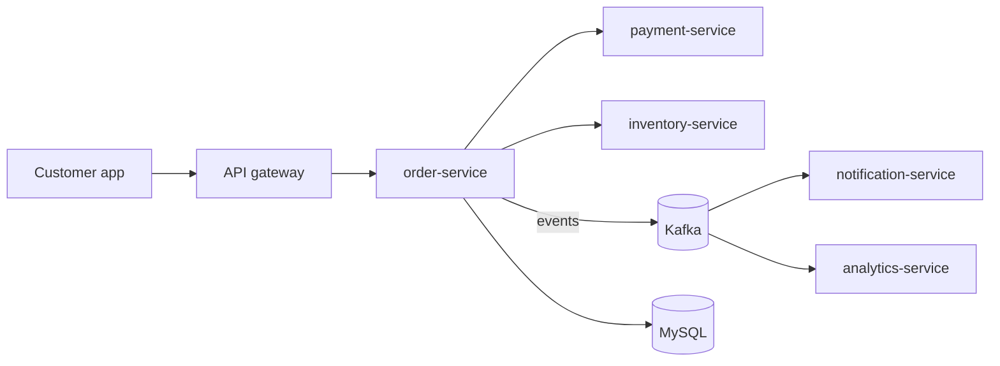

# Learning Notes

Personal reference notes, one per topic, written in simple language. Each note should be readable months later without the original lesson, and useful to architects and engineers alike.

**Purpose:** learn what a software engineer and software architect needs, in a simple and structured way, and be able to revise it quickly. Start at the [Learning Roadmap](roadmap.md), which lists every track, the order to learn them in, and what is done.

> [!TIP]
> Import this whole `notes` folder into Kenmora (Import page, choose the folder). It is the only folder meant for Kenmora. Re-import with "skip" or "replace and keep bookmarks and progress".

## Notes by area

### 01 · Resilience

**Complete (10 of 10 steps).** Start with the overview, which explains how the patterns relate. When you want to revise, use the cheat sheet.

| Step | Note | Status |
|---|---|---|
| 1.1 | [Resilience patterns: the big picture](01-resilience/01-resilience-overview.md) | Done |
| 1.2 | [Timeouts](01-resilience/02-timeouts.md) | Done |
| 1.3 | [Retries, backoff and jitter](01-resilience/03-retries-backoff-jitter.md) | Done |
| 1.4 | [Idempotency](01-resilience/04-idempotency.md) | Done |
| 1.5 | [Circuit breaker](01-resilience/05-circuit-breaker.md) | Done |
| 1.6 | [Bulkhead](01-resilience/06-bulkhead.md) | Done |
| 1.7 | [Rate limiting and throttling](01-resilience/07-rate-limiting.md) | Done |
| 1.8 | [Load shedding and backpressure](01-resilience/08-load-shedding-backpressure.md) | Done |
| 1.9 | [Fallbacks and graceful degradation](01-resilience/09-fallbacks-graceful-degradation.md) | Done |
| 1.10 | [Testing resilience (chaos engineering)](01-resilience/10-testing-resilience.md) | Done |
| | [Resilience cheat sheet](01-resilience/99-resilience-cheat-sheet.md) (revision) | Done |

### 02 · Messaging

Kafka series complete. Start with the overview (queues versus logs, and the four questions every design must answer). The Kafka series then goes from fundamentals to advanced.

| Step | Note | Status |
|---|---|---|
| 2.1 | [Messaging and event-driven design: the big picture](02-messaging/01-messaging-overview.md) | Done |
| 2.2.1 | [Apache Kafka: the big picture](02-messaging/02-kafka/01-kafka-overview.md) (series index) | Done |
| 2.2.2 | [The log: topics, partitions and offsets](02-messaging/02-kafka/02-log-topics-partitions-offsets.md) | Done |
| 2.2.3 | [Producers: keys, partitioning, acks and batching](02-messaging/02-kafka/03-producers-keys-acks-batching.md) | Done |
| 2.2.4 | [Consumers and consumer groups](02-messaging/02-kafka/04-consumers-consumer-groups.md) | Done |
| 2.2.5 | [Offset commits and delivery guarantees](02-messaging/02-kafka/05-offset-commits-delivery-guarantees.md) | Done |
| 2.2.6 | [Brokers, replication and leader election](02-messaging/02-kafka/06-brokers-replication-leader-election.md) | Done |
| 2.2.7 | [Rebalancing and static membership](02-messaging/02-kafka/07-rebalancing-static-membership.md) | Done |
| 2.2.8 | [Error handling, retries and dead-letter topics](02-messaging/02-kafka/08-error-handling-retries-dlt.md) | Done |
| 2.2.9 | [Idempotent producer and transactions (exactly-once)](02-messaging/02-kafka/09-idempotent-producer-transactions.md) | Done |
| 2.2.10 | [Schemas and evolution (Avro, Schema Registry)](02-messaging/02-kafka/10-schemas-evolution.md) | Done |
| 2.2.11 | [Ordering, partition planning and hot partitions](02-messaging/02-kafka/11-ordering-partition-planning-hot-partitions.md) | Done |
| 2.2.12 | [Kafka with Spring Boot](02-messaging/02-kafka/12-kafka-with-spring-boot.md) | Done |
| 2.2.13 | [Retention, log compaction and tiered storage](02-messaging/02-kafka/13-retention-compaction-tiered-storage.md) | Done |
| 2.2.14 | [Stream processing basics (Kafka Streams)](02-messaging/02-kafka/14-kafka-streams-basics.md) | Done |
| 2.2.15 | [Kafka Connect and change data capture](02-messaging/02-kafka/15-kafka-connect-cdc.md) | Done |
| 2.2.16 | [Security: TLS, SASL and ACLs](02-messaging/02-kafka/16-security-tls-sasl-acls.md) | Done |
| 2.2.17 | [Monitoring, consumer lag and capacity planning](02-messaging/02-kafka/17-monitoring-lag-capacity.md) | Done |
| 2.2.18 | [Multi-cluster and disaster recovery](02-messaging/02-kafka/18-multi-cluster-disaster-recovery.md) | Done |
| | [Messaging glossary](02-messaging/98-messaging-glossary.md) (canonical terms) | Growing |
| | [Messaging cheat sheet](02-messaging/99-messaging-cheat-sheet.md) (revision) | Growing |

**Kafka series complete (2.2.1 to 2.2.18).** Planned in this area: a RabbitMQ series (2.3.x) and a comparison note, "choosing a messaging system" (2.4).

### 13 · Java

Added on request. The Streams series has started; the other Java topics are planned.

| Step | Note | Status |
|---|---|---|
| 13.1 | [Java language and platform: the big picture](13-java/01-java-overview.md) | Done |
| 13.2.1 | [Java Stream API: the big picture](13-java/02-streams/01-streams-overview.md) (series index) | Done |
| 13.2.2 | [The pipeline: source, operations and laziness](13-java/02-streams/02-pipeline-laziness.md) | Done |

**Planned in this series:** 13.2.3 to 13.2.10 (transforming and filtering, terminal operations, collectors, primitive streams, lambdas in pipelines, parallel streams, streams versus loops, Stream Gatherers). The full list is in the [roadmap](roadmap.md).

### Coming next

Design patterns (track 3) and microservices (4), followed by architecture foundations (5), data, APIs, security, cloud, observability, delivery and architect skills. The full list, with levels, is in the [roadmap](roadmap.md).

## How the notes are organised

```text
notes/
  roadmap.md
  01-resilience/
    01-resilience-overview.md      area index: how the topics relate and in what order
    05-circuit-breaker.md          topic notes, numbered in learning order
    99-resilience-cheat-sheet.md   one-page revision sheet
  02-messaging/
    01-messaging-overview.md
    98-messaging-glossary.md       canonical definitions of the area's terms
    99-messaging-cheat-sheet.md
    02-kafka/                      a series: one subject taught from fundamentals to advanced
      01-kafka-overview.md
      02-... .md
```

- **Numbers are paths.** The folder number is the track, the file number is the step (series add one more level), so `01-resilience/05-circuit-breaker.md` is step 1.5 and alphabetical order is learning order.
- **Every area and series starts with an overview** that doubles as its index, and ends with a cheat sheet (`99-...`). Areas with many terms also have a glossary (`98-...`), which holds the canonical definitions.
- **Levels:** big series are grouped as Fundamentals, Intermediate and Advanced in their overview, and each note records its `level` in the front matter.
- Every note follows the same learning flow (see below).
- **Notes are self-contained.** Examples and results are written inside each note. Hands-on demo apps live elsewhere and are optional.
- Plain Markdown that Kenmora renders: callouts (`> [!NOTE]`), Mermaid diagrams, tables and highlighted code. Links between notes are relative. Obsidian-style `[[wikilinks]]` are not used because Kenmora doesn't convert them.

## How each note teaches

The authoring rules live in `LEARNING-STANDARD.md` at the repository root (outside this folder). Every topic note follows the same progression: **problem → simple explanation → industry terms → real example → how it works → failure cases → trade-offs → practice → revision.**

| Section | Why it is there |
|---|---|
| **What it is and why it matters** | What it is, why we need it, when you meet it, and a memory hook |
| **Mental model** (optional) | An everyday analogy mapped to the real parts, and where the analogy breaks |
| **Industry terms** | The vocabulary interviewers and colleagues use, with simple meanings and examples |
| **In a real system (ShopFlow)** | The business problem first, then how the concept helps and what it costs, optionally short cases from other industries ("Elsewhere") |
| **How it works** | The flow step by step and who guarantees what; a diagram or a small explained example only where it helps |
| **Failure scenarios** (where relevant) | What goes wrong, why, what users see, the fix and its trade-offs |
| **Architectural decisions** (substantial topics) | When to use it, when not, the alternatives, and optionally common mistakes |
| **Try it yourself** (optional) | A small predict-then-run experiment |
| **Check your understanding** | Three to five questions; the answers are at the end of the note |
| **Revision** | Remember, a 15-second and a 60-second explanation, optionally likely interview follow-up questions, the architect's takeaway, the next topic |
| **Verification and sources** | What was checked, against which versions, and what still needs verifying |

Only the concept, the terms, the ShopFlow example, how it works, the questions, the revision and the verification are always present; analogies, diagrams, code, failure scenarios and the other parts appear only where they help, and the sections are renumbered, so numbers can differ slightly between notes.

> [!NOTE]
> The resilience notes (1.1 to 1.10, with the cheat sheet) and the messaging notes (2.1 to 2.2.18) all use this format.

**Notes with a "Try it yourself" experiment:** [2.2.2](02-messaging/02-kafka/02-log-topics-partitions-offsets.md), [2.2.4](02-messaging/02-kafka/04-consumers-consumer-groups.md), [2.2.5](02-messaging/02-kafka/05-offset-commits-delivery-guarantees.md), [2.2.7](02-messaging/02-kafka/07-rebalancing-static-membership.md) and [2.2.13](02-messaging/02-kafka/13-retention-compaction-tiered-storage.md). They need only a local Kafka broker and its command-line tools, and were run on Apache Kafka 4.3.2 on 2026-10-21.

**Hands-on Java notes:** [13.2.1](13-java/02-streams/01-streams-overview.md) and [13.2.2](13-java/02-streams/02-pipeline-laziness.md) are built around complete Java 21 programs with their exact output, experiments and practice exercises with solutions. How to run them on a Mac (terminal or VS Code) is in [the Java overview](13-java/01-java-overview.md), section 5.

## The running example: ShopFlow

Stories in every note use the same fictional online shop, so topics connect and stick:



- **order-service** takes orders and publishes `OrderPlaced`.
- **payment-service** charges cards through an external payment provider.
- **inventory-service** reserves stock.
- **notification-service** sends emails and push messages.
- **analytics-service** builds dashboards from the event stream.
- Built with Spring Boot, MySQL and Kafka, running on Kubernetes in AWS. Busy days such as a sale bring traffic spikes.

ShopFlow is imaginary; it exists only to give every lesson the same, familiar setting.

## How to study a topic

1. Read the area's overview to see where the topic fits and what it builds on.
2. Read the topic note top to bottom. Look at each diagram and say the flow in your own words.
3. Answer "Check your understanding" before reading the answers at the end.
4. Optional: do the "Try it yourself" experiment, if the note has one. Predict the result first.
5. Say the 15-second and 60-second explanations out loud.

## How to revise

- **Next day:** reread the "Remember" list and answer the questions again.
- **Each week:** revise the area from its cheat sheet; look up any unclear term in the glossary.
- **Before an interview:** the cheat sheet, then the 60-second explanations and the architect's takeaways of the notes you need.
- **About every 6 months, or when you use the topic at work:** reread the note and re-check its "Verification and sources" section against current versions.

## How they are kept up to date

- After each lesson, the learning coach creates or updates the topic's note, the area overview, this page, and the topic's status in [the roadmap](roadmap.md).
- Each note has a **Verification and sources** section. Re-verify it before relying on a note.
- Progress tracking (completed lessons, weak areas, next lesson) lives separately in `progress/`, outside this folder.
